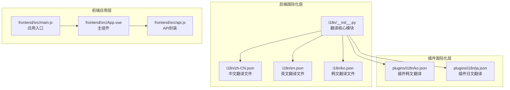
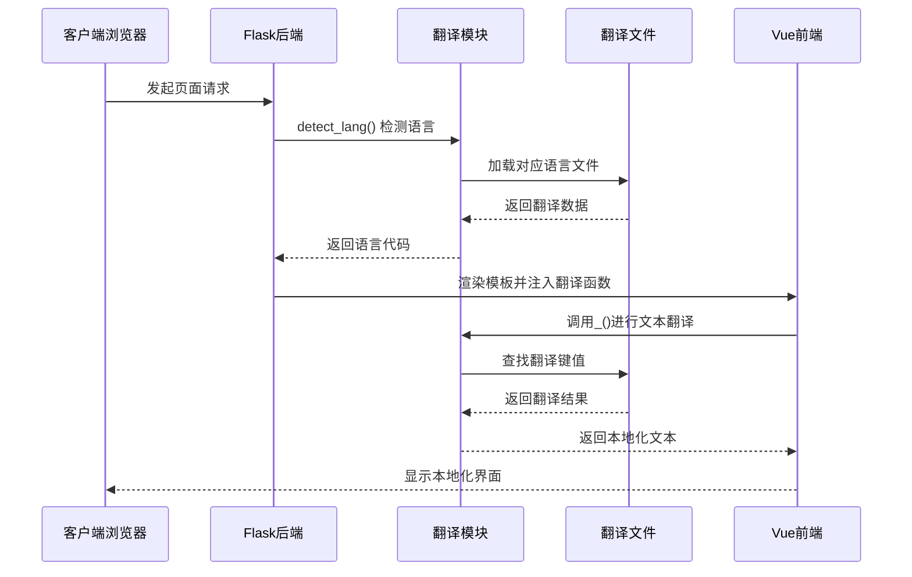
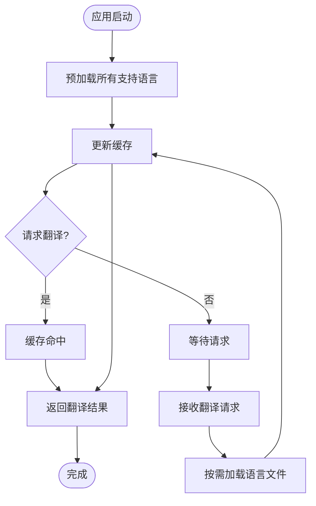
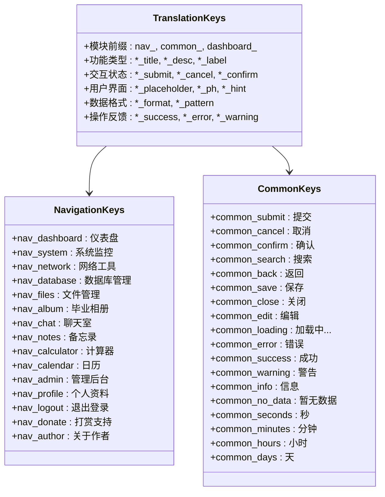
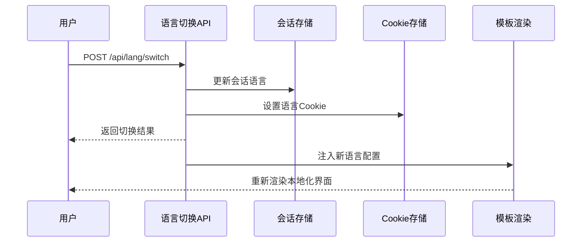
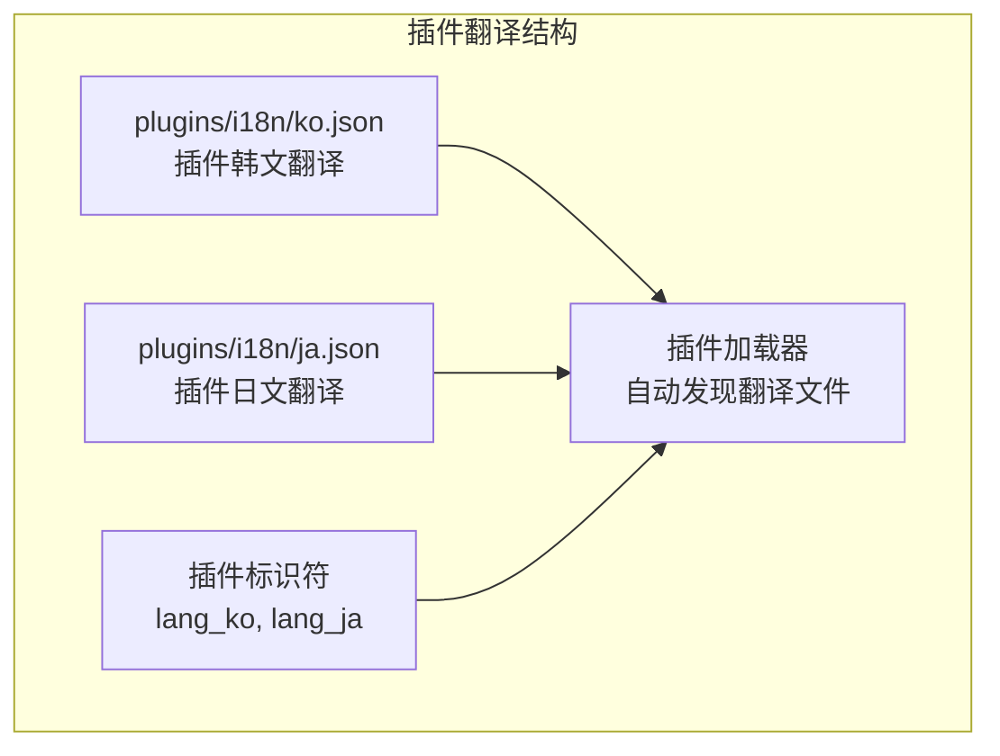
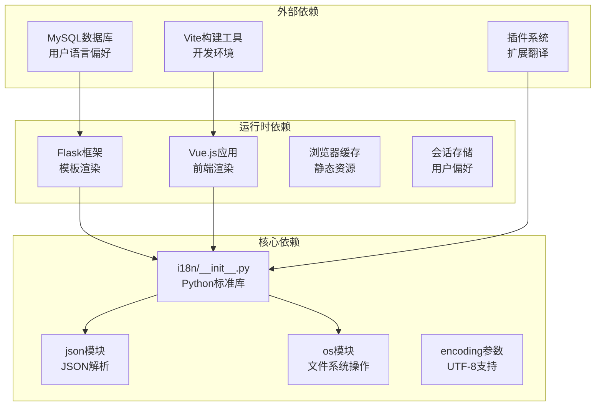
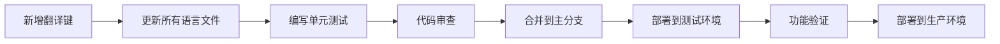

# 翻译文件管理

<cite>
**本文档引用的文件**
- [i18n/zh-CN.json](file://i18n/zh-CN.json)
- [i18n/en.json](file://i18n/en.json)
- [i18n/ko.json](file://i18n/ko.json)
- [plugins/i18n/ko.json](file://plugins/i18n/ko.json)
- [plugins/i18n/ja.json](file://plugins/i18n/ja.json)
- [i18n/__init__.py](file://i18n/__init__.py)
- [app.py](file://app.py)
- [frontend/src/main.js](file://frontend/src/main.js)
- [frontend/src/App.vue](file://frontend/src/App.vue)
- [frontend/src/api.js](file://frontend/src/api.js)
- [frontend/package.json](file://frontend/package.json)
</cite>

## 目录
1. [引言](#引言)
2. [项目结构](#项目结构)
3. [核心组件](#核心组件)
4. [架构概览](#架构概览)
5. [详细组件分析](#详细组件分析)
6. [依赖分析](#依赖分析)
7. [性能考虑](#性能考虑)
8. [故障排除指南](#故障排除指南)
9. [结论](#结论)
10. [附录](#附录)

## 引言

School_Web项目采用双层国际化架构，结合后端Flask模板引擎和前端Vue应用，实现了完整的翻译文件管理系统。该系统支持多种语言，包括简体中文(zh-CN)、英语(en)、韩语(ko)、日语(ja)，并通过统一的翻译键命名约定和模块化组织方式，确保了翻译内容的一致性和可维护性。

## 项目结构

翻译文件管理系统主要由以下层次组成：

**图表来源**
- [i18n/__init__.py:1-113](file://i18n/__init__.py#L1-L113)
- [i18n/zh-CN.json:1-477](file://i18n/zh-CN.json#L1-L477)
- [i18n/en.json:1-477](file://i18n/en.json#L1-L477)
- [i18n/ko.json:1-486](file://i18n/ko.json#L1-L486)

**章节来源**
- [i18n/__init__.py:1-113](file://i18n/__init__.py#L1-L113)
- [i18n/zh-CN.json:1-477](file://i18n/zh-CN.json#L1-L477)
- [i18n/en.json:1-477](file://i18n/en.json#L1-L477)
- [i18n/ko.json:1-486](file://i18n/ko.json#L1-L486)

## 核心组件

### 翻译文件组织结构

翻译文件采用JSON格式，每个文件包含标准化的元数据和翻译键值对：

```mermaid
graph LR
subgraph "翻译文件结构"
A["_lang<br/>语言代码"]
B["_name<br/>语言名称"]
C["app_title<br/>应用标题"]
D["nav_*<br/>导航菜单"]
E["common_*<br/>通用词汇"]
F["dashboard_*<br/>仪表盘"]
G["system_*<br/>系统监控"]
H["network_*<br/>网络工具"]
I["database_*<br/>数据库管理"]
J["files_*<br/>文件管理"]
K["album_*<br/>相册功能"]
L["chat_*<br/>聊天室"]
M["notes_*<br/>备忘录"]
N["calendar_*<br/>日历"]
O["admin_*<br/>管理后台"]
P["profile_*<br/>个人资料"]
Q["login_*<br/>登录相关"]
R["register_*<br/>注册相关"]
S["backup_*<br/>备份功能"]
T["study_*<br/>学习工具"]
U["market_*<br/>插件市场"]
end
```

**图表来源**
- [i18n/zh-CN.json:1-477](file://i18n/zh-CN.json#L1-L477)
- [i18n/en.json:1-477](file://i18n/en.json#L1-L477)
- [i18n/ko.json:1-486](file://i18n/ko.json#L1-L486)

### 支持的语言列表

系统当前支持以下语言配置：

| 语言代码 | 语言名称 | 文件大小 | 键数量 |
|---------|----------|----------|--------|
| zh-CN | 简体中文 | 477键 | 477 |
| en | 英语 | 477键 | 477 |
| ko | 韩语 | 486键 | 486 |
| ja | 日语 | 17键 | 17 |

**章节来源**
- [i18n/__init__.py:8-9](file://i18n/__init__.py#L8-L9)
- [i18n/zh-CN.json:1-477](file://i18n/zh-CN.json#L1-L477)
- [i18n/en.json:1-477](file://i18n/en.json#L1-L477)
- [i18n/ko.json:1-486](file://i18n/ko.json#L1-L486)
- [plugins/i18n/ja.json:1-17](file://plugins/i18n/ja.json#L1-L17)

## 架构概览

翻译系统采用三层架构设计，确保了前后端的协同工作：

**图表来源**
- [app.py:164-194](file://app.py#L164-L194)
- [i18n/__init__.py:50-67](file://i18n/__init__.py#L50-L67)

### 预加载策略

系统采用预加载机制优化性能：

**图表来源**
- [i18n/__init__.py:31-35](file://i18n/__init__.py#L31-L35)
- [i18n/__init__.py:111-112](file://i18n/__init__.py#L111-L112)

**章节来源**
- [app.py:164-194](file://app.py#L164-L194)
- [i18n/__init__.py:31-35](file://i18n/__init__.py#L31-L35)
- [i18n/__init__.py:111-112](file://i18n/__init__.py#L111-L112)

## 详细组件分析

### 翻译键命名约定

翻译键采用层次化命名结构，确保语义清晰和组织有序：

**图表来源**
- [i18n/zh-CN.json:6-167](file://i18n/zh-CN.json#L6-L167)
- [i18n/en.json:6-148](file://i18n/en.json#L6-L148)

### 动态加载机制

系统支持动态语言切换和按需加载：

**图表来源**
- [app.py:214-228](file://app.py#L214-L228)

**章节来源**
- [app.py:214-228](file://app.py#L214-L228)
- [i18n/__init__.py:70-108](file://i18n/__init__.py#L70-L108)

### 插件国际化支持

插件系统同样支持国际化，采用独立的翻译文件：

**图表来源**
- [plugins/i18n/ko.json:1-17](file://plugins/i18n/ko.json#L1-L17)
- [plugins/i18n/ja.json:1-17](file://plugins/i18n/ja.json#L1-L17)

**章节来源**
- [plugins/i18n/ko.json:1-17](file://plugins/i18n/ko.json#L1-L17)
- [plugins/i18n/ja.json:1-17](file://plugins/i18n/ja.json#L1-L17)

## 依赖分析

翻译系统的依赖关系相对简单，主要依赖于文件系统和基础的数据结构：

**图表来源**
- [i18n/__init__.py:4-7](file://i18n/__init__.py#L4-L7)
- [app.py:27](file://app.py#L27)

**章节来源**
- [i18n/__init__.py:4-7](file://i18n/__init__.py#L4-L7)
- [app.py:27](file://app.py#L27)

## 性能考虑

### 缓存策略

系统采用多层次缓存机制：

1. **预加载缓存**: 应用启动时预加载所有支持语言
2. **按需加载**: 未预加载的语言在首次访问时加载
3. **内存缓存**: 已加载的语言文件缓存在内存中
4. **文件缓存**: JSON文件内容缓存在字典结构中

### 性能优化建议

- **减少文件大小**: 合并相似的翻译键，避免重复
- **延迟加载**: 对不常用的功能模块采用延迟加载
- **缓存失效**: 实现缓存失效机制，支持热更新
- **CDN加速**: 生产环境可将翻译文件部署到CDN

## 故障排除指南

### 常见问题及解决方案

| 问题类型 | 症状 | 可能原因 | 解决方案 |
|---------|------|----------|----------|
| 语言切换失败 | 页面仍显示原语言 | 会话或Cookie设置失败 | 检查/api/lang/switch接口响应 |
| 翻译缺失 | 显示键名而非翻译文本 | 翻译文件缺少对应键 | 验证JSON文件完整性 |
| 语言检测错误 | 自动检测到错误语言 | Accept-Language头解析失败 | 检查客户端语言设置 |
| 缓存问题 | 语言切换后仍显示旧翻译 | 内存缓存未更新 | 清除应用缓存或重启服务 |

**章节来源**
- [app.py:214-228](file://app.py#L214-L228)
- [i18n/__init__.py:50-67](file://i18n/__init__.py#L50-L67)

### 调试方法

1. **检查语言检测**: 在后端打印`detect_lang()`的返回值
2. **验证翻译文件**: 确认JSON文件语法正确且包含必需键
3. **监控缓存状态**: 检查`_translations`字典的内容
4. **测试API接口**: 验证语言切换API的响应格式

## 结论

School_Web项目的翻译文件管理系统采用了成熟的技术架构，通过前后端分离的设计实现了高效的国际化支持。系统的主要优势包括：

1. **模块化设计**: 清晰的翻译键命名约定和文件组织结构
2. **性能优化**: 预加载和缓存机制确保快速响应
3. **扩展性强**: 支持插件国际化和动态语言切换
4. **维护友好**: 统一的格式规范便于翻译内容的管理和更新

该系统为类似Web应用的国际化需求提供了良好的参考范例，特别是在处理多语言、多模块的复杂应用场景中展现出了优秀的架构设计。

## 附录

### 翻译文件维护最佳实践

1. **命名规范**: 严格遵循层次化命名约定
2. **版本控制**: 使用Git跟踪翻译文件变更
3. **质量保证**: 建立翻译审查流程
4. **自动化测试**: 编写单元测试验证翻译完整性
5. **文档同步**: 保持翻译键文档与代码同步更新

### 更新流程建议

