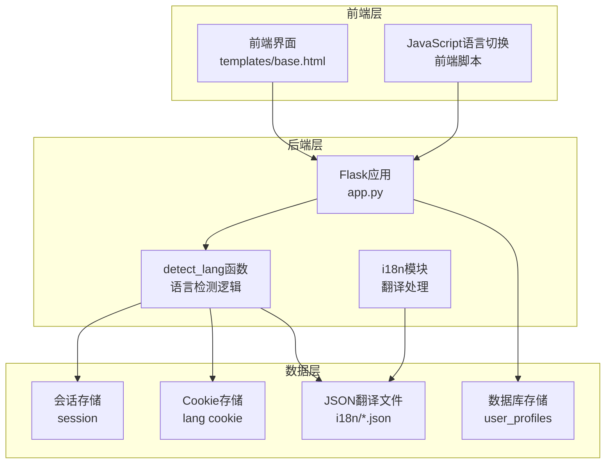
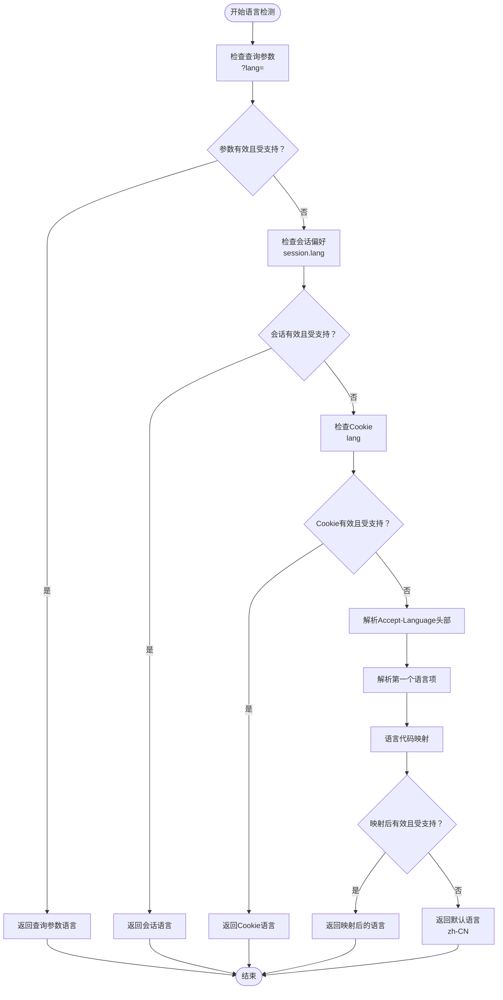
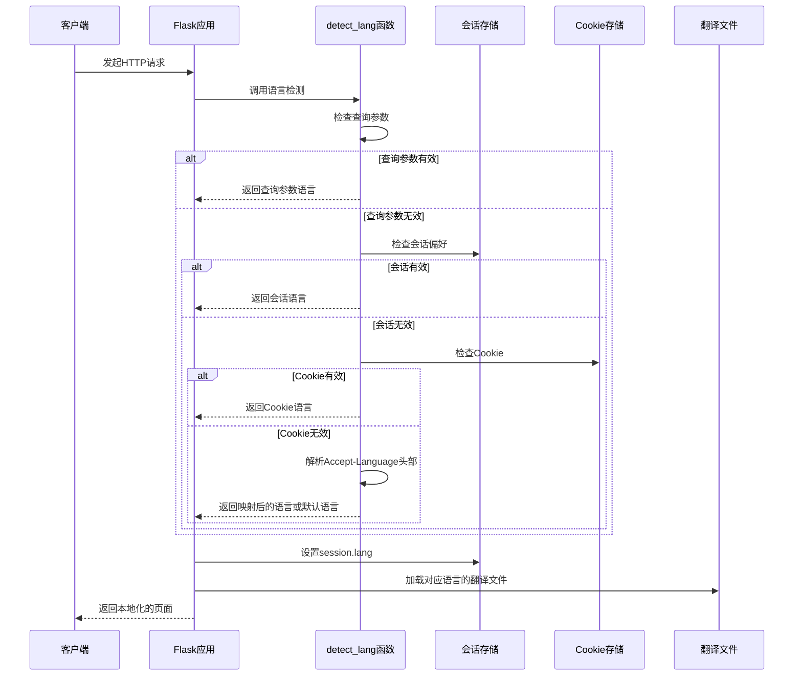
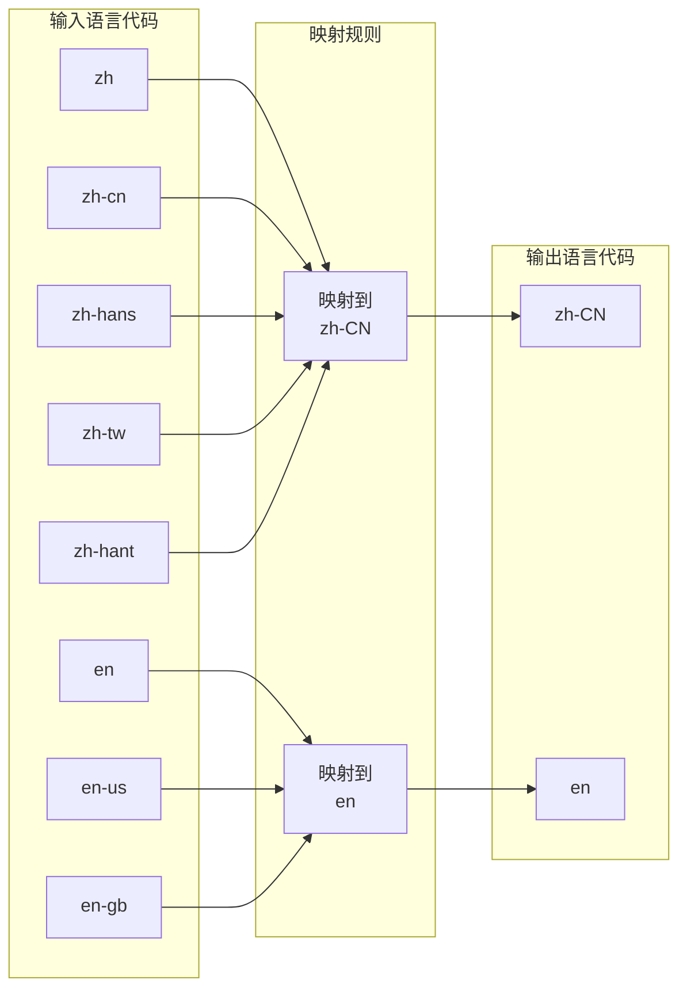
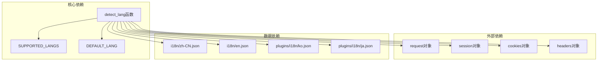

# 语言检测机制

<cite>
**本文档引用的文件**
- [i18n/__init__.py](file://i18n/__init__.py)
- [app.py](file://app.py)
- [i18n/en.json](file://i18n/en.json)
- [i18n/zh-CN.json](file://i18n/zh-CN.json)
- [plugins/i18n/ko.json](file://plugins/i18n/ko.json)
- [plugins/i18n/ja.json](file://plugins/i18n/ja.json)
- [templates/base.html](file://templates/base.html)
</cite>

## 目录
1. [简介](#简介)
2. [项目结构概览](#项目结构概览)
3. [核心组件分析](#核心组件分析)
4. [架构概览](#架构概览)
5. [详细组件分析](#详细组件分析)
6. [依赖关系分析](#依赖关系分析)
7. [性能考虑](#性能考虑)
8. [故障排除指南](#故障排除指南)
9. [结论](#结论)

## 简介

School_Web项目采用了一套完整的多语言支持机制，通过`detect_lang`函数实现了智能的语言检测和切换功能。该机制支持四种语言检测优先级：查询参数覆盖、会话偏好设置、Cookie存储和Accept-Language头部解析，确保用户能够获得最佳的本地化体验。

## 项目结构概览

School_Web项目的国际化架构主要由以下几个关键部分组成：



**图表来源**
- [app.py:164-228](file://app.py#L164-L228)
- [i18n/__init__.py:70-108](file://i18n/__init__.py#L70-L108)

**章节来源**
- [app.py:164-228](file://app.py#L164-L228)
- [i18n/__init__.py:1-113](file://i18n/__init__.py#L1-113)

## 核心组件分析

### detect_lang函数详解

`detect_lang`函数是整个语言检测机制的核心，实现了四层优先级的语言选择策略：



**图表来源**
- [i18n/__init__.py:70-108](file://i18n/__init__.py#L70-L108)

### 支持的语言列表

系统当前支持以下四种语言：
- 中文简体 (zh-CN) - 默认语言
- 英语 (en) - 标准英语变体
- 韩语 (ko) - 韩国韩语
- 日语 (ja) - 日本日语

**章节来源**
- [i18n/__init__.py:8-9](file://i18n/__init__.py#L8-L9)

## 架构概览

### 语言检测流程



**图表来源**
- [app.py:164-173](file://app.py#L164-L173)
- [i18n/__init__.py:70-108](file://i18n/__init__.py#L70-L108)

### 语言代码映射规则

系统实现了智能的语言代码映射，将常见的语言代码标准化为受支持的格式：



**图表来源**
- [i18n/__init__.py:99-106](file://i18n/__init__.py#L99-L106)

**章节来源**
- [i18n/__init__.py:99-106](file://i18n/__init__.py#L99-L106)

## 详细组件分析

### 语言检测优先级实现

#### 1. 查询参数覆盖 (最高优先级)

查询参数提供了最直接的语言覆盖方式，适用于临时性的语言切换需求：

```python
# 查询参数检测逻辑
qp_lang = request.args.get("lang", "").strip()
if qp_lang in SUPPORTED_LANGS:
    return qp_lang
```

**适用场景：**
- 临时语言切换测试
- 链接分享时的特定语言展示
- 开发调试和功能演示

#### 2. 会话偏好设置 (第二优先级)

会话存储提供了用户偏好的持久化能力，适用于已登录用户的个性化设置：

```python
# 会话检测逻辑
sess_lang = session.get("lang", "")
if sess_lang in SUPPORTED_LANGS:
    return sess_lang
```

**适用场景：**
- 已登录用户的长期语言偏好
- 用户主动选择的语言设置
- 个性化用户体验

#### 3. Cookie存储 (第三优先级)

Cookie存储为未登录用户提供了一种轻量级的语言偏好保存方式：

```python
# Cookie检测逻辑
cookie_lang = request.cookies.get("lang", "")
if cookie_lang in SUPPORTED_LANGS:
    return cookie_lang
```

**适用场景：**
- 未登录用户的临时语言偏好
- 浏览器端的语言记忆
- 无状态访问的用户偏好

#### 4. Accept-Language头部解析 (最低优先级)

Accept-Language头部解析提供了浏览器级别的语言检测能力：

```python
# Accept-Language解析逻辑
accept = request.headers.get("Accept-Language", "")
if accept:
    first = accept.split(",")[0].split(";")[0].strip().lower()
    # 语言代码映射
    lang_map = {
        "zh": "zh-CN", "zh-cn": "zh-CN", "zh-hans": "zh-CN",
        "zh-tw": "zh-CN", "zh-hant": "zh-CN",
        "en": "en", "en-us": "en", "en-gb": "en",
    }
    mapped = lang_map.get(first, "")
    if mapped in SUPPORTED_LANGS:
        return mapped
```

**适用场景：**
- 新访客的首次语言识别
- 浏览器默认语言的自动检测
- 无用户交互的智能语言选择

### 语言代码映射规则

系统实现了完善的语言代码映射机制，确保不同格式的语言代码能够正确映射到受支持的语言：

#### 简繁中文自动转换

```python
# 简繁中文映射规则
"zh": "zh-CN",      # 中文
"zh-cn": "zh-CN",   # 中文-中国
"zh-hans": "zh-CN", # 中文-简体
"zh-tw": "zh-CN",   # 中文-台湾
"zh-hant": "zh-CN"  # 中文-繁体
```

**映射策略：**
- 所有中文相关代码统一映射到简体中文 (zh-CN)
- 确保中文用户的统一语言体验
- 减少翻译维护成本

#### 英语变体标准化处理

```python
# 英语变体映射规则
"en": "en",      # 英语
"en-us": "en",   # 英语-美国
"en-gb": "en"    # 英语-英国
```

**映射策略：**
- 所有英语变体统一映射到标准英语 (en)
- 保持英语内容的一致性
- 简化翻译文件管理

### 错误处理和边界情况

系统在语言检测过程中实现了完善的错误处理机制：

```python
# 无效语言代码处理
if lang not in SUPPORTED_LANGS:
    return DEFAULT_LANG  # 回退到默认语言

# 未知语言代码处理
mapped = lang_map.get(first, "")
if mapped in SUPPORTED_LANGS:
    return mapped
else:
    return DEFAULT_LANG  # 回退到默认语言
```

**处理策略：**
- 任何无效或不受支持的语言代码都会回退到默认语言
- 确保系统的稳定性和一致性
- 防止语言检测失败影响用户体验

**章节来源**
- [i18n/__init__.py:70-108](file://i18n/__init__.py#L70-L108)

## 依赖关系分析

### 组件间依赖关系



**图表来源**
- [i18n/__init__.py:1-113](file://i18n/__init__.py#L1-L113)
- [app.py:27](file://app.py#L27)

### 前后端集成

系统通过Flask的before_request钩子实现了语言检测的自动化集成：

```python
@app.before_request
def set_language():
    """检测并设置当前请求的语言"""
    lang = detect_lang(request, session)
    session["lang"] = lang
    # 如果用户已登录，持久化语言偏好到数据库
    if session.get("username"):
        _save_user_lang(session["username"], lang)
```

**集成特点：**
- 自动化语言检测，无需手动调用
- 会话级别的语言偏好管理
- 用户登录状态下的持久化存储

**章节来源**
- [app.py:164-173](file://app.py#L164-L173)
- [app.py:197-212](file://app.py#L197-L212)

## 性能考虑

### 语言检测性能优化

系统在语言检测方面采用了多项性能优化策略：

1. **早期返回机制**：一旦检测到有效的语言代码，立即返回，避免不必要的处理
2. **缓存机制**：翻译文件在首次加载后会被缓存，减少重复的文件I/O操作
3. **最小化依赖**：语言检测仅依赖于基本的请求对象和会话存储，避免复杂的外部依赖

### 内存使用优化

```python
# 预加载翻译文件
def _load_all():
    """预加载所有支持的语言"""
    for lang in SUPPORTED_LANGS:
        _load_translations(lang)
```

**优化策略：**
- 应用启动时预加载所有翻译文件
- 减少运行时的文件系统访问
- 提高翻译查询的响应速度

## 故障排除指南

### 常见问题诊断

#### 问题1：语言切换不生效

**可能原因：**
- 前端fetch请求失败
- 后端session设置异常
- Cookie设置被浏览器阻止

**解决方案：**
1. 检查浏览器控制台是否有JavaScript错误
2. 验证后端API `/api/lang/switch` 的响应
3. 确认浏览器允许设置Cookie

#### 问题2：Accept-Language检测失败

**可能原因：**
- 浏览器未正确设置Accept-Language头部
- 语言代码格式不符合预期
- 服务器端解析逻辑异常

**解决方案：**
1. 使用开发者工具检查HTTP请求头
2. 验证语言代码格式 (如 `zh-CN` 而非 `zh_cn`)
3. 检查服务器端日志中的语言检测过程

#### 问题3：翻译内容缺失

**可能原因：**
- 对应语言的翻译文件不存在
- 翻译键值在JSON文件中缺失
- 语言文件编码问题

**解决方案：**
1. 确认翻译文件存在且格式正确
2. 检查翻译键值是否完整
3. 验证JSON文件的UTF-8编码

### 调试技巧

#### 启用详细日志

在开发环境中，可以通过以下方式获取更详细的语言检测信息：

```python
# 在语言检测函数中添加调试信息
def detect_lang(request, session):
    print(f"查询参数: {request.args.get('lang', '')}")
    print(f"会话语言: {session.get('lang', '')}")
    print(f"Cookie语言: {request.cookies.get('lang', '')}")
    print(f"Accept-Language: {request.headers.get('Accept-Language', '')}")
    # ... 其他检测逻辑
```

#### 测试不同语言检测场景

```bash
# 测试查询参数覆盖
curl "http://localhost:5800/?lang=en"

# 测试会话偏好
curl -H "Cookie: lang=en" "http://localhost:5800/"

# 测试Accept-Language头部
curl -H "Accept-Language: zh-CN,zh;q=0.9,en;q=0.8" "http://localhost:5800/"
```

## 结论

School_Web项目的语言检测机制通过`detect_lang`函数实现了智能化的语言选择，具有以下优势：

1. **多层次优先级设计**：从用户主动选择到浏览器默认设置，确保最佳的用户体验
2. **智能代码映射**：自动处理简繁中文和英语变体的标准化
3. **完善的错误处理**：无效语言代码的优雅降级机制
4. **前后端无缝集成**：通过Flask钩子实现自动化的语言检测
5. **性能优化考虑**：预加载翻译文件和早期返回机制

这套机制为用户提供了灵活、智能且稳定的多语言支持，既满足了不同用户群体的需求，又保证了系统的稳定性和性能表现。通过合理的错误处理和调试支持，开发者可以轻松地维护和扩展语言功能。