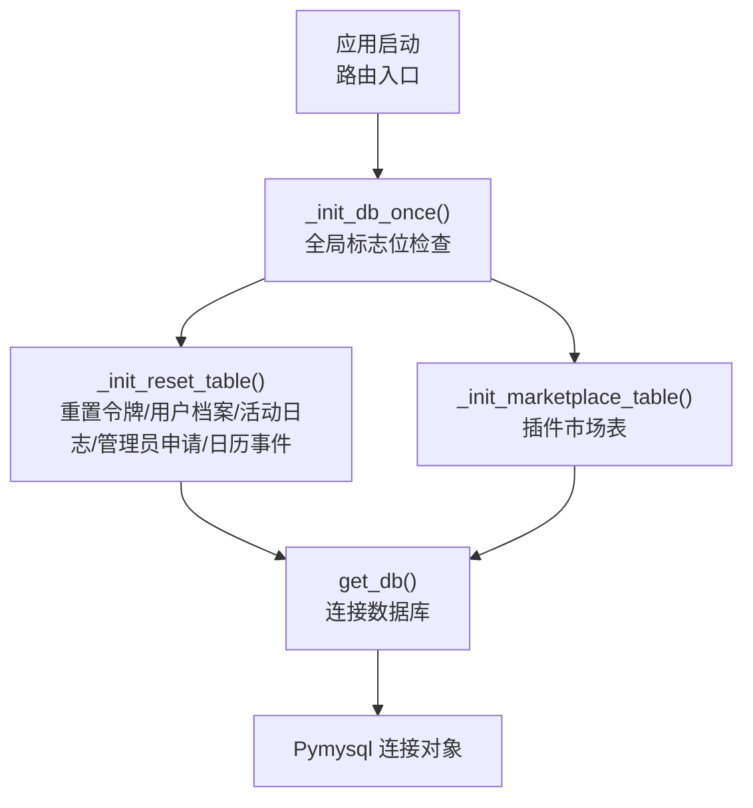
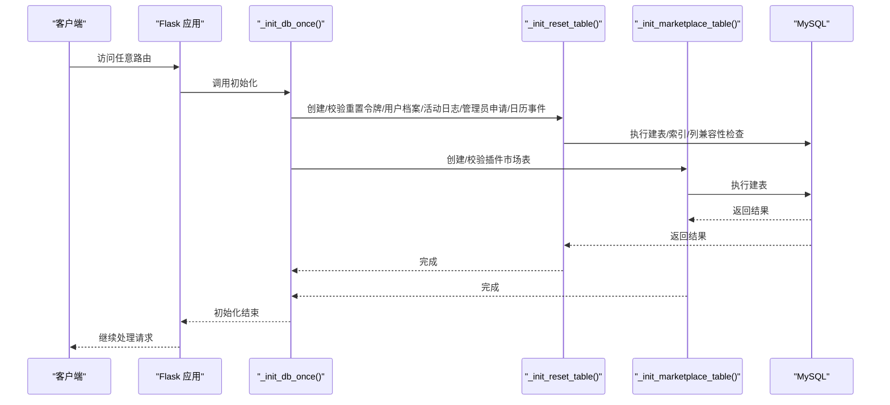
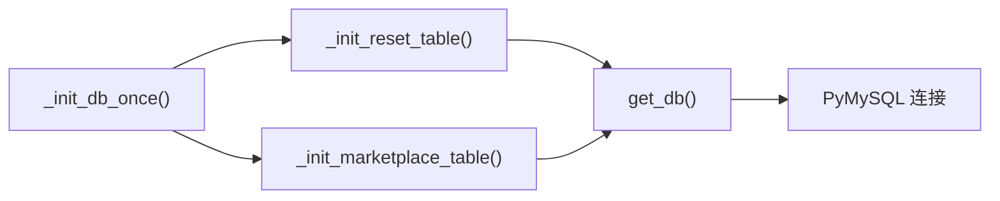

# 数据库初始化

<cite>
**本文引用的文件**
- [app.py](file://app.py)
- [README.md](file://README.md)
</cite>

## 目录
1. [简介](#简介)
2. [项目结构](#项目结构)
3. [核心组件](#核心组件)
4. [架构总览](#架构总览)
5. [详细组件分析](#详细组件分析)
6. [依赖分析](#依赖分析)
7. [性能考虑](#性能考虑)
8. [故障排除指南](#故障排除指南)
9. [结论](#结论)
10. [附录](#附录)

## 简介
本文件聚焦于 School_Web 的数据库初始化流程，系统性梳理 _init_db_once() 的初始化顺序与关键步骤，深入解析 _reset_table 与 _init_marketplace_table 的执行逻辑，总结表创建过程中的错误处理机制、兼容性检查与索引优化策略，并阐述数据库版本管理与迁移思路（含向后兼容与数据结构演进）。最后提供初始化故障排除与性能优化建议。

## 项目结构
数据库初始化相关代码集中在后端入口文件中，采用“一次性初始化 + 按需表创建”的策略：
- 全局标志位控制初始化只执行一次
- 通过若干初始化函数分别创建核心业务表与插件市场表
- 数据库连接统一通过 get_db() 获取，异常时返回空值以避免中断

**图示来源**
- [app.py:231-237](file://app.py#L231-L237)
- [app.py:240-317](file://app.py#L240-L317)
- [app.py:319-345](file://app.py#L319-L345)
- [app.py:680-684](file://app.py#L680-L684)

**章节来源**
- [app.py:231-237](file://app.py#L231-L237)
- [app.py:240-345](file://app.py#L240-L345)
- [app.py:680-684](file://app.py#L680-L684)

## 核心组件
- _init_db_once(): 控制器，负责在进程生命周期内仅执行一次数据库初始化，串行调用 _init_reset_table() 与 _init_marketplace_table()。
- _init_reset_table(): 创建与重置密码相关的表及扩展列，包含索引优化与兼容性检查。
- _init_marketplace_table(): 创建插件市场表，支持管理员上传的 HTML/Vue 插件元数据管理。
- get_db(): 统一数据库连接入口，异常时返回 None，避免阻断后续流程。

**章节来源**
- [app.py:231-237](file://app.py#L231-L237)
- [app.py:240-317](file://app.py#L240-L317)
- [app.py:319-345](file://app.py#L319-L345)
- [app.py:680-684](file://app.py#L680-L684)

## 架构总览
数据库初始化的整体流程如下：

**图示来源**
- [app.py:231-237](file://app.py#L231-L237)
- [app.py:240-317](file://app.py#L240-L317)
- [app.py:319-345](file://app.py#L319-L345)

## 详细组件分析

### _init_db_once() 初始化顺序与关键步骤
- 全局标志位 _db_init_done 防止重复初始化
- 依次调用：
  - _init_reset_table()：创建/校验核心业务表与扩展列
  - _init_marketplace_table()：创建插件市场表
- 初始化完成后，后续请求不再重复执行

**章节来源**
- [app.py:231-237](file://app.py#L231-L237)

### _reset_table 执行逻辑
- 建表与约束
  - password_reset_tokens：唯一令牌、过期时间、使用状态
  - user_profiles：主键用户名、语言默认值、更新时间戳
  - activity_log：用户行为日志，带用户与时间索引
  - admin_requests：管理员申请状态机
  - calendar_events：日历事件，带用户与日期索引
- 兼容性检查
  - 对 user_profiles 表补充 lang 列（若缺失），默认值为 zh-CN
- 索引优化
  - activity_log：idx_activity_user、idx_activity_time
  - calendar_events：idx_cal_user、idx_cal_date
  - chat_messages：idx_channel、idx_sender、idx_recipient、idx_created（相册扩展表）
  - friendships：uk_pair 唯一键（相册扩展表）

**章节来源**
- [app.py:240-317](file://app.py#L240-L317)

### _init_marketplace_table 执行逻辑
- 建表与约束
  - plugin_marketplace：唯一插件名、显示名、描述、版本、作者、文件类型、图标、上传者、时间戳
  - 默认版本号为 1.0.0
- 字段类型与约束
  - version 使用默认值
  - file_type 使用枚举类型限定
  - 主键自增 id

**章节来源**
- [app.py:319-345](file://app.py#L319-L345)

### 表创建过程中的错误处理机制
- 连接失败
  - get_db() 在连接异常时返回 None，避免中断初始化
- SQL 异常捕获
  - 初始化函数内部使用 try-except 捕获 MySQLError，保证单个表失败不影响其他表创建
- 列兼容性异常
  - ALTER 语句在列已存在时忽略异常，确保向前兼容

**章节来源**
- [app.py:680-684](file://app.py#L680-L684)
- [app.py:240-317](file://app.py#L240-L317)
- [app.py:319-345](file://app.py#L319-L345)

### 兼容性检查与索引优化
- 兼容性检查
  - user_profiles.lang 列的条件性添加，避免破坏已有数据
  - 相册扩展表中对 class_name、graduation_year 列的存在性检查与补充
- 索引优化
  - 高频查询字段建立索引（用户维度、时间维度）
  - 复合查询场景使用联合索引（如 friendships.uk_pair）

**章节来源**
- [app.py:280-285](file://app.py#L280-L285)
- [app.py:728-741](file://app.py#L728-L741)
- [app.py:818-827](file://app.py#L818-L827)

### 数据库版本管理与迁移策略
- 当前实现
  - 通过默认值与可选列维持向后兼容（如 user_profiles.lang、plugin_marketplace.version）
  - 通过信息架构查询判断列是否存在，按需补充
- 建议的迁移策略
  - 引入版本号字段与迁移脚本，按版本号顺序执行迁移
  - 对于新增表，采用“存在即跳过”的幂等建表策略
  - 对于列变更，采用“存在性检查 + 条件 ALTER”的策略
  - 为关键表增加迁移锁或迁移状态表，避免并发迁移冲突
- 向后兼容性
  - 默认值与可选列优先，避免强制变更导致历史数据不可用
  - 旧版数据可通过升级流程（如登录时自动升级）平滑过渡

**章节来源**
- [app.py:265](file://app.py#L265)
- [app.py:332](file://app.py#L332)
- [app.py:729-741](file://app.py#L729-L741)

### 初始化故障排除指南
- 数据库连接失败
  - 检查 DB_CONFIG 与 ALBUM_DB_CONFIG 的 host、user、password、database 是否正确
  - 确认 MySQL 服务已启动且网络可达
- 表创建失败
  - 检查权限：初始化用户是否具备 CREATE/ALTER 权限
  - 检查字符集与排序规则：确保与表定义兼容
- 初始化未生效
  - 确认 _init_db_once() 在路由入口被调用（如登录、注册、忘记密码等）
  - 检查全局标志位是否被意外重置
- 速率限制与封禁
  - 若初始化过程中触发速率限制，适当放宽 RATE_CONFIG 或临时加入白名单

**章节来源**
- [app.py:624-640](file://app.py#L624-L640)
- [app.py:1022](file://app.py#L1022)
- [app.py:1121](file://app.py#L1121)
- [app.py:1211](file://app.py#L1211)
- [app.py:1263](file://app.py#L1263)

## 依赖分析
- 组件耦合
  - _init_db_once() 依赖 _init_reset_table() 与 _init_marketplace_table()
  - 两个初始化函数依赖 get_db() 获取连接
- 外部依赖
  - PyMySQL：数据库驱动
  - 信息架构表：用于列存在性检查

**图示来源**
- [app.py:231-237](file://app.py#L231-L237)
- [app.py:240-345](file://app.py#L240-L345)
- [app.py:680-684](file://app.py#L680-L684)

**章节来源**
- [app.py:231-237](file://app.py#L231-L237)
- [app.py:240-345](file://app.py#L240-L345)
- [app.py:680-684](file://app.py#L680-L684)

## 性能考虑
- 连接复用
  - get_db() 每次调用新建连接，建议在初始化阶段复用连接对象，减少握手开销
- 幂等建表
  - 使用“存在即跳过”策略，避免重复建表带来的额外开销
- 索引设计
  - 为高频查询字段建立合适索引，避免全表扫描
  - 注意维护成本，避免冗余索引
- 批量操作
  - 初始化阶段尽量合并 SQL，减少往返次数

[本节为通用建议，不直接分析具体文件]

## 故障排除指南
- 常见问题定位
  - 数据库连接异常：检查 DB_CONFIG 与网络连通性
  - 权限不足：授予初始化所需权限（CREATE/ALTER/INDEX）
  - 表已存在：确认是否为重复初始化或并发冲突
- 诊断步骤
  - 在 get_db() 处打印连接参数与异常信息
  - 在各初始化函数中增加日志输出，标记已创建的表
  - 使用数据库客户端验证表结构与索引是否符合预期

**章节来源**
- [app.py:624-640](file://app.py#L624-L640)
- [app.py:680-684](file://app.py#L680-L684)

## 结论
School_Web 的数据库初始化采用“一次性 + 幂等”的设计，通过 _init_db_once() 统一调度 _reset_table 与 _marketplace_table 的创建，并结合兼容性检查与索引优化，确保系统在不同版本与部署环境下稳定运行。建议在现有基础上引入显式的版本号与迁移脚本，进一步提升演进能力与运维可控性。

## 附录
- 配置参考
  - 数据库配置：DB_CONFIG、ALBUM_DB_CONFIG
  - 速率限制配置：rate_config、白名单与封禁策略

**章节来源**
- [app.py:624-640](file://app.py#L624-L640)
- [app.py:352-382](file://app.py#L352-L382)
- [README.md:626-640](file://README.md#L626-L640)