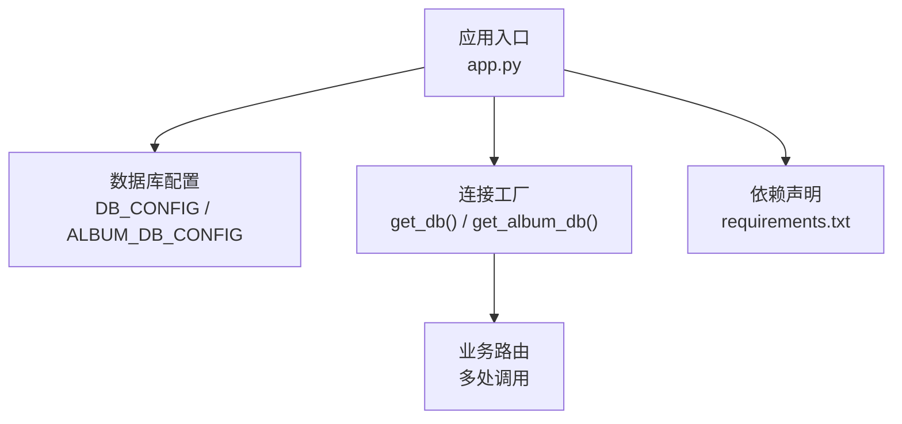
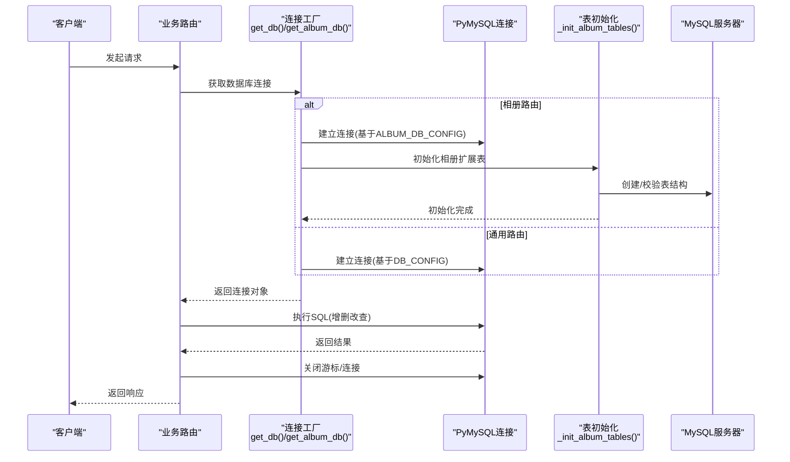
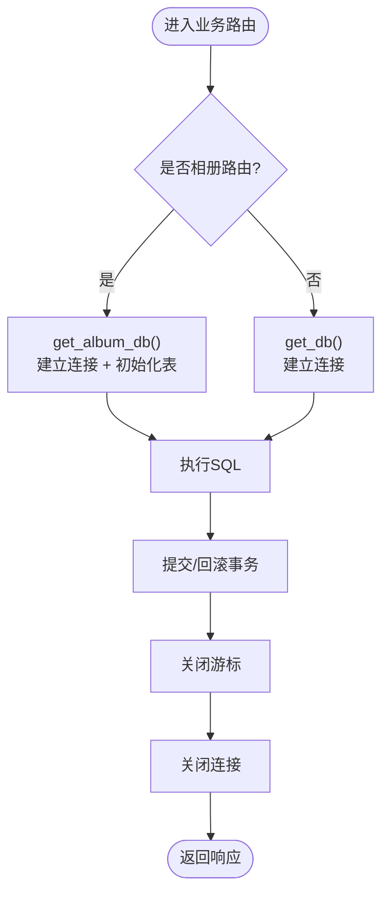
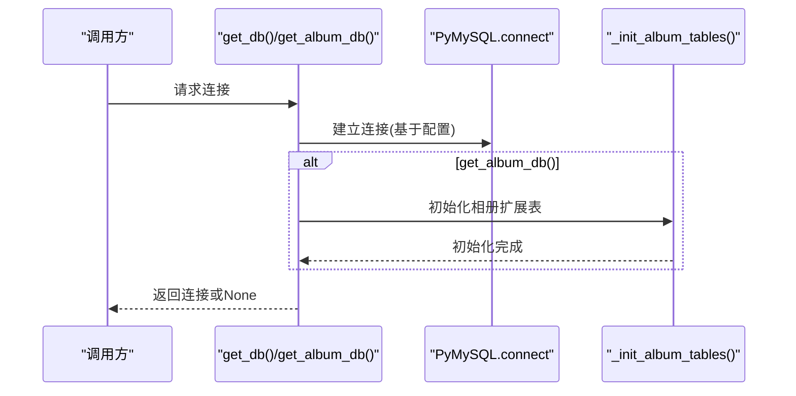
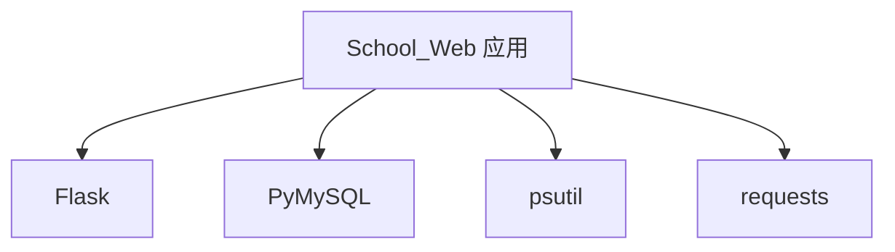

# 数据库连接管理

<cite>
**本文档引用的文件**
- [app.py](file://app.py)
- [requirements.txt](file://requirements.txt)
</cite>

## 目录
1. [简介](#简介)
2. [项目结构](#项目结构)
3. [核心组件](#核心组件)
4. [架构概览](#架构概览)
5. [详细组件分析](#详细组件分析)
6. [依赖分析](#依赖分析)
7. [性能考虑](#性能考虑)
8. [故障排查指南](#故障排查指南)
9. [结论](#结论)

## 简介
本文件聚焦于School_Web项目的数据库连接管理，围绕PyMySQL连接配置与生命周期管理展开，详细说明DB_CONFIG与ALBUM_DB_CONFIG的配置项、get_db()与get_album_db()的实现原理、错误处理与资源释放策略，并补充安全考量、性能优化建议与最佳实践。文档同时提供关键流程的可视化图示，帮助读者快速理解系统如何在不同业务场景下进行数据库连接与事务管理。

## 项目结构
- 应用入口与核心逻辑集中在app.py中，包含：
  - 数据库配置常量DB_CONFIG与ALBUM_DB_CONFIG
  - 连接工厂函数get_db()与get_album_db()
  - 相册扩展表初始化函数_init_album_tables()
  - 多处业务路由对数据库的调用模式
- 依赖声明位于requirements.txt，明确使用Flask与PyMySQL。

**图表来源**
- [app.py:624-640](file://app.py#L624-L640)
- [app.py:679-693](file://app.py#L679-L693)
- [requirements.txt:1-5](file://requirements.txt#L1-L5)

**章节来源**
- [app.py:624-640](file://app.py#L624-L640)
- [requirements.txt:1-5](file://requirements.txt#L1-L5)

## 核心组件
- 数据库配置常量
  - DB_CONFIG：通用业务数据库连接参数（主机、用户、密码、数据库名等）
  - ALBUM_DB_CONFIG：相册扩展功能专用数据库连接参数
- 连接工厂函数
  - get_db()：基于DB_CONFIG建立连接，捕获MySQLError并返回None
  - get_album_db()：基于ALBUM_DB_CONFIG建立连接，并在成功后调用_init_album_tables()初始化相册扩展表
- 相册扩展表初始化
  - _init_album_tables()：按需创建相册相关表（如大事记、同学录、标签、歌单、弹幕、分享链接、聊天消息、好友关系等）

上述组件共同构成School_Web的数据库连接与表结构管理基础。

**章节来源**
- [app.py:624-640](file://app.py#L624-L640)
- [app.py:679-693](file://app.py#L679-L693)
- [app.py:694-831](file://app.py#L694-L831)

## 架构概览
下图展示了数据库连接在应用中的整体流向：业务路由通过连接工厂获取连接，执行SQL后及时释放资源；相册相关路由在获取连接后先初始化扩展表，再进行业务操作。

**图表来源**
- [app.py:679-693](file://app.py#L679-L693)
- [app.py:694-831](file://app.py#L694-L831)

## 详细组件分析

### 连接配置与管理机制
- DB_CONFIG与ALBUM_DB_CONFIG
  - 结构：包含host、user、password、database等关键字段
  - 用途：分别驱动get_db()与get_album_db()建立连接
  - 注意：当前实现未显式设置连接超时、字符集、autocommit等参数，若需增强可在此基础上扩展
- 连接池与生命周期
  - 当前实现为“按需连接”模式：每次调用工厂函数创建新连接，执行完毕后由业务代码主动关闭游标与连接
  - 未使用连接池（如pymysql pooling或更高层连接池），因此并发高时会产生较多连接开销
- 资源释放
  - 业务代码普遍遵循“cursor -> commit/rollback -> close cursor -> close connection”的模式
  - 部分异常分支也包含try/except并在异常路径上关闭资源，降低泄漏风险

**图表来源**
- [app.py:679-693](file://app.py#L679-L693)
- [app.py:694-831](file://app.py#L694-L831)

**章节来源**
- [app.py:624-640](file://app.py#L624-L640)
- [app.py:679-693](file://app.py#L679-L693)
- [app.py:694-831](file://app.py#L694-L831)

### get_db()与get_album_db()实现原理
- get_db()
  - 使用DB_CONFIG解包传入pymysql.connect()，返回连接对象
  - 捕获pymysql.MySQLError并返回None，便于上层统一处理“连接失败”
- get_album_db()
  - 使用ALBUM_DB_CONFIG解包传入pymysql.connect()
  - 成功后立即调用_init_album_tables()确保相册扩展表存在
  - 捕获pymysql.MySQLError并返回None
- 错误处理
  - 两函数均采用“捕获异常 -> 返回None”的策略，避免异常向上传播导致进程崩溃
  - 业务侧通常在获取连接失败时返回错误响应或进行降级处理

**图表来源**
- [app.py:679-693](file://app.py#L679-L693)
- [app.py:694-831](file://app.py#L694-L831)

**章节来源**
- [app.py:679-693](file://app.py#L679-L693)

### 相册扩展表初始化机制
- 触发时机：get_album_db()成功建立连接后即调用_init_album_tables()
- 初始化内容：相册事件、同学录、毕业寄语、照片标签、照片-标签关联、毕业歌单、弹幕、分享链接、聊天消息、好友关系等
- 兼容性处理：针对旧表结构，通过information_schema查询与ALTER语句保证新增列存在
- 事务与索引：初始化过程包含CREATE TABLE IF NOT EXISTS与索引定义，确保后续查询性能

**图表来源**
- [app.py:694-831](file://app.py#L694-L831)

**章节来源**
- [app.py:694-831](file://app.py#L694-L831)

### 数据库连接的安全考量
- 凭据管理
  - 当前凭据硬编码在配置常量中，存在泄露风险
  - 建议迁移到环境变量或密钥管理服务，并在部署时注入
- 连接超时与异常恢复
  - 当前未设置连接超时参数；建议在pymysql.connect中增加timeout等参数
  - get_db()/get_album_db()对MySQLError返回None，业务侧应具备重试或降级策略
- SQL注入防护
  - 项目广泛使用参数化查询（如%s占位符），有效降低注入风险
  - 建议在路由层统一校验输入类型与长度，进一步加固

**章节来源**
- [app.py:624-640](file://app.py#L624-L640)
- [app.py:679-693](file://app.py#L679-L693)

### 连接性能优化建议与最佳实践
- 连接池化
  - 引入连接池（如pymysql连接池或更高层ORM连接池）以减少连接建立与销毁开销
  - 配置池大小、空闲回收、连接超时等参数，结合业务QPS调优
- 连接复用与事务控制
  - 在单次请求内尽量复用同一连接，避免重复建立连接
  - 明确事务边界，批量写入时使用事务提升吞吐
- 资源释放规范化
  - 统一在业务函数末尾关闭游标与连接，必要时使用with上下文管理
  - 对异常路径补充finally块确保资源释放
- 查询优化
  - 为高频查询字段建立合适索引（如相册路由中已见索引定义）
  - 控制查询字段数量与分页，避免全表扫描
- 配置参数增强
  - 在pymysql.connect中设置charset、autocommit、connect_timeout、read_timeout等参数
  - 对相册路由等热点路径进行慢查询日志与监控

**章节来源**
- [app.py:679-693](file://app.py#L679-L693)
- [app.py:2544-2576](file://app.py#L2544-L2576)

## 依赖分析
- 直接依赖
  - Flask：Web框架，提供路由、请求/响应处理与模板渲染
  - PyMySQL：MySQL驱动，负责连接与SQL执行
- 间接依赖
  - psutil、requests：系统监控与网络请求相关，与数据库连接管理无直接耦合
- 版本要求
  - Flask>=3.0，PyMySQL>=1.0

**图表来源**
- [requirements.txt:1-5](file://requirements.txt#L1-L5)

**章节来源**
- [requirements.txt:1-5](file://requirements.txt#L1-L5)

## 性能考虑
- 当前实现为“按需连接”，适合低并发场景；高并发下建议引入连接池
- 相册路由涉及多表关联与条件筛选，建议配合索引与分页优化
- 事务批处理与资源释放规范化可显著降低延迟与资源占用

[本节为通用指导，无需特定文件引用]

## 故障排查指南
- 连接失败
  - 现象：get_db()/get_album_db()返回None
  - 排查：检查DB_CONFIG/ALBUM_DB_CONFIG参数、MySQL服务状态、网络连通性
- SQL执行异常
  - 现象：业务路由返回错误或抛出异常
  - 排查：定位具体SQL与参数，检查表结构、索引与权限
- 资源未释放
  - 现象：连接数增长、内存占用上升
  - 排查：检查业务代码是否在所有分支都关闭了游标与连接
- 表结构缺失
  - 现象：相册功能异常
  - 排查：确认_init_album_tables()执行情况与权限

**章节来源**
- [app.py:679-693](file://app.py#L679-L693)
- [app.py:694-831](file://app.py#L694-L831)

## 结论
School_Web的数据库连接管理采用简单直接的“按需连接”模式，通过DB_CONFIG与ALBUM_DB_CONFIG区分通用与相册业务数据库，配合get_db()与get_album_db()工厂函数实现连接获取与表初始化。当前实现具备基本的错误处理与资源释放规范，但在连接池化、超时配置与安全加固方面仍有改进空间。建议结合业务规模引入连接池与参数化配置，完善异常恢复与监控告警，以获得更稳定与高性能的数据库访问体验。