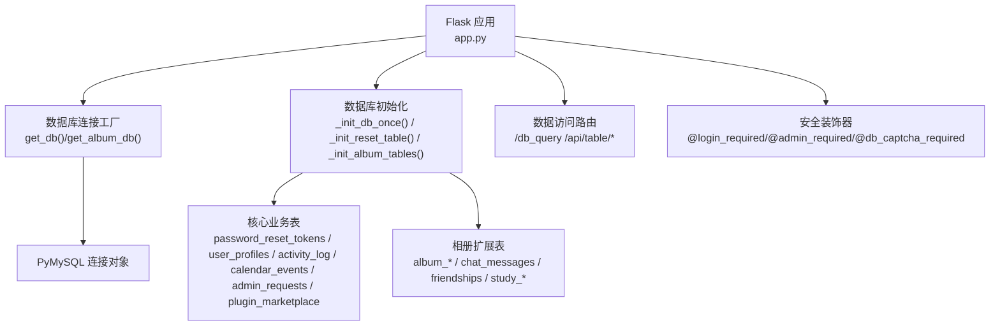
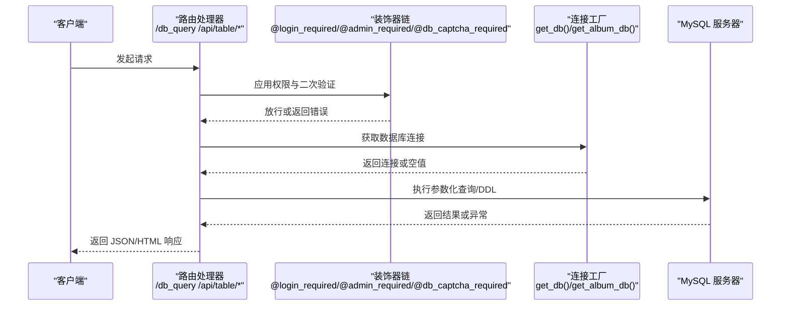
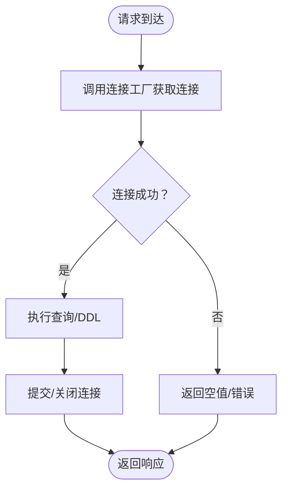
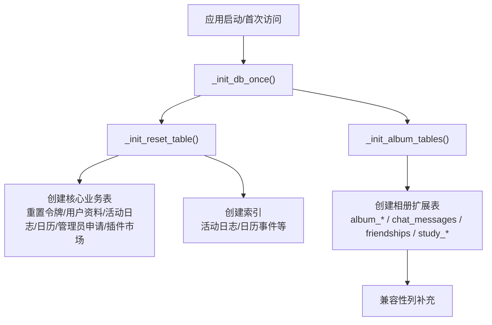
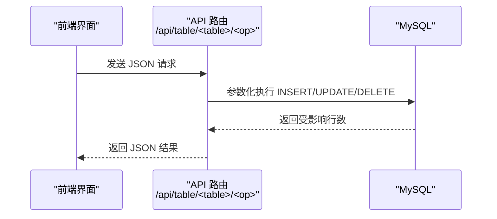
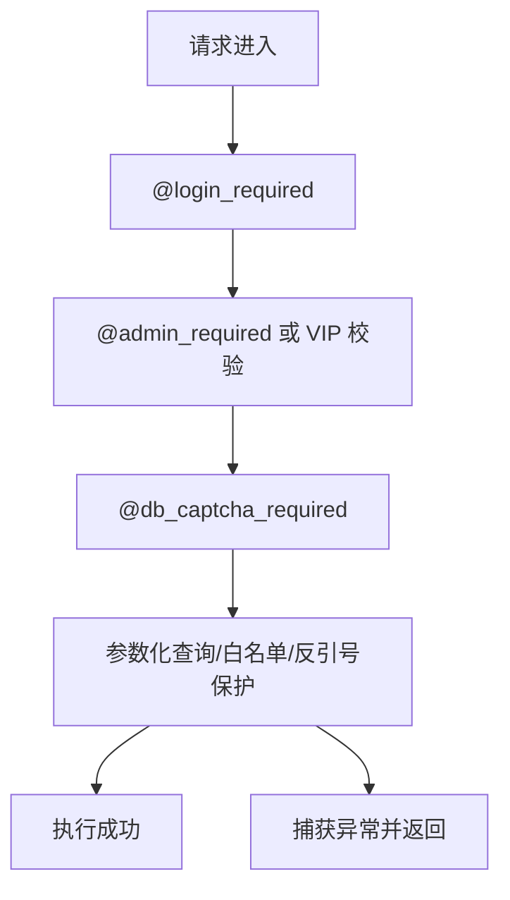
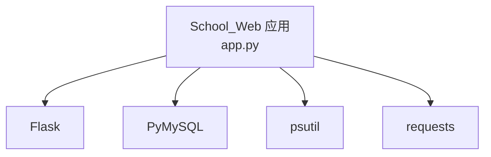

# 数据库集成

<cite>
**本文引用的文件**
- [app.py](file://app.py)
- [requirements.txt](file://requirements.txt)
</cite>

## 目录
1. [简介](#简介)
2. [项目结构](#项目结构)
3. [核心组件](#核心组件)
4. [架构总览](#架构总览)
5. [详细组件分析](#详细组件分析)
6. [依赖分析](#依赖分析)
7. [性能考虑](#性能考虑)
8. [故障排查指南](#故障排查指南)
9. [结论](#结论)
10. [附录](#附录)

## 简介
本文件面向 School_Web 的数据库集成，围绕 PyMySQL 连接与管理、数据库初始化流程、数据访问层设计、安全与错误处理、以及性能优化等方面进行系统化说明。内容基于仓库中的实际代码实现，帮助开发者与运维人员理解并正确使用数据库相关功能。

## 项目结构
- 数据库相关逻辑集中在后端应用入口文件中，采用“按需连接”的方式，通过统一的连接工厂函数创建连接。
- 数据库初始化在应用启动阶段执行，负责创建业务所需的核心表及索引。
- 数据访问层采用“路由 + 参数化查询”的模式，结合装饰器实现权限与二次验证控制。
- 安全方面包含：参数化查询、白名单/反引号保护、二次验证码、CSRF 校验、速率限制等。

图表来源
- [app.py:624-692](file://app.py#L624-L692)
- [app.py:2319-2508](file://app.py#L2319-L2508)
- [app.py:907-988](file://app.py#L907-L988)

章节来源
- [app.py:624-692](file://app.py#L624-L692)
- [app.py:2319-2508](file://app.py#L2319-L2508)
- [app.py:907-988](file://app.py#L907-L988)

## 核心组件
- 连接工厂与配置
  - 通过连接工厂函数创建数据库连接，集中处理异常并返回空值，避免上层重复捕获。
  - 提供独立的相册数据库配置，便于扩展不同数据库实例。
- 数据库初始化
  - 应用启动时调用一次性初始化函数，创建核心表与索引，保证运行前的表结构就绪。
  - 相册扩展模块在获取相册数据库连接时自动初始化扩展表。
- 数据访问层
  - 提供可视化查询与增删改查 API，均采用参数化查询与白名单/反引号保护，降低 SQL 注入风险。
  - 通过装饰器实现登录、VIP/管理员权限与数据库二次验证码的强制校验。
- 安全与错误处理
  - 统一的错误捕获与降级返回，保障服务稳定性。
  - 二次验证码与 CSRF 校验配合，提升敏感操作的安全性。

章节来源
- [app.py:624-692](file://app.py#L624-L692)
- [app.py:2319-2508](file://app.py#L2319-L2508)
- [app.py:907-988](file://app.py#L907-L988)

## 架构总览
下图展示数据库集成的整体交互：请求经由路由与装饰器，进入数据访问层，通过连接工厂获取连接，执行参数化查询或 DDL 操作，最终返回结果或写入日志。

图表来源
- [app.py:2319-2508](file://app.py#L2319-L2508)
- [app.py:907-988](file://app.py#L907-L988)
- [app.py:624-692](file://app.py#L624-L692)

## 详细组件分析

### PyMySQL 连接与管理
- 连接工厂
  - 单例式按需创建连接，失败时返回空值，便于上层统一处理。
  - 支持多数据库配置（主库与相册库），分别用于不同业务域。
- 连接池与超时
  - 当前实现为每次请求创建新连接，未显式配置连接池参数。
  - 未见显式的连接超时与自动重连配置项。
- 重连机制
  - 未实现自动重连逻辑；若连接失败，上层需自行判断并重试。

图表来源
- [app.py:624-692](file://app.py#L624-L692)

章节来源
- [app.py:624-692](file://app.py#L624-L692)

### 数据库初始化流程
- 初始化触发
  - 登录页首次访问时触发一次性初始化，确保核心表与索引存在。
  - 相册功能在获取相册库连接时自动初始化扩展表。
- 核心表与索引
  - 核心表：重置令牌、用户资料、活动日志、日历事件、管理员申请、插件市场等。
  - 索引：活动日志、日历事件、聊天消息等表建立常用查询字段索引。
- 兼容性处理
  - 对旧表结构进行列补充（如语言字段），保证升级兼容。

图表来源
- [app.py:232-345](file://app.py#L232-L345)
- [app.py:695-866](file://app.py#L695-L866)

章节来源
- [app.py:232-345](file://app.py#L232-L345)
- [app.py:695-866](file://app.py#L695-L866)

### 数据访问层设计
- DAO 模式实现
  - 路由层承担数据访问职责，采用“参数化查询 + 白名单/反引号保护”的组合策略，避免直接拼接 SQL。
  - 常见操作：查询表列表、读取表结构与数据、插入/更新/删除记录。
- 事务管理
  - 当前实现未显式使用事务上下文；对写操作采用提交后关闭连接的方式。
- 错误处理
  - 统一捕获数据库异常并返回友好提示；对查询异常进行降级处理，避免中断页面渲染。

图表来源
- [app.py:2408-2485](file://app.py#L2408-L2485)

章节来源
- [app.py:2319-2508](file://app.py#L2319-L2508)
- [app.py:2408-2485](file://app.py#L2408-L2485)

### 数据库安全措施
- SQL 注入防护
  - 所有写操作使用参数化查询占位符，避免直接拼接。
  - 查询表名时采用白名单校验与反引号包裹，降低注入风险。
- 参数化查询
  - 登录、文件管理器密码验证等敏感路径均使用参数化查询。
- 权限控制
  - 通过装饰器强制要求登录、VIP/管理员权限与数据库二次验证码。
- 其他安全
  - CSRF 校验、速率限制、白名单封禁、CSP 非ces 注入等综合防护。

图表来源
- [app.py:907-988](file://app.py#L907-L988)
- [app.py:2347-2348](file://app.py#L2347-L2348)
- [app.py:2423-2424](file://app.py#L2423-L2424)
- [app.py:2453-2454](file://app.py#L2453-L2454)
- [app.py:2477-2478](file://app.py#L2477-L2478)

章节来源
- [app.py:907-988](file://app.py#L907-L988)
- [app.py:2347-2348](file://app.py#L2347-L2348)
- [app.py:2423-2424](file://app.py#L2423-L2424)
- [app.py:2453-2454](file://app.py#L2453-L2454)
- [app.py:2477-2478](file://app.py#L2477-L2478)

### 性能优化建议
- 连接池与超时
  - 建议引入连接池以减少连接开销；在连接工厂中配置连接池大小、超时与重试策略。
- 查询优化
  - 为高频查询字段建立合适索引；避免 SELECT *，仅查询必要列。
  - 对分页查询使用 LIMIT/OFFSET，避免一次性拉取大量数据。
- 缓存机制
  - 对静态配置与低频变更数据使用进程内缓存；对热点读取引入 Redis 缓存。
- 日志与监控
  - 记录慢查询与错误统计，结合数据库慢日志定位问题。

## 依赖分析
- 外部依赖
  - Flask：Web 框架。
  - PyMySQL：数据库驱动。
  - 其他：psutil、requests 等用于系统与网络功能。

图表来源
- [requirements.txt:1-5](file://requirements.txt#L1-L5)

章节来源
- [requirements.txt:1-5](file://requirements.txt#L1-L5)

## 性能考虑
- 连接管理
  - 当前每次请求新建连接，建议引入连接池以降低握手与认证成本。
- 查询与索引
  - 为常用过滤/排序字段添加索引；定期分析执行计划，调整索引策略。
- 缓存
  - 对只读数据与热点数据进行缓存，减少数据库压力。
- 监控
  - 建立数据库性能指标（QPS、慢查询、连接数、锁等待）监控告警。

## 故障排查指南
- 连接失败
  - 检查连接工厂返回值与数据库服务状态；确认凭据与网络可达性。
- 权限不足
  - 确认会话中权限标识与装饰器校验链是否满足要求。
- 二次验证码
  - 确认验证码生成与校验流程是否正常，API 场景返回 JSON 错误。
- 查询异常
  - 查看统一异常捕获分支，结合日志定位具体 SQL 与参数。

章节来源
- [app.py:624-692](file://app.py#L624-L692)
- [app.py:907-988](file://app.py#L907-L988)
- [app.py:2358-2359](file://app.py#L2358-L2359)
- [app.py:2404-2405](file://app.py#L2404-L2405)

## 结论
本项目采用简洁的“按需连接 + 参数化查询 + 装饰器校验”模式实现数据库集成，具备良好的可维护性与安全性。建议后续引入连接池、完善事务管理、加强缓存与监控，以进一步提升性能与稳定性。

## 附录
- 关键实现位置参考
  - 连接工厂与配置：[app.py:624-692](file://app.py#L624-L692)
  - 初始化流程：[app.py:232-345](file://app.py#L232-L345)、[app.py:695-866](file://app.py#L695-L866)
  - 数据访问 API：[app.py:2319-2508](file://app.py#L2319-L2508)
  - 安全装饰器与校验：[app.py:907-988](file://app.py#L907-L988)