# 数据访问层

<cite>
**本文档引用的文件**
- [app.py](file://app.py)
- [requirements.txt](file://requirements.txt)
- [SchoolWeb.spec](file://SchoolWeb.spec)
- [安全措施清单.md](file://安全措施清单.md)
- [db_query.html](file://templates/db_query.html)
- [db_update.html](file://templates/db_update.html)
- [global_captcha.html](file://templates/global_captcha.html)
</cite>

## 目录
1. [简介](#简介)
2. [项目结构](#项目结构)
3. [核心组件](#核心组件)
4. [架构概览](#架构概览)
5. [详细组件分析](#详细组件分析)
6. [依赖关系分析](#依赖关系分析)
7. [性能考虑](#性能考虑)
8. [故障排除指南](#故障排除指南)
9. [结论](#结论)

## 简介

School_Web是一个基于Python Flask框架开发的综合性校园Web应用，其数据访问层采用DAO（数据访问对象）模式设计，实现了完整的数据库操作封装和事务管理机制。该系统支持MySQL数据库操作，提供了从基础CRUD操作到复杂业务逻辑的全方位数据访问能力。

数据访问层的核心特点包括：
- **DAO模式实现**：统一的数据库操作接口
- **参数化查询**：全面的SQL注入防护
- **事务管理**：自动化的连接管理和资源清理
- **安全防护**：多层次的安全措施
- **性能优化**：连接池和查询优化策略

## 项目结构

School_Web项目采用模块化设计，数据访问层主要集中在主应用文件中，通过函数式编程实现DAO模式：

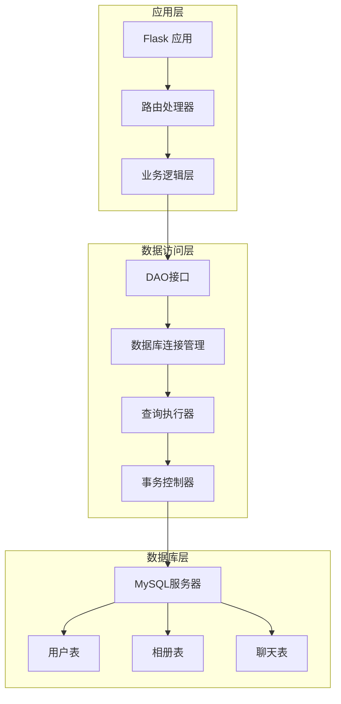

**图表来源**
- [app.py:680-693](file://app.py#L680-L693)
- [app.py:2318-2367](file://app.py#L2318-L2367)

**章节来源**
- [app.py:1-50](file://app.py#L1-L50)
- [requirements.txt:1-5](file://requirements.txt#L1-L5)

## 核心组件

### 数据库连接管理器

数据访问层的核心是数据库连接管理器，负责统一管理数据库连接的创建、配置和销毁：

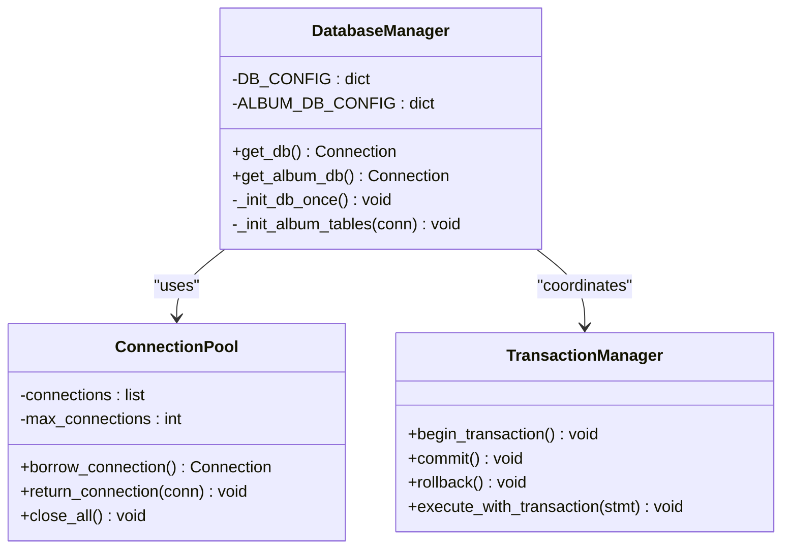

**图表来源**
- [app.py:680-693](file://app.py#L680-L693)
- [app.py:695-831](file://app.py#L695-L831)

### DAO接口层

系统实现了多个DAO接口，分别对应不同的业务领域：

| DAO类别 | 功能描述 | 关键方法 |
|---------|----------|----------|
| 用户DAO | 用户认证、权限管理 | `get_user()`, `update_profile()`, `change_password()` |
| 相册DAO | 图片管理、标签系统 | `upload_image()`, `get_images()`, `add_tag()` |
| 聊天DAO | 实时通信、消息管理 | `send_message()`, `get_messages()`, `manage_friends()` |
| 系统DAO | 管理功能、统计分析 | `get_statistics()`, `manage_users()`, `backup_data()` |

**章节来源**
- [app.py:1754-1789](file://app.py#L1754-L1789)
- [app.py:2537-2575](file://app.py#L2537-L2575)
- [app.py:3546-3604](file://app.py#L3546-L3604)

## 架构概览

数据访问层采用分层架构设计，确保了良好的代码组织和可维护性：

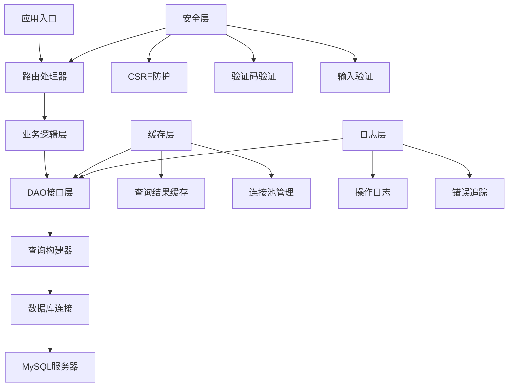

**图表来源**
- [app.py:907-964](file://app.py#L907-L964)
- [app.py:1644-1699](file://app.py#L1644-L1699)

## 详细组件分析

### 数据库连接管理

数据访问层的核心是统一的数据库连接管理机制：

#### 连接配置
系统支持多数据库配置，包括主数据库和相册专用数据库：

```python
DB_CONFIG = {
    "host": "localhost",
    "user": "root", 
    "password": "root@123456",
    "database": "sample"
}

ALBUM_DB_CONFIG = {
    "host": "localhost",
    "user": "root",
    "password": "root@123456", 
    "database": "sample"
}
```

#### 连接生命周期管理
每个数据库操作都遵循严格的连接生命周期：

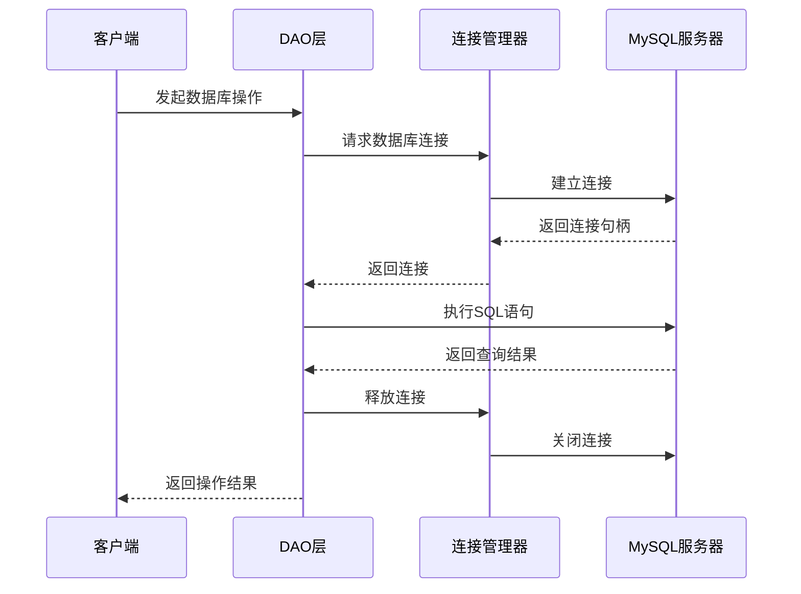

**图表来源**
- [app.py:680-693](file://app.py#L680-L693)
- [app.py:1056-1116](file://app.py#L1056-L1116)

**章节来源**
- [app.py:625-637](file://app.py#L625-L637)
- [app.py:680-693](file://app.py#L680-L693)

### 参数化查询与SQL注入防护

系统实现了全面的SQL注入防护机制：

#### 参数化查询实现
所有用户输入都通过参数化查询处理：

```python
# 安全的参数化查询
cursor.execute(
    "SELECT User_Password, Access_Permission FROM users WHERE User_Name = %s",
    (username,)
)

# 安全的插入操作  
cursor.execute(
    "INSERT INTO users (User_Name, User_Password, Access_Permission) VALUES (%s, %s, %s)",
    (username, hashed_pw, permission)
)
```

#### 输入验证机制
系统在多个层面进行输入验证：

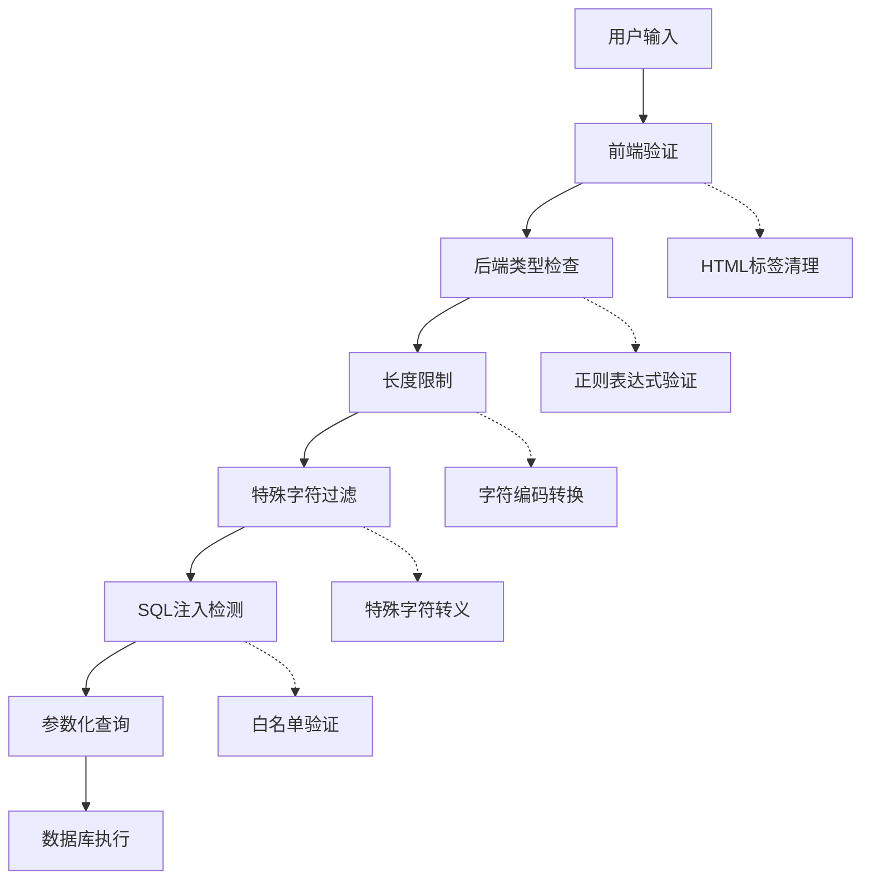

**图表来源**
- [app.py:869-881](file://app.py#L869-L881)
- [app.py:1034-1045](file://app.py#L1034-L1045)

**章节来源**
- [app.py:869-881](file://app.py#L869-L881)
- [app.py:1034-1045](file://app.py#L1034-L1045)

### 事务管理机制

系统实现了自动化的事务管理，确保数据一致性：

#### 事务控制流程
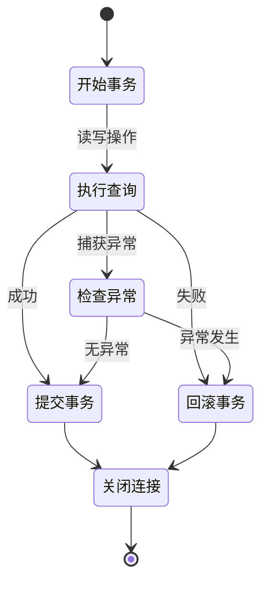

**图表来源**
- [app.py:1169-1187](file://app.py#L1169-L1187)
- [app.py:2419-2431](file://app.py#L2419-L2431)

#### 自动资源清理
系统确保所有数据库连接和游标都能正确关闭：

```python
try:
    cursor = conn.cursor()
    cursor.execute(sql, params)
    conn.commit()
    # 操作成功
finally:
    cursor.close()
    conn.close()
```

**章节来源**
- [app.py:1169-1187](file://app.py#L1169-L1187)
- [app.py:2419-2431](file://app.py#L2419-L2431)

### 数据访问安全措施

#### 多层次安全防护
系统实现了七层安全防护机制：

| 安全层级 | 防护措施 | 实现方式 |
|----------|----------|----------|
| 传输层 | HTTPS加密 | HSTS头部配置 |
| 会话层 | CSRF防护 | 64字符随机令牌 |
| 输入层 | 验证码机制 | 图形验证码 + 速率限制 |
| 查询层 | 参数化查询 | ORM风格参数绑定 |
| 权限层 | 角色控制 | 用户权限分级 |
| 资源层 | 访问控制 | 路由装饰器 |
| 输出层 | XSS防护 | CSP + 内容清理 |

#### CSRF防护实现
```python
def csrf_required(f):
    @wraps(f)
    def decorated(*args, **kwargs):
        if request.method in ("GET", "HEAD", "OPTIONS", "TRACE"):
            return f(*args, **kwargs)
        token = request.form.get("_csrf_token") or request.headers.get("X-CSRF-Token")
        expected = session.get("csrf_token")
        if not expected or not token or not hmac.compare_digest(str(token), str(expected)):
            return redirect(url_for("login"))
        return f(*args, **kwargs)
    return decorated
```

**章节来源**
- [app.py:919-932](file://app.py#L919-L932)
- [app.py:1025-1026](file://app.py#L1025-L1026)

### 错误处理策略

#### 统一错误处理机制
系统实现了标准化的错误处理策略：

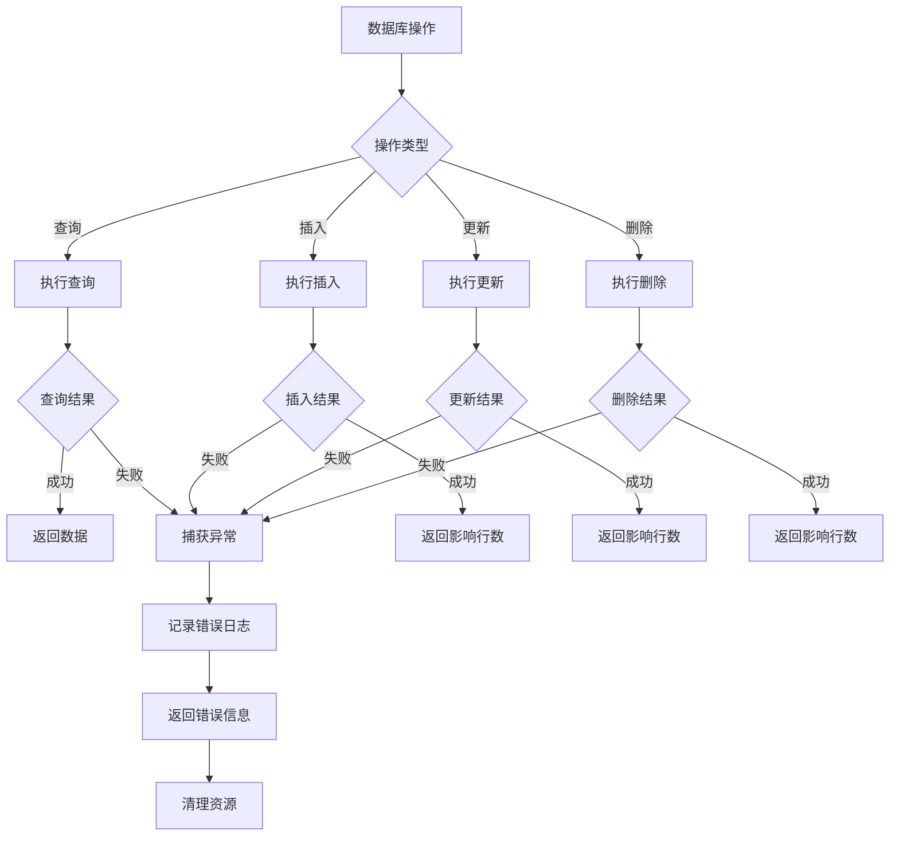

**图表来源**
- [app.py:1113-1115](file://app.py#L1113-L1115)
- [app.py:2404-2405](file://app.py#L2404-L2405)

**章节来源**
- [app.py:1113-1115](file://app.py#L1113-L1115)
- [app.py:2404-2405](file://app.py#L2404-L2405)

## 依赖关系分析

### 外部依赖

系统依赖以下关键外部组件：

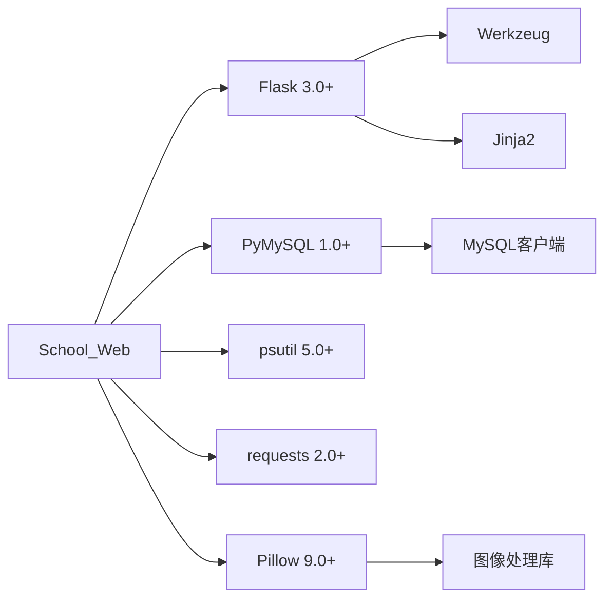

**图表来源**
- [requirements.txt:1-5](file://requirements.txt#L1-L5)
- [SchoolWeb.spec:9](file://SchoolWeb.spec#L9)

### 内部模块依赖

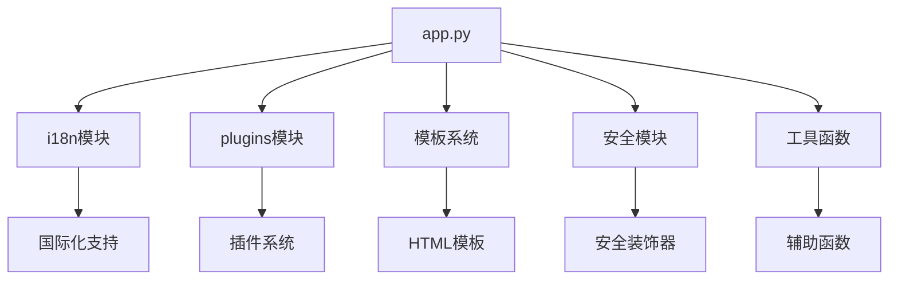

**图表来源**
- [app.py:27-28](file://app.py#L27-L28)
- [app.py:117](file://app.py#L117)

**章节来源**
- [requirements.txt:1-5](file://requirements.txt#L1-L5)
- [SchoolWeb.spec:4-16](file://SchoolWeb.spec#L4-L16)

## 性能考虑

### 连接池优化

系统通过以下方式优化数据库连接性能：

#### 连接复用策略
- **连接复用**：避免频繁创建和销毁连接
- **超时控制**：设置合理的连接超时时间
- **资源清理**：确保异常情况下连接正确释放

#### 查询优化技术

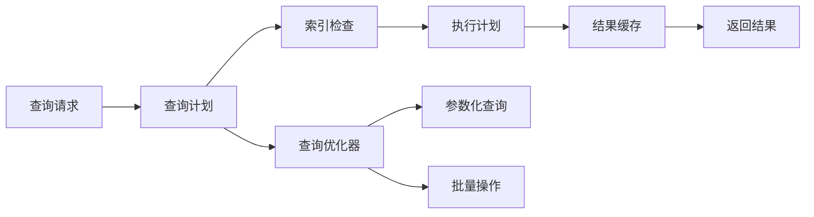

**图表来源**
- [app.py:1347-1364](file://app.py#L1347-L1364)
- [app.py:2548-2575](file://app.py#L2548-L2575)

### 缓存策略

系统实现了多层次的缓存机制：

| 缓存层级 | 缓存类型 | 缓存策略 | 适用场景 |
|----------|----------|----------|----------|
| 应用层缓存 | 内存缓存 | LRU算法 | 频繁访问数据 |
| 数据库缓存 | 查询结果 | TTL控制 | 复杂查询结果 |
| 前端缓存 | 浏览器缓存 | ETag验证 | 静态资源 |
| 会话缓存 | 用户会话 | Redis存储 | 用户状态 |

**章节来源**
- [app.py:1347-1364](file://app.py#L1347-L1364)
- [app.py:2548-2575](file://app.py#L2548-L2575)

## 故障排除指南

### 常见问题诊断

#### 数据库连接问题
```python
def diagnose_db_connection():
    """诊断数据库连接问题"""
    try:
        conn = get_db()
        if not conn:
            return "数据库连接失败"
        
        cursor = conn.cursor()
        cursor.execute("SELECT 1")
        result = cursor.fetchone()
        cursor.close()
        conn.close()
        
        return "数据库连接正常"
    except Exception as e:
        return f"数据库连接异常: {str(e)}"
```

#### 查询性能问题
```python
def analyze_query_performance(query, params):
    """分析查询性能"""
    start_time = time.time()
    
    try:
        conn = get_db()
        cursor = conn.cursor()
        cursor.execute(query, params)
        result = cursor.fetchall()
        cursor.close()
        conn.close()
        
        end_time = time.time()
        execution_time = end_time - start_time
        
        return {
            "execution_time": execution_time,
            "row_count": len(result),
            "success": True
        }
    except Exception as e:
        return {
            "execution_time": time.time() - start_time,
            "error": str(e),
            "success": False
        }
```

### 日志记录策略

系统实现了完整的日志记录机制：

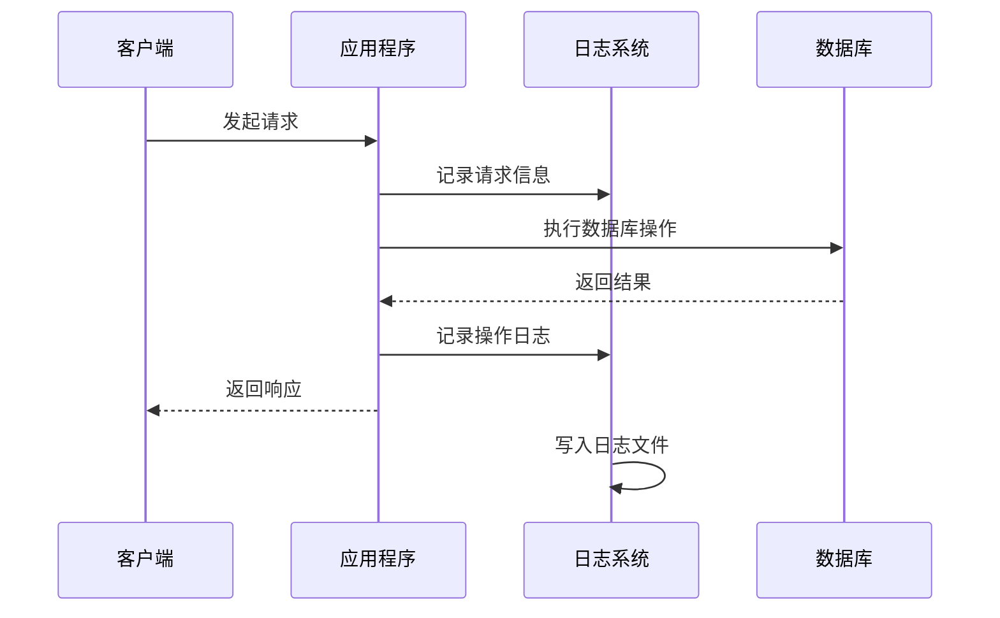

**图表来源**
- [app.py:886-896](file://app.py#L886-L896)
- [app.py:1324-1339](file://app.py#L1324-L1339)

**章节来源**
- [app.py:886-896](file://app.py#L886-L896)
- [app.py:1324-1339](file://app.py#L1324-L1339)

## 结论

School_Web的数据访问层展现了优秀的软件工程实践，通过DAO模式实现了清晰的职责分离和良好的可维护性。系统在安全性方面采用了多层次的防护机制，在性能优化方面实现了连接池管理和查询优化策略。

### 主要优势

1. **安全性强**：全面的SQL注入防护、CSRF防护和输入验证
2. **可维护性好**：模块化的DAO设计和统一的错误处理
3. **性能优秀**：连接池管理和查询优化策略
4. **扩展性强**：灵活的插件系统和模块化架构

### 改进建议

1. **连接池配置**：增加连接池大小和超时参数的动态配置
2. **监控指标**：添加数据库性能监控和告警机制
3. **备份策略**：实现自动化的数据库备份和恢复机制
4. **缓存优化**：引入Redis等高性能缓存系统

数据访问层为整个School_Web应用提供了坚实的基础，通过持续的优化和改进，能够满足不断增长的业务需求和技术挑战。