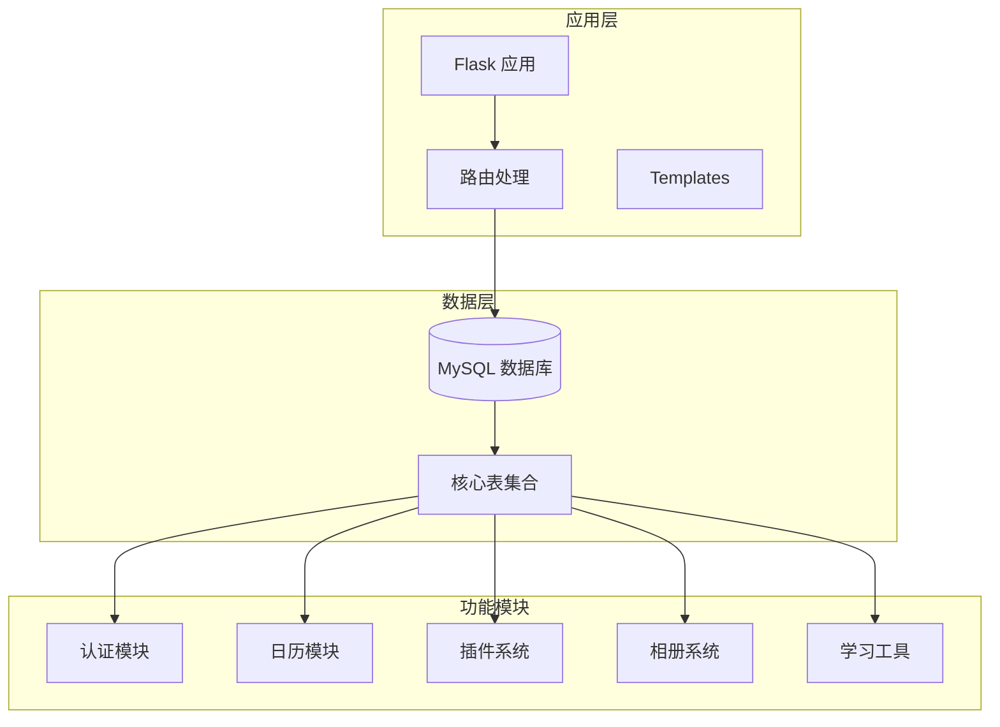
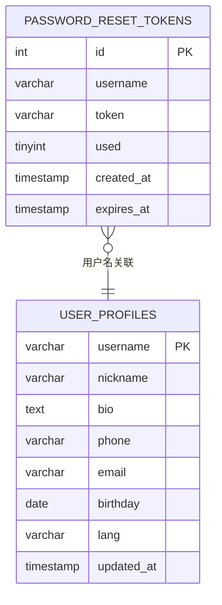
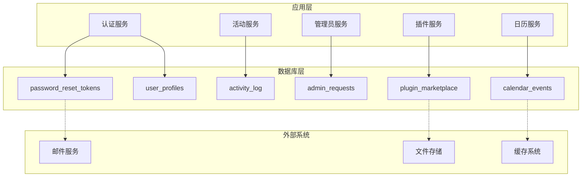
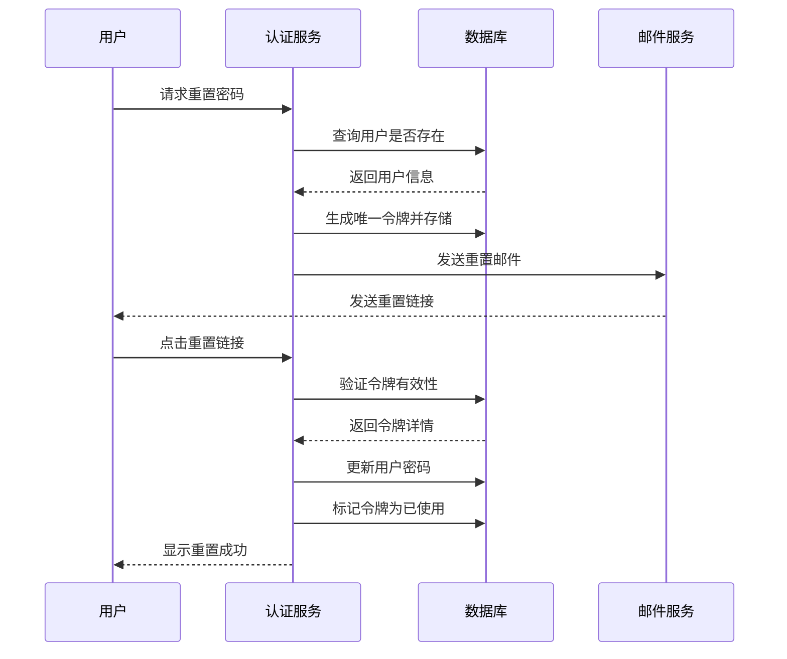
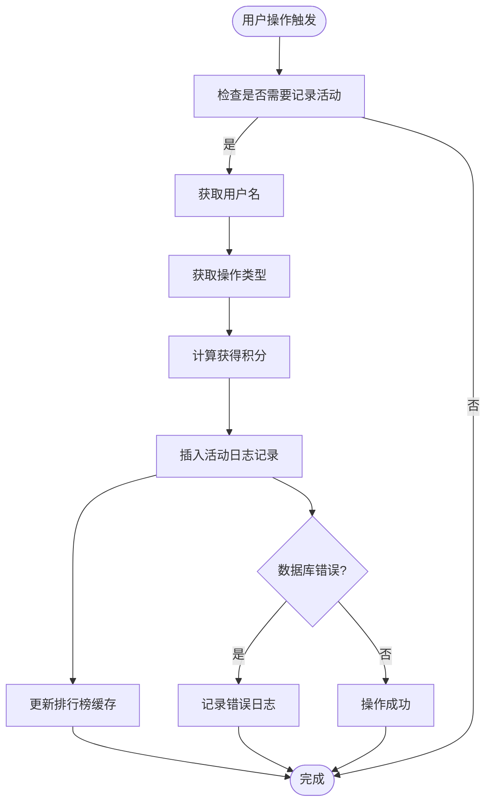
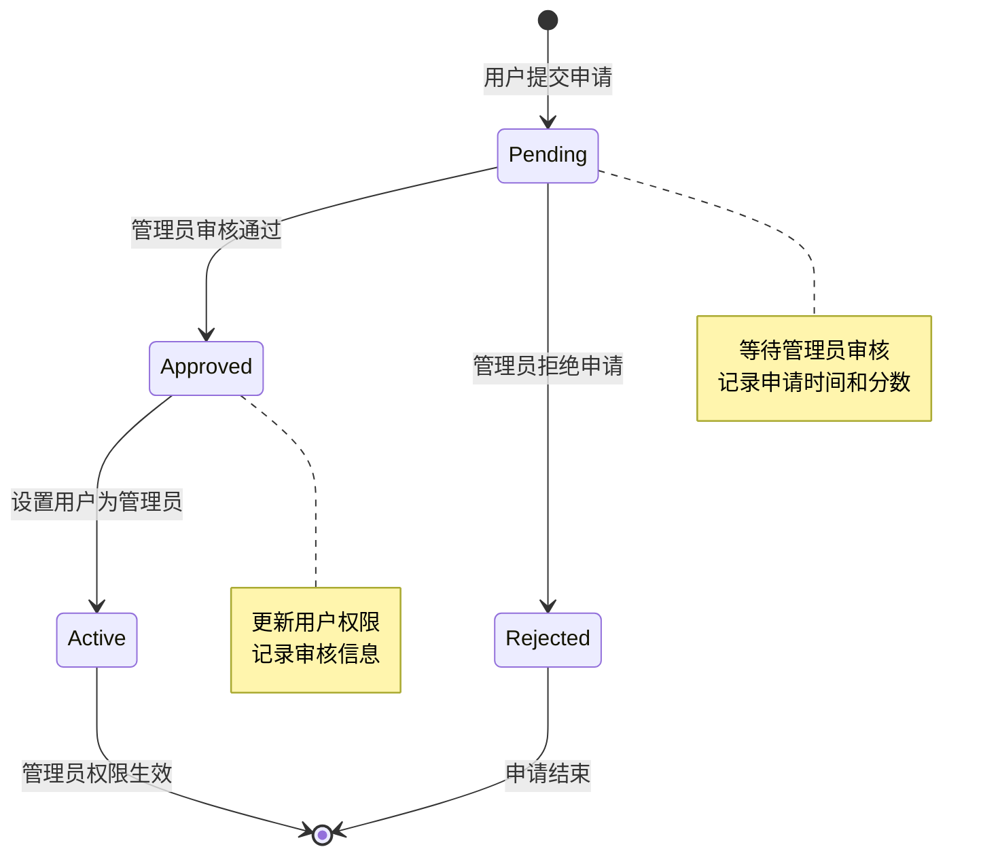
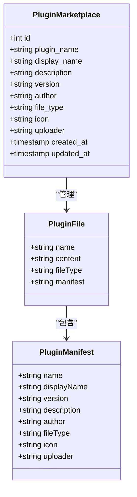
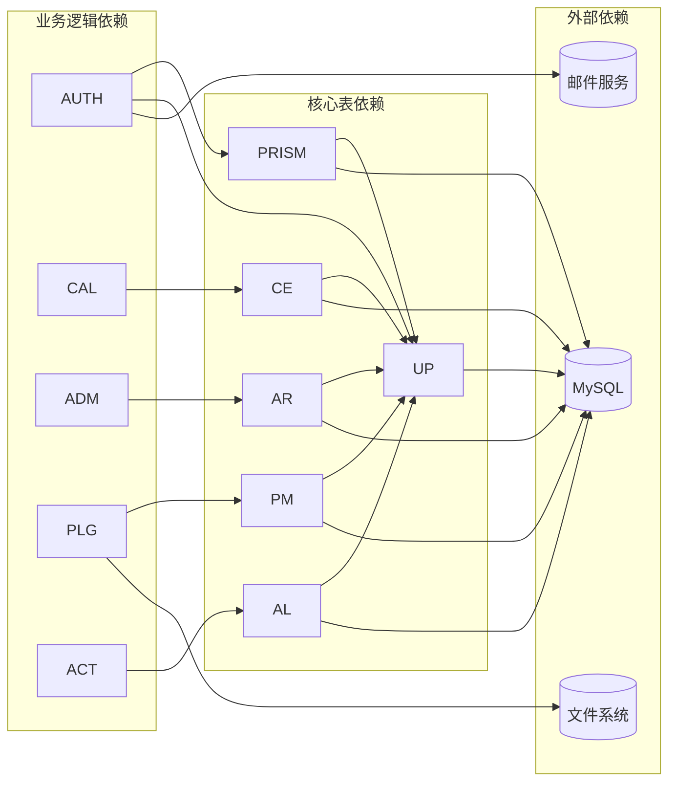

# 表结构设计

<cite>
**本文档引用的文件**
- [app.py](file://app.py)
</cite>

## 目录
1. [简介](#简介)
2. [项目结构](#项目结构)
3. [核心表设计](#核心表设计)
4. [架构概览](#架构概览)
5. [详细组件分析](#详细组件分析)
6. [依赖关系分析](#依赖关系分析)
7. [性能考虑](#性能考虑)
8. [故障排除指南](#故障排除指南)
9. [结论](#结论)

## 简介

School_Web 是一个基于 Flask 的校园 Web 应用程序，包含了完整的用户管理系统、日历功能、插件市场、相册系统等多个模块。本文档详细分析了数据库表结构设计，重点关注以下核心表：

- password_reset_tokens - 密码重置令牌表
- user_profiles - 用户资料表  
- activity_log - 活动日志表
- admin_requests - 管理员申请表
- calendar_events - 日历事件表
- plugin_marketplace - 插件市场表

这些表的设计体现了现代 Web 应用的数据完整性、安全性和可扩展性要求。

## 项目结构

School_Web 采用模块化的项目结构，主要包含以下关键组件：

**图表来源**
- [app.py:231-345](file://app.py#L231-L345)

**章节来源**
- [app.py:231-345](file://app.py#L231-L345)

## 核心表设计

### password_reset_tokens 表

密码重置令牌表负责管理用户的密码重置流程，确保安全性的同时提供便捷的密码找回功能。

**图表来源**
- [app.py:240-268](file://app.py#L240-L268)

**表结构特点：**
- **主键**: 自增 ID，提供唯一标识符
- **唯一约束**: token 字段确保令牌的唯一性
- **索引策略**: 未显式创建索引，但查询通常基于 username 和 token
- **约束条件**: 
  - username 非空，关联用户表
  - token 非空且唯一
  - used 字段默认 0，表示未使用
  - expires_at 确保令牌时效性

### user_profiles 表

用户资料表存储用户的基本个人信息，支持多语言和个性化设置。

**表结构：**
- **主键**: username（VARCHAR 50），作为用户唯一标识
- **字段**: 包含昵称、个人简介、电话、邮箱、生日等个人信息
- **默认值**: lang 字段默认为 'zh-CN'
- **时间戳**: updated_at 自动更新，反映资料修改时间

**章节来源**
- [app.py:258-268](file://app.py#L258-L268)

### activity_log 表

活动日志表记录用户的活跃行为，用于构建排行榜和用户活跃度分析。

**表结构：**
- **主键**: 自增 ID
- **索引策略**: 
  - idx_activity_user(username) - 支持按用户查询
  - idx_activity_time(created_at) - 支持按时间排序
- **字段**: 包含用户名、操作类型、积分等信息

**章节来源**
- [app.py:270-279](file://app.py#L270-L279)

### admin_requests 表

管理员申请表管理用户申请管理员权限的流程。

**表结构：**
- **主键**: 自增 ID
- **唯一约束**: username 字段唯一，确保每个用户只能有一个待处理的管理员申请
- **字段**: 包含用户名、状态、分数、申请时间等信息
- **审核字段**: reviewed_by 和 reviewed_at 记录审核人和时间

**章节来源**
- [app.py:287-296](file://app.py#L287-L296)

### calendar_events 表

日历事件表支持用户创建和管理个人日程安排。

**表结构：**
- **主键**: 自增 ID
- **索引策略**:
  - idx_cal_user(username) - 支持按用户查询事件
  - idx_cal_date(event_date) - 支持按日期查询事件
- **分类系统**: category 字段支持多种事件类型（课程、考试、活动等）
- **颜色标识**: color 字段支持事件可视化

**章节来源**
- [app.py:298-311](file://app.py#L298-L311)

### plugin_marketplace 表

插件市场表管理管理员上传的插件信息。

**表结构：**
- **主键**: 自增 ID
- **唯一约束**: plugin_name 字段唯一，确保插件名称的唯一性
- **枚举类型**: file_type 字段限制为 'html' 或 'vue'
- **版本管理**: version 字段支持插件版本控制
- **时间戳**: created_at 和 updated_at 自动管理

**章节来源**
- [app.py:327-340](file://app.py#L327-L340)

## 架构概览

**图表来源**
- [app.py:240-340](file://app.py#L240-L340)

## 详细组件分析

### 认证与安全组件

密码重置流程确保了用户账户的安全性：

**图表来源**
- [app.py:1209-1321](file://app.py#L1209-L1321)

### 活动日志系统

活动日志系统通过统一的记录机制跟踪用户行为：

**图表来源**
- [app.py:1324-1340](file://app.py#L1324-L1340)

### 管理员申请流程

管理员申请流程确保了权限分配的可控性：

**图表来源**
- [app.py:1419-1517](file://app.py#L1419-L1517)

**章节来源**
- [app.py:1209-1517](file://app.py#L1209-L1517)

### 插件市场管理

插件市场支持管理员上传和管理第三方插件：

**图表来源**
- [app.py:5262-5393](file://app.py#L5262-L5393)

**章节来源**
- [app.py:5262-5393](file://app.py#L5262-L5393)

## 依赖关系分析

**图表来源**
- [app.py:240-340](file://app.py#L240-L340)

**章节来源**
- [app.py:240-340](file://app.py#L240-L340)

## 性能考虑

### 索引优化策略

1. **复合索引设计**: 在高频查询字段上建立适当索引
2. **查询优化**: 使用 EXPLAIN 分析慢查询
3. **缓存策略**: 对热点数据实施缓存机制
4. **分区策略**: 大表考虑按时间分区

### 数据完整性保障

1. **事务处理**: 关键业务操作使用事务确保一致性
2. **约束验证**: 利用数据库约束防止脏数据
3. **审计日志**: 记录重要的数据变更操作
4. **备份策略**: 定期备份确保数据安全

## 故障排除指南

### 常见问题诊断

1. **连接问题**: 检查数据库连接配置和网络连通性
2. **权限问题**: 验证数据库用户权限设置
3. **索引失效**: 分析查询计划，重建必要索引
4. **锁竞争**: 识别长时间运行的事务，优化查询逻辑

### 监控指标

- **查询性能**: 慢查询日志分析
- **连接池**: 连接数和等待时间监控
- **存储空间**: 磁盘使用率和增长趋势
- **错误率**: 数据库错误统计和分类

## 结论

School_Web 的数据库表结构设计体现了现代 Web 应用的最佳实践：

1. **安全性**: 通过令牌机制和权限控制确保系统安全
2. **可扩展性**: 模块化设计支持功能扩展
3. **性能**: 合理的索引策略和查询优化
4. **可维护性**: 清晰的表结构和约束定义

这些设计原则为系统的长期发展奠定了坚实的基础，同时为未来的功能扩展提供了良好的架构支撑。