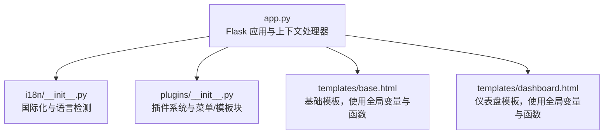
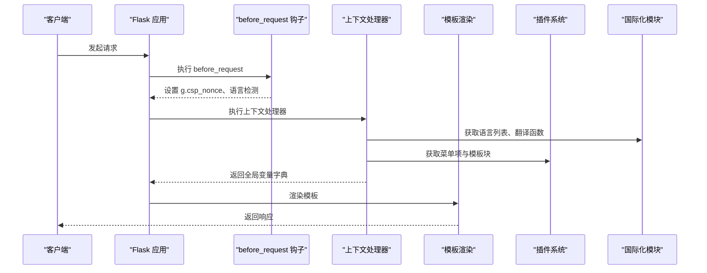
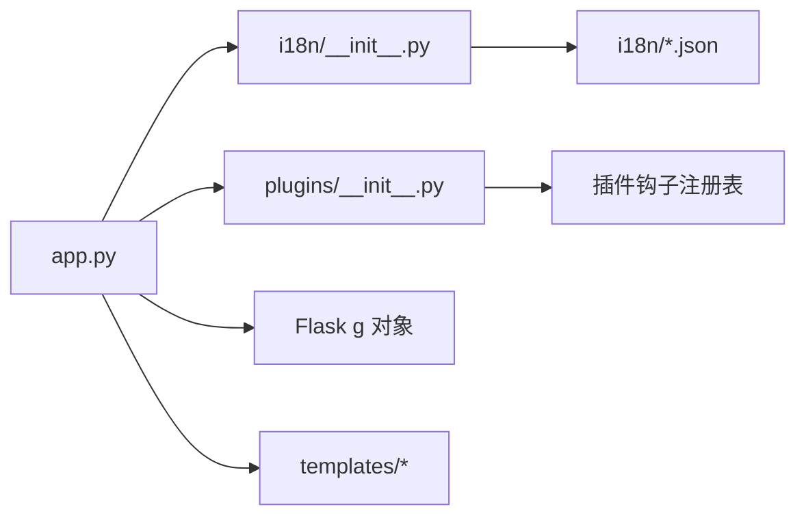

# 上下文处理器

<cite>
**本文档引用的文件**
- [app.py](file://app.py)
- [i18n/__init__.py](file://i18n/__init__.py)
- [plugins/__init__.py](file://plugins/__init__.py)
- [templates/base.html](file://templates/base.html)
- [templates/dashboard.html](file://templates/dashboard.html)
</cite>

## 目录
1. [简介](#简介)
2. [项目结构](#项目结构)
3. [核心组件](#核心组件)
4. [架构总览](#架构总览)
5. [详细组件分析](#详细组件分析)
6. [依赖分析](#依赖分析)
7. [性能考虑](#性能考虑)
8. [故障排查指南](#故障排查指南)
9. [结论](#结论)

## 简介
本文件面向 School_Web 的上下文处理器（Context Processor）进行系统性技术文档整理，重点解释 Flask 上下文处理器的工作机制与最佳实践，涵盖：
- @context_processor 装饰器的使用方式与执行时机
- 全局变量注入流程（用户会话、语言设置、权限级别等）
- 模板函数注册与使用（如 lang_name()、url_for() 等）
- 上下文处理器的作用范围与性能优化策略
- 实际代码示例路径，帮助开发者快速创建与使用自定义上下文处理器

## 项目结构
School_Web 使用 Flask 作为后端框架，上下文处理器位于主应用入口文件中，配合国际化模块与插件系统共同向模板注入全局数据与函数。模板文件通过 Jinja2 语法直接使用这些注入的数据与函数。

图表来源
- [app.py:175-194](file://app.py#L175-L194)
- [i18n/__init__.py:1-113](file://i18n/__init__.py#L1-113)
- [plugins/__init__.py:1-249](file://plugins/__init__.py#L1-L249)
- [templates/base.html:1-337](file://templates/base.html#L1-L337)
- [templates/dashboard.html:1-200](file://templates/dashboard.html#L1-L200)

章节来源
- [app.py:175-194](file://app.py#L175-L194)
- [i18n/__init__.py:1-113](file://i18n/__init__.py#L1-L113)
- [plugins/__init__.py:1-249](file://plugins/__init__.py#L1-L249)
- [templates/base.html:1-337](file://templates/base.html#L1-L337)
- [templates/dashboard.html:1-200](file://templates/dashboard.html#L1-L200)

## 核心组件
- 上下文处理器（Context Processor）
  - 注入 CSP nonce：确保模板中的内联样式/脚本符合 CSP 策略
  - 注入国际化与插件数据：提供翻译函数、语言列表、语言名称映射、插件菜单与模板块
- 国际化模块（i18n）
  - 提供语言检测、翻译函数、语言名称查询、支持语言列表
- 插件系统（plugins）
  - 提供菜单项注册与查询、模板块注册与查询、权限过滤
- 模板（Jinja2）
  - 基础模板与业务模板使用全局变量与函数，如 csp_nonce、lang_name、supported_langs、plugin_* 等

章节来源
- [app.py:175-194](file://app.py#L175-L194)
- [i18n/__init__.py:50-108](file://i18n/__init__.py#L50-L108)
- [plugins/__init__.py:154-193](file://plugins/__init__.py#L154-L193)
- [templates/base.html:8,168-177,220-223,232-233,268-269:8-269](file://templates/base.html#L8-L269)

## 架构总览
上下文处理器在每次请求渲染模板前执行，将全局数据注入到模板上下文中，使模板可以无须在视图层显式传参即可访问这些数据与函数。

图表来源
- [app.py:158-178](file://app.py#L158-L178)
- [app.py:175-194](file://app.py#L175-L194)
- [i18n/__init__.py:50-108](file://i18n/__init__.py#L50-L108)
- [plugins/__init__.py:154-193](file://plugins/__init__.py#L154-L193)

## 详细组件分析

### 上下文处理器工作机制
- @context_processor 装饰器
  - 作用：将返回的字典键值注入到所有模板上下文
  - 执行时机：每次请求渲染模板前，由 Flask 自动调用
  - 返回格式：字典，键为模板中可用的变量名或函数名，值为对应的 Python 对象或可调用对象
- 典型实现
  - 注入 CSP nonce：从 g.csp_nonce 获取，保证模板内联样式/脚本的 CSP 合规
  - 注入国际化数据：从会话中读取语言与权限，提供翻译函数、语言列表、语言名称映射、插件菜单与模板块

章节来源
- [app.py:175-194](file://app.py#L175-L194)

### 全局变量注入流程
- CSP nonce 注入
  - before_request 钩子在请求开始时生成并存储到 g.csp_nonce
  - 上下文处理器将 g.csp_nonce 注入模板上下文，模板通过 nonce 属性启用 CSP
- 语言与权限注入
  - before_request 钩子设置 session.lang 与 session.permission
  - 上下文处理器读取 session.lang 与 session.permission，提供：
    - 翻译函数 "_"：按当前语言进行翻译
    - lang：当前语言代码
    - supported_langs：支持的语言列表
    - lang_name：语言名称映射函数
    - plugin_menu_items：根据权限过滤后的插件菜单
    - plugin_footer_blocks / plugin_head_blocks：插件模板块

章节来源
- [app.py:158-178](file://app.py#L158-L178)
- [app.py:181-194](file://app.py#L181-L194)
- [i18n/__init__.py:50-108](file://i18n/__init__.py#L50-L108)
- [plugins/__init__.py:154-193](file://plugins/__init__.py#L154-L193)

### 模板函数注册与使用
- 自定义模板函数
  - "_"：翻译函数，支持参数插值
  - "lang_name"：将语言代码映射为人类可读语言名
  - "plugin_menu_items"、"plugin_footer_blocks"、"plugin_head_blocks"：插件提供的菜单与模板块
- 模板中使用
  - 基础模板使用 lang_name、supported_langs、plugin_footer_blocks 等
  - 仪表盘模板使用 "_" 进行多语言文案输出

章节来源
- [app.py:186-194](file://app.py#L186-L194)
- [templates/base.html:168-177,220-223:168-223](file://templates/base.html#L168-L223)
- [templates/dashboard.html:2-8](file://templates/dashboard.html#L2-L8)

### 执行时机与作用范围
- 执行时机
  - before_request：生成 CSP nonce 并设置语言
  - 上下文处理器：在模板渲染前注入全局数据
- 作用范围
  - 所有模板均可访问上下文处理器注入的变量与函数
  - 适用于所有视图函数返回的模板渲染场景

章节来源
- [app.py:158-178](file://app.py#L158-L178)
- [app.py:175-194](file://app.py#L175-L194)

### 性能优化建议
- 数据缓存
  - 国际化翻译：模块内部维护翻译缓存字典，避免重复加载
  - 支持语言列表：可缓存到模块级变量，减少重复计算
- 延迟加载
  - 插件菜单与模板块：按需查询，避免在高频请求中重复构建
- 减少数据库访问
  - 语言偏好持久化仅在用户登录且语言变更时触发
- 降低上下文处理器开销
  - 仅注入必要数据，避免复杂计算与外部 I/O
  - 对于昂贵操作（如远程 API 调用）采用缓存或异步策略

章节来源
- [i18n/__init__.py:11-29](file://i18n/__init__.py#L11-L29)
- [i18n/__init__.py:45-47](file://i18n/__init__.py#L45-L47)
- [plugins/__init__.py:154-193](file://plugins/__init__.py#L154-L193)
- [app.py:197-211](file://app.py#L197-L211)

### 实际代码示例（路径）
以下为创建与使用自定义上下文处理器的参考路径（请勿直接复制代码内容）：
- 定义上下文处理器
  - 参考路径：[app.py:175-194](file://app.py#L175-L194)
- 注入 CSP nonce
  - 参考路径：[app.py:158-178](file://app.py#L158-L178)
- 注入国际化与插件数据
  - 参考路径：[app.py:181-194](file://app.py#L181-L194)
- 模板中使用全局变量与函数
  - 参考路径：[templates/base.html:8,168-177,220-223,232-233,268-269:8-269](file://templates/base.html#L8-L269)
  - 参考路径：[templates/dashboard.html:2-8](file://templates/dashboard.html#L2-L8)
- 国际化模块
  - 参考路径：[i18n/__init__.py:50-108](file://i18n/__init__.py#L50-L108)
- 插件系统
  - 参考路径：[plugins/__init__.py:154-193](file://plugins/__init__.py#L154-L193)

## 依赖分析
上下文处理器的依赖关系如下：
- app.py
  - 依赖 i18n 模块：提供翻译函数与语言检测
  - 依赖 plugins 模块：提供插件菜单与模板块
  - 依赖 Flask 的 g 对象：存储 CSP nonce
- 模板
  - 依赖上下文处理器注入的全局变量与函数

图表来源
- [app.py:175-194](file://app.py#L175-L194)
- [i18n/__init__.py:1-113](file://i18n/__init__.py#L1-L113)
- [plugins/__init__.py:16-22](file://plugins/__init__.py#L16-L22)

章节来源
- [app.py:175-194](file://app.py#L175-L194)
- [i18n/__init__.py:1-113](file://i18n/__init__.py#L1-L113)
- [plugins/__init__.py:16-22](file://plugins/__init__.py#L16-L22)

## 性能考虑
- 缓存策略
  - 国际化翻译与语言名称：利用模块级缓存字典
  - 支持语言列表：缓存到模块变量
- 延迟加载
  - 插件菜单与模板块：仅在需要时查询
- 数据库访问控制
  - 用户语言偏好持久化仅在登录用户语言变更时触发
- 上下文处理器优化
  - 避免在上下文处理器中执行耗时操作
  - 对外部 I/O 采用缓存或异步策略

章节来源
- [i18n/__init__.py:11-29](file://i18n/__init__.py#L11-L29)
- [i18n/__init__.py:45-47](file://i18n/__init__.py#L45-L47)
- [plugins/__init__.py:154-193](file://plugins/__init__.py#L154-L193)
- [app.py:197-211](file://app.py#L197-L211)

## 故障排查指南
- CSP nonce 无效
  - 检查 before_request 是否正确生成 g.csp_nonce
  - 检查上下文处理器是否将 g.csp_nonce 注入模板
  - 参考路径：[app.py:158-178](file://app.py#L158-L178)，[app.py:175-178](file://app.py#L175-L178)
- 语言显示异常
  - 检查语言检测逻辑与 session.lang 设置
  - 检查翻译函数与语言名称映射
  - 参考路径：[app.py:165-173](file://app.py#L165-L173)，[i18n/__init__.py:70-108](file://i18n/__init__.py#L70-L108)
- 插件菜单/模板块不显示
  - 检查权限过滤与插件钩子注册
  - 参考路径：[plugins/__init__.py:154-193](file://plugins/__init__.py#L154-L193)
- 模板中函数不可用
  - 确认上下文处理器返回的键名与模板使用一致
  - 参考路径：[app.py:186-194](file://app.py#L186-L194)，[templates/base.html:168-177,220-223:168-223](file://templates/base.html#L168-L223)

章节来源
- [app.py:158-178](file://app.py#L158-L178)
- [app.py:165-173](file://app.py#L165-L173)
- [app.py:186-194](file://app.py#L186-L194)
- [i18n/__init__.py:70-108](file://i18n/__init__.py#L70-L108)
- [plugins/__init__.py:154-193](file://plugins/__init__.py#L154-L193)
- [templates/base.html:168-177,220-223:168-223](file://templates/base.html#L168-L223)

## 结论
上下文处理器是 School_Web 中实现“模板全局数据注入”的关键机制。通过 @context_processor 装饰器，系统在每次请求渲染模板前自动注入 CSP nonce、国际化数据与插件扩展，使模板无需在视图层显式传参即可获得所需资源。结合国际化与插件系统的模块化设计，上下文处理器实现了高内聚、低耦合的全局数据供给能力。建议在保持上下文处理器轻量化的同时，充分利用缓存与延迟加载策略，进一步提升整体性能与可维护性。