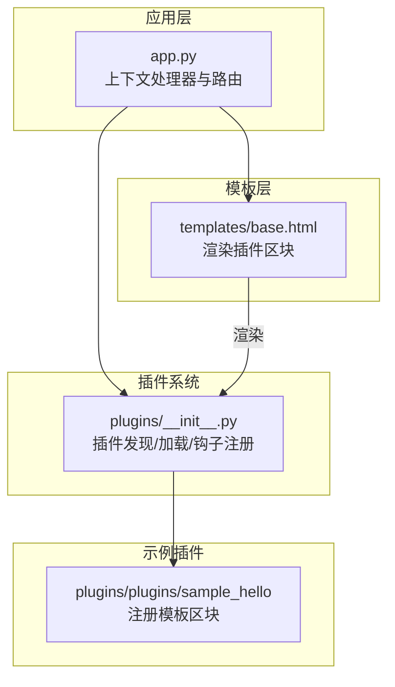
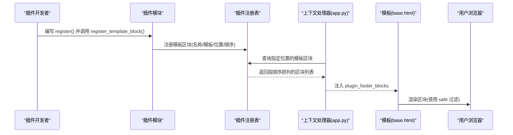
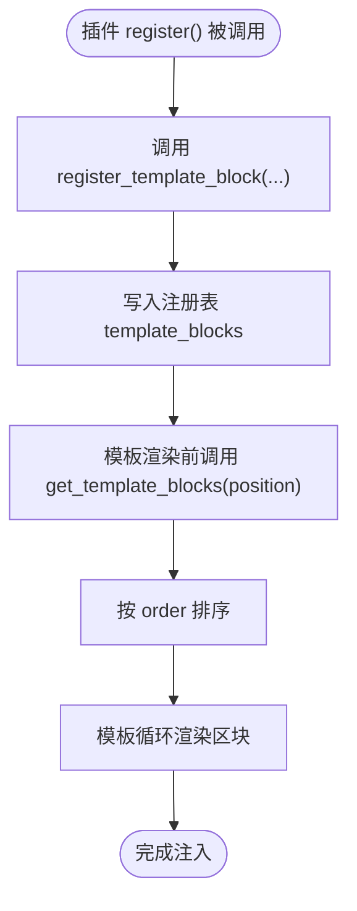
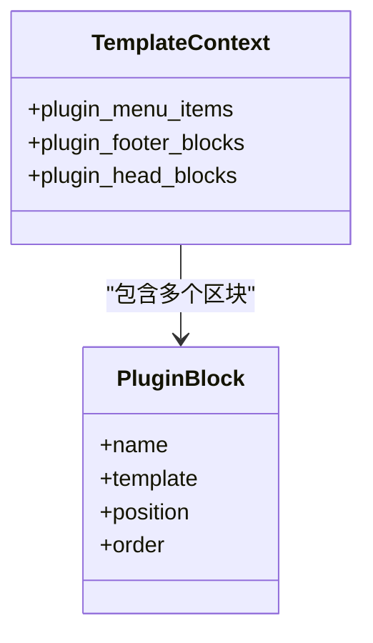
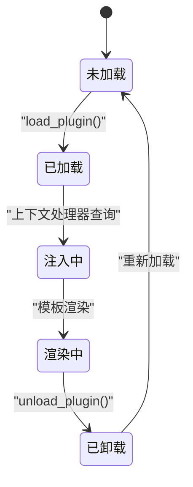
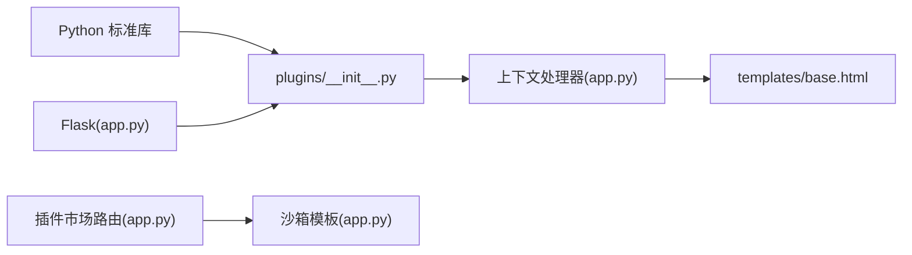

# 插件模板集成

<cite>
**本文引用的文件**
- [plugins/__init__.py](file://plugins/__init__.py)
- [app.py](file://app.py)
- [templates/base.html](file://templates/base.html)
- [plugins/plugins/sample_hello/__init__.py](file://plugins/plugins/sample_hello/__init__.py)
- [plugins/plugins/sample_hello/plugin.json](file://plugins/plugins/sample_hello/plugin.json)
- [plugins/marketplace/markdown-editor/plugin.json](file://plugins/marketplace/markdown-editor/plugin.json)
- [plugins/marketplace/markdown-editor/index.html](file://plugins/marketplace/markdown-editor/index.html)
- [requirements.txt](file://requirements.txt)
</cite>

## 目录
1. [简介](#简介)
2. [项目结构](#项目结构)
3. [核心组件](#核心组件)
4. [架构总览](#架构总览)
5. [组件详解](#组件详解)
6. [依赖关系分析](#依赖关系分析)
7. [性能考量](#性能考量)
8. [故障排查指南](#故障排查指南)
9. [结论](#结论)
10. [附录](#附录)

## 简介
本文件面向插件开发者与维护者，系统性阐述 School_Web 的“插件模板集成”能力：如何通过插件向模板系统注入自定义 HTML 片段，以及这些片段在模板中的渲染与安全控制机制。重点覆盖以下方面：
- 插件系统与模板系统的协作方式
- plugin_footer_blocks 变量的来源与使用
- 插件如何注册模板区块（模板字符串格式与安全处理）
- 插件模板的生命周期（加载、排序、渲染、卸载）
- 安全考虑（XSS 防护、内容净化、CSP 与沙箱）
- 开发者最佳实践与常见陷阱
- 完整的集成示例（从注册到渲染）

## 项目结构
围绕“插件模板集成”，本项目的关键文件与职责如下：
- 插件系统核心：plugins/__init__.py 提供插件发现、加载、卸载、钩子注册与查询接口
- 应用上下文注入：app.py 在模板上下文中注入插件菜单与模板区块
- 模板渲染点：templates/base.html 在页脚区域渲染插件注入的区块
- 示例插件：plugins/plugins/sample_hello 展示了如何注册模板区块
- 插件市场（HTML/Vue 插件）：通过独立目录与路由实现沙箱隔离与安全加载

图表来源
- [app.py:181-194](file://app.py#L181-L194)
- [plugins/__init__.py:25-110](file://plugins/__init__.py#L25-L110)
- [templates/base.html:220-223](file://templates/base.html#L220-L223)
- [plugins/plugins/sample_hello/__init__.py:9-26](file://plugins/plugins/sample_hello/__init__.py#L9-L26)

章节来源
- [plugins/__init__.py:1-249](file://plugins/__init__.py#L1-L249)
- [app.py:181-194](file://app.py#L181-L194)
- [templates/base.html:220-223](file://templates/base.html#L220-L223)

## 核心组件
- 插件钩子注册表：维护“菜单项”“模板注入块”“静态路由”“API 路由”等钩子
- 模板区块注册与查询：register_template_block 与 get_template_blocks
- 上下文注入：app.py 的上下文处理器将插件菜单与模板区块注入模板
- 模板渲染点：base.html 中以循环渲染插件_footer_blocks

章节来源
- [plugins/__init__.py:167-184](file://plugins/__init__.py#L167-L184)
- [app.py:181-194](file://app.py#L181-L194)
- [templates/base.html:220-223](file://templates/base.html#L220-L223)

## 架构总览
插件模板集成的端到端流程如下：

图表来源
- [plugins/__init__.py:167-184](file://plugins/__init__.py#L167-L184)
- [app.py:181-194](file://app.py#L181-L194)
- [templates/base.html:220-223](file://templates/base.html#L220-L223)

## 组件详解

### 插件系统与模板区块注册
- 注册接口：插件在初始化时调用 register_template_block，传入区块描述对象（名称、模板字符串、位置、顺序）
- 存储结构：区块被追加到全局注册表中，按位置过滤与顺序排序
- 查询接口：get_template_blocks(position) 返回指定位置的区块列表，按 order 升序排列

图表来源
- [plugins/__init__.py:167-184](file://plugins/__init__.py#L167-L184)
- [plugins/plugins/sample_hello/__init__.py:20-26](file://plugins/plugins/sample_hello/__init__.py#L20-L26)

章节来源
- [plugins/__init__.py:167-184](file://plugins/__init__.py#L167-L184)
- [plugins/plugins/sample_hello/__init__.py:9-26](file://plugins/plugins/sample_hello/__init__.py#L9-L26)

### 模板渲染点与变量绑定
- 上下文注入：app.py 的上下文处理器将 plugin_footer_blocks 与 plugin_head_blocks 注入模板
- 渲染位置：templates/base.html 在页脚区域遍历 plugin_footer_blocks，并使用 safe 过滤输出
- 变量命名：插件区块对象包含 name、template、position、order 等字段；模板侧直接使用 template 字段

图表来源
- [app.py:181-194](file://app.py#L181-L194)
- [templates/base.html:220-223](file://templates/base.html#L220-L223)

章节来源
- [app.py:181-194](file://app.py#L181-L194)
- [templates/base.html:220-223](file://templates/base.html#L220-L223)

### 生命周期管理
- 加载阶段：discover_plugins 扫描插件目录，load_plugin 动态导入并调用插件 register
- 注入阶段：上下文处理器在渲染前查询区块并注入模板
- 渲染阶段：模板循环渲染区块，使用 safe 过滤避免二次转义
- 卸载阶段：unload_plugin 调用插件 unregister（如实现），清理注册表与 sys.modules

图表来源
- [plugins/__init__.py:60-135](file://plugins/__init__.py#L60-L135)
- [app.py:181-194](file://app.py#L181-L194)
- [templates/base.html:220-223](file://templates/base.html#L220-L223)

章节来源
- [plugins/__init__.py:60-135](file://plugins/__init__.py#L60-L135)
- [app.py:181-194](file://app.py#L181-L194)
- [templates/base.html:220-223](file://templates/base.html#L220-L223)

### 安全考虑
- XSS 防护与内容净化
  - 模板侧对区块模板使用 safe 过滤，避免二次转义；但插件仍需确保模板字符串本身不含不受信任的用户输入
  - 对于来自外部的 HTML 内容，建议在插件侧进行白名单净化或服务端渲染时进行二次校验
- CSP 与沙箱
  - 插件市场中的 HTML/Vue 插件采用沙箱隔离与严格的 CSP 头，限制脚本执行范围与来源
  - 模板上下文注入的区块遵循应用级 CSP 策略，结合 nonce 使用
- 模板注入防护
  - 服务端对上传的插件内容进行基础安全检查，拒绝包含特定模板语法的文件，降低服务端模板注入风险

章节来源
- [templates/base.html:220-223](file://templates/base.html#L220-L223)
- [app.py:175-194](file://app.py#L175-L194)
- [app.py:5293-5300](file://app.py#L5293-L5300)
- [app.py:5611-5623](file://app.py#L5611-L5623)

### 开发者指南与最佳实践
- 模板字符串格式要求
  - 必须是合法的 HTML 片段，可包含内联样式与脚本（受 CSP 限制）
  - 不应包含服务端模板语法（如 Jinja2 的 {{ }}、），以免被误解析
- 安全处理
  - 不在模板字符串中拼接不可信输入；若必须拼接，请在插件侧进行严格净化与转义
  - 避免使用 eval 或动态脚本注入；优先使用事件监听与静态资源
- 位置与顺序
  - 选择合适的注入位置（如 footer、head），并设置合理的 order，避免与其他插件冲突
- 错误处理
  - 在插件 register/unregister 中捕获异常，保证卸载时不会影响系统稳定性
- 性能与体积
  - 控制模板字符串大小，避免一次性注入过多内容导致页面渲染延迟
  - 将外部资源（CSS/JS）尽量外链，减少模板字符串体积

章节来源
- [plugins/__init__.py:167-184](file://plugins/__init__.py#L167-L184)
- [plugins/plugins/sample_hello/__init__.py:20-26](file://plugins/plugins/sample_hello/__init__.py#L20-L26)
- [app.py:5293-5300](file://app.py#L5293-L5300)

### 完整集成示例
以下示例展示从插件注册到模板渲染的完整流程（步骤说明，不包含具体代码内容）：
1. 插件目录与清单
   - 在 plugins/plugins 下创建插件目录，并编写 plugin.json（包含名称、版本、作者等元数据）
2. 插件初始化
   - 在插件的 __init__.py 中实现 register()，调用 register_template_block 注册模板区块（指定 name、template、position、order）
3. 应用加载插件
   - 应用启动时扫描插件目录，动态导入插件并调用其 register
4. 上下文注入
   - app.py 的上下文处理器查询指定位置的模板区块并注入模板
5. 模板渲染
   - templates/base.html 循环渲染 plugin_footer_blocks，使用 safe 输出区块模板
6. 效果验证
   - 访问页面，确认插件区块出现在页脚区域，且符合预期样式与交互

章节来源
- [plugins/plugins/sample_hello/plugin.json:1-7](file://plugins/plugins/sample_hello/plugin.json#L1-L7)
- [plugins/plugins/sample_hello/__init__.py:9-26](file://plugins/plugins/sample_hello/__init__.py#L9-L26)
- [plugins/__init__.py:60-110](file://plugins/__init__.py#L60-L110)
- [app.py:181-194](file://app.py#L181-L194)
- [templates/base.html:220-223](file://templates/base.html#L220-L223)

## 依赖关系分析
- 插件系统依赖
  - Python 标准库：os、json、importlib、sys、traceback
  - Flask（通过 app.py 使用）：上下文处理器、模板渲染
- 插件与模板的关系
  - 插件通过注册表向模板注入区块
  - 模板通过上下文变量访问区块集合
- 插件市场与沙箱
  - 插件市场路由与沙箱模板提供独立的隔离执行环境，与模板注入机制互补

图表来源
- [requirements.txt:1-5](file://requirements.txt#L1-L5)
- [plugins/__init__.py:1-249](file://plugins/__init__.py#L1-L249)
- [app.py:181-194](file://app.py#L181-L194)
- [templates/base.html:220-223](file://templates/base.html#L220-L223)

章节来源
- [requirements.txt:1-5](file://requirements.txt#L1-L5)
- [plugins/__init__.py:1-249](file://plugins/__init__.py#L1-L249)
- [app.py:181-194](file://app.py#L181-L194)
- [templates/base.html:220-223](file://templates/base.html#L220-L223)

## 性能考量
- 区块数量与顺序：区块过多会增加模板渲染时间；合理设置 order 与按需注入可优化性能
- 模板字符串体积：过大模板字符串会增加传输与渲染成本；建议外链资源
- CSP 与沙箱：虽然提升安全性，但可能带来额外的策略解析成本；应保持策略简洁有效

## 故障排查指南
- 插件未生效
  - 检查插件目录与 plugin.json 是否存在，插件是否被正确加载
  - 确认 register_template_block 的 position 与 get_template_blocks 查询一致
- 模板未渲染
  - 检查上下文处理器是否注入 plugin_footer_blocks
  - 确认模板中是否使用了正确的变量名与 safe 过滤
- 安全相关问题
  - 若出现脚本被阻止或样式异常，检查 CSP 策略与沙箱设置
  - 对于上传的插件内容，确认未包含不安全的模板语法

章节来源
- [plugins/__init__.py:60-110](file://plugins/__init__.py#L60-L110)
- [app.py:181-194](file://app.py#L181-L194)
- [templates/base.html:220-223](file://templates/base.html#L220-L223)
- [app.py:5293-5300](file://app.py#L5293-L5300)

## 结论
School_Web 的插件模板集成功以“注册—注入—渲染”的清晰路径实现：插件通过 register_template_block 注册区块，应用在上下文阶段查询并注入，模板在渲染阶段输出。该机制具备良好的扩展性与可控性，配合 CSP 与沙箱策略，能在保证安全的前提下灵活扩展页面功能。开发者应重视模板字符串的安全性与性能，遵循最佳实践，避免常见陷阱。

## 附录
- 相关文件索引
  - 插件系统核心：[plugins/__init__.py](file://plugins/__init__.py)
  - 应用上下文与路由：[app.py](file://app.py)
  - 模板渲染点：[templates/base.html](file://templates/base.html)
  - 示例插件：[plugins/plugins/sample_hello](file://plugins/plugins/sample_hello)
  - 插件市场示例：[plugins/marketplace/markdown-editor](file://plugins/marketplace/markdown-editor)
  - 依赖声明：[requirements.txt](file://requirements.txt)