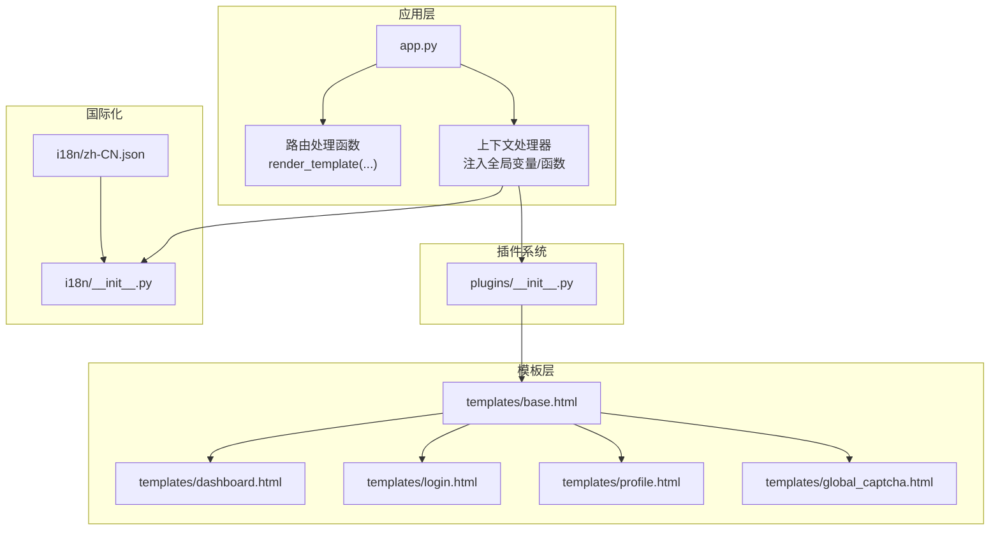
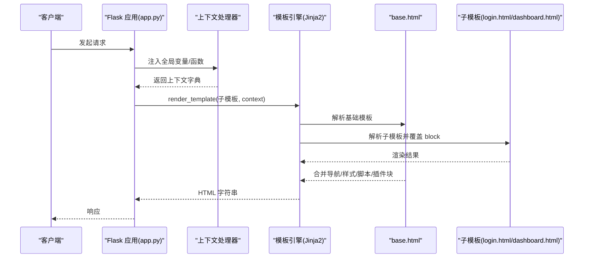
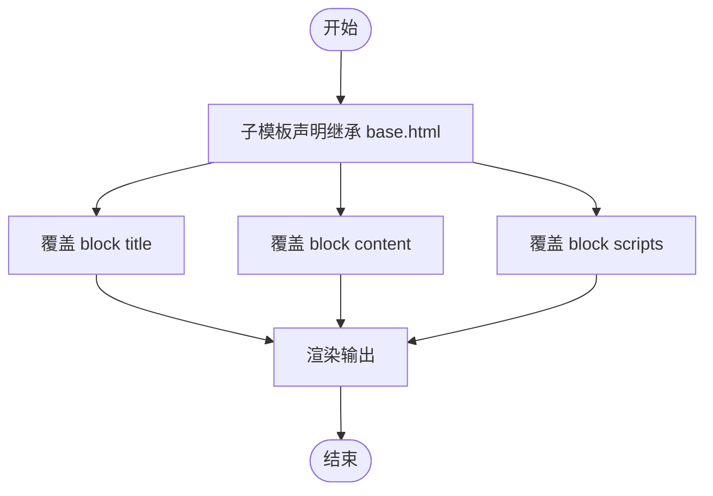
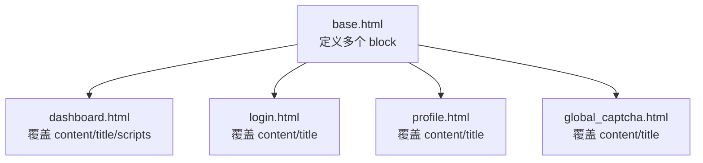
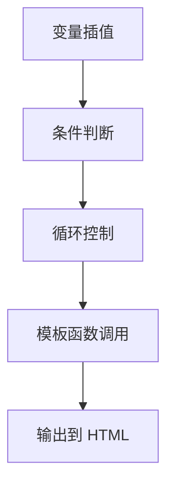
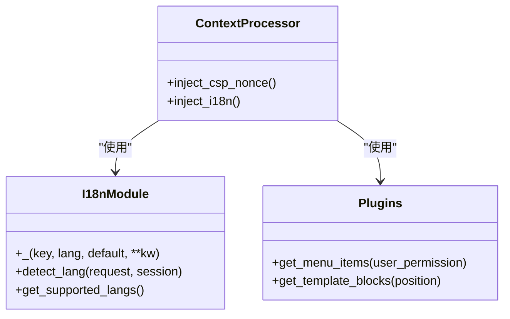
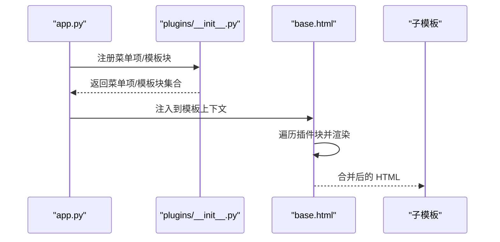
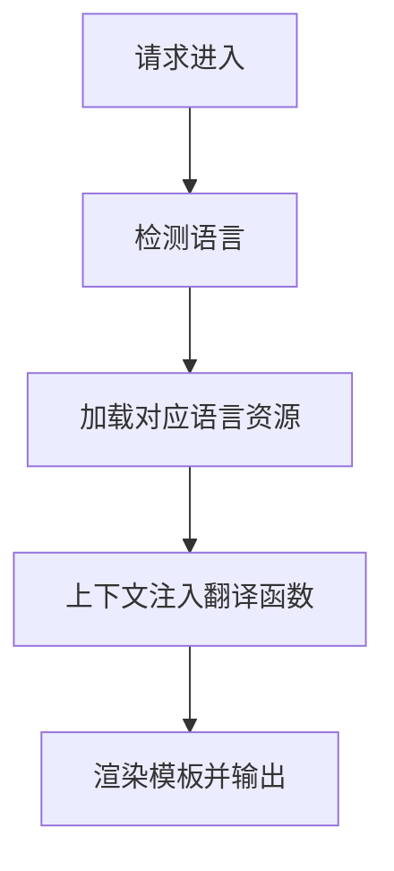
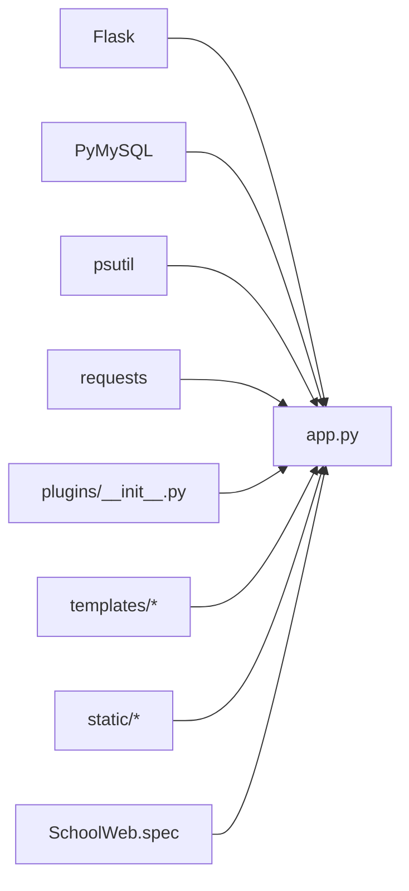

# 模板系统

<cite>
**本文引用的文件**
- [app.py](file://app.py)
- [base.html](file://templates/base.html)
- [dashboard.html](file://templates/dashboard.html)
- [login.html](file://templates/login.html)
- [profile.html](file://templates/profile.html)
- [global_captcha.html](file://templates/global_captcha.html)
- [plugins/__init__.py](file://plugins/__init__.py)
- [i18n/__init__.py](file://i18n/__init__.py)
- [i18n/zh-CN.json](file://i18n/zh-CN.json)
- [requirements.txt](file://requirements.txt)
- [SchoolWeb.spec](file://SchoolWeb.spec)
</cite>

## 目录
1. [简介](#简介)
2. [项目结构](#项目结构)
3. [核心组件](#核心组件)
4. [架构总览](#架构总览)
5. [详细组件分析](#详细组件分析)
6. [依赖分析](#依赖分析)
7. [性能考虑](#性能考虑)
8. [故障排查指南](#故障排查指南)
9. [结论](#结论)
10. [附录](#附录)

## 简介
本文件面向 School_Web 的模板系统，系统基于 Flask 与 Jinja2 模板引擎构建，提供统一的基础模板、模板继承、上下文注入、国际化与插件注入能力。本文将深入解释：
- 模板语法与变量插值、条件判断、循环控制
- 模板继承与基础模板设计
- 模板块的定义、覆盖与传递
- 上下文处理器如何注入全局变量与模板函数
- 模板性能优化策略（缓存、静态资源与响应时间）

## 项目结构
模板系统主要分布在以下目录与文件：
- templates：存放所有 HTML 模板，其中 base.html 为基础模板，其他模板通过 extends 继承
- app.py：Flask 应用入口，负责路由、上下文处理器、安全与响应头等
- plugins：插件系统，支持菜单与模板块注入
- i18n：国际化模块与多语言资源
- requirements.txt：运行依赖（Flask 等）
- SchoolWeb.spec：打包配置，包含模板与静态资源打包

图表来源
- [app.py](file://app.py)
- [base.html](file://templates/base.html)
- [dashboard.html](file://templates/dashboard.html)
- [login.html](file://templates/login.html)
- [profile.html](file://templates/profile.html)
- [global_captcha.html](file://templates/global_captcha.html)
- [plugins/__init__.py](file://plugins/__init__.py)
- [i18n/__init__.py](file://i18n/__init__.py)
- [i18n/zh-CN.json](file://i18n/zh-CN.json)

章节来源
- [app.py](file://app.py)
- [base.html](file://templates/base.html)
- [dashboard.html](file://templates/dashboard.html)
- [login.html](file://templates/login.html)
- [profile.html](file://templates/profile.html)
- [global_captcha.html](file://templates/global_captcha.html)
- [plugins/__init__.py](file://plugins/__init__.py)
- [i18n/__init__.py](file://i18n/__init__.py)
- [i18n/zh-CN.json](file://i18n/zh-CN.json)
- [requirements.txt](file://requirements.txt)
- [SchoolWeb.spec](file://SchoolWeb.spec)

## 核心组件
- 基础模板 base.html：定义站点通用结构、导航、样式、脚本与插件注入点
- 子模板：如 dashboard.html、login.html、profile.html、global_captcha.html，通过 extends 继承 base.html 并覆盖 block
- 上下文处理器：注入 CSP nonce、国际化函数与语言信息、插件菜单与模板块
- 插件系统：动态注册菜单项与模板块，实现模板级扩展
- 国际化：翻译函数与多语言资源，支持键值替换与占位符插值

章节来源
- [base.html](file://templates/base.html)
- [dashboard.html](file://templates/dashboard.html)
- [login.html](file://templates/login.html)
- [profile.html](file://templates/profile.html)
- [global_captcha.html](file://templates/global_captcha.html)
- [app.py](file://app.py)
- [plugins/__init__.py](file://plugins/__init__.py)
- [i18n/__init__.py](file://i18n/__init__.py)

## 架构总览
模板系统采用“基础模板 + 子模板 + 上下文注入 + 插件注入”的分层架构。请求到达路由处理函数后，通过 render_template 渲染子模板，并由上下文处理器注入全局变量与函数，最终输出 HTML。

图表来源
- [app.py](file://app.py)
- [base.html](file://templates/base.html)
- [login.html](file://templates/login.html)
- [dashboard.html](file://templates/dashboard.html)

## 详细组件分析

### 基础模板与模板继承
- base.html 定义了站点的通用结构：HTML 结构、Bootstrap 引入、主题切换、语言切换、导航栏、Flash 消息区、插件注入区、页脚免责声明、脚本与 CSP nonce 注入等
- 子模板通过 extends "base.html" 继承基础结构，并使用 block 标签覆盖或插入内容
- 子模板中的 block 名称与基础模板保持一致，即可完成覆盖与拼接

图表来源
- [base.html](file://templates/base.html)
- [dashboard.html](file://templates/dashboard.html)
- [login.html](file://templates/login.html)
- [profile.html](file://templates/profile.html)
- [global_captcha.html](file://templates/global_captcha.html)

章节来源
- [base.html](file://templates/base.html)
- [dashboard.html](file://templates/dashboard.html)
- [login.html](file://templates/login.html)
- [profile.html](file://templates/profile.html)
- [global_captcha.html](file://templates/global_captcha.html)

### 模板块(block)的使用
- 内容块：子模板通过  ...  覆盖基础模板中的内容区域
- 标题块：子模板通过  ...  覆盖页面标题
- 脚本块：子模板通过  ...  注入页面特定脚本
- 插件块：基础模板中通过遍历插件提供的模板块集合进行注入，实现模板级扩展

图表来源
- [base.html](file://templates/base.html)
- [dashboard.html](file://templates/dashboard.html)
- [login.html](file://templates/login.html)
- [profile.html](file://templates/profile.html)
- [global_captcha.html](file://templates/global_captcha.html)

章节来源
- [base.html](file://templates/base.html)
- [dashboard.html](file://templates/dashboard.html)
- [login.html](file://templates/login.html)
- [profile.html](file://templates/profile.html)
- [global_captcha.html](file://templates/global_captcha.html)

### 模板语法与控制结构
- 变量插值：使用表达式语法输出变量，如 session.username、csrf_token、csp_nonce 等
- 条件判断：使用  ...  控制元素显示，如导航栏中的登录状态、权限判断
- 循环控制：使用  ...  输出列表，如语言切换下拉菜单、通知列表等
- 模板函数：上下文处理器注入的翻译函数与辅助函数，如 _()、lang、supported_langs、plugin_menu_items 等

图表来源
- [base.html](file://templates/base.html)
- [dashboard.html](file://templates/dashboard.html)
- [login.html](file://templates/login.html)
- [profile.html](file://templates/profile.html)
- [global_captcha.html](file://templates/global_captcha.html)

章节来源
- [base.html](file://templates/base.html)
- [dashboard.html](file://templates/dashboard.html)
- [login.html](file://templates/login.html)
- [profile.html](file://templates/profile.html)
- [global_captcha.html](file://templates/global_captcha.html)

### 上下文处理器与全局变量注入
- 注入 CSP nonce：为每个请求生成 nonce，并注入到模板上下文，用于 CSP 安全策略
- 注入国际化：提供翻译函数 _()、当前语言 lang、支持的语言列表 supported_langs、语言名称映射 lang_name
- 注入插件信息：提供插件菜单项 plugin_menu_items、插件模板块 plugin_footer_blocks、plugin_head_blocks
- 注入 CSRF 令牌：为表单提交提供 CSRF 校验支持

图表来源
- [app.py](file://app.py)
- [i18n/__init__.py](file://i18n/__init__.py)
- [plugins/__init__.py](file://plugins/__init__.py)

章节来源
- [app.py](file://app.py)
- [i18n/__init__.py](file://i18n/__init__.py)
- [plugins/__init__.py](file://plugins/__init__.py)

### 插件系统与模板注入
- 插件发现与加载：扫描 plugins/plugins/ 目录，读取 plugin.json 与 __init__.py，动态导入并调用 register
- 菜单项注册：插件通过 register_menu_item 注册菜单项，按权限过滤后注入到模板
- 模板块注册：插件通过 register_template_block 注册模板块，支持 footer/head 位置，按 order 排序后注入
- 模板中使用：基础模板通过遍历 plugin_footer_blocks/plugin_head_blocks 注入 HTML 片段

图表来源
- [app.py](file://app.py)
- [plugins/__init__.py](file://plugins/__init__.py)
- [base.html](file://templates/base.html)

章节来源
- [plugins/__init__.py](file://plugins/__init__.py)
- [app.py](file://app.py)
- [base.html](file://templates/base.html)

### 国际化与多语言
- 翻译函数：_() 支持键值查找与占位符插值，如 _("dashboard_hello", n=5)
- 语言检测：优先级为查询参数、会话、Cookie、Accept-Language
- 语言列表：supported_langs 提供支持的语言列表，lang_name 提供语言名称映射
- 资源文件：i18n/zh-CN.json 提供键值映射，支持多语言扩展

图表来源
- [i18n/__init__.py](file://i18n/__init__.py)
- [i18n/zh-CN.json](file://i18n/zh-CN.json)
- [app.py](file://app.py)

章节来源
- [i18n/__init__.py](file://i18n/__init__.py)
- [i18n/zh-CN.json](file://i18n/zh-CN.json)
- [app.py](file://app.py)

## 依赖分析
- Flask：提供路由、模板渲染、会话、响应头等功能
- PyMySQL：数据库连接与表初始化
- psutil、requests：系统监控与网络工具
- 插件系统：动态加载与注册钩子
- 打包配置：SchoolWeb.spec 将 templates、static、frontend/dist、.secret_key 打包进可执行文件

图表来源
- [requirements.txt](file://requirements.txt)
- [app.py](file://app.py)
- [SchoolWeb.spec](file://SchoolWeb.spec)

章节来源
- [requirements.txt](file://requirements.txt)
- [app.py](file://app.py)
- [SchoolWeb.spec](file://SchoolWeb.spec)

## 性能考虑
- 模板缓存：Flask 默认使用 Jinja2 的模板缓存机制，无需额外配置即可生效
- 静态资源管理：基础模板引入 CDN 资源，减少本地带宽压力；验证码等敏感接口设置 no-store、no-cache，避免缓存导致的安全问题
- 响应时间优化：路由处理函数中对静态资源与分享链接跳过速率限制，降低非业务请求的开销；对敏感路由设置严格的 CSP 与安全头，减少 XSS 风险带来的额外处理成本
- 插件注入：插件块按需排序注入，避免在模板中进行复杂计算；插件菜单项按权限过滤，减少不必要的渲染

章节来源
- [app.py](file://app.py)
- [base.html](file://templates/base.html)

## 故障排查指南
- 模板未正确继承：检查子模板是否正确 extends 基础模板，block 名称是否与基础模板一致
- 变量未注入：确认上下文处理器是否正常工作，检查 CSP nonce、翻译函数、插件块等是否在模板中使用
- 国际化失效：确认语言检测逻辑与资源文件加载是否正确，检查 supported_langs 与 lang_name 的返回值
- 插件未生效：检查插件目录结构与 plugin.json 是否规范，确认 register/unregister 是否正确调用
- CSRF 校验失败：确认表单中包含 _csrf_token，且服务端会话中存在对应令牌

章节来源
- [app.py](file://app.py)
- [base.html](file://templates/base.html)
- [plugins/__init__.py](file://plugins/__init__.py)
- [i18n/__init__.py](file://i18n/__init__.py)

## 结论
School_Web 的模板系统通过基础模板与子模板的清晰分离、上下文处理器的全局注入、插件系统的模板块扩展以及国际化的完善支持，实现了高可维护性与可扩展性的前端渲染层。结合 Flask 的模板缓存与安全头策略，能够在保证安全性的同时提升响应性能。

## 附录
- 模板打包：SchoolWeb.spec 将 templates、static、frontend/dist、.secret_key 打包，便于部署与分发
- 依赖安装：requirements.txt 指定 Flask、PyMySQL、psutil、requests 等运行依赖

章节来源
- [SchoolWeb.spec](file://SchoolWeb.spec)
- [requirements.txt](file://requirements.txt)