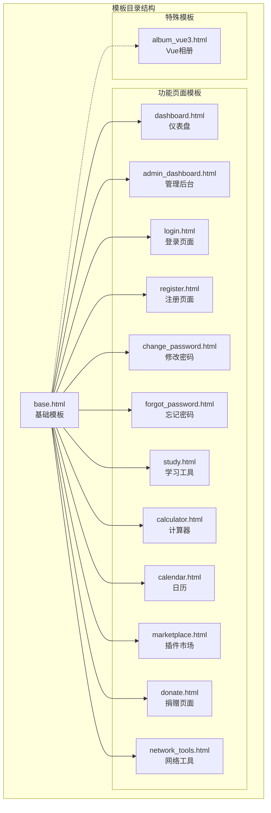
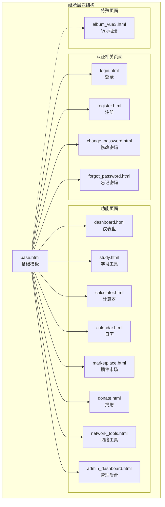
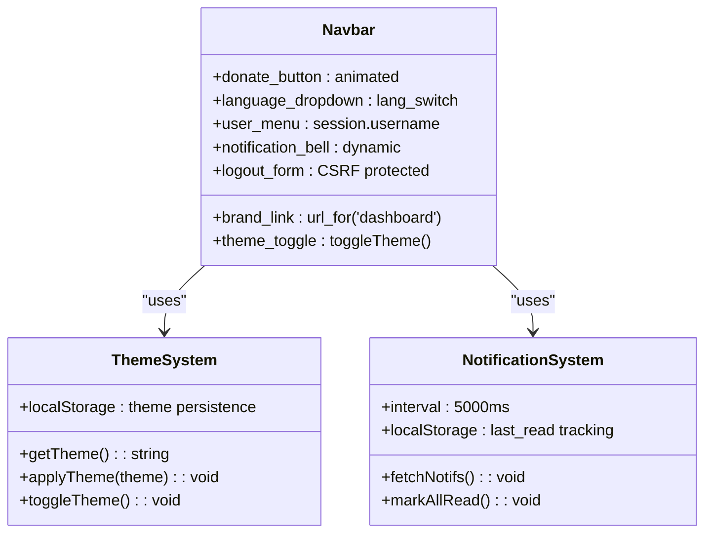
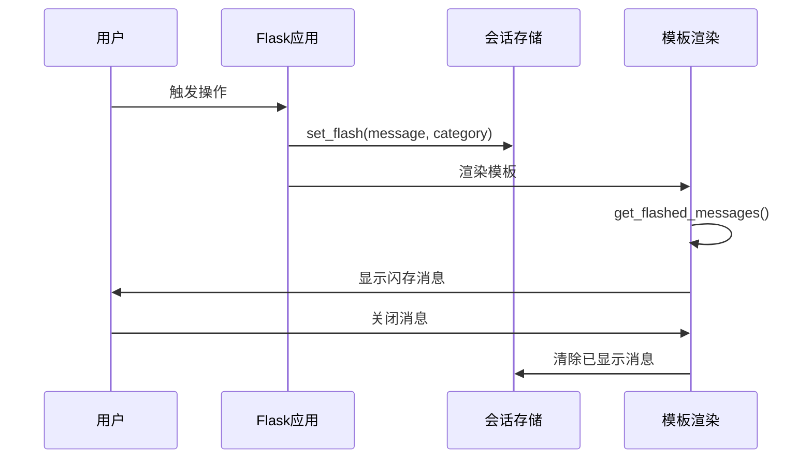
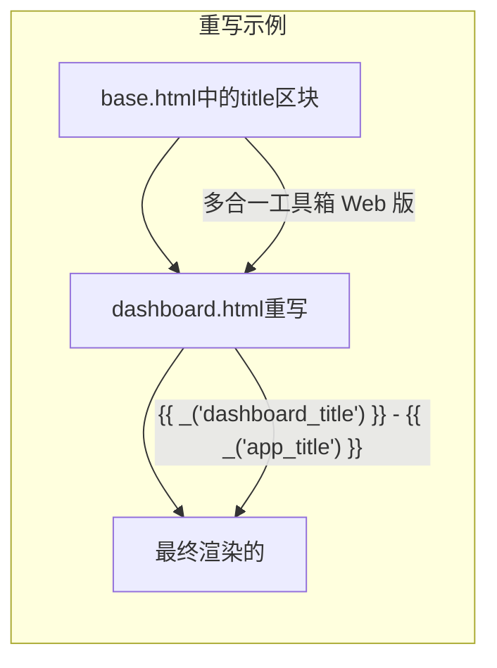
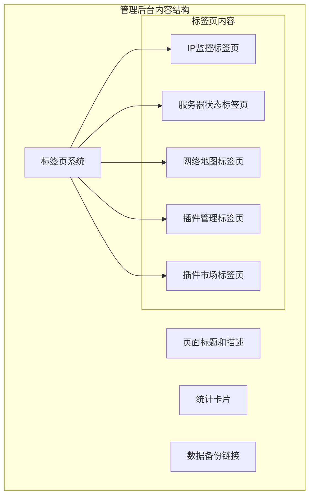
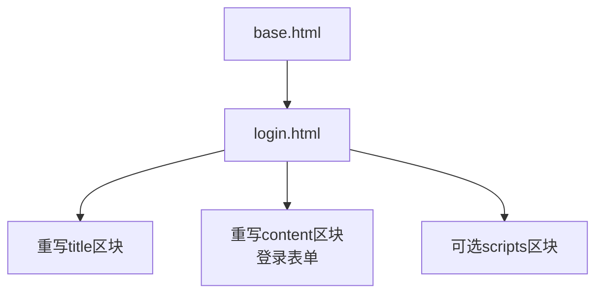
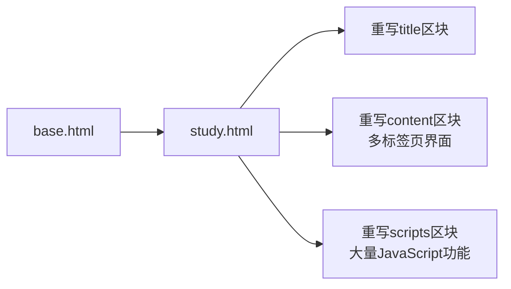
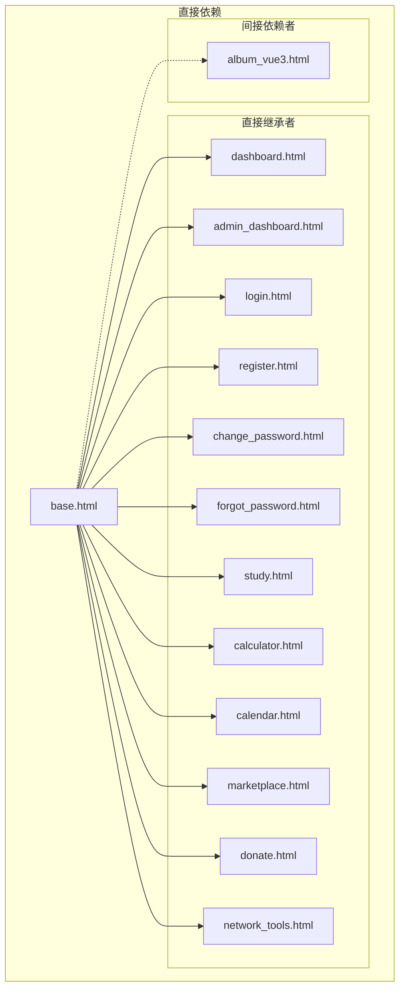

# 模板继承机制

<cite>
**本文档引用的文件**
- [templates/base.html](file://templates/base.html)
- [templates/dashboard.html](file://templates/dashboard.html)
- [templates/admin_dashboard.html](file://templates/admin_dashboard.html)
- [templates/login.html](file://templates/login.html)
- [templates/register.html](file://templates/register.html)
- [templates/change_password.html](file://templates/change_password.html)
- [templates/forgot_password.html](file://templates/forgot_password.html)
- [templates/study.html](file://templates/study.html)
- [templates/calculator.html](file://templates/calculator.html)
- [templates/calendar.html](file://templates/calendar.html)
- [templates/marketplace.html](file://templates/marketplace.html)
- [templates/donate.html](file://templates/donate.html)
- [templates/network_tools.html](file://templates/network_tools.html)
- [templates/album_vue3.html](file://templates/album_vue3.html)
</cite>

## 目录
1. [引言](#引言)
2. [项目结构](#项目结构)
3. [核心组件](#核心组件)
4. [架构概览](#架构概览)
5. [详细组件分析](#详细组件分析)
6. [依赖分析](#依赖分析)
7. [性能考虑](#性能考虑)
8. [故障排除指南](#故障排除指南)
9. [结论](#结论)

## 引言

School_Web项目采用Jinja2模板引擎实现强大的模板继承机制。该机制允许开发者创建可复用的基础模板，并通过继承关系构建各种功能页面，实现了代码的模块化、可维护性和一致性。

本项目的核心设计理念是"基础模板 + 子模板"的继承模式，其中base.html作为所有页面的基础模板，定义了统一的HTML结构、样式和布局框架，而各个功能页面通过继承base.html来获得一致的外观和行为。

## 项目结构

项目采用清晰的模板组织结构，所有模板文件都位于`templates/`目录下：



**图表来源**
- [templates/base.html](file://templates/base.html)
- [templates/dashboard.html](file://templates/dashboard.html)
- [templates/admin_dashboard.html](file://templates/admin_dashboard.html)

**章节来源**
- [templates/base.html](file://templates/base.html)
- [templates/dashboard.html](file://templates/dashboard.html)

## 核心组件

### 基础模板设计

base.html是整个模板系统的基石，它定义了完整的HTML骨架和通用布局结构：

#### 核心结构元素

1. **HTML文档结构**
   - 完整的DOCTYPE声明和HTML5语义标记
   - 国际化支持（lang属性设置为zh-CN）
   - 响应式设计基础（viewport配置）

2. **头部区域**
   - 动态标题块（...）
   - Bootstrap 5.3.3 CSS框架集成
   - 自定义CSS变量和主题支持
   - CSP nonce安全策略支持

3. **主体结构**
   - 导航栏（包含品牌标识、主题切换、语言切换）
   - 闪存消息系统（Flash Messages）
   - 主要内容区域（...）
   - 插件注入点（plugin_footer_blocks）
   - 页脚免责声明
   - 脚本区域（...）

#### 关键区块定义

```mermaid
flowchart TD
Start[模板开始] --> Head[头部区域]
Head --> TitleBlock[标题区块<br/>...]
Head --> StyleBlock[样式区块<br/>自定义CSS变量]
Start --> Body[主体区域]
Body --> Nav[导航栏]
Body --> Flash[闪存消息]
Body --> Content[内容区块<br/>...]
Body --> Plugin[插件注入<br/>plugin_footer_blocks]
Body --> Footer[页脚免责声明]
Body --> Scripts[脚本区块<br/>...]
TitleBlock --> Content
StyleBlock --> Content
```

**图表来源**
- [templates/base.html](file://templates/base.html)

**章节来源**
- [templates/base.html](file://templates/base.html)

## 架构概览

### 模板继承层次结构

School_Web项目实现了清晰的模板继承层次，从基础模板到具体页面形成了完整的继承链：



**图表来源**
- [templates/base.html](file://templates/base.html)
- [templates/login.html](file://templates/login.html)
- [templates/register.html](file://templates/register.html)
- [templates/dashboard.html](file://templates/dashboard.html)

### 继承关系分析

每个子模板都通过``指令继承基础模板，然后根据需要重写特定的区块：

1. **强制重写区块**
   - `title`区块：定义页面特定的标题
   - `content`区块：定义页面主要内容

2. **可选重写区块**
   - `scripts`区块：定义页面特定的JavaScript代码

3. **继承特性**
   - 子模板可以完全替换父模板的区块内容
   - 子模板可以调用父模板的区块内容（通过super()函数）
   - 子模板可以添加额外的区块

**章节来源**
- [templates/login.html](file://templates/login.html)
- [templates/register.html](file://templates/register.html)
- [templates/dashboard.html](file://templates/dashboard.html)
- [templates/admin_dashboard.html](file://templates/admin_dashboard.html)

## 详细组件分析

### 基础模板（base.html）深度解析

#### 导航栏系统

导航栏是base.html的核心组成部分，提供了统一的用户界面元素：



**图表来源**
- [templates/base.html](file://templates/base.html)

#### 闪存消息系统

闪存消息提供了临时性的用户反馈机制：



**图表来源**
- [templates/base.html](file://templates/base.html)

**章节来源**
- [templates/base.html](file://templates/base.html)

### 仪表盘页面（dashboard.html）

dashboard.html展示了模板继承的最佳实践：

#### 标题重写机制



**图表来源**
- [templates/dashboard.html](file://templates/dashboard.html)

#### 内容区块组织

dashboard.html的内容区块包含了丰富的UI组件：

1. **用户欢迎信息**
   - 用户名显示
   - 权限徽章
   - 动态问候语

2. **排行榜展示**
   - 活跃度排名
   - 用户分数
   - 排名变化

3. **功能卡片网格**
   - 响应式布局（Bootstrap Grid）
   - 权限控制的卡片显示
   - 动态链接生成

4. **交互式功能**
   - 管理员申请功能
   - VIP申请功能
   - Web跳转对话框

**章节来源**
- [templates/dashboard.html](file://templates/dashboard.html)

### 管理后台页面（admin_dashboard.html）

admin_dashboard.html体现了复杂页面的模板继承：

#### 多样化内容组织



**图表来源**
- [templates/admin_dashboard.html](file://templates/admin_dashboard.html)

#### 高级JavaScript集成

管理后台页面集成了大量的JavaScript功能：

1. **实时数据更新**
   - IP统计自动刷新
   - 服务器状态定时更新
   - 实时通知轮询

2. **复杂的前端交互**
   - Canvas绘图（网络地图）
   - SVG图形（仪表盘）
   - 表格操作（IP管理）

3. **状态持久化**
   - localStorage数据存储
   - 页面状态恢复
   - 用户偏好设置

**章节来源**
- [templates/admin_dashboard.html](file://templates/admin_dashboard.html)

### 认证相关页面

#### 登录页面（login.html）

登录页面展示了最小化的模板继承：



**图表来源**
- [templates/login.html](file://templates/login.html)

#### 注册页面（register.html）

注册页面提供了更完整的表单处理：

1. **密码强度验证**
   - 实时密码强度检测
   - 可视化强度指示器
   - 用户体验优化

2. **管理员密码选项**
   - 可选的管理员权限
   - 安全性考虑

**章节来源**
- [templates/login.html](file://templates/login.html)
- [templates/register.html](file://templates/register.html)

### 功能页面模板

#### 学习工具页面（study.html）

study.html展示了复杂页面的模板继承：



**图表来源**
- [templates/study.html](file://templates/study.html)

#### 计算器页面（calculator.html）

计算器页面体现了简洁模板继承：

1. **导航辅助**
   - 计算器类型导航
   - 返回仪表盘链接

2. **简单内容结构**
   - 单一功能的计算器界面
   - 内联JavaScript实现

**章节来源**
- [templates/study.html](file://templates/study.html)
- [templates/calculator.html](file://templates/calculator.html)

## 依赖分析

### 模板依赖关系



**图表来源**
- [templates/base.html](file://templates/base.html)
- [templates/dashboard.html](file://templates/dashboard.html)

### 组件耦合度分析

1. **低耦合高内聚**
   - 每个子模板只关注自己的特定功能
   - 基础模板提供通用基础设施
   - 模板间无直接依赖关系

2. **扩展性设计**
   - 新增页面只需继承base.html
   - 区块重写机制灵活
   - 插件注入点支持功能扩展

3. **维护性优势**
   - 基础样式和布局集中管理
   - 全局主题切换支持
   - 统一的安全策略

**章节来源**
- [templates/base.html](file://templates/base.html)
- [templates/dashboard.html](file://templates/dashboard.html)

## 性能考虑

### 模板渲染优化

1. **静态资源管理**
   - Bootstrap CDN使用减少本地带宽
   - CSS变量避免重复样式定义
   - JavaScript按需加载

2. **内存使用优化**
   - localStorage数据持久化
   - 事件委托减少内存占用
   - 按需DOM操作

3. **网络性能**
   - CDN加速静态资源
   - 响应式图片优化
   - 减少HTTP请求

### 模板继承性能

1. **编译时优化**
   - Jinja2模板预编译
   - 缓存机制利用
   - 模板查找优化

2. **运行时效率**
   - 区块重写避免重复代码
   - 条件渲染减少DOM节点
   - 动态内容懒加载

## 故障排除指南

### 常见问题诊断

#### 模板继承问题

1. **区块未正确重写**
   - 检查``语法
   - 确认区块标签匹配
   - 验证模板路径正确性

2. **变量访问错误**
   - 检查上下文变量传递
   - 验证CSRF令牌存在
   - 确认国际化函数可用

#### JavaScript集成问题

1. **脚本执行顺序**
   - 确保base.html脚本在子模板之前
   - 检查CSP nonce配置
   - 验证jQuery依赖加载

2. **动态内容加载**
   - 检查AJAX请求配置
   - 验证API端点可用性
   - 确认跨域设置正确

**章节来源**
- [templates/base.html](file://templates/base.html)
- [templates/dashboard.html](file://templates/dashboard.html)

## 结论

School_Web项目的模板继承机制展现了现代Web开发的最佳实践：

### 设计优势

1. **代码复用最大化**
   - 基础模板提供统一基础设施
   - 子模板专注于业务逻辑
   - 减少重复代码编写

2. **维护性卓越**
   - 集中式样式和布局管理
   - 统一的用户体验
   - 简化的升级流程

3. **扩展性强**
   - 灵活的区块重写机制
   - 插件系统支持
   - 多种页面类型适配

### 最佳实践总结

1. **命名规范**
   - 使用语义化的模板名称
   - 区块命名保持一致性
   - 文件组织遵循功能分组

2. **区块设计**
   - 明确区分必需和可选区块
   - 合理组织内容结构
   - 考虑SEO和可访问性

3. **性能优化**
   - 合理使用静态资源
   - 优化JavaScript加载
   - 实施缓存策略

该模板继承机制为School_Web项目提供了坚实的技术基础，确保了系统的可维护性、可扩展性和用户体验的一致性。通过遵循这些最佳实践，开发者可以轻松地扩展和维护这个复杂的Web应用程序。