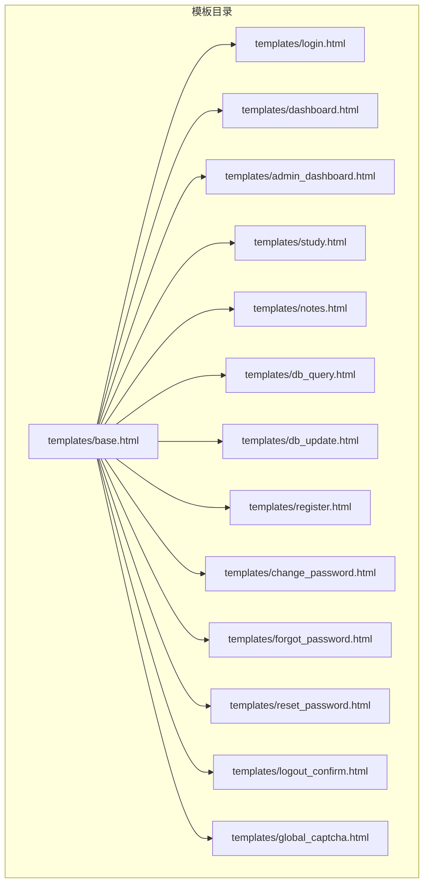
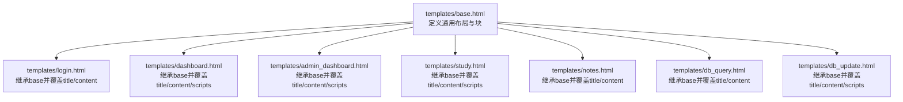
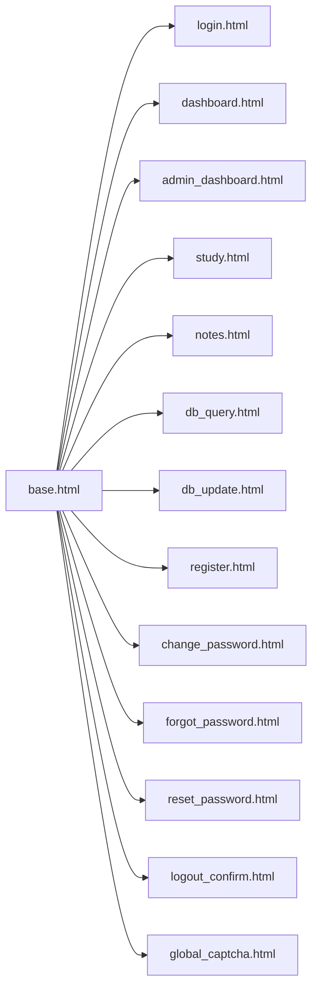

# 模板语法基础

<cite>
**本文档引用的文件**
- [templates/base.html](file://templates/base.html)
- [templates/login.html](file://templates/login.html)
- [templates/dashboard.html](file://templates/dashboard.html)
- [templates/admin_dashboard.html](file://templates/admin_dashboard.html)
- [templates/db_query.html](file://templates/db_query.html)
- [templates/db_update.html](file://templates/db_update.html)
- [templates/study.html](file://templates/study.html)
- [templates/notes.html](file://templates/notes.html)
- [templates/register.html](file://templates/register.html)
- [templates/change_password.html](file://templates/change_password.html)
- [templates/forgot_password.html](file://templates/forgot_password.html)
- [templates/reset_password.html](file://templates/reset_password.html)
- [templates/logout_confirm.html](file://templates/logout_confirm.html)
- [templates/global_captcha.html](file://templates/global_captcha.html)
</cite>

## 目录
1. [引言](#引言)
2. [项目结构](#项目结构)
3. [核心组件](#核心组件)
4. [架构概览](#架构概览)
5. [详细组件分析](#详细组件分析)
6. [依赖分析](#依赖分析)
7. [性能考虑](#性能考虑)
8. [故障排除指南](#故障排除指南)
9. [结论](#结论)

## 引言
本文件面向School_Web项目的模板语法基础，系统性梳理Jinja2模板在项目中的使用实践，覆盖变量插值、控制结构、过滤器、模板继承与块定义、注释语法等核心要素，并结合真实模板文件展示常见用法与最佳实践。

## 项目结构
School_Web采用前后端分离与服务端渲染相结合的方式，前端主要由Vue单页应用构成，模板系统集中在后端，使用Jinja2渲染HTML页面。模板文件位于templates目录，基础布局模板base.html定义了通用结构与块，各功能页面通过extends继承并在相应block中填充内容。

图表来源
- [templates/base.html](file://templates/base.html)
- [templates/login.html](file://templates/login.html)
- [templates/dashboard.html](file://templates/dashboard.html)
- [templates/admin_dashboard.html](file://templates/admin_dashboard.html)
- [templates/study.html](file://templates/study.html)
- [templates/notes.html](file://templates/notes.html)
- [templates/db_query.html](file://templates/db_query.html)
- [templates/db_update.html](file://templates/db_update.html)
- [templates/register.html](file://templates/register.html)
- [templates/change_password.html](file://templates/change_password.html)
- [templates/forgot_password.html](file://templates/forgot_password.html)
- [templates/reset_password.html](file://templates/reset_password.html)
- [templates/logout_confirm.html](file://templates/logout_confirm.html)
- [templates/global_captcha.html](file://templates/global_captcha.html)

章节来源
- [templates/base.html](file://templates/base.html)
- [templates/login.html](file://templates/login.html)
- [templates/dashboard.html](file://templates/dashboard.html)
- [templates/admin_dashboard.html](file://templates/admin_dashboard.html)
- [templates/study.html](file://templates/study.html)
- [templates/notes.html](file://templates/notes.html)
- [templates/db_query.html](file://templates/db_query.html)
- [templates/db_update.html](file://templates/db_update.html)
- [templates/register.html](file://templates/register.html)
- [templates/change_password.html](file://templates/change_password.html)
- [templates/forgot_password.html](file://templates/forgot_password.html)
- [templates/reset_password.html](file://templates/reset_password.html)
- [templates/logout_confirm.html](file://templates/logout_confirm.html)
- [templates/global_captcha.html](file://templates/global_captcha.html)

## 核心组件
本节聚焦Jinja2模板语法在School_Web中的关键用法与数据类型处理：

- 变量插值与数据类型
  - 字符串与标量：如页面标题、用户名称、权限标识等，直接通过{{ ... }}输出。
  - 结构化数据：字典、列表、对象属性等，通过点号或方括号访问字段；模板中常见如session.username、leaderboard列表项、profile对象等。
  - 函数调用：如url_for('endpoint')生成路由链接、lang_name(lang)获取语言显示名、csrf_token等。
  - 国际化：使用_()函数进行本地化字符串处理，如_('login_title')、_('dashboard_hello')等。

- 控制结构
  - 条件判断：...用于根据布尔表达式或变量存在性决定渲染内容；支持与。
  - 循环遍历：...用于迭代列表或字典；模板中广泛用于渲染导航语言列表、通知列表、数据库表列与行等。
  - 嵌套循环：在表格渲染中常见，外层遍历行，内层遍历单元格，实现二维数据展示。
  - with语句：...用于临时绑定变量，如获取flash消息列表并逐条渲染。

- 过滤器
  - 安全过滤：|safe用于标记HTML片段无需转义，如插件注入块中使用{{ block.template | safe }}。
  - 长度过滤：|length用于计算序列长度，如在表格渲染中计算列数。
  - 其他常用过滤：|upper、|lower、|title等（具体使用取决于上下文）。

- 注释语法
  - 模板注释：{# ... #}用于注释模板代码，不影响最终渲染输出，便于维护与调试。

- 模板继承与块定义
  - extends：子模板通过继承基础布局。
  - block：子模板通过...、...、...覆盖父模板中的对应块，实现差异化内容与脚本注入。

章节来源
- [templates/base.html](file://templates/base.html)
- [templates/dashboard.html](file://templates/dashboard.html)
- [templates/admin_dashboard.html](file://templates/admin_dashboard.html)
- [templates/db_query.html](file://templates/db_query.html)
- [templates/db_update.html](file://templates/db_update.html)
- [templates/study.html](file://templates/study.html)
- [templates/notes.html](file://templates/notes.html)
- [templates/login.html](file://templates/login.html)
- [templates/register.html](file://templates/register.html)
- [templates/change_password.html](file://templates/change_password.html)
- [templates/forgot_password.html](file://templates/forgot_password.html)
- [templates/reset_password.html](file://templates/reset_password.html)
- [templates/logout_confirm.html](file://templates/logout_confirm.html)
- [templates/global_captcha.html](file://templates/global_captcha.html)

## 架构概览
模板系统围绕base.html构建统一布局，子模板按需覆盖块并注入业务数据。下图展示了模板继承关系与典型数据流：

图表来源
- [templates/base.html](file://templates/base.html)
- [templates/login.html](file://templates/login.html)
- [templates/dashboard.html](file://templates/dashboard.html)
- [templates/admin_dashboard.html](file://templates/admin_dashboard.html)
- [templates/study.html](file://templates/study.html)
- [templates/notes.html](file://templates/notes.html)
- [templates/db_query.html](file://templates/db_query.html)
- [templates/db_update.html](file://templates/db_update.html)

## 详细组件分析

### 变量插值与数据类型处理
- 字符串与标量
  - 页面标题与品牌名：如{{ _('app_brand') }}、{{ _('login_title') }}等。
  - 用户信息：如{{ session.username }}、{{ username }}、{{ permission }}等。
  - 链接与令牌：如{{ url_for('login') }}、{{ csrf_token }}等。
- 结构化数据
  - 列表渲染：如语言列表、通知列表、数据库表列表等。
  - 字典/对象访问：如leaderboard中项的字段、profile对象的属性等。
- 函数与国际化
  - 路由生成：url_for('endpoint')。
  - 本地化：_('key')。
  - 辅助函数：lang_name(lang)等。

章节来源
- [templates/base.html](file://templates/base.html)
- [templates/login.html](file://templates/login.html)
- [templates/dashboard.html](file://templates/dashboard.html)
- [templates/admin_dashboard.html](file://templates/admin_dashboard.html)
- [templates/db_query.html](file://templates/db_query.html)
- [templates/db_update.html](file://templates/db_update.html)

### 控制结构详解
- 条件判断
  - 用户登录状态：...。
  - 权限判断：.........。
  - 列表存在性：...。
  - 成员资格：...。
- 循环与嵌套
  - 语言切换下拉菜单：...。
  - 通知列表：...。
  - 数据库表格：外层，内层...。
  - 学习工具标签页：渲染多个面板。
- with语句
  - 获取flash消息：...。

章节来源
- [templates/base.html](file://templates/base.html)
- [templates/dashboard.html](file://templates/dashboard.html)
- [templates/admin_dashboard.html](file://templates/admin_dashboard.html)
- [templates/db_query.html](file://templates/db_query.html)
- [templates/study.html](file://templates/study.html)

### 过滤器使用
- 安全过滤：|safe用于避免HTML转义，如插件注入块中使用{{ block.template | safe }}。
- 长度过滤：|length用于计算列数，如在表格渲染中使用{{ columns|length }}。
- 其他常用过滤：|upper、|lower、|title等（依据具体上下文使用）。

章节来源
- [templates/base.html](file://templates/base.html)
- [templates/db_query.html](file://templates/db_query.html)

### 注释语法
- 模板注释：{# ... #}用于注释模板代码，不影响最终渲染输出，便于维护与调试。

章节来源
- [templates/base.html](file://templates/base.html)

### 模板继承与块定义
- 继承：子模板通过继承基础布局。
- 覆盖块：title、content、scripts等块在子模板中被覆盖，实现差异化内容与脚本注入。
- 块嵌套：子模板在覆盖content块的同时，内部仍可使用注入特定脚本。

章节来源
- [templates/base.html](file://templates/base.html)
- [templates/login.html](file://templates/login.html)
- [templates/dashboard.html](file://templates/dashboard.html)
- [templates/admin_dashboard.html](file://templates/admin_dashboard.html)
- [templates/study.html](file://templates/study.html)
- [templates/notes.html](file://templates/notes.html)
- [templates/db_query.html](file://templates/db_query.html)
- [templates/db_update.html](file://templates/db_update.html)
- [templates/register.html](file://templates/register.html)
- [templates/change_password.html](file://templates/change_password.html)
- [templates/forgot_password.html](file://templates/forgot_password.html)
- [templates/reset_password.html](file://templates/reset_password.html)
- [templates/logout_confirm.html](file://templates/logout_confirm.html)
- [templates/global_captcha.html](file://templates/global_captcha.html)

### 实际用法示例路径
- 变量插值与国际化
  - [templates/base.html](file://templates/base.html)
  - [templates/login.html](file://templates/login.html)
  - [templates/dashboard.html](file://templates/dashboard.html)
- 条件判断
  - [templates/base.html](file://templates/base.html)
  - [templates/dashboard.html](file://templates/dashboard.html)
  - [templates/admin_dashboard.html](file://templates/admin_dashboard.html)
- 循环与嵌套
  - [templates/base.html](file://templates/base.html)
  - [templates/db_query.html](file://templates/db_query.html)
  - [templates/study.html](file://templates/study.html)
- 过滤器
  - [templates/base.html](file://templates/base.html)
  - [templates/db_query.html](file://templates/db_query.html)
- 注释
  - [templates/base.html](file://templates/base.html)
- 模板继承
  - [templates/base.html](file://templates/base.html)
  - [templates/login.html](file://templates/login.html)
  - [templates/dashboard.html](file://templates/dashboard.html)
  - [templates/admin_dashboard.html](file://templates/admin_dashboard.html)
  - [templates/study.html](file://templates/study.html)
  - [templates/notes.html](file://templates/notes.html)
  - [templates/db_query.html](file://templates/db_query.html)
  - [templates/db_update.html](file://templates/db_update.html)
  - [templates/register.html](file://templates/register.html)
  - [templates/change_password.html](file://templates/change_password.html)
  - [templates/forgot_password.html](file://templates/forgot_password.html)
  - [templates/reset_password.html](file://templates/reset_password.html)
  - [templates/logout_confirm.html](file://templates/logout_confirm.html)
  - [templates/global_captcha.html](file://templates/global_captcha.html)

## 依赖分析
- 模板间依赖
  - 所有页面均继承自base.html，形成统一布局与块接口。
  - 子模板通过url_for()生成路由链接，依赖后端路由定义。
  - 子模板通过_('key')进行本地化，依赖i18n资源。
- 数据依赖
  - 子模板依赖后端传入的数据上下文，如session、username、permission、leaderboard、tables等。
  - 插件注入块依赖后端提供的plugin_footer_blocks集合。

图表来源
- [templates/base.html](file://templates/base.html)
- [templates/login.html](file://templates/login.html)
- [templates/dashboard.html](file://templates/dashboard.html)
- [templates/admin_dashboard.html](file://templates/admin_dashboard.html)
- [templates/study.html](file://templates/study.html)
- [templates/notes.html](file://templates/notes.html)
- [templates/db_query.html](file://templates/db_query.html)
- [templates/db_update.html](file://templates/db_update.html)
- [templates/register.html](file://templates/register.html)
- [templates/change_password.html](file://templates/change_password.html)
- [templates/forgot_password.html](file://templates/forgot_password.html)
- [templates/reset_password.html](file://templates/reset_password.html)
- [templates/logout_confirm.html](file://templates/logout_confirm.html)
- [templates/global_captcha.html](file://templates/global_captcha.html)

## 性能考虑
- 模板渲染性能
  - 避免在模板中执行复杂计算，尽量在后端预处理数据。
  - 合理使用过滤器，避免重复计算（如多次使用同一过滤器时可先在后端缓存结果）。
- 循环优化
  - 对于大型列表，优先在后端分页或截断，减少模板渲染负担。
  - 在嵌套循环中注意数据规模，必要时进行降维或延迟渲染。
- 安全与转义
  - 对外部输入或动态HTML使用|safe时务必确保内容可信，防止XSS风险。
  - 使用默认转义机制保护用户输入，仅在确有必要时使用|safe。

## 故障排除指南
- 模板继承问题
  - 症状：子模板无法覆盖块或布局错乱。
  - 排查：确认extends语法正确且块名一致；检查是否有重复或拼写错误。
- 变量未定义
  - 症状：{{ variable }}显示为空或报错。
  - 排查：确认后端上下文是否传递了该变量；检查变量作用域与命名空间。
- 条件渲染异常
  - 症状：if条件不生效或分支错误。
  - 排查：检查布尔表达式与比较运算符；确认变量类型与值。
- 循环渲染问题
  - 症状：for循环未渲染或渲染异常。
  - 排查：确认迭代对象非空且类型正确；检查嵌套循环索引与边界。
- 过滤器错误
  - 症状：|safe导致XSS或|length报错。
  - 排查：确保|safe仅用于可信HTML；确认过滤器参数类型匹配。
- 本地化字符串缺失
  - 症状：_('key')未翻译或显示原文。
  - 排查：确认i18n资源中存在该键；检查语言环境设置。

章节来源
- [templates/base.html](file://templates/base.html)
- [templates/dashboard.html](file://templates/dashboard.html)
- [templates/admin_dashboard.html](file://templates/admin_dashboard.html)
- [templates/db_query.html](file://templates/db_query.html)
- [templates/db_update.html](file://templates/db_update.html)

## 结论
School_Web的模板系统以Jinja2为核心，通过base.html统一布局与块接口，配合丰富的变量插值、控制结构、过滤器与模板继承，实现了高度模块化与可维护的页面渲染体系。遵循本文档的语法规范与最佳实践，可在保证安全性与性能的前提下，高效构建复杂的Web界面。