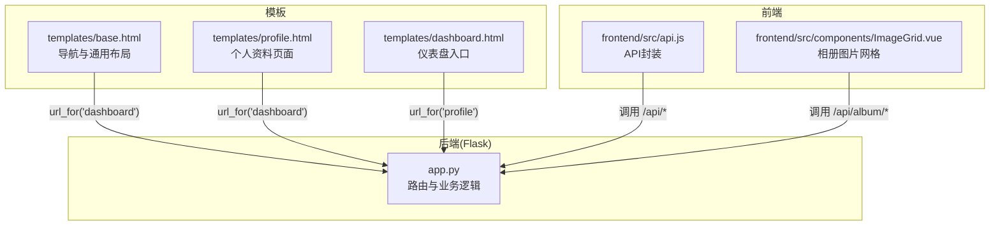
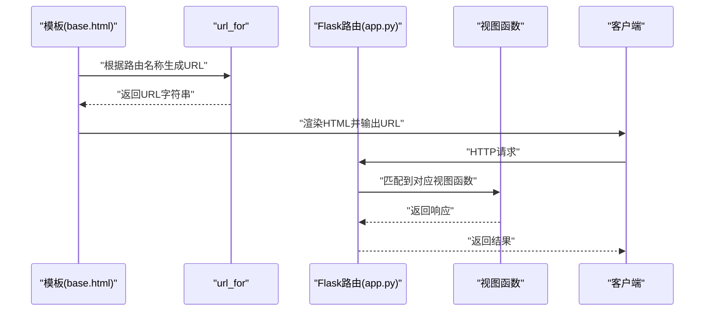
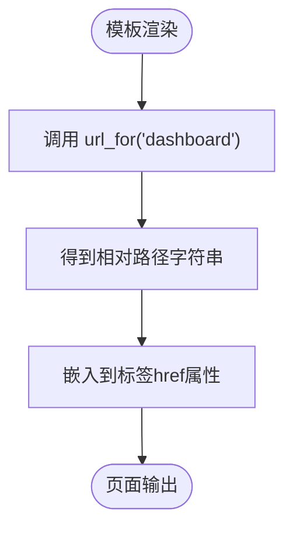
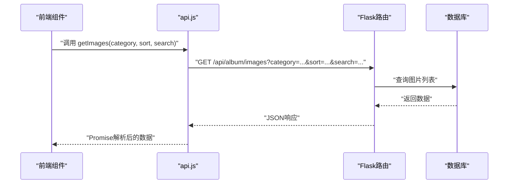
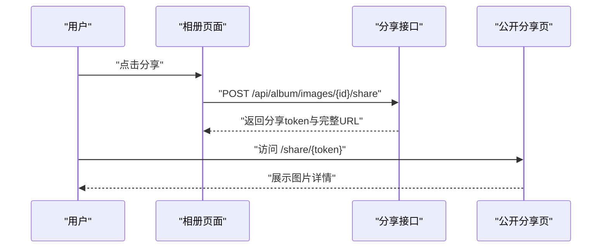
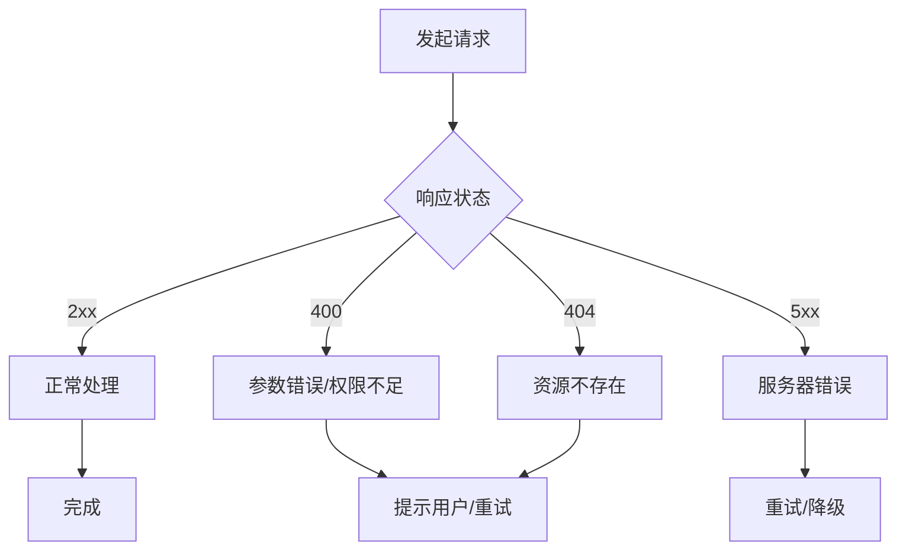
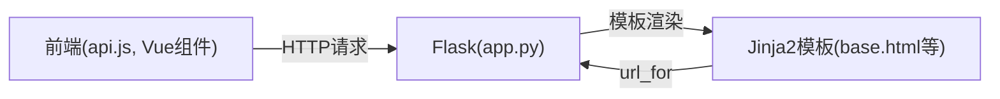

# URL生成与反向解析

<cite>
**本文引用的文件**
- [app.py](file://app.py)
- [base.html](file://templates/base.html)
- [profile.html](file://templates/profile.html)
- [dashboard.html](file://templates/dashboard.html)
- [api.js](file://frontend/src/api.js)
- [ImageGrid.vue](file://frontend/src/components/ImageGrid.vue)
- [requirements.txt](file://requirements.txt)
</cite>

## 目录
1. [简介](#简介)
2. [项目结构](#项目结构)
3. [核心组件](#核心组件)
4. [架构总览](#架构总览)
5. [详细组件分析](#详细组件分析)
6. [依赖分析](#依赖分析)
7. [性能考虑](#性能考虑)
8. [故障排查指南](#故障排查指南)
9. [结论](#结论)
10. [附录](#附录)

## 简介
本文件围绕School_Web项目中的Flask URL生成与反向解析进行系统性说明，重点涵盖：
- 基于路由名称生成URL的机制与最佳实践
- 参数传递、查询字符串处理与类型转换
- 动态URL生成在用户个人页面、文件下载链接、API端点等场景的应用
- 错误处理与异常情况的应对策略

## 项目结构
School_Web采用Flask框架，路由定义集中在后端Python文件中，前端交互通过Vue组件与后端API协作。模板中广泛使用url_for进行反向解析，保证路由变更时的稳定性。

图表来源
- [app.py](file://app.py)
- [base.html](file://templates/base.html)
- [profile.html](file://templates/profile.html)
- [dashboard.html](file://templates/dashboard.html)
- [api.js](file://frontend/src/api.js)
- [ImageGrid.vue](file://frontend/src/components/ImageGrid.vue)

章节来源
- [app.py](file://app.py)
- [base.html](file://templates/base.html)
- [profile.html](file://templates/profile.html)
- [dashboard.html](file://templates/dashboard.html)
- [api.js](file://frontend/src/api.js)
- [ImageGrid.vue](file://frontend/src/components/ImageGrid.vue)

## 核心组件
- Flask应用与路由系统：集中于app.py，包含大量以@app.route装饰器定义的路由，覆盖认证、相册、网络工具、数据库管理、插件市场等模块。
- 模板中的URL生成：在base.html等模板中使用url_for根据路由名称生成URL，避免硬编码路径带来的维护成本。
- 前端API封装：前端通过api.js统一发起请求，内部拼接/api前缀，减少重复代码。

章节来源
- [app.py](file://app.py)
- [base.html](file://templates/base.html)
- [api.js](file://frontend/src/api.js)

## 架构总览
下图展示了从模板到后端路由的关键交互流程，体现URL生成与反向解析在系统中的位置与作用。

图表来源
- [base.html](file://templates/base.html)
- [app.py](file://app.py)

## 详细组件分析

### 1) 基于路由名称生成URL
- 模板侧使用url_for('route_name')生成相对或绝对路径，确保在路由重构时保持一致性。
- 示例涉及的路由名称包括：dashboard、profile、logout、login等。

图表来源
- [base.html](file://templates/base.html)
- [profile.html](file://templates/profile.html)
- [dashboard.html](file://templates/dashboard.html)

章节来源
- [base.html](file://templates/base.html)
- [profile.html](file://templates/profile.html)
- [dashboard.html](file://templates/dashboard.html)

### 2) 参数传递与查询字符串处理
- 强类型参数：部分路由使用类型转换装饰器，如<int:img_id>，确保传入参数符合预期类型。
- 查询字符串：前端通过fetch携带查询参数，后端使用request.args获取。
- 实际示例：
  - 相册图片下载：/api/album/images/<int:img_id>/download
  - 相册图片列表：/api/album/images?category=...&sort=...&search=...
  - 通知轮询：/api/notifications?since=...

图表来源
- [api.js](file://frontend/src/api.js)
- [ImageGrid.vue](file://frontend/src/components/ImageGrid.vue)
- [app.py](file://app.py)

章节来源
- [api.js](file://frontend/src/api.js)
- [ImageGrid.vue](file://frontend/src/components/ImageGrid.vue)
- [app.py](file://app.py)

### 3) 动态URL生成场景
- 用户个人页面：profile路由，模板中通过url_for('dashboard')返回仪表盘。
- 文件下载链接：/api/album/images/<int:img_id>/download，结合send_from_directory实现安全下载。
- API端点：/api/album/images/<int:img_id>/share用于生成分享链接，/share/<token>用于公开访问。
- 备份下载：/api/backup/download/<path:filename>，使用path转换器匹配文件名。

图表来源
- [app.py](file://app.py)

章节来源
- [app.py](file://app.py)

### 4) 路由参数类型转换与验证
- int转换器：如<int:img_id>，确保img_id为整数，否则404。
- path转换器：如<path:filename>，允许路径分隔符，适合文件名。
- 查询参数类型：使用type=int等进行显式类型转换，避免字符串比较引发的错误。

章节来源
- [app.py](file://app.py)

### 5) SEO友好与相对/绝对路径选择
- 相对路径：导航与内部页面常用相对路径，简洁且便于部署迁移。
- 绝对路径：分享链接使用request.host_url拼接完整URL，提升可访问性与可复制性。
- 建议：
  - 内部导航使用相对路径配合url_for，降低耦合。
  - 对外分享链接使用绝对路径，避免跨域与协议问题。

章节来源
- [app.py](file://app.py)

### 6) 错误处理与异常情况
- 404：当资源不存在（如图片、备份文件）时返回404。
- 400/403：参数缺失、权限不足、无效输入等情况返回相应状态码。
- 5xx：数据库连接失败、文件系统异常等返回500。
- 前端：对fetch失败与非2xx响应进行统一处理，提示用户或重定向。

图表来源
- [app.py](file://app.py)
- [api.js](file://frontend/src/api.js)

章节来源
- [app.py](file://app.py)
- [api.js](file://frontend/src/api.js)

## 依赖分析
- Flask版本要求：requirements.txt中指定Flask>=3.0，确保url_for与路由系统的稳定特性。
- 前后端交互：前端通过/api前缀统一访问后端路由，避免硬编码具体路径。

图表来源
- [requirements.txt](file://requirements.txt)
- [app.py](file://app.py)
- [base.html](file://templates/base.html)

章节来源
- [requirements.txt](file://requirements.txt)
- [app.py](file://app.py)
- [base.html](file://templates/base.html)

## 性能考虑
- 减少硬编码URL：使用url_for统一生成，降低维护成本与出错概率。
- 合理使用查询参数：避免过长的查询串，必要时改用POST或分页。
- 静态资源与API分离：静态资源走CDN或静态目录，API走后端路由，提高缓存命中率。

## 故障排查指南
- 路由名称错误：检查模板中url_for参数是否与@app.route定义的endpoint一致。
- 类型转换异常：确认URL中的参数类型与路由定义的转换器匹配。
- 权限与鉴权：某些API需登录或特定权限，检查会话与装饰器逻辑。
- 文件下载失败：核对文件路径、权限与安全校验逻辑。

章节来源
- [app.py](file://app.py)

## 结论
通过在模板中使用url_for与后端路由的强类型参数、查询字符串处理相结合，School_Web实现了高内聚、低耦合的URL生成与反向解析机制。遵循本文的最佳实践，可以在保证安全性的同时提升开发效率与用户体验。

## 附录
- 关键路由示例（节选）：
  - /profile → 个人资料
  - /api/album/images/<int:img_id>/download → 图片下载
  - /api/album/images/<int:img_id>/share → 生成分享链接
  - /share/<token> → 公开分享页
  - /api/backup/download/<path:filename> → 备份下载

章节来源
- [app.py](file://app.py)