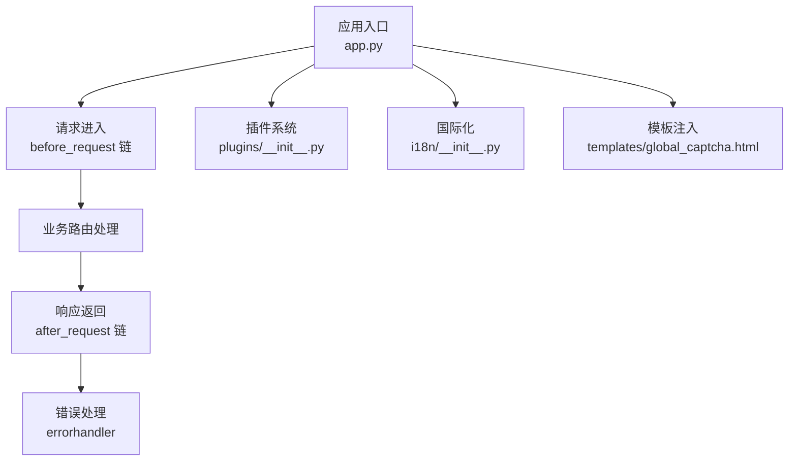
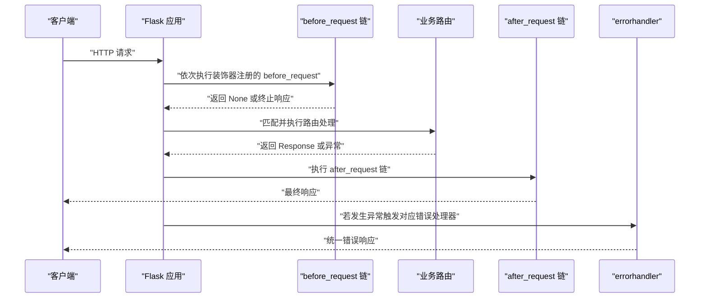
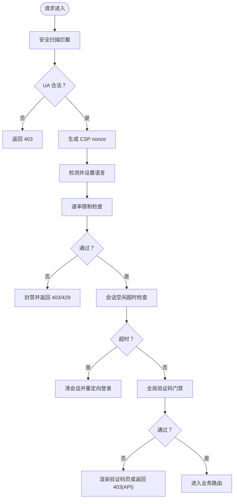
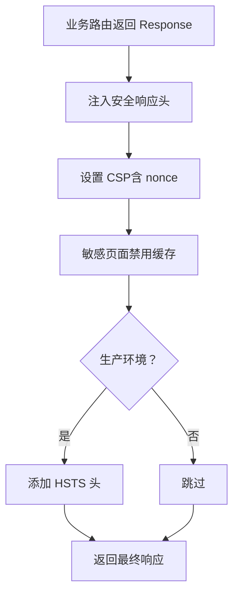
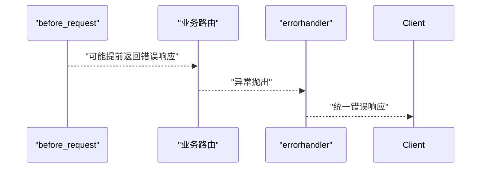
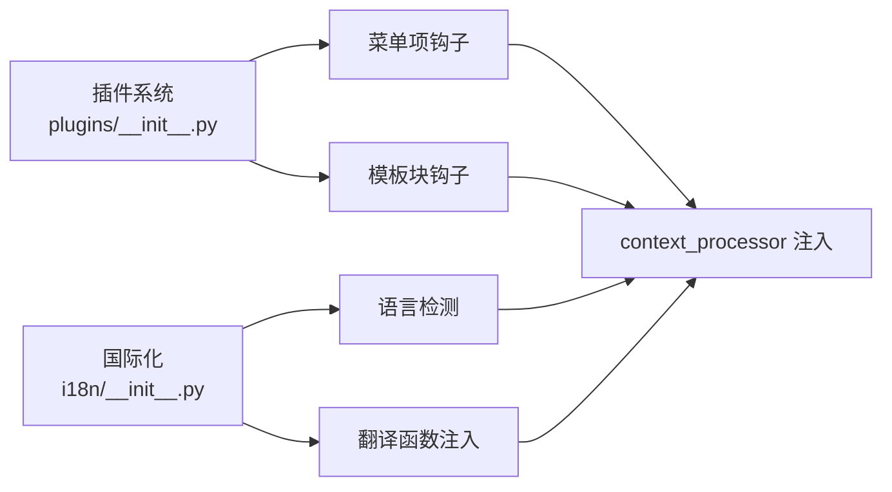
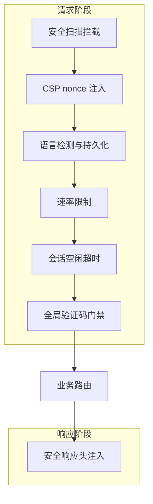
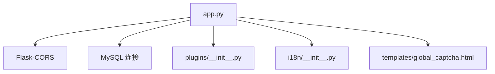

# 中间件机制

<cite>
**本文引用的文件**
- [app.py](file://app.py)
- [plugins/__init__.py](file://plugins/__init__.py)
- [i18n/__init__.py](file://i18n/__init__.py)
- [templates/global_captcha.html](file://templates/global_captcha.html)
</cite>

## 目录
1. [引言](#引言)
2. [项目结构](#项目结构)
3. [核心组件](#核心组件)
4. [架构总览](#架构总览)
5. [详细组件分析](#详细组件分析)
6. [依赖分析](#依赖分析)
7. [性能考虑](#性能考虑)
8. [故障排查指南](#故障排查指南)
9. [结论](#结论)
10. [附录](#附录)

## 引言
本文件围绕 School_Web 的路由中间件机制展开，系统性阐述 Flask 的 before_request、after_request、errorhandler 等钩子与全局中间件的实现方式，重点说明请求预处理、响应后处理、异常处理的执行顺序与依赖关系，并给出身份验证、日志记录、CORS、CSRF、速率限制、国际化等实际中间件的实现思路与最佳实践。文档同时提供可视化图示与路径级“代码片段”指引，便于读者快速定位实现细节。

## 项目结构
School_Web 的中间件能力主要集中在后端应用入口文件中，通过装饰器注册的钩子函数形成“全局中间件层”，配合插件系统与国际化模块，实现跨路由的一致行为控制与上下文注入。

图表来源
- [app.py:149-173](file://app.py#L149-L173)
- [app.py:641-676](file://app.py#L641-L676)
- [app.py:4315-4332](file://app.py#L4315-L4332)
- [plugins/__init__.py:1-249](file://plugins/__init__.py#L1-L249)
- [i18n/__init__.py:1-113](file://i18n/__init__.py#L1-L113)
- [templates/global_captcha.html:1-22](file://templates/global_captcha.html#L1-L22)

章节来源
- [app.py:131-139](file://app.py#L131-L139)
- [app.py:149-173](file://app.py#L149-L173)
- [app.py:641-676](file://app.py#L641-L676)
- [app.py:4315-4332](file://app.py#L4315-L4332)
- [plugins/__init__.py:1-249](file://plugins/__init__.py#L1-L249)
- [i18n/__init__.py:1-113](file://i18n/__init__.py#L1-L113)
- [templates/global_captcha.html:1-22](file://templates/global_captcha.html#L1-L22)

## 核心组件
- 请求预处理（全局中间件）
  - 安全扫描拦截、CSP nonce 注入、语言检测与持久化、速率限制、会话空闲超时、全局验证码门禁等。
- 响应后处理（全局中间件）
  - 安全响应头注入、HTML 缓存策略、HSTS 等。
- 错误处理（全局中间件）
  - 统一 404/500/403 响应格式，区分 API 与页面场景。
- 插件系统与国际化
  - 插件钩子注册与模板注入，为中间件扩展提供机制；国际化模块提供语言检测与翻译函数注入。

章节来源
- [app.py:149-173](file://app.py#L149-L173)
- [app.py:513-593](file://app.py#L513-L593)
- [app.py:641-676](file://app.py#L641-L676)
- [app.py:4315-4332](file://app.py#L4315-L4332)
- [plugins/__init__.py:16-249](file://plugins/__init__.py#L16-L249)
- [i18n/__init__.py:50-108](file://i18n/__init__.py#L50-L108)

## 架构总览
下图展示了请求生命周期中各中间件的执行顺序与职责边界：

图表来源
- [app.py:149-173](file://app.py#L149-L173)
- [app.py:513-593](file://app.py#L513-L593)
- [app.py:641-676](file://app.py#L641-L676)
- [app.py:4315-4332](file://app.py#L4315-L4332)

## 详细组件分析

### 1) 请求预处理中间件链
- 安全扫描拦截
  - 通过 User-Agent 黑名单拦截常见扫描器，直接返回 403。
- CSP nonce 注入
  - 为每个请求生成随机 nonce，注入 g 对象，供模板与 CSP 策略使用。
- 多语言支持
  - 检测并设置当前语言，必要时持久化到数据库。
- 速率限制（IP 维度）
  - 静态资源与特定前缀跳过；白名单与手动封禁优先；基于滑动窗口与队列记录请求，超限封禁并记录最近封禁。
- 会话空闲超时
  - 对已登录用户，若 IP 超过阈值无活动，强制清会话并重定向登录。
- 全局验证码门禁
  - 已登录用户访问受限资源需完成验证码校验，API 场景直接返回 403。

图表来源
- [app.py:149-156](file://app.py#L149-L156)
- [app.py:158-162](file://app.py#L158-L162)
- [app.py:164-173](file://app.py#L164-L173)
- [app.py:513-593](file://app.py#L513-L593)
- [app.py:600-622](file://app.py#L600-L622)

章节来源
- [app.py:149-156](file://app.py#L149-L156)
- [app.py:158-162](file://app.py#L158-L162)
- [app.py:164-173](file://app.py#L164-L173)
- [app.py:513-593](file://app.py#L513-L593)
- [app.py:600-622](file://app.py#L600-L622)

### 2) 响应后处理中间件
- 安全响应头注入
  - 设置 X-Content-Type-Options、X-Frame-Options、X-XSS-Protection、Referrer-Policy、Permissions-Policy。
  - 注入 Content-Security-Policy，使用 nonce 控制脚本与样式内联策略；保留 unsafe-inline 以兼容现有内联事件，后续逐步迁移。
  - 隐藏 Server 版本信息；敏感页面禁用缓存；生产环境启用 HSTS。
- 模板上下文注入
  - 通过 context_processor 注入 CSP nonce、翻译函数与语言信息、插件菜单与模板块。

图表来源
- [app.py:641-676](file://app.py#L641-L676)
- [app.py:175-194](file://app.py#L175-L194)

章节来源
- [app.py:641-676](file://app.py#L641-L676)
- [app.py:175-194](file://app.py#L175-L194)

### 3) 错误处理中间件
- 统一错误处理器
  - 404：API 返回 JSON，页面返回登录模板。
  - 500：API 返回 JSON，页面返回提示文本。
  - 403：API 返回 JSON，页面返回提示文本。
- 与 before_request 的协作
  - 速率限制、验证码门禁等在 before_request 中可能提前返回错误响应，交由 errorhandler 统一格式化。

图表来源
- [app.py:4315-4332](file://app.py#L4315-L4332)
- [app.py:513-593](file://app.py#L513-L593)
- [app.py:600-622](file://app.py#L600-L622)

章节来源
- [app.py:4315-4332](file://app.py#L4315-L4332)

### 4) 插件系统与国际化（扩展中间件能力）
- 插件系统
  - 提供菜单项、模板块、静态路由、API 路由等钩子注册表，支持动态加载/卸载插件，为中间件扩展提供机制。
- 国际化
  - 支持从查询参数、会话、Cookie、Accept-Language 多源检测语言，提供翻译函数与语言名称映射，注入模板上下文。

图表来源
- [plugins/__init__.py:16-249](file://plugins/__init__.py#L16-L249)
- [i18n/__init__.py:50-108](file://i18n/__init__.py#L50-L108)
- [app.py:175-194](file://app.py#L175-L194)

章节来源
- [plugins/__init__.py:16-249](file://plugins/__init__.py#L16-L249)
- [i18n/__init__.py:50-108](file://i18n/__init__.py#L50-L108)
- [app.py:175-194](file://app.py#L175-L194)

### 5) 实战示例：自定义中间件实现思路
以下为常见中间件的实现思路与参考路径（不直接展示代码内容）：

- 身份验证中间件
  - 思路：在 before_request 中检查会话状态，未登录则重定向或返回 401/403。
  - 参考路径
    - [app.py:934-963](file://app.py#L934-L963)
    - [app.py:564-593](file://app.py#L564-L593)

- 日志记录中间件
  - 思路：在 before_request 记录请求元信息，在 after_request 输出耗时与状态码。
  - 参考路径
    - [app.py:513-593](file://app.py#L513-L593)
    - [app.py:641-676](file://app.py#L641-L676)

- CORS 处理中间件
  - 思路：通过 Flask-CORS 配置支持凭据与跨域来源；结合 after_request 注入相关响应头。
  - 参考路径
    - [app.py:131](file://app.py#L131)
    - [app.py:641-676](file://app.py#L641-L676)

- CSRF 防护中间件
  - 思路：在装饰器中校验表单或请求头中的 CSRF token，失败则重定向并提示。
  - 参考路径
    - [app.py:919-932](file://app.py#L919-L932)

- 全局验证码门禁中间件
  - 思路：在 before_request 中判断是否需要验证码，未通过则渲染验证码页或返回 403。
  - 参考路径
    - [app.py:600-622](file://app.py#L600-L622)
    - [templates/global_captcha.html:1-22](file://templates/global_captcha.html#L1-L22)

- 速率限制中间件
  - 思路：基于滑动窗口与队列记录请求，超限封禁并记录最近封禁。
  - 参考路径
    - [app.py:513-593](file://app.py#L513-L593)

章节来源
- [app.py:919-963](file://app.py#L919-L963)
- [app.py:513-593](file://app.py#L513-L593)
- [app.py:600-622](file://app.py#L600-L622)
- [templates/global_captcha.html:1-22](file://templates/global_captcha.html#L1-L22)

### 6) 执行顺序与依赖关系
- before_request 链按注册顺序依次执行，任一中间件可提前返回响应（如 403/429/重定向），阻止后续中间件与路由处理。
- after_request 链在路由处理成功后执行，无论业务是否抛出异常（异常由 errorhandler 处理）。
- context_processor 在每次请求渲染模板前注入上下文，供模板使用。
- 插件与国际化通过钩子与上下文注入增强中间件能力，但不改变核心钩子的执行顺序。

图表来源
- [app.py:149-173](file://app.py#L149-L173)
- [app.py:513-593](file://app.py#L513-L593)
- [app.py:641-676](file://app.py#L641-L676)

章节来源
- [app.py:149-173](file://app.py#L149-L173)
- [app.py:513-593](file://app.py#L513-L593)
- [app.py:641-676](file://app.py#L641-L676)

## 依赖分析
- 组件耦合
  - 中间件之间通过 Flask 钩子机制解耦，彼此独立注册，降低耦合度。
  - 速率限制与封禁状态共享全局字典与锁，注意并发安全。
- 外部依赖
  - Flask-CORS 用于跨域配置；MySQL 连接用于持久化语言偏好与用户资料；插件系统与国际化模块提供扩展能力。
- 循环依赖
  - 当前实现未见循环依赖迹象；插件系统通过动态导入与钩子注册避免直接循环引用。

图表来源
- [app.py:131](file://app.py#L131)
- [app.py:197-211](file://app.py#L197-L211)
- [plugins/__init__.py:1-249](file://plugins/__init__.py#L1-L249)
- [i18n/__init__.py:1-113](file://i18n/__init__.py#L1-L113)
- [templates/global_captcha.html:1-22](file://templates/global_captcha.html#L1-L22)

章节来源
- [app.py:131](file://app.py#L131)
- [app.py:197-211](file://app.py#L197-L211)
- [plugins/__init__.py:1-249](file://plugins/__init__.py#L1-L249)
- [i18n/__init__.py:1-113](file://i18n/__init__.py#L1-L113)
- [templates/global_captcha.html:1-22](file://templates/global_captcha.html#L1-L22)

## 性能考虑
- 速率限制
  - 使用滑动窗口与队列记录请求，注意清理过期记录；封禁期间试探次数阈值与延长策略避免暴力探测。
- 并发与锁
  - 速率限制与会话空闲超时使用线程锁保护共享状态，避免竞态条件。
- 响应头注入
  - CSP nonce 按请求生成，避免重复计算；敏感页面禁用缓存减少浏览器缓存带来的安全风险。
- 插件与国际化
  - 插件钩子与翻译函数按需加载，避免不必要的开销；模板块与菜单项排序在注入时完成，减少渲染时计算。

章节来源
- [app.py:513-593](file://app.py#L513-L593)
- [app.py:641-676](file://app.py#L641-L676)
- [plugins/__init__.py:16-249](file://plugins/__init__.py#L16-L249)
- [i18n/__init__.py:50-108](file://i18n/__init__.py#L50-L108)

## 故障排查指南
- 403/429/500 统一错误响应
  - API 与页面分别返回不同格式，便于前端与用户区分。
- 速率限制导致封禁
  - 检查封禁状态与试探次数阈值；确认白名单与手动封禁配置。
- 验证码门禁
  - 确认验证码接口可用、会话中验证码与提交值一致；API 场景直接返回 403。
- 会话空闲超时
  - 检查会话活跃时间更新逻辑与超时阈值；确认跳过检测的路由前缀。
- 安全响应头
  - 确认 CSP nonce 注入与响应头设置；生产环境启用 HSTS。

章节来源
- [app.py:4315-4332](file://app.py#L4315-L4332)
- [app.py:513-593](file://app.py#L513-L593)
- [app.py:600-622](file://app.py#L600-L622)
- [app.py:641-676](file://app.py#L641-L676)

## 结论
School_Web 的中间件机制通过 Flask 钩子与装饰器实现了高内聚、低耦合的全局控制层，涵盖安全、国际化、速率限制、验证码门禁、CORS、CSRF、响应头注入与统一错误处理。其执行顺序清晰、扩展性强，适合在复杂业务场景中持续演进与维护。

## 附录
- 关键实现路径索引
  - 安全扫描拦截：[app.py:149-156](file://app.py#L149-L156)
  - CSP nonce 注入：[app.py:158-162](file://app.py#L158-L162)
  - 语言检测与持久化：[app.py:164-173](file://app.py#L164-L173)
  - 速率限制：[app.py:513-593](file://app.py#L513-L593)
  - 会话空闲超时：[app.py:564-593](file://app.py#L564-L593)
  - 全局验证码门禁：[app.py:600-622](file://app.py#L600-L622)
  - 响应头注入：[app.py:641-676](file://app.py#L641-L676)
  - 统一错误处理：[app.py:4315-4332](file://app.py#L4315-L4332)
  - 插件系统：[plugins/__init__.py:16-249](file://plugins/__init__.py#L16-L249)
  - 国际化：[i18n/__init__.py:50-108](file://i18n/__init__.py#L50-L108)
  - 验证码模板：[templates/global_captcha.html:1-22](file://templates/global_captcha.html#L1-L22)