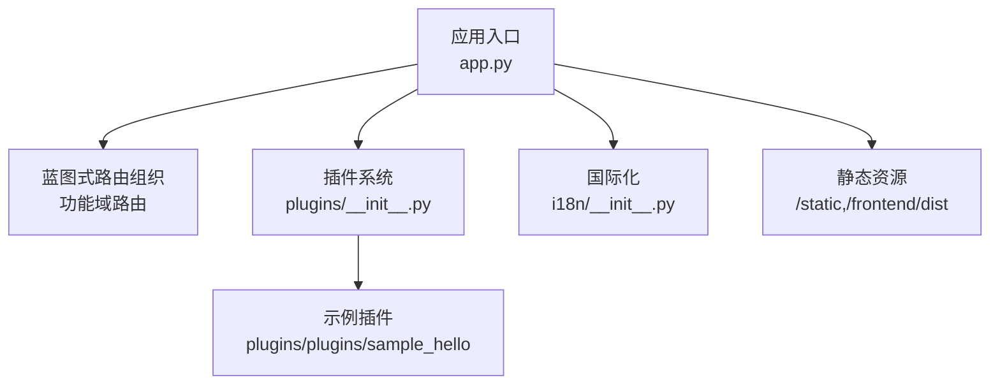
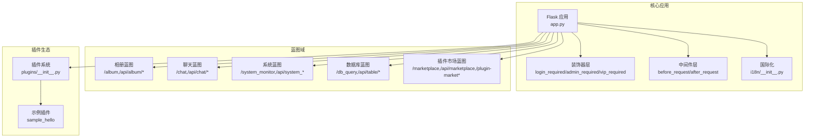
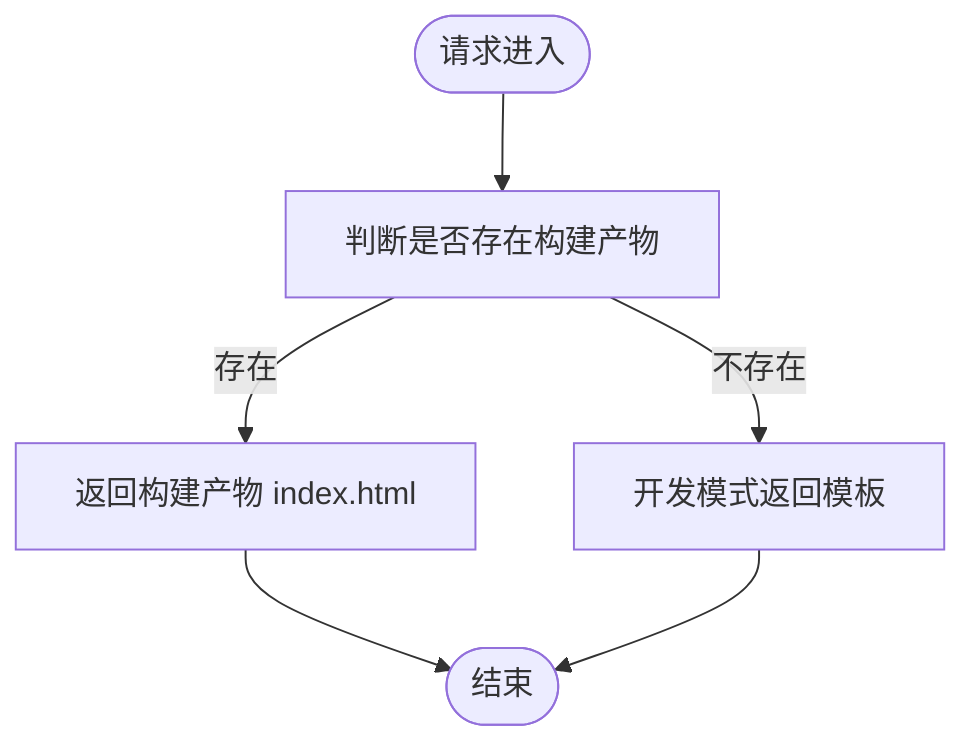
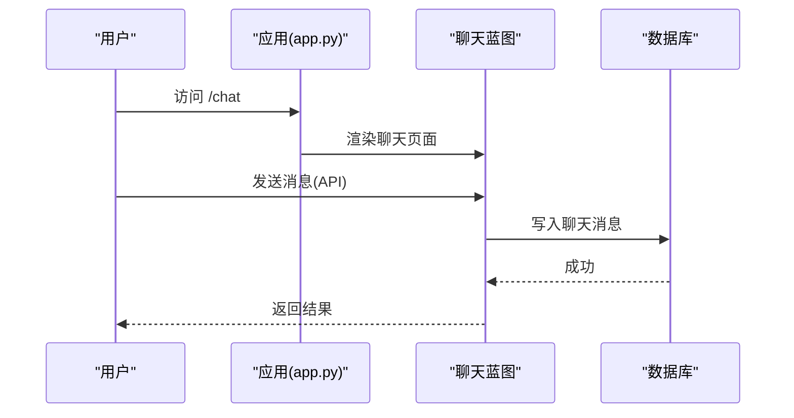
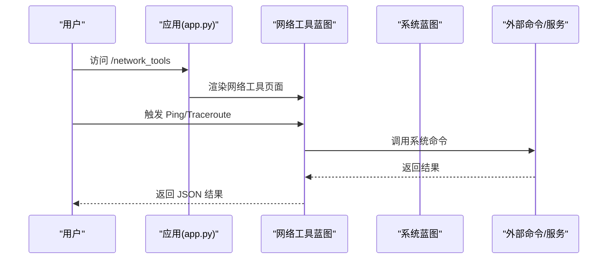
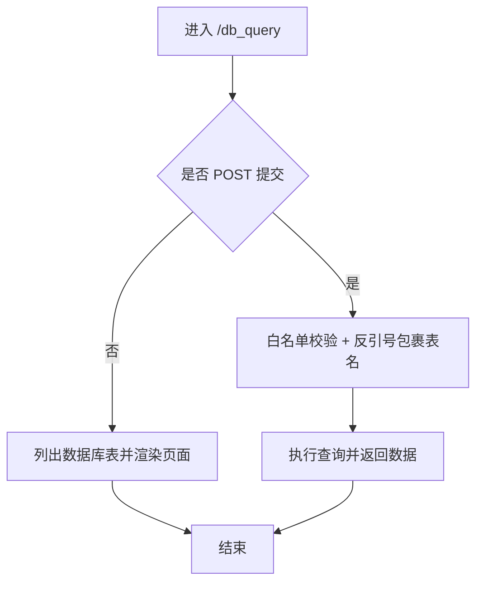
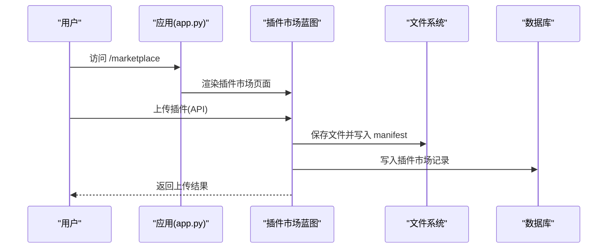
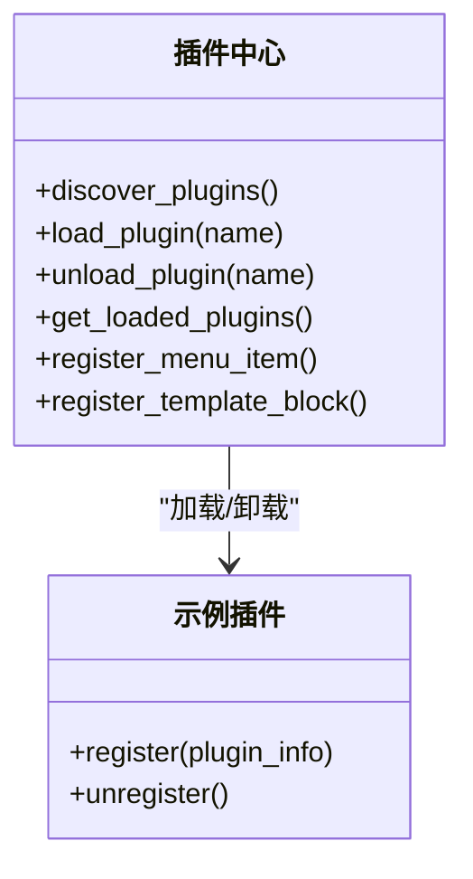
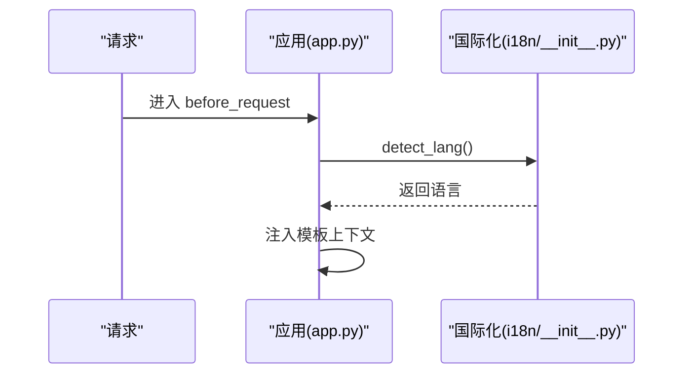
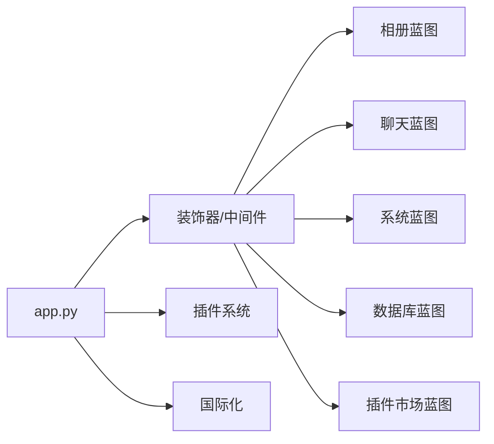

# 蓝图管理

<cite>
**本文引用的文件**
- [app.py](file://app.py)
- [plugins/__init__.py](file://plugins/__init__.py)
- [i18n/__init__.py](file://i18n/__init__.py)
- [plugins/plugins/sample_hello/__init__.py](file://plugins/plugins/sample_hello/__init__.py)
</cite>

## 目录
1. [简介](#简介)
2. [项目结构](#项目结构)
3. [核心组件](#核心组件)
4. [架构总览](#架构总览)
5. [详细组件分析](#详细组件分析)
6. [依赖分析](#依赖分析)
7. [性能考虑](#性能考虑)
8. [故障排查指南](#故障排查指南)
9. [结论](#结论)
10. [附录](#附录)

## 简介
本文件围绕 School_Web 的“蓝图管理”主题，系统阐述如何在 Flask 应用中通过蓝图（Blueprint）实现模块化路由组织、代码分离与可维护性提升。尽管当前仓库未直接使用 Flask 蓝图注册（如 app.register_blueprint(...)），但项目广泛采用“蓝图式”的组织思想：以功能域划分路由与模板、以插件机制承载可扩展能力、以装饰器与中间件实现横切关注点（如鉴权、速率限制、国际化）。本文将结合现有代码，给出蓝图式组织的最佳实践、流程图与序列图，帮助读者在大型应用中高效管理路由结构。

## 项目结构
- 应用入口与核心逻辑集中在 app.py，包含大量路由、装饰器、中间件与业务接口。
- 插件系统位于 plugins/，提供动态加载、卸载与钩子注册，体现蓝图式的模块化与解耦。
- 国际化模块 i18n/ 提供多语言支持，贯穿模板上下文注入，便于按功能域扩展语言资源。
- 前端资源通过 /frontend/dist 与 /static 提供，蓝图式组织有助于前后端分离与静态资源管理。

图表来源
- [app.py](file://app.py)
- [plugins/__init__.py](file://plugins/__init__.py)
- [i18n/__init__.py](file://i18n/__init__.py)
- [plugins/plugins/sample_hello/__init__.py](file://plugins/plugins/sample_hello/__init__.py)

章节来源
- [app.py](file://app.py)
- [plugins/__init__.py](file://plugins/__init__.py)
- [i18n/__init__.py](file://i18n/__init__.py)
- [plugins/plugins/sample_hello/__init__.py](file://plugins/plugins/sample_hello/__init__.py)

## 核心组件
- 路由与蓝图式组织：app.py 中大量以功能域划分的路由（如相册、聊天、系统监控、数据库管理等），体现了蓝图的“按域分组、按职责拆分”的思想。
- 插件系统：plugins/__init__.py 实现插件发现、加载、卸载与钩子注册，形成“插件即蓝图”的扩展模型。
- 国际化：i18n/__init__.py 提供语言检测、翻译函数与模板上下文注入，支撑多语言蓝图。
- 装饰器与中间件：login_required、admin_required、vip_required 等装饰器，以及全局 before_request、after_request，实现跨域路由的安全与合规控制。

章节来源
- [app.py](file://app.py)
- [plugins/__init__.py](file://plugins/__init__.py)
- [i18n/__init__.py](file://i18n/__init__.py)

## 架构总览
下图展示了蓝图式组织在应用中的交互关系：核心应用通过装饰器与中间件统一治理，功能域路由与插件系统共同构成“蓝图生态”。

图表来源
- [app.py](file://app.py)
- [plugins/__init__.py](file://plugins/__init__.py)
- [i18n/__init__.py](file://i18n/__init__.py)
- [plugins/plugins/sample_hello/__init__.py](file://plugins/plugins/sample_hello/__init__.py)

## 详细组件分析

### 组件一：蓝图式路由组织（相册蓝图）
- 路由范围：相册主页、静态资源服务、相册 API（图片列表、上传、审核、点赞、评论、统计等）。
- 组织方式：以 /album 为主入口，/api/album/* 为 API 域，配合 /assets/* 提供静态资源。
- 模板与静态资源：相册前端采用 Vue3，生产环境返回构建产物，开发环境返回模板；静态资源通过 /static/albums 提供。

图表来源
- [app.py](file://app.py)

章节来源
- [app.py](file://app.py)

### 组件二：蓝图式路由组织（聊天蓝图）
- 路由范围：聊天页面、聊天消息 API、好友关系与消息通道。
- 组织方式：以 /chat 为页面入口，/api/chat/* 为聊天相关 API，结合好友关系表实现私聊与群聊基础。

图表来源
- [app.py](file://app.py)

章节来源
- [app.py](file://app.py)

### 组件三：蓝图式路由组织（系统蓝图）
- 路由范围：系统监控页面与 API、网络工具（Ping/Traceroute/Whois/DNS/SSL/Subnet）、系统信息采集。
- 组织方式：以 /system_monitor 与 /network_tools 为入口，/api/network/* 为网络工具 API，/api/system_info 与 /api/system_users 为系统信息 API。

图表来源
- [app.py](file://app.py)

章节来源
- [app.py](file://app.py)

### 组件四：蓝图式路由组织（数据库蓝图）
- 路由范围：数据库查询页面、数据库变更页面、通用数据表 API（增删改查）。
- 组织方式：以 /db_query 与 /db_update 为入口，/api/table/<table>/* 为数据表操作 API，配合验证码门禁与权限控制。

图表来源
- [app.py](file://app.py)

章节来源
- [app.py](file://app.py)

### 组件五：插件蓝图（插件市场蓝图）
- 路由范围：插件市场浏览、插件上传、插件沙箱渲染、插件管理 API。
- 组织方式：以 /marketplace 为浏览入口，/api/marketplace 为公开 API，/plugin-market* 为沙箱渲染路由，/api/admin/plugins* 为管理员管理 API。

图表来源
- [app.py](file://app.py)

章节来源
- [app.py](file://app.py)

### 组件六：插件系统（插件蓝图）
- 功能：插件发现、加载/卸载、钩子注册（菜单项、模板注入块、静态路由、API 路由）。
- 组织方式：plugins/__init__.py 作为插件中心，sample_hello 为示例插件，演示菜单项与模板注入块的注册。

图表来源
- [plugins/__init__.py](file://plugins/__init__.py)
- [plugins/plugins/sample_hello/__init__.py](file://plugins/plugins/sample_hello/__init__.py)

章节来源
- [plugins/__init__.py](file://plugins/__init__.py)
- [plugins/plugins/sample_hello/__init__.py](file://plugins/plugins/sample_hello/__init__.py)

### 组件七：国际化蓝图
- 功能：语言检测、翻译函数、模板上下文注入。
- 组织方式：i18n/__init__.py 提供 _()、detect_lang 等，app.py 在 before_request 与 context_processor 中注入语言与翻译上下文，形成“多语言蓝图”。

图表来源
- [app.py](file://app.py)
- [i18n/__init__.py](file://i18n/__init__.py)

章节来源
- [app.py](file://app.py)
- [i18n/__init__.py](file://i18n/__init__.py)

## 依赖分析
- 耦合与内聚：各蓝图域相对独立（相册、聊天、系统、数据库、插件市场），通过装饰器与中间件实现横切一致性（鉴权、速率限制、国际化）。
- 外部依赖：MySQL（pymysql）、前端构建产物（/frontend/dist）、插件沙箱（CSP 与 iframe sandbox）。
- 潜在循环依赖：当前实现未见直接循环导入；插件系统通过动态导入与钩子注册避免强耦合。

图表来源
- [app.py](file://app.py)
- [plugins/__init__.py](file://plugins/__init__.py)
- [i18n/__init__.py](file://i18n/__init__.py)

章节来源
- [app.py](file://app.py)
- [plugins/__init__.py](file://plugins/__init__.py)
- [i18n/__init__.py](file://i18n/__init__.py)

## 性能考虑
- 路由与模板渲染：将静态资源与构建产物分离，减少模板渲染压力；对敏感页面禁用缓存，保障安全与一致性。
- 数据库访问：在蓝图域内进行白名单校验与参数转义，降低 SQL 注入风险；对热点查询使用索引与分页。
- 插件沙箱：通过 CSP 与 sandbox 限制插件能力，避免恶意脚本影响主应用性能与安全。
- 速率限制：全局与局部速率限制相结合，防止滥用与 DDoS。

## 故障排查指南
- 插件加载失败：检查插件目录与 plugin.json 是否存在，确认动态导入路径与模块命名空间。
- 路由 404：确认蓝图域路由前缀与子路径是否正确；检查插件路由分发逻辑。
- 权限不足：核对装饰器顺序与权限常量，确保会话中权限字段正确。
- 国际化异常：检查语言检测逻辑与模板上下文注入，确认 i18n 文件完整性。

章节来源
- [plugins/__init__.py](file://plugins/__init__.py)
- [app.py](file://app.py)
- [i18n/__init__.py](file://i18n/__init__.py)

## 结论
本项目虽未直接使用 Flask 蓝图注册，但通过“蓝图式组织”的思想实现了清晰的功能域划分、可扩展的插件体系与一致的安全治理。建议在后续演进中引入真正的 Flask 蓝图（如按域拆分 user_maps、album_maps、chat_maps），并在应用入口集中注册，以进一步提升模块化与可维护性。同时保持装饰器与中间件的横切一致性，确保安全与国际化策略在各蓝图域内统一落地。

## 附录
- 实战建议
  - 将相册、聊天、系统、数据库、插件市场分别抽象为蓝图模块，在应用入口集中注册。
  - 使用 URL 前缀与子域绑定（如 /api/v1/album、/chat.ws）实现版本化与域名隔离。
  - 将静态资源与模板渲染分离，利用蓝图的 static_folder 与 url_prefix 管理静态文件。
  - 通过钩子系统（菜单项、模板注入块、API 路由）实现插件与核心应用的低耦合集成。
  - 避免循环导入：将装饰器、中间件与工具函数集中管理，插件通过回调注册而非直接导入。