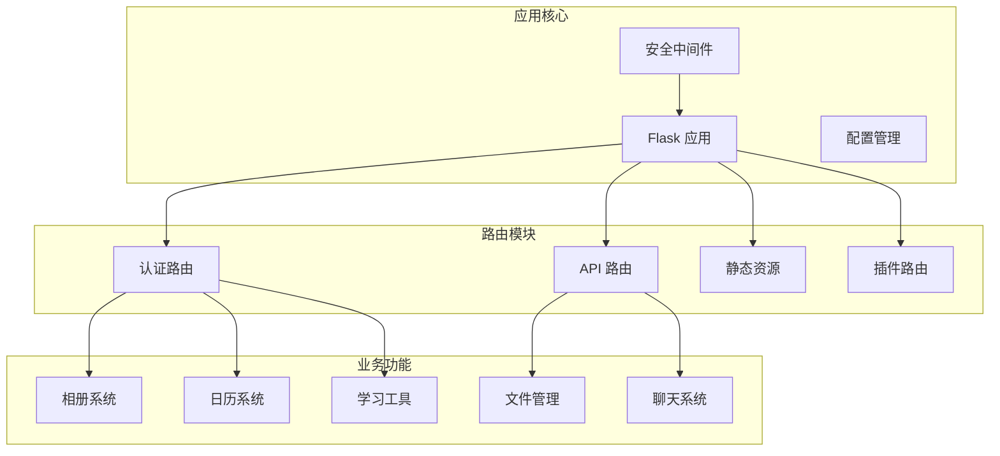
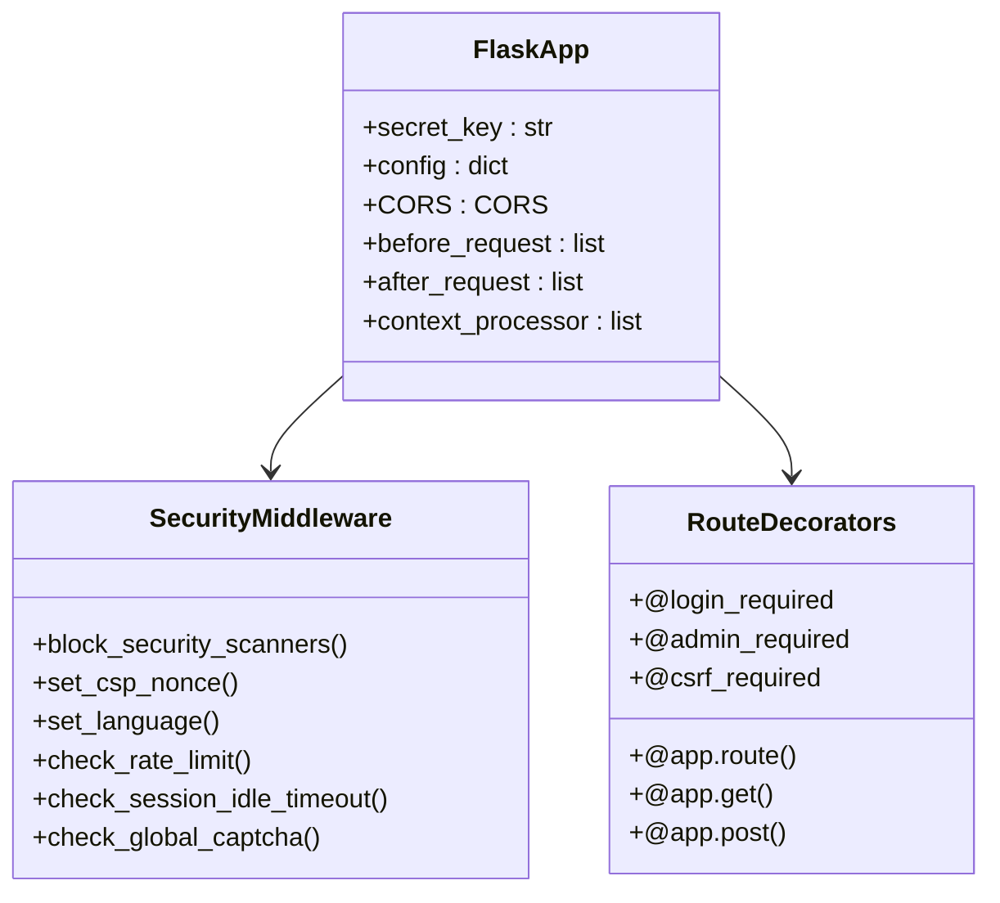
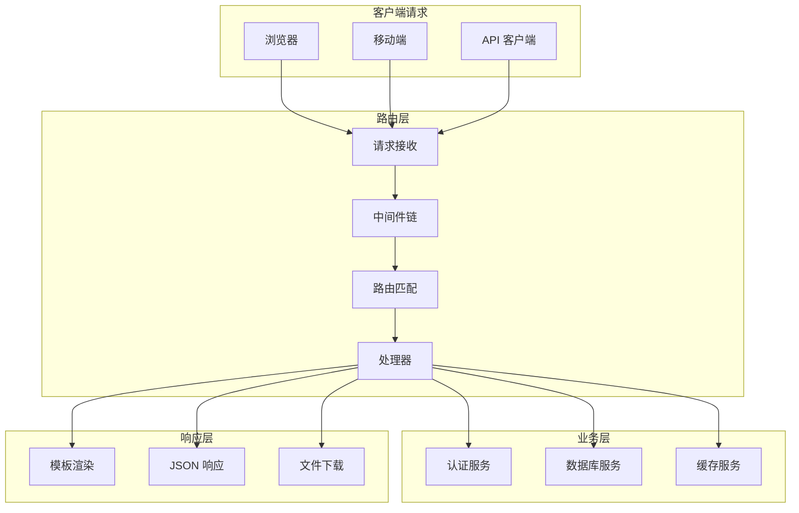
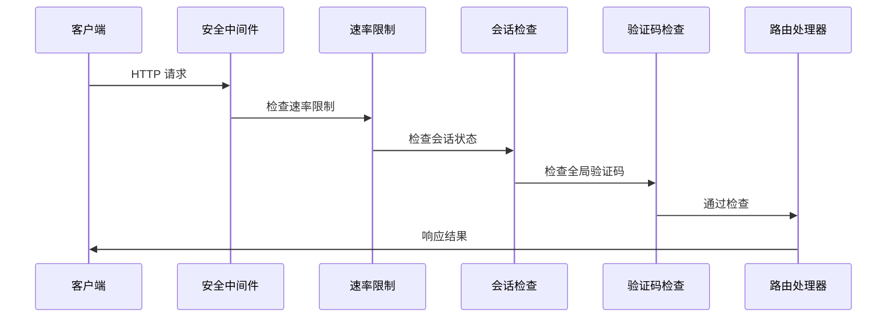
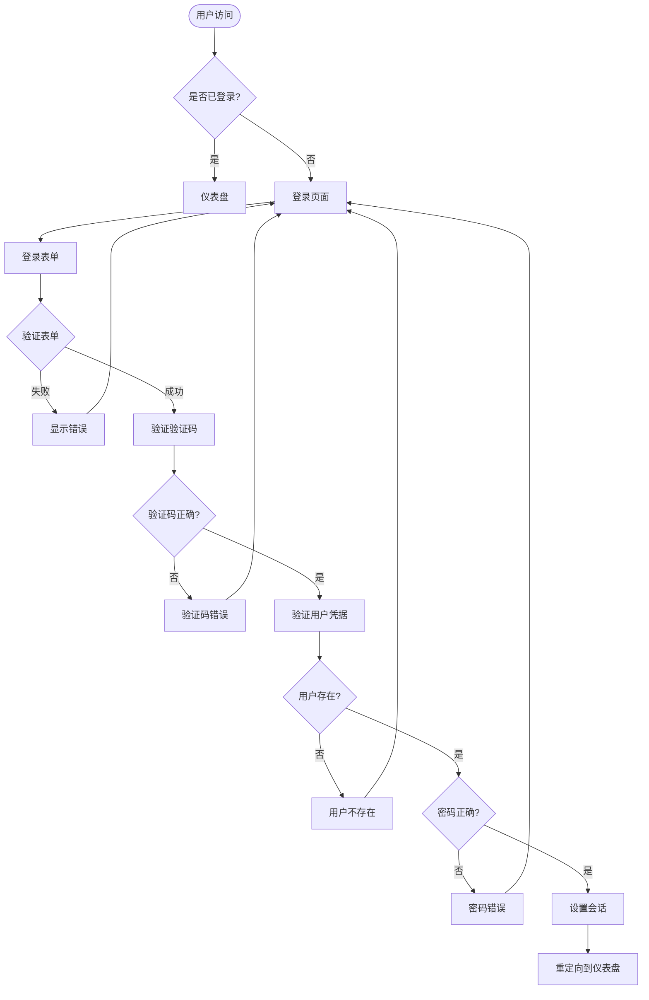
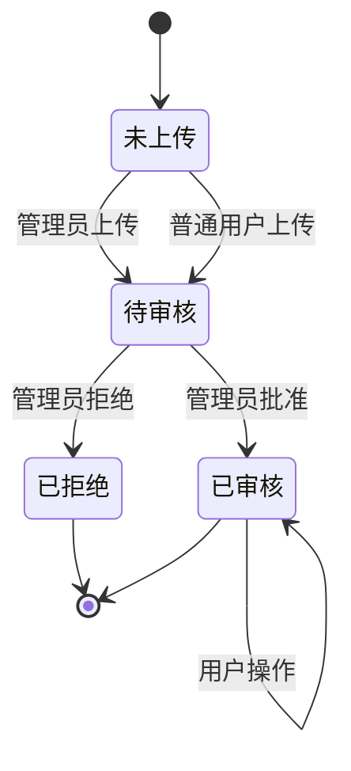
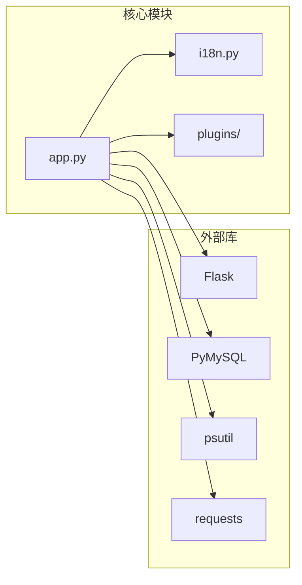
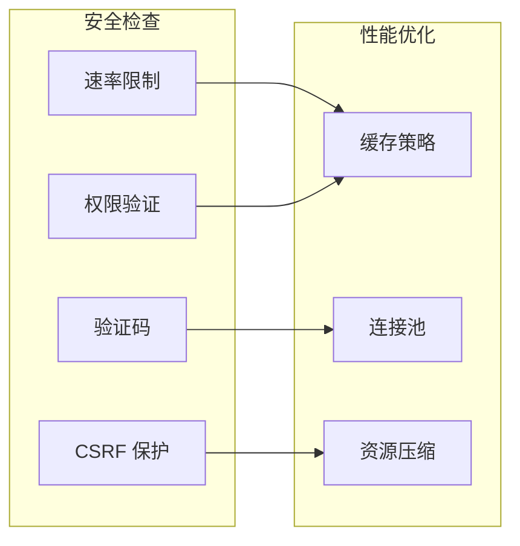

# 路由系统设计

<cite>
**本文档引用的文件**
- [app.py](file://app.py)
- [requirements.txt](file://requirements.txt)
</cite>

## 目录
1. [简介](#简介)
2. [项目结构](#项目结构)
3. [核心组件](#核心组件)
4. [架构概览](#架构概览)
5. [详细组件分析](#详细组件分析)
6. [依赖分析](#依赖分析)
7. [性能考虑](#性能考虑)
8. [故障排除指南](#故障排除指南)
9. [结论](#结论)

## 简介

School_Web 是一个基于 Flask 的学校管理系统，其路由系统设计体现了现代 Web 应用的完整架构。该项目采用模块化的路由设计，结合装饰器模式和中间件机制，实现了从基础认证到复杂业务逻辑的全方位路由管理。

该路由系统的核心特点包括：
- 基于 Flask 的装饰器路由机制
- 多层次的安全中间件
- 模块化的蓝图式路由组织
- 完善的 RESTful API 设计
- 动态路由参数处理

## 项目结构

School_Web 项目采用清晰的文件组织结构，主要路由逻辑集中在 app.py 文件中，通过装饰器模式实现各种路由功能：



**图表来源**
- [app.py:119](file://app.py#L119)
- [app.py:149](file://app.py#L149)

**章节来源**
- [app.py:1-800](file://app.py#L1-L800)
- [requirements.txt:1-5](file://requirements.txt#L1-L5)

## 核心组件

### Flask 应用实例

应用通过标准的 Flask 实例化创建，配置了必要的安全设置和中间件：



**图表来源**
- [app.py:119](file://app.py#L119)
- [app.py:149](file://app.py#L149)
- [app.py:907](file://app.py#L907)

### 路由装饰器系统

项目实现了完整的路由装饰器体系，包括基础路由装饰器和业务逻辑装饰器：

| 装饰器类型 | 用途 | 示例 |
|-----------|------|------|
| 基础装饰器 | URL 路由定义 | `@app.route('/login', methods=['GET', 'POST'])` |
| 权限装饰器 | 访问控制 | `@login_required`, `@admin_required` |
| 安全装饰器 | CSRF 保护 | `@csrf_required` |
| 业务装饰器 | 功能特定 | `@db_captcha_required`, `@fm_password_required` |

**章节来源**
- [app.py:1021](file://app.py#L1021)
- [app.py:907](file://app.py#L907)

## 架构概览

### 路由系统整体架构



**图表来源**
- [app.py:149](file://app.py#L149)
- [app.py:642](file://app.py#L642)

### 中间件链设计

项目实现了多层次的中间件机制，确保请求在到达具体路由处理器之前经过必要的安全检查：



**图表来源**
- [app.py:513](file://app.py#L513)
- [app.py:564](file://app.py#L564)
- [app.py:600](file://app.py#L600)

**章节来源**
- [app.py:149-676](file://app.py#L149-L676)

## 详细组件分析

### 认证路由系统

认证路由系统是整个应用的基础，包含了用户登录、注册、注销等核心功能：



**图表来源**
- [app.py:1021](file://app.py#L1021)
- [app.py:1119](file://app.py#L1119)
- [app.py:1191](file://app.py#L1191)

#### 登录流程实现

登录功能实现了完整的用户认证流程，包括验证码验证、密码哈希验证和会话管理：

**章节来源**
- [app.py:1021-1116](file://app.py#L1021-L1116)

### API 路由设计

API 路由采用了 RESTful 设计原则，提供了统一的接口规范：

```mermaid
erDiagram
API_ENDPOINTS {
string PATH
string METHOD
string AUTHENTICATION
string RESPONSE_FORMAT
string DESCRIPTION
}
USER_ENDPOINTS {
string GET_USER_PROFILE
string UPDATE_USER_PROFILE
string DELETE_USER_ACCOUNT
}
DATA_ENDPOINTS {
string GET_DATA_LIST
string CREATE_DATA_ITEM
string UPDATE_DATA_ITEM
string DELETE_DATA_ITEM
}
AUTH_ENDPOINTS {
string LOGIN
string LOGOUT
string CHANGE_PASSWORD
string RESET_PASSWORD
}
API_ENDPOINTS ||--|| USER_ENDPOINTS
API_ENDPOINTS ||--|| DATA_ENDPOINTS
API_ENDPOINTS ||--|| AUTH_ENDPOINTS
```

**图表来源**
- [app.py:1390](file://app.py#L1390)
- [app.py:2371](file://app.py#L2371)
- [app.py:3546](file://app.py#L3546)

#### 数据库操作 API

数据库操作 API 提供了完整的 CRUD 操作接口，支持管理员权限的数据库管理功能：

**章节来源**
- [app.py:2371-2485](file://app.py#L2371-L2485)

### 相册系统路由

相册系统实现了完整的图片管理功能，包括上传、审核、评论等特性：



**图表来源**
- [app.py:2733](file://app.py#L2733)
- [app.py:2634](file://app.py#L2634)

**章节来源**
- [app.py:2537-2810](file://app.py#L2537-L2810)

### 插件系统路由

插件系统实现了动态路由分发机制，支持运行时加载和卸载插件：

**章节来源**
- [app.py:5187-5198](file://app.py#L5187-L5198)

## 依赖分析

### 外部依赖

项目使用了现代化的 Python Web 开发栈，主要依赖包括：

| 依赖包 | 版本要求 | 用途 |
|--------|----------|------|
| Flask | >=3.0 | Web 框架核心 |
| PyMySQL | >=1.0 | MySQL 数据库驱动 |
| psutil | >=5.0 | 系统信息监控 |
| requests | >=2.0 | HTTP 请求处理 |

### 内部模块依赖



**图表来源**
- [requirements.txt:1](file://requirements.txt#L1)

**章节来源**
- [requirements.txt:1-5](file://requirements.txt#L1-L5)

## 性能考虑

### 路由性能优化

项目在路由设计中考虑了多个性能优化点：

1. **静态文件缓存**：通过 Caching-Control 头部实现静态资源缓存
2. **数据库连接池**：使用连接复用来减少数据库连接开销
3. **会话状态管理**：内存中的会话状态减少数据库查询
4. **图片缓存**：头像生成结果缓存到文件系统

### 安全性能平衡



## 故障排除指南

### 常见路由问题

| 问题类型 | 症状 | 解决方案 |
|----------|------|----------|
| 路由未匹配 | 404 错误 | 检查 URL 规则和参数类型 |
| 权限不足 | 403 错误 | 验证用户权限和装饰器使用 |
| CSRF 验证失败 | 403 错误 | 确认 CSRF token 设置和传递 |
| 会话超时 | 重定向到登录页 | 检查会话配置和超时设置 |

### 调试技巧

1. **启用调试模式**：设置 `FLASK_DEBUG=1` 启用开发模式
2. **查看日志**：检查应用日志输出
3. **使用 Flask CLI**：`flask routes` 查看路由表
4. **单元测试**：编写路由测试用例验证功能

**章节来源**
- [app.py:4315-4333](file://app.py#L4315-L4333)

## 结论

School_Web 的路由系统设计体现了现代 Web 应用的最佳实践，通过装饰器模式和中间件机制实现了高度模块化和可维护的路由架构。系统的主要优势包括：

1. **模块化设计**：清晰的路由分类和职责分离
2. **安全性保障**：多层次的安全中间件和权限控制
3. **扩展性良好**：插件系统和蓝图机制支持功能扩展
4. **性能优化**：合理的缓存策略和资源管理
5. **开发友好**：完善的错误处理和调试支持

该路由系统为学校管理系统的稳定运行提供了坚实的技术基础，同时为未来的功能扩展预留了充足的空间。