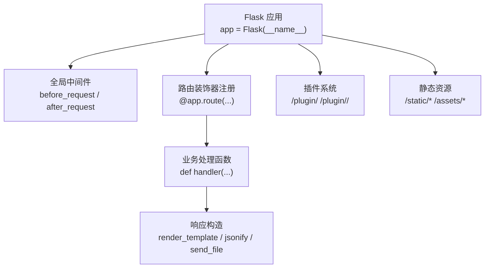
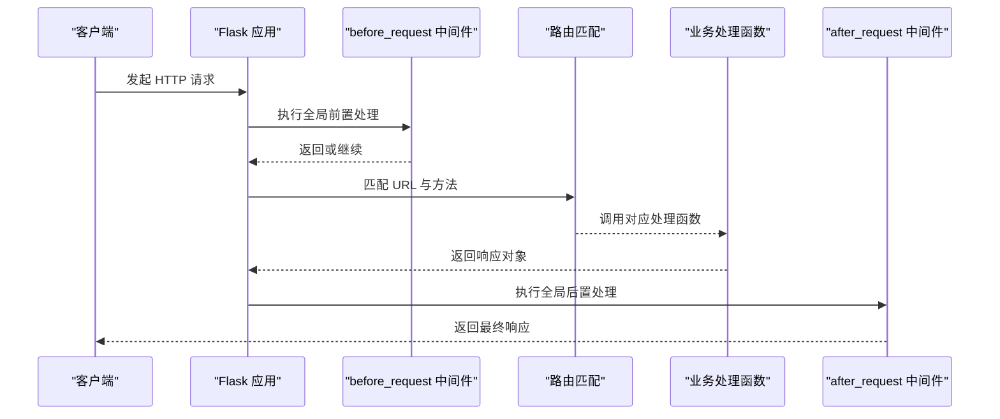
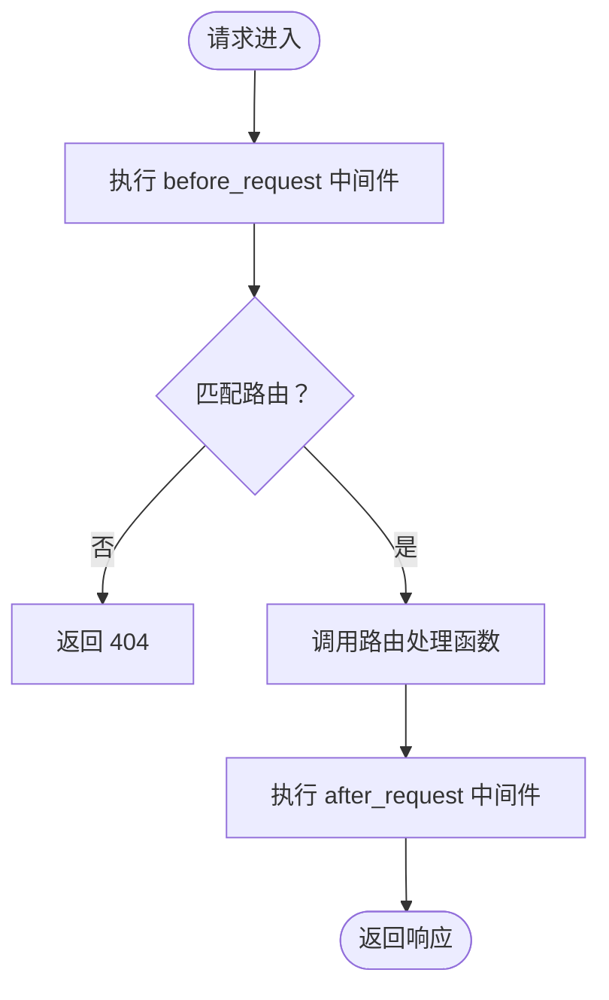
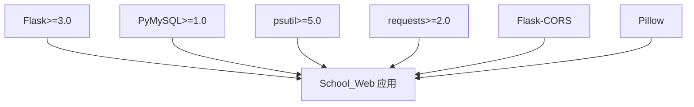

# 路由装饰器使用

<cite>
**本文引用的文件**
- [app.py](file://app.py)
- [requirements.txt](file://requirements.txt)
</cite>

## 目录
1. [简介](#简介)
2. [项目结构](#项目结构)
3. [核心组件](#核心组件)
4. [架构总览](#架构总览)
5. [详细组件分析](#详细组件分析)
6. [依赖分析](#依赖分析)
7. [性能考虑](#性能考虑)
8. [故障排查指南](#故障排查指南)
9. [结论](#结论)
10. [附录](#附录)

## 简介
本文件面向 School_Web 的 Flask 路由装饰器使用，系统性讲解：
- Flask 路由装饰器的核心概念与区别（@app.route、@app.get、@app.post、@app.put、@app.delete 等）
- URL 规则定义方式（静态路由、动态路由参数、路径转换器）
- 变量捕获、类型转换与默认值设置
- 实际使用模式（RESTful API、文件上传、JSON API）
- 路由装饰器的执行顺序与优先级规则

本指南兼顾初学者与进阶读者，既给出概念性说明，也结合项目中的真实路由实现进行分析与可视化。

## 项目结构
School_Web 采用单应用入口，核心逻辑集中在 app.py 中，通过装饰器注册大量路由，涵盖登录认证、多语言、网络工具、插件系统、数据库管理、学习工具等多个模块。

图表来源
- [app.py:119](file://app.py#L119)
- [app.py:149](file://app.py#L149)
- [app.py:642](file://app.py#L642)

章节来源
- [app.py:119](file://app.py#L119)
- [app.py:149](file://app.py#L149)
- [app.py:642](file://app.py#L642)

## 核心组件
- Flask 应用实例与装饰器
  - 应用实例：[app.py:119](file://app.py#L119)
  - 装饰器注册：[app.py:1020](file://app.py#L1020)、[app.py:1118](file://app.py#L1118)、[app.py:1190](file://app.py#L1190)、[app.py:213](file://app.py#L213)、[app.py:428](file://app.py#L428)
- 全局中间件
  - 请求前处理：[app.py:149](file://app.py#L149)、[app.py:513](file://app.py#L513)、[app.py:600](file://app.py#L600)
  - 响应后处理：[app.py:642](file://app.py#L642)
- 路由装饰器与方法限定
  - 方法限定：[app.py:1020](file://app.py#L1020)、[app.py:1118](file://app.py#L1118)、[app.py:1190](file://app.py#L1190)、[app.py:213](file://app.py#L213)、[app.py:428](file://app.py#L428)
  - 动态参数与路径转换器：[app.py:2576](file://app.py#L2576)、[app.py:2677](file://app.py#L2677)、[app.py:4896](file://app.py#L4896)、[app.py:5187](file://app.py#L5187)、[app.py:5188](file://app.py#L5188)
- JSON API 与文件上传
  - JSON API：[app.py:2075](file://app.py#L2075)、[app.py:2103](file://app.py#L2103)、[app.py:2129](file://app.py#L2129)、[app.py:2152](file://app.py#L2152)
  - 文件上传：[app.py:5263](file://app.py#L5263)

章节来源
- [app.py:119](file://app.py#L119)
- [app.py:1020](file://app.py#L1020)
- [app.py:1118](file://app.py#L1118)
- [app.py:1190](file://app.py#L1190)
- [app.py:213](file://app.py#L213)
- [app.py:428](file://app.py#L428)
- [app.py:2576](file://app.py#L2576)
- [app.py:2677](file://app.py#L2677)
- [app.py:4896](file://app.py#L4896)
- [app.py:5187](file://app.py#L5187)
- [app.py:5188](file://app.py#L5188)
- [app.py:2075](file://app.py#L2075)
- [app.py:2103](file://app.py#L2103)
- [app.py:2129](file://app.py#L2129)
- [app.py:2152](file://app.py#L2152)
- [app.py:5263](file://app.py#L5263)

## 架构总览
下图展示了路由装饰器在应用生命周期中的位置与作用范围，以及与中间件、业务处理函数的关系。

图表来源
- [app.py:149](file://app.py#L149)
- [app.py:642](file://app.py#L642)

## 详细组件分析

### Flask 路由装饰器核心概念与区别
- @app.route
  - 通用装饰器，可指定多个 HTTP 方法，常用于需要同时支持 GET/POST 的页面或接口。
  - 示例：登录页路由 [app.py:1020](file://app.py#L1020)，注册页路由 [app.py:1118](file://app.py#L1118)，登出路由 [app.py:1190](file://app.py#L1190)。
- @app.get、@app.post、@app.put、@app.delete 等
  - 限定单一方法的便捷装饰器。在项目中，@app.route 更常用，但部分 API 明确使用方法限定装饰器，如网络工具类 API：
    - Ping 接口：[app.py:2075](file://app.py#L2075)
    - Traceroute 接口：[app.py:2103](file://app.py#L2103)
    - Whois 接口：[app.py:2129](file://app.py#L2129)
    - DNS 接口：[app.py:2152](file://app.py#L2152)
    - 子网计算接口：[app.py:2287](file://app.py#L2287)
    - 备份删除接口（DELETE）：[app.py:4812](file://app.py#L4812)
    - 备份清理接口（DELETE）：[app.py:4829](file://app.py#L4829)
    - 备份恢复接口（POST）：[app.py:4851](file://app.py#L4851)
    - 抽认卡删除接口（DELETE）：[app.py:5119](file://app.py#L5119)
    - 插件市场删除接口（DELETE）：[app.py:5524](file://app.py#L5524)

使用建议
- 若接口仅支持单一方法，优先使用 @app.get/@app.post/@app.put/@app.delete 等明确装饰器，增强语义性与安全性。
- 若需同时支持 GET/POST（如登录页），使用 @app.route 并显式 methods 参数。

章节来源
- [app.py:1020](file://app.py#L1020)
- [app.py:1118](file://app.py#L1118)
- [app.py:1190](file://app.py#L1190)
- [app.py:2075](file://app.py#L2075)
- [app.py:2103](file://app.py#L2103)
- [app.py:2129](file://app.py#L2129)
- [app.py:2152](file://app.py#L2152)
- [app.py:2287](file://app.py#L2287)
- [app.py:4812](file://app.py#L4812)
- [app.py:4829](file://app.py#L4829)
- [app.py:4851](file://app.py#L4851)
- [app.py:5119](file://app.py#L5119)
- [app.py:5524](file://app.py#L5524)

### URL 规则定义与动态路由参数
- 静态路由
  - 如 “/”、“/register”、“/logout”、“/dashboard” 等，直接匹配固定路径。
  - 示例：[app.py:1020](file://app.py#L1020)、[app.py:1118](file://app.py#L1118)、[app.py:1190](file://app.py#L1190)、[app.py:1709](file://app.py#L1709)
- 动态路由参数与路径转换器
  - 使用尖括号定义变量捕获，支持类型转换与路径捕获：
    - 整数转换器：<int:id>：用于 ID 类参数，如相册图片 ID、插件市场 ID。
      - 示例：[app.py:2576](file://app.py#L2576)、[app.py:2677](file://app.py#L2677)、[app.py:4896](file://app.py#L4896)、[app.py:5524](file://app.py#L5524)
    - 路径转换器：<path:subpath>：用于捕获多段路径，常用于插件系统。
      - 示例：[app.py:5187](file://app.py#L5187)、[app.py:5188](file://app.py#L5188)
- 变量捕获、类型转换与默认值
  - 类型转换：通过转换器实现，如 <int:img_id>、<path:subpath>。
  - 默认值：在处理函数中通过 request.view_args 或 request.args 设置默认值。
  - 示例：插件路由分发 [app.py:5187](file://app.py#L5187)、[app.py:5188](file://app.py#L5188) 中的 subpath 默认为 None。

章节来源
- [app.py:1020](file://app.py#L1020)
- [app.py:1118](file://app.py#L1118)
- [app.py:1190](file://app.py#L1190)
- [app.py:1709](file://app.py#L1709)
- [app.py:2576](file://app.py#L2576)
- [app.py:2677](file://app.py#L2677)
- [app.py:4896](file://app.py#L4896)
- [app.py:5524](file://app.py#L5524)
- [app.py:5187](file://app.py#L5187)
- [app.py:5188](file://app.py#L5188)

### 路由规则中的变量捕获、类型转换与默认值设置
- 变量捕获
  - 通过装饰器参数中的变量名捕获路径片段，如 <int:fid>、<int:img_id>、<path:subpath>。
- 类型转换
  - Flask 内置转换器：int、float、path 等。项目中广泛使用 int 转换器处理 ID。
- 默认值设置
  - 在处理函数内部通过 request.view_args 或 request.args 获取参数并设置默认值，避免未传参导致的异常。

示例路径
- 抽认卡删除接口（DELETE）：[app.py:5119](file://app.py#L5119)
- 插件路由分发（多段路径）：[app.py:5187](file://app.py#L5187)、[app.py:5188](file://app.py#L5188)

章节来源
- [app.py:5119](file://app.py#L5119)
- [app.py:5187](file://app.py#L5187)
- [app.py:5188](file://app.py#L5188)

### 实际代码示例与使用模式
- RESTful API 路由设计
  - 使用 @app.route 显式 methods 参数，区分不同操作：
    - GET：查询资源（如 /api/study/todos、/api/study/flashcards）
    - POST：创建资源（如 /api/study/todos、/api/study/flashcards）
    - DELETE：删除资源（如 /api/study/flashcards/<int:fid>）
    - PUT：更新资源（如 /api/album/images/<int:img_id>）
  - 示例路径：
    - 待办列表查询：[app.py:4992](file://app.py#L4992)
    - 添加待办：[app.py:5013](file://app.py#L5013)
    - 删除待办：[app.py:5036](file://app.py#L5036)
    - 切换完成状态：[app.py:5051](file://app.py#L5051)
    - 抽认卡列表查询：[app.py:5071](file://app.py#L5071)
    - 添加抽认卡：[app.py:5096](file://app.py#L5096)
    - 删除抽认卡：[app.py:5119](file://app.py#L5119)
    - 复习抽认卡：[app.py:5134](file://app.py#L5134)
    - 下一题抽认卡：[app.py:5156](file://app.py#L5156)
- 文件上传路由
  - 管理员上传插件到市场，支持 .html/.vue 文件，包含大小限制与安全扫描：
    - 上传接口：[app.py:5263](file://app.py#L5263)
    - 保存与写入 manifest：[app.py:5325](file://app.py#L5325)、[app.py:5334](file://app.py#L5334)
    - 数据库存储：[app.py:5356](file://app.py#L5356)
- JSON API 路由
  - 网络工具类 API（POST）：
    - Ping：[app.py:2075](file://app.py#L2075)
    - Traceroute：[app.py:2103](file://app.py#L2103)
    - Whois：[app.py:2129](file://app.py#L2129)
    - DNS：[app.py:2152](file://app.py#L2152)
    - 子网计算：[app.py:2287](file://app.py#L2287)
  - 多语言切换 API（POST）：[app.py:213](file://app.py#L213)
  - 验证码接口（GET）：[app.py:428](file://app.py#L428)

章节来源
- [app.py:4992](file://app.py#L4992)
- [app.py:5013](file://app.py#L5013)
- [app.py:5036](file://app.py#L5036)
- [app.py:5051](file://app.py#L5051)
- [app.py:5071](file://app.py#L5071)
- [app.py:5096](file://app.py#L5096)
- [app.py:5119](file://app.py#L5119)
- [app.py:5134](file://app.py#L5134)
- [app.py:5156](file://app.py#L5156)
- [app.py:5263](file://app.py#L5263)
- [app.py:5325](file://app.py#L5325)
- [app.py:5334](file://app.py#L5334)
- [app.py:5356](file://app.py#L5356)
- [app.py:2075](file://app.py#L2075)
- [app.py:2103](file://app.py#L2103)
- [app.py:2129](file://app.py#L2129)
- [app.py:2152](file://app.py#L2152)
- [app.py:2287](file://app.py#L2287)
- [app.py:213](file://app.py#L213)
- [app.py:428](file://app.py#L428)

### 路由装饰器的执行顺序与优先级规则
- 执行顺序
  1) 全局 before_request 中间件（按注册顺序依次执行）
  2) 路由匹配（根据 URL 与方法选择处理函数）
  3) 路由处理函数（业务逻辑）
  4) 全局 after_request 中间件（统一设置安全头、CSP 等）
- 优先级规则
  - Flask 按装饰器注册顺序建立匹配链，先注册的装饰器优先被考虑。
  - 若存在多个匹配项，通常按“先匹配先执行”的原则；若需要精确控制，可通过调整装饰器注册顺序或使用更具体的 URL 规则。
  - 中间件与装饰器的组合：中间件在路由处理前后分别执行，可影响后续处理流程（如速率限制、会话超时、验证码门禁等）。

图表来源
- [app.py:149](file://app.py#L149)
- [app.py:642](file://app.py#L642)

章节来源
- [app.py:149](file://app.py#L149)
- [app.py:642](file://app.py#L642)

## 依赖分析
- Flask 版本要求
  - 项目使用 Flask>=3.0，确保具备现代装饰器与中间件特性。
  - 参考：[requirements.txt:1](file://requirements.txt#L1)
- 关键依赖
  - PyMySQL：数据库连接与操作
  - psutil、requests：系统监控与网络工具
  - Flask-CORS：跨域支持
  - PIL：验证码图片生成
  - 详见：[requirements.txt:1-5](file://requirements.txt#L1-L5)

图表来源
- [requirements.txt:1](file://requirements.txt#L1)
- [requirements.txt:2](file://requirements.txt#L2)
- [requirements.txt:3](file://requirements.txt#L3)
- [requirements.txt:4](file://requirements.txt#L4)

章节来源
- [requirements.txt:1](file://requirements.txt#L1)
- [requirements.txt:2](file://requirements.txt#L2)
- [requirements.txt:3](file://requirements.txt#L3)
- [requirements.txt:4](file://requirements.txt#L4)

## 性能考虑
- 速率限制
  - 内存级速率限制与持久化配置，支持动态调整与封禁策略，减少恶意请求与资源消耗。
  - 参考：[app.py:319](file://app.py#L319)、[app.py:360](file://app.py#L360)、[app.py:513](file://app.py#L513)
- 静态资源与缓存
  - 静态文件与分享链接跳过速率限制，合理利用浏览器缓存与服务端缓存头。
  - 参考：[app.py:515](file://app.py#L515)
- 响应头与安全
  - after_request 中统一设置安全头与 CSP，降低 XSS 风险，提升整体性能与安全性。
  - 参考：[app.py:642](file://app.py#L642)

章节来源
- [app.py:319](file://app.py#L319)
- [app.py:360](file://app.py#L360)
- [app.py:513](file://app.py#L513)
- [app.py:515](file://app.py#L515)
- [app.py:642](file://app.py#L642)

## 故障排查指南
- 路由 404/405
  - 检查 URL 是否与装饰器定义一致，方法是否匹配。
  - 参考：[app.py:5187](file://app.py#L5187)、[app.py:5188](file://app.py#L5188)
- 速率限制触发
  - 查看全局速率限制中间件与白名单配置，确认是否误封。
  - 参考：[app.py:513](file://app.py#L513)、[app.py:394](file://app.py#L394)
- 验证码门禁
  - 检查全局验证码门禁逻辑与跳过规则，确认是否需要验证码。
  - 参考：[app.py:600](file://app.py#L600)
- 安全头与 CSP
  - after_request 中统一设置安全头，若前端脚本报错，检查 CSP 配置与 nonce 注入。
  - 参考：[app.py:642](file://app.py#L642)、[app.py:175](file://app.py#L175)

章节来源
- [app.py:5187](file://app.py#L5187)
- [app.py:5188](file://app.py#L5188)
- [app.py:513](file://app.py#L513)
- [app.py:394](file://app.py#L394)
- [app.py:600](file://app.py#L600)
- [app.py:642](file://app.py#L642)
- [app.py:175](file://app.py#L175)

## 结论
- School_Web 通过 @app.route 与方法限定装饰器构建了清晰的路由体系，配合全局中间件实现了统一的安全与性能控制。
- 动态路由参数与路径转换器提升了 API 的灵活性与可维护性。
- RESTful 设计与 JSON API、文件上传路由共同构成了完整的后端接口生态。
- 建议在新增路由时遵循：
  - 明确方法限定装饰器的使用
  - 合理使用动态参数与转换器
  - 在 before_request/after_request 中集中处理安全与性能相关逻辑
  - 保持装饰器注册顺序与 URL 规则的一致性与可预测性

## 附录
- 相关文件
  - 应用入口与路由注册：[app.py](file://app.py)
  - 依赖声明：[requirements.txt](file://requirements.txt)