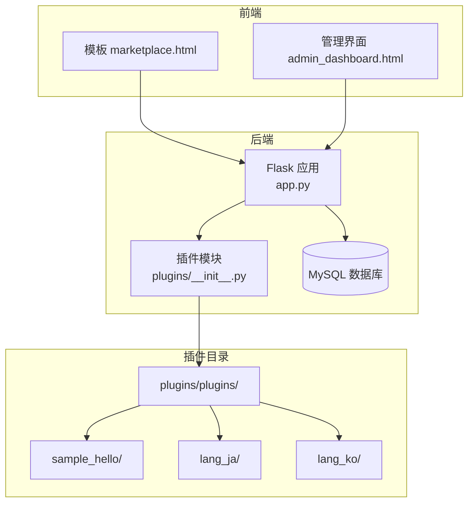
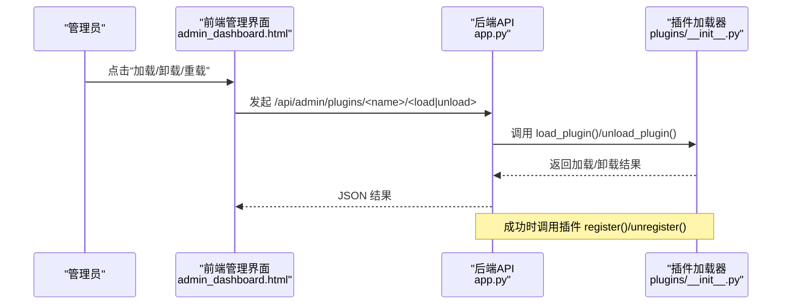
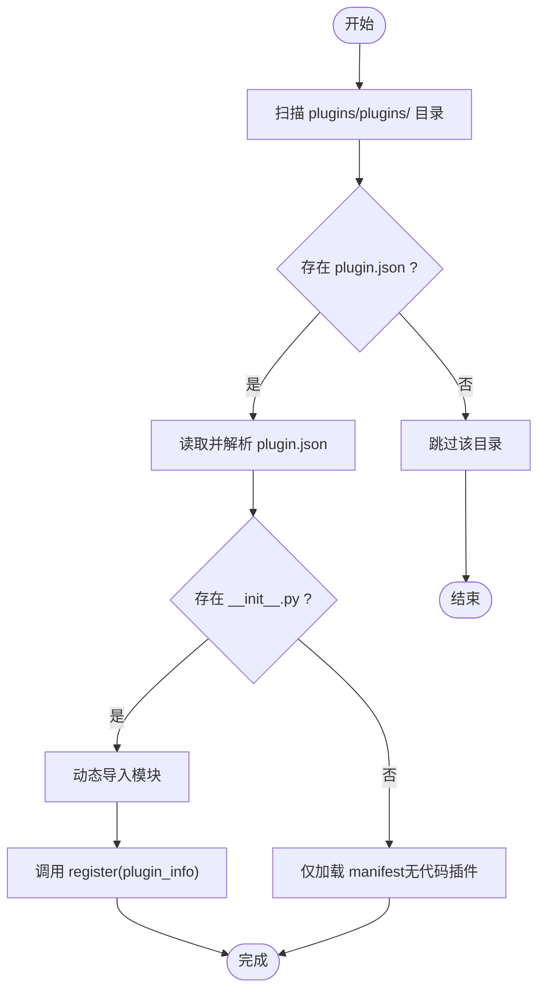
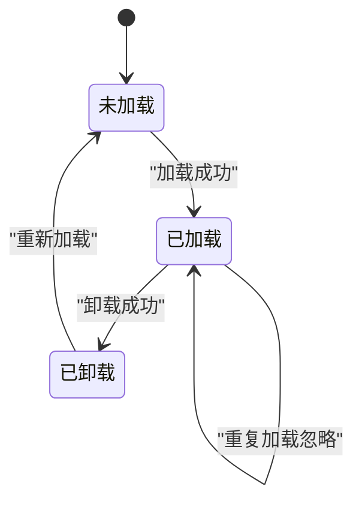
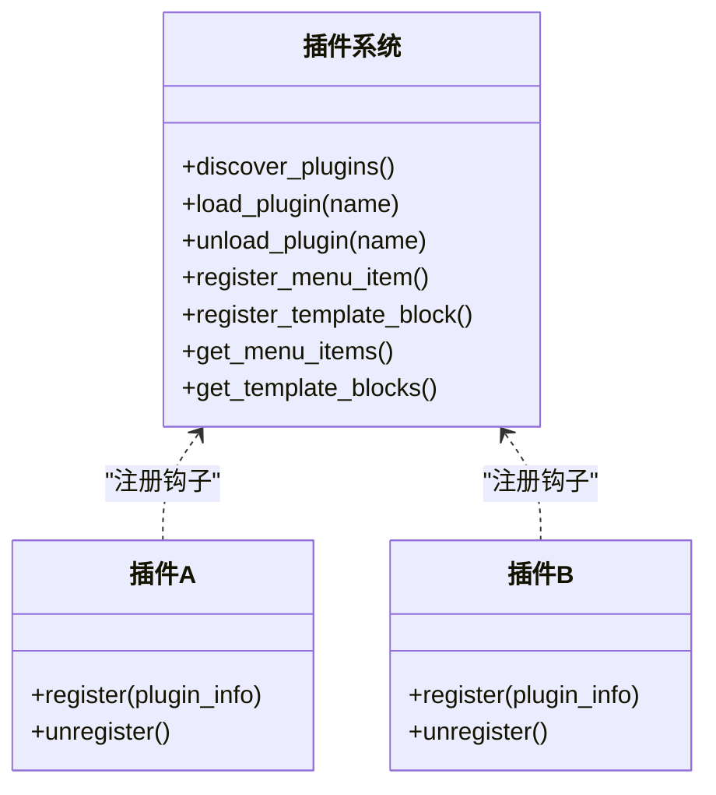
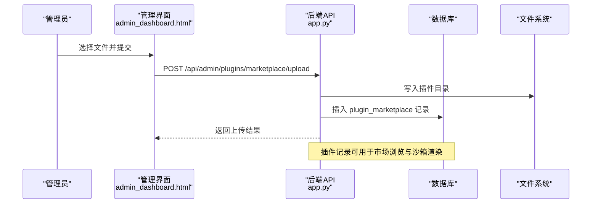
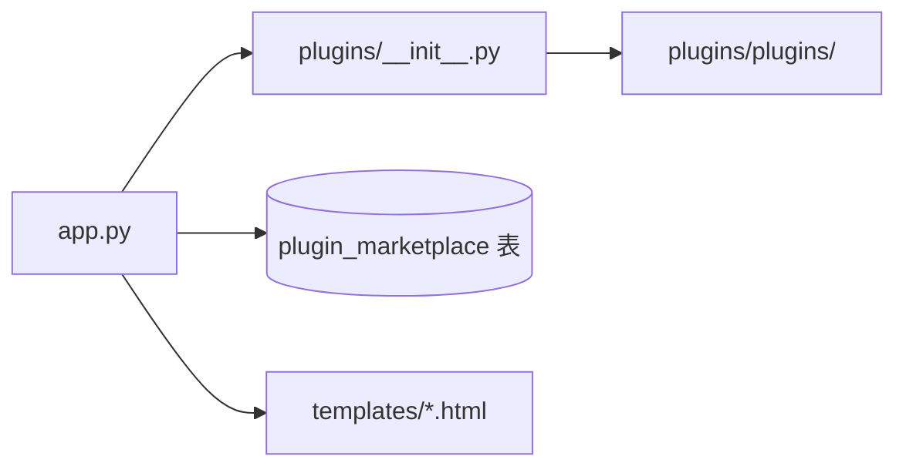

# 插件系统架构

<cite>
**本文引用的文件**
- [app.py](file://app.py)
- [plugins/__init__.py](file://plugins/__init__.py)
- [plugins/plugins/sample_hello/__init__.py](file://plugins/plugins/sample_hello/__init__.py)
- [plugins/plugins/sample_hello/plugin.json](file://plugins/plugins/sample_hello/plugin.json)
- [plugins/plugins/lang_ja/__init__.py](file://plugins/plugins/lang_ja/__init__.py)
- [plugins/plugins/lang_ja/plugin.json](file://plugins/plugins/lang_ja/plugin.json)
- [plugins/plugins/lang_ko/__init__.py](file://plugins/plugins/lang_ko/__init__.py)
- [plugins/plugins/lang_ko/plugin.json](file://plugins/plugins/lang_ko/plugin.json)
- [templates/marketplace.html](file://templates/marketplace.html)
- [templates/admin_dashboard.html](file://templates/admin_dashboard.html)
</cite>

## 目录
1. [引言](#引言)
2. [项目结构](#项目结构)
3. [核心组件](#核心组件)
4. [架构总览](#架构总览)
5. [详细组件分析](#详细组件分析)
6. [依赖分析](#依赖分析)
7. [性能考量](#性能考量)
8. [故障排查指南](#故障排查指南)
9. [结论](#结论)
10. [附录](#附录)

## 引言
本文件面向 School_Web 的插件系统，系统性阐述其设计理念、架构模式与实现细节。重点包括：
- 动态加载机制与插件发现/注册流程
- 插件生命周期管理（安装、激活、停用、卸载）
- 插件配置文件 plugin.json 的结构与字段含义
- 插件与主应用的交互机制（钩子系统、事件与模板注入、数据交换）
- 插件市场实现（上传、审核、分发、沙箱渲染）
- 安全机制（沙箱执行、权限控制、资源隔离）
- 开发指南（环境搭建、API 使用、调试技巧）
- 性能优化与兼容性建议
- 现有插件示例的最佳实践

## 项目结构
插件系统围绕后端 Python 包 plugins 与前端模板/脚本协同工作，同时结合数据库表 plugin_marketplace 支持“插件市场”能力。

图表来源
- [app.py](file://app.py)
- [plugins/__init__.py](file://plugins/__init__.py)
- [templates/marketplace.html](file://templates/marketplace.html)
- [templates/admin_dashboard.html](file://templates/admin_dashboard.html)

章节来源
- [app.py](file://app.py)
- [plugins/__init__.py](file://plugins/__init__.py)

## 核心组件
- 插件发现与加载器：负责扫描插件目录、解析 plugin.json、动态导入模块并调用插件的 register/unregister 生命周期钩子。
- 钩子注册表：集中管理菜单项、模板注入块等扩展点。
- 插件市场服务：提供上传、查询、删除等管理接口，并通过沙箱 iframe 安全渲染第三方插件。
- 前端市场与管理界面：提供用户侧浏览与管理员侧加载/卸载/重载插件的功能入口。

章节来源
- [plugins/__init__.py](file://plugins/__init__.py)
- [app.py](file://app.py)

## 架构总览
插件系统采用“声明式 + 动态导入”的模式：
- 插件以目录形式存在，包含 plugin.json 与可选的 __init__.py。
- 主应用启动时或按需触发，扫描插件目录，读取 manifest，动态导入模块并调用 register。
- 插件通过统一的注册 API 向主应用注入菜单项、模板片段等。
- 管理员可通过管理界面加载/卸载插件，或批量重载；用户可通过市场页面浏览与预览插件。

图表来源
- [app.py](file://app.py)
- [plugins/__init__.py](file://plugins/__init__.py)
- [templates/admin_dashboard.html](file://templates/admin_dashboard.html)

## 详细组件分析

### 插件发现与动态加载
- 发现策略：扫描 plugins/plugins/ 下的子目录，要求存在 plugin.json；若存在 __init__.py，则视为可执行插件。
- 动态导入：使用 importlib.util.spec_from_file_location 与 module_from_spec，避免硬编码路径，支持插件目录自定义。
- 生命周期钩子：加载成功后调用插件模块的 register(plugin_info)；卸载前调用 unregister()。
- 错误处理：捕获 JSON 解析异常、导入异常与执行异常，返回明确错误信息。

图表来源
- [plugins/__init__.py](file://plugins/__init__.py)

章节来源
- [plugins/__init__.py](file://plugins/__init__.py)

### 插件生命周期管理
- 安装：将插件目录放置于 plugins/plugins/，确保 plugin.json 存在；如需代码执行，提供 __init__.py。
- 激活：管理员在管理界面点击“加载”，后端调用 load_plugin，动态导入并注册钩子。
- 停用：调用 unload_plugin，先尝试调用插件 unregister，再清理 sys.modules。
- 卸载：物理删除插件目录或通过管理界面“卸载”后，不再参与后续加载。

图表来源
- [plugins/__init__.py](file://plugins/__init__.py)

章节来源
- [plugins/__init__.py](file://plugins/__init__.py)

### 插件配置文件 plugin.json 结构设计
- 字段示例与含义（基于现有插件）：
  - name/display_name：插件名称与展示名称
  - version：版本号
  - author/description/icon：作者、描述、图标
  - file_type：文件类型（如 html、vue），用于市场与沙箱渲染
  - type：插件类型（如 language），用于识别语言包等
  - license：许可证信息
- 设计要点：
  - 保持字段最小化但足够表达元数据
  - 与市场页面展示强关联（file_type、icon、version）
  - 与语言包插件区分（type/language）

章节来源
- [plugins/plugins/sample_hello/plugin.json](file://plugins/plugins/sample_hello/plugin.json)
- [plugins/plugins/lang_ja/plugin.json](file://plugins/plugins/lang_ja/plugin.json)
- [plugins/plugins/lang_ko/plugin.json](file://plugins/plugins/lang_ko/plugin.json)

### 插件与主应用的交互机制
- 钩子系统：
  - 菜单项注册：插件调用 register_menu_item，传入 label/url/icon/permission/order 等。
  - 模板注入块：插件调用 register_template_block，注入 head/footer 等位置的 HTML 片段。
  - 权限过滤：主应用根据用户权限与插件声明的最低权限进行匹配。
- 上下文注入：主应用在模板上下文中注入 plugin_menu_items 与 plugin_footer_blocks 等，供模板渲染使用。

图表来源
- [plugins/__init__.py](file://plugins/__init__.py)

章节来源
- [plugins/__init__.py](file://plugins/__init__.py)

### 插件市场实现原理
- 数据模型：plugin_marketplace 表存储插件元数据（名称、展示名、描述、版本、作者、文件类型、图标、上传者等）。
- 上传流程：管理员在管理界面填写表单并上传 zip/html/vue 文件，后端写入数据库与磁盘目录。
- 审核与分发：当前仓库未见显式的审核流程逻辑，市场页面提供公开浏览与预览；审核可由管理员在管理界面进行（如删除）。
- 沙箱渲染：通过专用路由与模板，使用 iframe sandbox 与严格 CSP，隔离第三方插件的脚本执行与网络访问。

图表来源
- [app.py](file://app.py)
- [templates/admin_dashboard.html](file://templates/admin_dashboard.html)

章节来源
- [app.py](file://app.py)
- [templates/admin_dashboard.html](file://templates/admin_dashboard.html)
- [templates/marketplace.html](file://templates/marketplace.html)

### 安全机制
- 沙箱执行：
  - 沙箱页面模板 SANDBOX_TEMPLATE 提供隔离容器，iframe 使用 sandbox 属性限制脚本、弹窗、表单等能力。
  - 直接访问路由（如 /plugin-market-raw/<dirname>/direct）设置严格的 CSP，允许有限的 script-src 与样式来源。
- 权限控制：
  - 菜单项与模板注入块支持按权限过滤，避免低权限用户看到高权限功能。
  - 管理接口仅对管理员开放，市场浏览对登录用户开放。
- 资源隔离：
  - 插件市场路由与静态资源分离，CSP 限制连接与帧祖先来源，降低 XSS 与点击劫持风险。

章节来源
- [app.py](file://app.py)
- [plugins/__init__.py](file://plugins/__init__.py)

### 开发指南
- 环境搭建：
  - 在 plugins/plugins/ 下新建目录，编写 plugin.json 与 __init__.py。
  - 若为纯静态插件（仅模板注入），可仅保留 plugin.json 与资源文件。
- API 使用：
  - 在 __init__.py 中导入 register_menu_item/register_template_block，并在 register 中注册扩展点。
  - 如需清理，在 unregister 中释放资源或注销钩子。
- 调试技巧：
  - 查看主应用日志输出（如语言包插件在 register/unregister 中打印日志）。
  - 使用浏览器开发者工具检查模板注入是否生效、CSP 是否阻断脚本加载。
  - 对于市场插件，优先在沙箱页面中验证渲染与交互。

章节来源
- [plugins/plugins/sample_hello/__init__.py](file://plugins/plugins/sample_hello/__init__.py)
- [plugins/plugins/lang_ja/__init__.py](file://plugins/plugins/lang_ja/__init__.py)
- [plugins/plugins/lang_ko/__init__.py](file://plugins/plugins/lang_ko/__init__.py)

### 现有插件示例与最佳实践
- sample_hello：演示最简插件结构，注册菜单项与页脚模板块。
- lang_ja/lang_ko：语言包插件，自动创建翻译文件并扩展支持语言列表，展示“manifest-only 插件”的用法（无 __init__.py 时仅加载 manifest）。
- 最佳实践：
  - 明确 plugin.json 字段，尤其是 file_type、icon、version，便于市场展示与版本管理。
  - 使用 register/unregister 管理资源，避免泄漏。
  - 模板注入尽量使用 nonce 安全注入，避免 unsafe-inline。
  - 语言包插件应保证翻译文件存在且可被 i18n 模块读取。

章节来源
- [plugins/plugins/sample_hello/__init__.py](file://plugins/plugins/sample_hello/__init__.py)
- [plugins/plugins/sample_hello/plugin.json](file://plugins/plugins/sample_hello/plugin.json)
- [plugins/plugins/lang_ja/__init__.py](file://plugins/plugins/lang_ja/__init__.py)
- [plugins/plugins/lang_ja/plugin.json](file://plugins/plugins/lang_ja/plugin.json)
- [plugins/plugins/lang_ko/__init__.py](file://plugins/plugins/lang_ko/__init__.py)
- [plugins/plugins/lang_ko/plugin.json](file://plugins/plugins/lang_ko/plugin.json)

## 依赖分析
- 插件系统依赖 Flask 上下文与模板注入（plugin_menu_items、plugin_footer_blocks 等）。
- 插件市场依赖数据库表 plugin_marketplace 与文件系统目录。
- 插件与主应用通过钩子解耦，耦合点集中在注册 API 与权限判断。

图表来源
- [app.py](file://app.py)
- [plugins/__init__.py](file://plugins/__init__.py)

章节来源
- [app.py](file://app.py)
- [plugins/__init__.py](file://plugins/__init__.py)

## 性能考量
- 插件发现与加载：
  - 控制插件数量与体积，避免过多插件导致启动时间增长。
  - 将非必要插件延迟加载，减少初始内存占用。
- 模板注入：
  - 合理组织注入块顺序（order），避免大量 DOM 操作带来的渲染压力。
- 市场沙箱：
  - 懒加载 iframe，减少首屏资源消耗。
  - 严格 CSP 有助于阻止恶意脚本，间接提升整体性能与稳定性。

## 故障排查指南
- 插件无法加载：
  - 检查 plugin.json 是否存在且格式正确。
  - 确认 __init__.py 是否存在；若无代码插件，确认仅需 manifest 注册。
  - 查看后端日志中的异常堆栈定位问题。
- 菜单/模板未显示：
  - 确认插件已加载且权限满足要求。
  - 检查模板上下文是否注入了插件扩展点。
- 市场插件无法预览：
  - 确认数据库记录与磁盘目录一致。
  - 检查沙箱路由与 CSP 设置是否正确。

章节来源
- [plugins/__init__.py](file://plugins/__init__.py)
- [app.py](file://app.py)

## 结论
School_Web 插件系统以“声明式 + 动态导入 + 钩子注册”为核心，实现了灵活的扩展能力与良好的安全性隔离。通过清晰的生命周期管理、规范的配置文件与完善的市场沙箱渲染，系统既便于开发者扩展，也便于管理员治理。建议在实际部署中进一步完善插件审核流程与监控告警，持续优化加载性能与用户体验。

## 附录
- 关键路由与职责概览（节选）
  - /api/admin/plugins：列出插件
  - /api/admin/plugins/<name>/load：加载插件
  - /api/admin/plugins/<name>/unload：卸载插件
  - /api/admin/plugins/reload：重载所有插件
  - /api/admin/plugins/marketplace：查询市场插件
  - /api/admin/plugins/marketplace/upload：上传插件
  - /api/admin/plugins/marketplace/<int:plugin_id>：删除插件
  - /marketplace：用户侧市场浏览
  - /plugin-market-raw/<dirname>：沙箱渲染磁盘插件
  - /plugin-market/<int:plugin_id>：沙箱渲染数据库插件

章节来源
- [app.py](file://app.py)
- [templates/marketplace.html](file://templates/marketplace.html)
- [templates/admin_dashboard.html](file://templates/admin_dashboard.html)