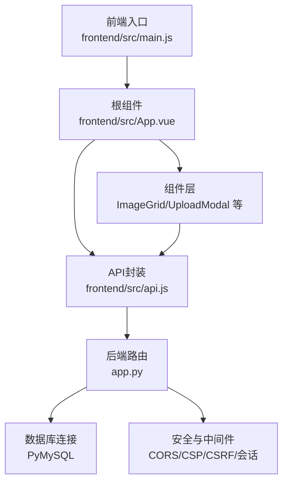
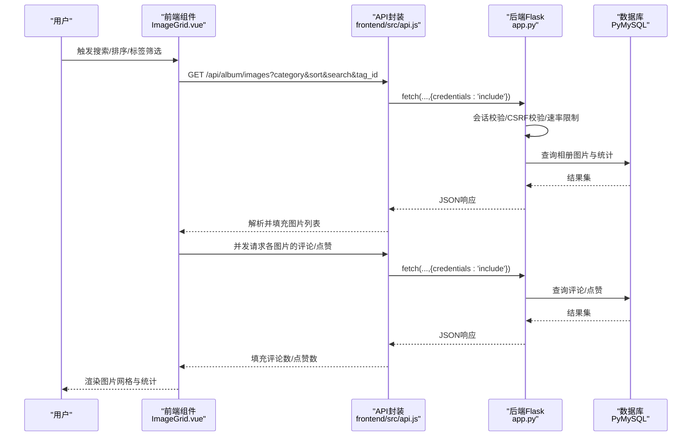
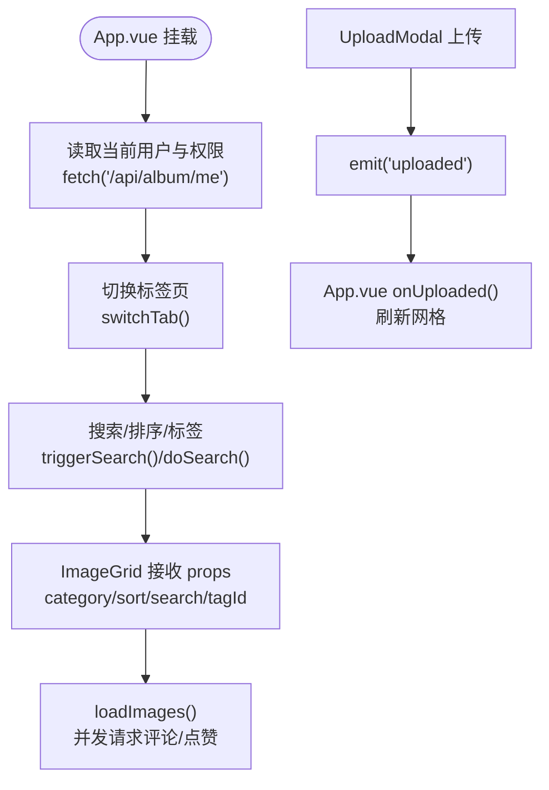
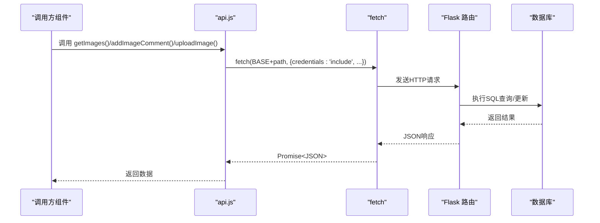
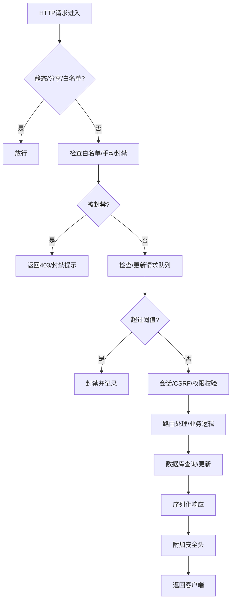
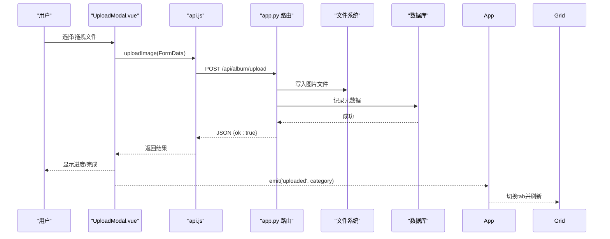
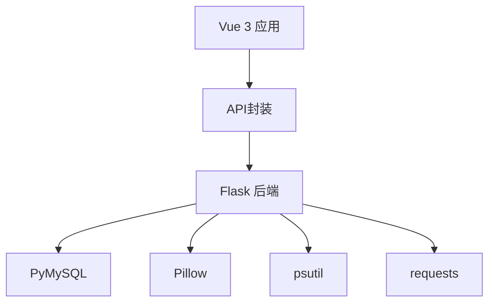

# 数据流设计

<cite>
**本文引用的文件**
- [app.py](file://app.py)
- [frontend/src/main.js](file://frontend/src/main.js)
- [frontend/src/api.js](file://frontend/src/api.js)
- [frontend/src/App.vue](file://frontend/src/App.vue)
- [frontend/src/components/ImageGrid.vue](file://frontend/src/components/ImageGrid.vue)
- [frontend/src/components/UploadModal.vue](file://frontend/src/components/UploadModal.vue)
- [requirements.txt](file://requirements.txt)
- [SchoolWeb.spec](file://SchoolWeb.spec)
</cite>

## 目录
1. [简介](#简介)
2. [项目结构](#项目结构)
3. [核心组件](#核心组件)
4. [架构总览](#架构总览)
5. [详细组件分析](#详细组件分析)
6. [依赖分析](#依赖分析)
7. [性能考虑](#性能考虑)
8. [故障排查指南](#故障排查指南)
9. [结论](#结论)
10. [附录](#附录)

## 简介
本文件面向School_Web项目的“数据流设计”，系统性梳理从前端到后端的数据路径、状态传递、数据处理与持久化、缓存与同步策略、以及验证与安全过滤机制。文档同时给出常见数据流场景的最佳实践与可视化图示，帮助开发者与运维人员快速理解与优化系统。

## 项目结构
- 前端采用Vue 3单页应用，入口位于frontend/src/main.js，根组件为frontend/src/App.vue。
- 前端通过frontend/src/api.js封装对后端/api/album系列接口的调用。
- 后端基于Flask，路由集中在app.py，负责认证、鉴权、速率限制、CSP安全头、国际化注入、数据库初始化与表结构维护等。
- 构建打包通过SchoolWeb.spec，将templates、static、frontend/dist与隐藏导入项打包为可执行程序。

图表来源
- [frontend/src/main.js:1-6](file://frontend/src/main.js#L1-L6)
- [frontend/src/App.vue:1-99](file://frontend/src/App.vue#L1-L99)
- [frontend/src/api.js:1-45](file://frontend/src/api.js#L1-L45)
- [app.py:119-139](file://app.py#L119-L139)
- [requirements.txt:1-5](file://requirements.txt#L1-L5)

章节来源
- [frontend/src/main.js:1-6](file://frontend/src/main.js#L1-L6)
- [frontend/src/App.vue:1-99](file://frontend/src/App.vue#L1-L99)
- [frontend/src/api.js:1-45](file://frontend/src/api.js#L1-L45)
- [app.py:119-139](file://app.py#L119-L139)
- [requirements.txt:1-5](file://requirements.txt#L1-L5)
- [SchoolWeb.spec:1-45](file://SchoolWeb.spec#L1-L45)

## 核心组件
- 前端应用启动与路由
  - Vue应用在frontend/src/main.js中创建并挂载根组件frontend/src/App.vue。
  - App.vue负责顶部导航、搜索与排序参数、标签筛选、子组件切换与全局状态（如是否管理员、当前用户）。
- API封装
  - frontend/src/api.js统一前缀BASE="/api/album"，封装相册相关REST请求，使用withCredentials携带Cookie进行跨域会话保持。
- 组件间数据流
  - ImageGrid组件接收来自App.vue的props（category/sort/search/tagId），内部通过fetch拉取图片列表与统计，支持并发获取评论与点赞数据。
  - UploadModal组件负责文件选择、预览、批量上传与进度反馈，上传完成后向父组件发出uploaded事件刷新视图。
- 后端路由与安全
  - app.py集中定义路由、CORS、CSP、会话安全、速率限制、CSRF校验、登录/注册/登出、活动榜、管理员/VIP申请与审核、头像生成等。
  - 数据库初始化与表结构维护在app.py中完成，确保相册扩展功能所需表存在。

章节来源
- [frontend/src/main.js:1-6](file://frontend/src/main.js#L1-L6)
- [frontend/src/App.vue:47-84](file://frontend/src/App.vue#L47-L84)
- [frontend/src/api.js:1-45](file://frontend/src/api.js#L1-L45)
- [frontend/src/components/ImageGrid.vue:43-106](file://frontend/src/components/ImageGrid.vue#L43-L106)
- [frontend/src/components/UploadModal.vue:48-99](file://frontend/src/components/UploadModal.vue#L48-L99)
- [app.py:119-139](file://app.py#L119-L139)
- [app.py:230-345](file://app.py#L230-L345)

## 架构总览
下图展示一次典型“相册图片列表加载”的端到端数据流：前端发起请求、后端鉴权与速率限制、数据库查询、序列化响应、前端渲染与并发统计。

图表来源
- [frontend/src/components/ImageGrid.vue:55-77](file://frontend/src/components/ImageGrid.vue#L55-L77)
- [frontend/src/api.js:7-18](file://frontend/src/api.js#L7-L18)
- [app.py:907-964](file://app.py#L907-L964)

章节来源
- [frontend/src/components/ImageGrid.vue:55-77](file://frontend/src/components/ImageGrid.vue#L55-L77)
- [frontend/src/api.js:7-18](file://frontend/src/api.js#L7-L18)
- [app.py:907-964](file://app.py#L907-L964)

## 详细组件分析

### 前端应用启动与状态传递
- 应用启动
  - main.js创建Vue应用并挂载根组件App.vue。
- 状态与props传递
  - App.vue通过ref与事件在子组件间传递状态：如tab、search、sort、activeTag；通过事件监听onUploaded刷新网格。
- 事件冒泡与状态提升
  - UploadModal通过emit('uploaded')向上冒泡，App.vue接收后切换tab并清空搜索条件，实现状态提升与视图联动。

图表来源
- [frontend/src/App.vue:78-84](file://frontend/src/App.vue#L78-L84)
- [frontend/src/App.vue:72-76](file://frontend/src/App.vue#L72-L76)
- [frontend/src/components/ImageGrid.vue:98-106](file://frontend/src/components/ImageGrid.vue#L98-L106)
- [frontend/src/components/UploadModal.vue:97-98](file://frontend/src/components/UploadModal.vue#L97-L98)

章节来源
- [frontend/src/main.js:1-6](file://frontend/src/main.js#L1-L6)
- [frontend/src/App.vue:47-84](file://frontend/src/App.vue#L47-L84)
- [frontend/src/components/ImageGrid.vue:43-106](file://frontend/src/components/ImageGrid.vue#L43-L106)
- [frontend/src/components/UploadModal.vue:48-99](file://frontend/src/components/UploadModal.vue#L48-L99)

### API封装与HTTP请求流程
- 统一前缀与凭据
  - api.js以BASE="/api/album"封装所有相册相关请求，统一设置credentials:'include'以携带Cookie。
- 请求类型与参数
  - GET：/images、/images/:id/comments、/images/:id/like、/comments、/stats等。
  - POST/DELETE/PUT：上传、添加/删除评论、点赞/取消、重命名、分享链接等。
- 响应处理
  - 统一使用r.json()解析，错误通过alert或上层提示展示。

图表来源
- [frontend/src/api.js:1-45](file://frontend/src/api.js#L1-L45)

章节来源
- [frontend/src/api.js:1-45](file://frontend/src/api.js#L1-L45)

### 后端路由与数据处理
- 会话与权限控制
  - login_required、admin_required、vip_required装饰器分别用于登录态、管理员与VIP权限校验。
- CSRF与安全头
  - csrf_required装饰器校验表单CSRF；after_request统一注入CSP、XSS/ClickJacking防护、HSTS等安全头。
- 速率限制与封禁
  - 基于内存队列与文件持久化的RateLimiter类，结合全局before_request实现IP维度的请求频率控制与封禁。
- 数据库初始化
  - _init_album_tables等方法在应用启动时确保相册扩展所需表存在，避免运行时异常。
- 日志与活动记录
  - write_log与record_activity用于审计与活跃度统计。

图表来源
- [app.py:513-593](file://app.py#L513-L593)
- [app.py:907-964](file://app.py#L907-L964)
- [app.py:641-676](file://app.py#L641-L676)
- [app.py:694-831](file://app.py#L694-L831)

章节来源
- [app.py:513-593](file://app.py#L513-L593)
- [app.py:907-964](file://app.py#L907-L964)
- [app.py:641-676](file://app.py#L641-L676)
- [app.py:694-831](file://app.py#L694-L831)

### 上传与批量处理流程
- 前端上传
  - UploadModal支持多文件选择/拖拽、预览、批量命名与逐个上传，上传过程中显示进度与已上传数量。
- 后端接收
  - app.py中对应路由接收multipart/form-data，结合数据库写入与文件系统落盘（静态资源目录）。
- 事件驱动刷新
  - 上传完成后通过emit('uploaded')触发App.vue刷新网格，保证UI与后端数据一致性。

图表来源
- [frontend/src/components/UploadModal.vue:81-99](file://frontend/src/components/UploadModal.vue#L81-L99)
- [frontend/src/api.js:33](file://frontend/src/api.js#L33)
- [frontend/src/App.vue:75](file://frontend/src/App.vue#L75)

章节来源
- [frontend/src/components/UploadModal.vue:48-99](file://frontend/src/components/UploadModal.vue#L48-L99)
- [frontend/src/api.js:33](file://frontend/src/api.js#L33)
- [frontend/src/App.vue:72-76](file://frontend/src/App.vue#L72-L76)

### 数据验证与安全过滤
- 输入清洗
  - sanitize_input对用户输入进行HTML/JS标签剥离与长度限制，降低XSS风险。
- CSRF校验
  - csrf_required装饰器校验表单中的CSRF token，防止跨站请求伪造。
- 会话安全
  - 会话Cookie配置HttpOnly/Secure/SameSite，限制会话生命周期，配合“IP会话超时”策略降低会话劫持风险。
- CSP与安全头
  - after_request统一注入CSP、X-Frame-Options、X-XSS-Protection、Referrer-Policy、HSTS等，减少XSS与点击劫持威胁。

章节来源
- [app.py:869-880](file://app.py#L869-L880)
- [app.py:919-932](file://app.py#L919-L932)
- [app.py:133-139](file://app.py#L133-L139)
- [app.py:641-676](file://app.py#L641-L676)

### 缓存策略与数据同步
- 前端缓存
  - 前端未显式实现浏览器级缓存策略；组件内部通过props变化触发重新加载，避免陈旧数据。
- 后端缓存
  - 头像生成接口支持本地文件缓存（static/avatars），命中则直接返回缓存文件，降低重复计算开销。
- 实时性
  - 当前未实现WebSocket或服务端推送；组件通过轮询或用户主动刷新保证数据可见性。

章节来源
- [app.py:1578-1600](file://app.py#L1578-L1600)
- [frontend/src/components/ImageGrid.vue:98-106](file://frontend/src/components/ImageGrid.vue#L98-L106)

### 数据持久化方案
- 数据库存储
  - 使用PyMySQL连接MySQL，相册扩展功能涉及多张表（事件、同学录、寄语墙、歌单、弹幕、分享链接等），均在应用启动时初始化。
- 文件系统
  - 上传的图片存储于static/albums目录，头像生成结果缓存于static/avatars。
- 会话存储
  - Flask会话存储于服务端（默认文件/内存），结合Cookie标识用户会话。

章节来源
- [app.py:680-693](file://app.py#L680-L693)
- [app.py:694-831](file://app.py#L694-L831)
- [app.py:1578-1600](file://app.py#L1578-L1600)

### 数据迁移与备份恢复
- 备份目录
  - 仓库包含backups/目录，可用于存放数据库/文件备份。
- 备份建议
  - 数据库：mysqldump导出schema与数据；文件：tar/zip打包static/albums与static/avatars。
- 恢复流程
  - 数据库：导入schema与数据；文件：解压至对应目录；重启服务使静态资源生效。

章节来源
- [SchoolWeb.spec:8](file://SchoolWeb.spec#L8)

## 依赖分析
- 前端依赖
  - Vue 3、CSS样式与组件库（由模板与第三方CDN引入）。
- 后端依赖
  - Flask、PyMySQL、psutil、requests、Pillow（PIL）等。
- 打包依赖
  - PyInstaller配置SchoolWeb.spec，包含templates、static、frontend/dist与隐藏导入项，便于生成独立可执行程序。

图表来源
- [requirements.txt:1-5](file://requirements.txt#L1-L5)
- [SchoolWeb.spec:8](file://SchoolWeb.spec#L8)

章节来源
- [requirements.txt:1-5](file://requirements.txt#L1-L5)
- [SchoolWeb.spec:1-45](file://SchoolWeb.spec#L1-L45)

## 性能考虑
- 并发请求
  - ImageGrid对每张图片并发请求评论与点赞，减少总等待时间，但需注意后端限流与数据库压力。
- 传输优化
  - 头像生成接口启用本地缓存，避免重复生成；图片URL指向静态资源，减少后端I/O。
- 会话与超时
  - IP维度的会话超时策略降低长期闲置会话带来的安全与资源占用风险。

章节来源
- [frontend/src/components/ImageGrid.vue:67-74](file://frontend/src/components/ImageGrid.vue#L67-L74)
- [app.py:1578-1600](file://app.py#L1578-L1600)
- [app.py:564-593](file://app.py#L564-L593)

## 故障排查指南
- 登录/注册频繁失败
  - 检查速率限制日志与封禁状态；确认验证码输入正确；核对CSRF token是否随表单提交。
- 上传失败或图片未显示
  - 检查文件大小/格式限制；确认/static/albums写权限；核对上传路由返回的错误信息。
- 权限相关错误
  - 确认会话中permission字段；检查admin_required/vip_required装饰器是否按预期工作。
- 安全相关问题
  - 检查CSP/安全头是否正确注入；确认Cookie的HttpOnly/Secure/SameSite配置；排查X-Frame-Options/XSS防护导致的嵌入问题。

章节来源
- [app.py:513-593](file://app.py#L513-L593)
- [app.py:907-964](file://app.py#L907-L964)
- [app.py:641-676](file://app.py#L641-L676)

## 结论
School_Web在前后端分离架构下，通过API封装与组件化设计实现了清晰的数据流：前端负责状态管理与UI渲染，后端负责鉴权、速率限制、安全头与数据库操作。通过输入清洗、CSRF校验与CSP等安全机制，系统具备基础的安全防护能力。建议后续在实时性方面引入服务端推送或长轮询，在前端引入更细粒度的缓存策略，并完善监控与日志审计，以进一步提升用户体验与系统稳定性。

## 附录
- 常见数据流场景最佳实践
  - 列表加载：使用并发请求聚合统计；对搜索/排序/标签变更进行防抖。
  - 上传流程：前端预览与校验、后端严格校验与错误回滚、上传完成事件驱动刷新。
  - 权限控制：统一装饰器与中间件，避免重复校验；对敏感操作增加二次验证。
  - 安全加固：启用CSP与安全头、最小暴露原则、严格的输入清洗与输出编码。