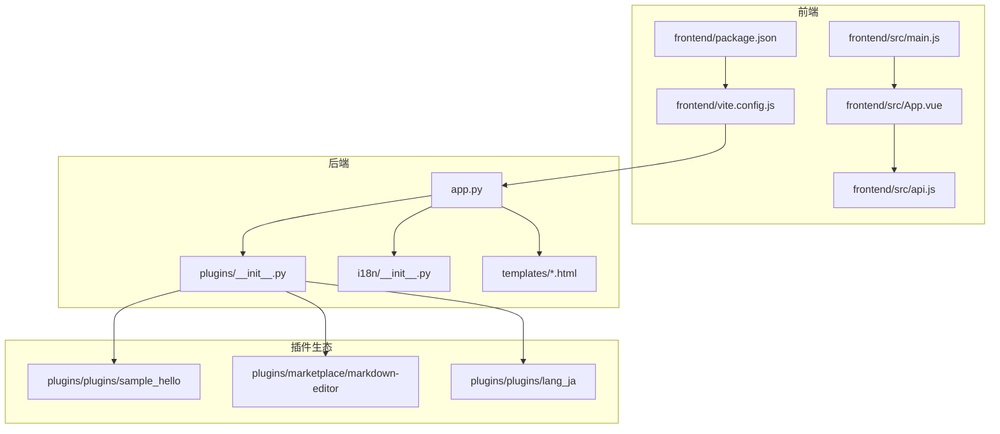
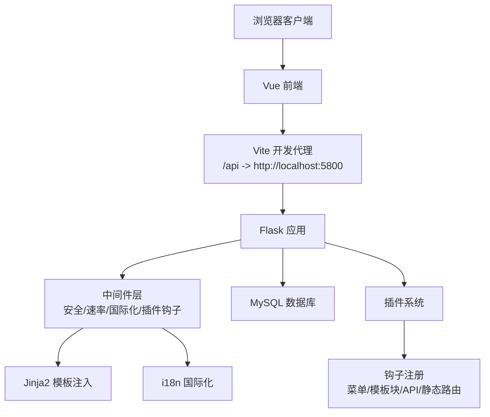
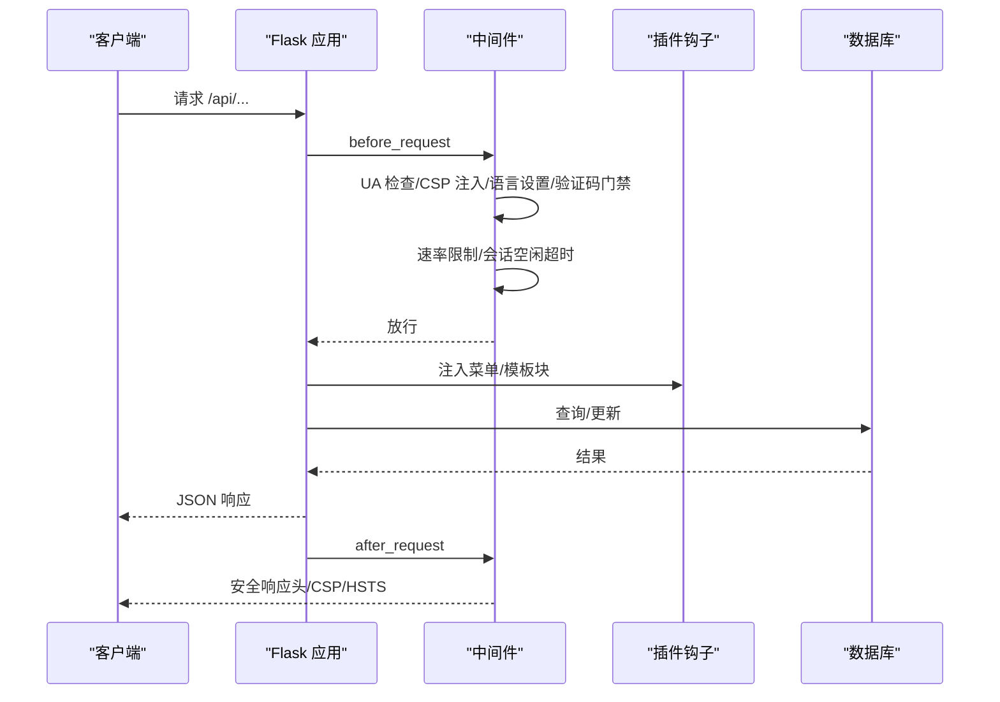
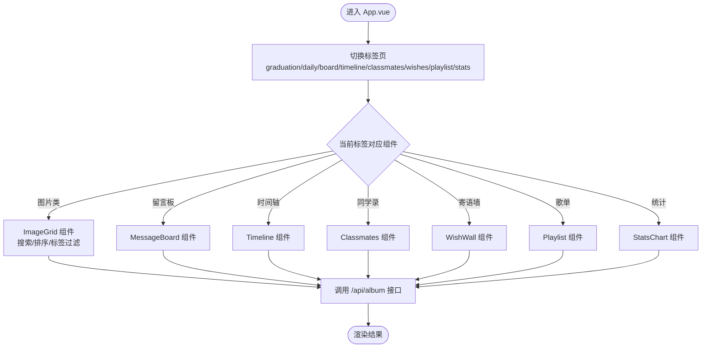
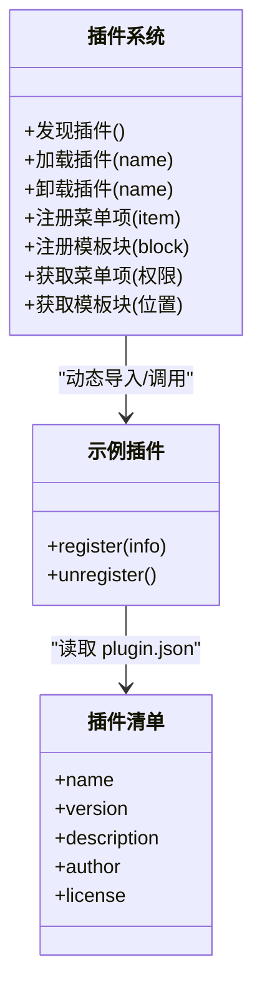
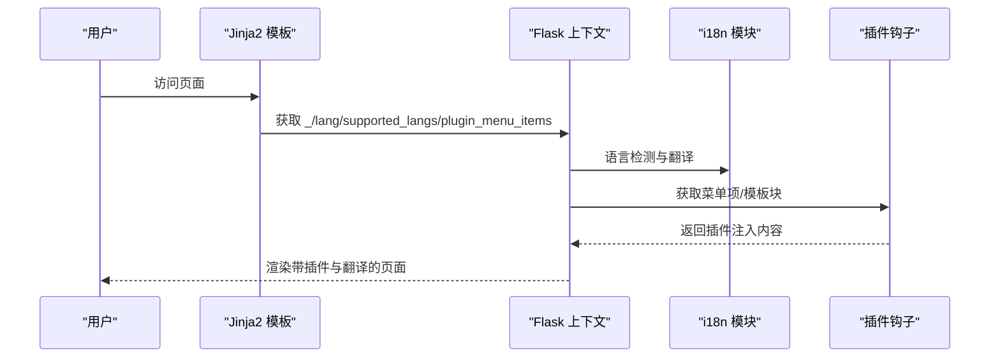
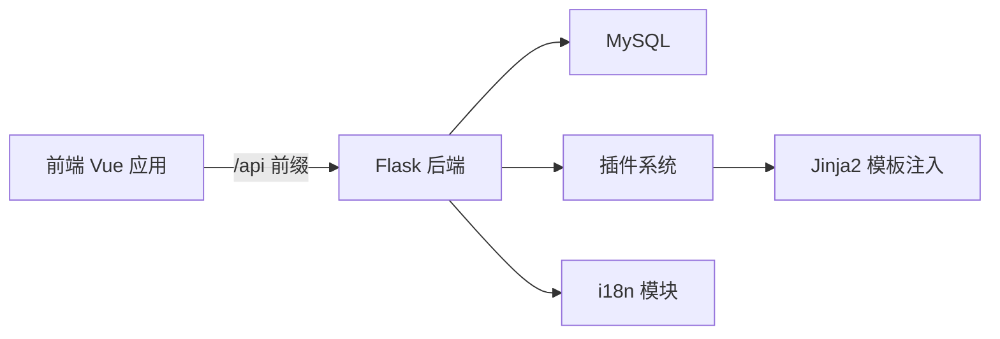

# 系统架构设计

<cite>
**本文引用的文件**
- [app.py](file://app.py)
- [frontend/src/main.js](file://frontend/src/main.js)
- [frontend/src/App.vue](file://frontend/src/App.vue)
- [frontend/src/api.js](file://frontend/src/api.js)
- [frontend/package.json](file://frontend/package.json)
- [frontend/vite.config.js](file://frontend/vite.config.js)
- [plugins/__init__.py](file://plugins/__init__.py)
- [plugins/plugins/sample_hello/__init__.py](file://plugins/plugins/sample_hello/__init__.py)
- [plugins/plugins/sample_hello/plugin.json](file://plugins/plugins/sample_hello/plugin.json)
- [plugins/marketplace/markdown-editor/plugin.json](file://plugins/marketplace/markdown-editor/plugin.json)
- [plugins/plugins/lang_ja/plugin.json](file://plugins/plugins/lang_ja/plugin.json)
- [i18n/__init__.py](file://i18n/__init__.py)
- [templates/base.html](file://templates/base.html)
- [templates/marketplace.html](file://templates/marketplace.html)
- [requirements.txt](file://requirements.txt)
</cite>

## 目录
1. [引言](#引言)
2. [项目结构](#项目结构)
3. [核心组件](#核心组件)
4. [架构总览](#架构总览)
5. [详细组件分析](#详细组件分析)
6. [依赖关系分析](#依赖关系分析)
7. [性能考虑](#性能考虑)
8. [故障排查指南](#故障排查指南)
9. [结论](#结论)
10. [附录](#附录)

## 引言
本设计文档面向 School_Web 的系统架构，聚焦以下目标：
- 前后端分离设计与 MVC 架构模式
- 插件化扩展架构与动态加载机制
- 技术栈选择原因与组件交互关系
- Flask 后端路由设计、中间件机制与数据库连接策略
- Vue.js 前端应用架构（组件化、状态管理、路由）
- 插件系统（钩子、模板注入、市场）
- 系统边界、数据流与依赖关系
- 架构决策的技术考量与性能优化策略

## 项目结构
项目采用“前后端分离 + 插件化扩展”的组织方式：
- 后端：基于 Flask 的 Python 应用，负责路由、中间件、安全策略、国际化、插件钩子注入与数据库访问
- 前端：基于 Vue 3 的 SPA，通过 Vite 开发服务器代理后端 API
- 插件系统：动态发现、加载、注册钩子（菜单、模板块、静态路由、API 路由）
- 国际化：i18n 模块集中管理多语言资源与语言检测
- 模板系统：Jinja2 模板注入插件内容与安全头

**图表来源**
- [frontend/src/main.js:1-6](file://frontend/src/main.js#L1-L6)
- [frontend/src/App.vue:1-99](file://frontend/src/App.vue#L1-L99)
- [frontend/src/api.js:1-45](file://frontend/src/api.js#L1-L45)
- [frontend/package.json:1-21](file://frontend/package.json#L1-L21)
- [frontend/vite.config.js:1-21](file://frontend/vite.config.js#L1-L21)
- [app.py:122-198](file://app.py#L122-L198)
- [plugins/__init__.py:1-249](file://plugins/__init__.py#L1-L249)
- [i18n/__init__.py:1-113](file://i18n/__init__.py#L1-L113)
- [templates/base.html:1-337](file://templates/base.html#L1-L337)
- [plugins/plugins/sample_hello/plugin.json:1-7](file://plugins/plugins/sample_hello/plugin.json#L1-L7)
- [plugins/marketplace/markdown-editor/plugin.json:1-10](file://plugins/marketplace/markdown-editor/plugin.json#L1-L10)
- [plugins/plugins/lang_ja/plugin.json:1-10](file://plugins/plugins/lang_ja/plugin.json#L1-L10)

**章节来源**
- [frontend/src/main.js:1-6](file://frontend/src/main.js#L1-L6)
- [frontend/src/App.vue:1-99](file://frontend/src/App.vue#L1-L99)
- [frontend/src/api.js:1-45](file://frontend/src/api.js#L1-L45)
- [frontend/package.json:1-21](file://frontend/package.json#L1-L21)
- [frontend/vite.config.js:1-21](file://frontend/vite.config.js#L1-L21)
- [app.py:122-198](file://app.py#L122-L198)
- [plugins/__init__.py:1-249](file://plugins/__init__.py#L1-L249)
- [i18n/__init__.py:1-113](file://i18n/__init__.py#L1-L113)
- [templates/base.html:1-337](file://templates/base.html#L1-L337)

## 核心组件
- Flask 应用与中间件
  - 安全中间件：UA 黑名单拦截、CSP nonce 注入、安全响应头、会话超时
  - 速率限制：内存桶 + 文件持久化，支持白名单与手动封禁
  - 全局验证码门禁：针对非登录用户的敏感路径进行二次验证
  - 国际化：请求前语言检测与模板上下文注入
  - 插件钩子：菜单项与模板块注入
- 插件系统
  - 动态发现与加载：扫描 plugins 目录，读取 plugin.json 与 __init__.py
  - 钩子注册：菜单项、模板块、静态路由、API 路由
  - 生命周期：register/unregister
- Vue 前端
  - 应用入口与根组件：main.js 与 App.vue
  - API 封装：统一前缀与凭据传递
  - 开发代理：Vite 代理 /api 与相册静态资源
- 国际化
  - 多语言资源加载与语言检测逻辑
- 模板系统
  - Jinja2 模板注入插件 footer/head 块与安全头

**章节来源**
- [app.py:152-198](file://app.py#L152-L198)
- [app.py:351-596](file://app.py#L351-L596)
- [app.py:644-677](file://app.py#L644-L677)
- [plugins/__init__.py:25-136](file://plugins/__init__.py#L25-L136)
- [plugins/__init__.py:143-193](file://plugins/__init__.py#L143-L193)
- [frontend/src/main.js:1-6](file://frontend/src/main.js#L1-L6)
- [frontend/src/App.vue:1-99](file://frontend/src/App.vue#L1-L99)
- [frontend/src/api.js:1-45](file://frontend/src/api.js#L1-L45)
- [frontend/vite.config.js:1-21](file://frontend/vite.config.js#L1-L21)
- [i18n/__init__.py:50-108](file://i18n/__init__.py#L50-L108)
- [templates/base.html:156-230](file://templates/base.html#L156-L230)

## 架构总览
系统采用前后端分离与插件化扩展的混合架构：
- 前端：Vue 3 SPA，开发时通过 Vite 代理后端 API，生产构建产物交由后端模板渲染或静态服务托管
- 后端：Flask 提供 RESTful API 与模板渲染，中间件统一处理安全、国际化、速率限制与插件钩子注入
- 插件：动态加载机制与钩子系统，支持菜单、模板块、静态路由与 API 路由扩展
- 数据：MySQL 通过 PyMySQL 连接，提供用户、相册、活动日志等业务数据

**图表来源**
- [frontend/vite.config.js:9-18](file://frontend/vite.config.js#L9-L18)
- [app.py:152-198](file://app.py#L152-L198)
- [app.py:644-677](file://app.py#L644-L677)
- [plugins/__init__.py:16-22](file://plugins/__init__.py#L16-L22)
- [i18n/__init__.py:1-113](file://i18n/__init__.py#L1-L113)
- [templates/base.html:220-224](file://templates/base.html#L220-L224)

## 详细组件分析

### Flask 后端：路由、中间件与数据库连接
- 路由设计
  - 静态资源与分享链接：跳过速率限制
  - 登录/注册/登出等页面：会话超时检测豁免
  - API 路由：统一前缀与跨域策略
- 中间件机制
  - before_request：UA 拦截、CSP nonce 注入、语言设置、全局验证码门禁、速率限制、会话空闲超时
  - after_request：安全响应头、CSP、HSTS（生产）、缓存控制
- 数据库连接
  - get_db/get_album_db：直接连接 MySQL，相册扩展表按需初始化
  - 未实现连接池：建议后续引入连接池以提升并发与稳定性

**图表来源**
- [app.py:152-198](file://app.py#L152-L198)
- [app.py:516-596](file://app.py#L516-L596)
- [app.py:644-677](file://app.py#L644-L677)
- [app.py:680-694](file://app.py#L680-L694)

**章节来源**
- [app.py:152-198](file://app.py#L152-L198)
- [app.py:516-596](file://app.py#L516-L596)
- [app.py:644-677](file://app.py#L644-L677)
- [app.py:680-694](file://app.py#L680-L694)

### Vue 前端：应用架构与交互
- 应用入口与根组件
  - main.js 创建应用并挂载根组件
  - App.vue 作为主界面容器，组织顶部栏、标签页、内容区与弹窗
- 组件化设计
  - 顶层组件通过组合式 API 管理状态与生命周期
  - 子组件职责清晰：图片网格、留言板、时间轴、同学录、寄语墙、歌单、统计图、音乐播放器等
- 状态管理
  - 使用组合式 API 的 ref/computed 管理本地状态
  - 通过 API 封装与后端交互，未使用 Pinia（尽管依赖中包含）
- 路由系统
  - 未见路由配置文件，页面切换通过标签页与条件渲染实现
- API 封装
  - 统一前缀 /api/album，携带凭据，简化调用

**图表来源**
- [frontend/src/App.vue:14-44](file://frontend/src/App.vue#L14-L44)
- [frontend/src/api.js:1-45](file://frontend/src/api.js#L1-L45)

**章节来源**
- [frontend/src/main.js:1-6](file://frontend/src/main.js#L1-L6)
- [frontend/src/App.vue:1-99](file://frontend/src/App.vue#L1-L99)
- [frontend/src/api.js:1-45](file://frontend/src/api.js#L1-L45)
- [frontend/package.json:11-19](file://frontend/package.json#L11-L19)

### 插件系统：动态加载、钩子与模板注入
- 动态加载机制
  - 扫描 plugins 目录，读取 plugin.json 与 __init__.py
  - 动态导入模块并调用 register/unregister
- 钩子系统
  - 菜单项：label/url/icon/permission/order
  - 模板块：position（如 footer/head）与 template 片段
  - 静态路由与 API 路由（注册表预留）
- 模板注入
  - Jinja2 上下文注入 plugin_menu_items 与 plugin_footer_blocks
  - 模板中循环渲染插件注入内容

**图表来源**
- [plugins/__init__.py:25-136](file://plugins/__init__.py#L25-L136)
- [plugins/plugins/sample_hello/__init__.py:1-32](file://plugins/plugins/sample_hello/__init__.py#L1-L32)
- [plugins/plugins/sample_hello/plugin.json:1-7](file://plugins/plugins/sample_hello/plugin.json#L1-L7)

**章节来源**
- [plugins/__init__.py:25-136](file://plugins/__init__.py#L25-L136)
- [plugins/__init__.py:143-193](file://plugins/__init__.py#L143-L193)
- [templates/base.html:220-224](file://templates/base.html#L220-L224)
- [plugins/marketplace/markdown-editor/plugin.json:1-10](file://plugins/marketplace/markdown-editor/plugin.json#L1-L10)
- [plugins/plugins/lang_ja/plugin.json:1-10](file://plugins/plugins/lang_ja/plugin.json#L1-L10)

### 国际化与模板系统
- 国际化
  - i18n 模块预加载多语言资源，支持语言检测与名称映射
  - Flask before_request 将翻译函数与语言信息注入模板上下文
- 模板系统
  - base.html 注入插件 footer 块与安全头
  - marketplace.html 展示插件市场卡片并通过 JS 调用 /api/marketplace

**图表来源**
- [i18n/__init__.py:50-108](file://i18n/__init__.py#L50-L108)
- [app.py:178-197](file://app.py#L178-L197)
- [templates/base.html:168-197](file://templates/base.html#L168-L197)
- [templates/base.html:220-224](file://templates/base.html#L220-L224)

**章节来源**
- [i18n/__init__.py:1-113](file://i18n/__init__.py#L1-L113)
- [app.py:178-197](file://app.py#L178-L197)
- [templates/base.html:1-337](file://templates/base.html#L1-L337)

## 依赖关系分析
- 技术栈
  - 后端：Flask、PyMySQL、psutil、requests
  - 前端：Vue 3、Vue Router、Pinia（未使用）、Vite、@vitejs/plugin-vue
- 组件耦合
  - 前端通过 /api 前缀与后端解耦
  - 插件系统通过钩子与后端模板/上下文弱耦合
  - 国际化与模板系统通过上下文注入强耦合但对外透明

**图表来源**
- [requirements.txt:1-5](file://requirements.txt#L1-L5)
- [frontend/package.json:11-19](file://frontend/package.json#L11-L19)
- [app.py:122-198](file://app.py#L122-L198)
- [plugins/__init__.py:16-22](file://plugins/__init__.py#L16-L22)
- [i18n/__init__.py:1-113](file://i18n/__init__.py#L1-L113)

**章节来源**
- [requirements.txt:1-5](file://requirements.txt#L1-L5)
- [frontend/package.json:1-21](file://frontend/package.json#L1-L21)

## 性能考虑
- 速率限制
  - 内存桶 + 文件持久化，避免频繁 IO；建议结合 Redis 或数据库实现跨进程共享
- 数据库连接
  - 当前未使用连接池，建议引入连接池以减少连接开销与提升并发
- 前端构建
  - 生产构建后静态资源可由 Nginx/CDN 提供，减少后端压力
- 模板渲染
  - 插件注入与国际化在模板层完成，建议缓存翻译与菜单结果以降低重复计算

[本节为通用指导，无需具体文件来源]

## 故障排查指南
- 速率限制与封禁
  - 检查 /api/captcha 与全局请求是否触发封禁；确认白名单与手动封禁配置
- 会话超时
  - 确认 /static/ 与特定路径是否被正确豁免；检查会话空闲时间与最近活跃记录
- 全局验证码门禁
  - 非登录用户访问敏感 API 时需二次验证；检查 /api/captcha 与模板渲染
- 插件加载失败
  - 检查 plugin.json 与 __init__.py 是否存在；查看动态导入异常日志
- 国际化显示异常
  - 确认语言检测逻辑与 cookie/session 优先级；检查翻译文件完整性

**章节来源**
- [app.py:516-596](file://app.py#L516-L596)
- [app.py:603-625](file://app.py#L603-L625)
- [plugins/__init__.py:60-110](file://plugins/__init__.py#L60-L110)
- [i18n/__init__.py:70-108](file://i18n/__init__.py#L70-L108)

## 结论
本系统通过前后端分离与插件化扩展实现了高内聚、低耦合的架构设计。Flask 提供稳定的安全中间件与模板注入能力，Vue 前端以组件化与 API 封装提升开发效率。插件系统通过钩子与动态加载实现功能扩展，国际化与模板系统保障用户体验一致性。建议后续引入数据库连接池与缓存策略以进一步提升性能与稳定性。

[本节为总结性内容，无需具体文件来源]

## 附录
- 系统边界
  - 前端边界：/api 前缀与静态资源代理
  - 后端边界：路由前缀、CORS 白名单、安全响应头
- 数据流向
  - 前端发起 API 请求 → 中间件处理 → 插件钩子注入 → 数据库查询 → 返回 JSON
- 依赖关系
  - 前端依赖 Vue 3 与 Vite；后端依赖 Flask 与 PyMySQL

[本节为概览性内容，无需具体文件来源]