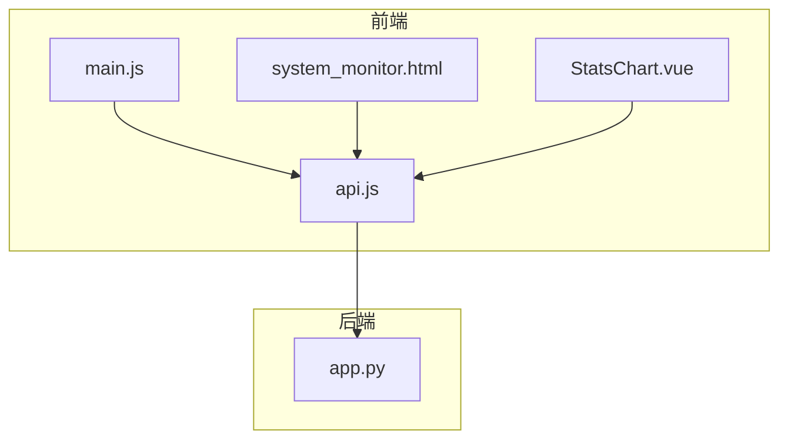
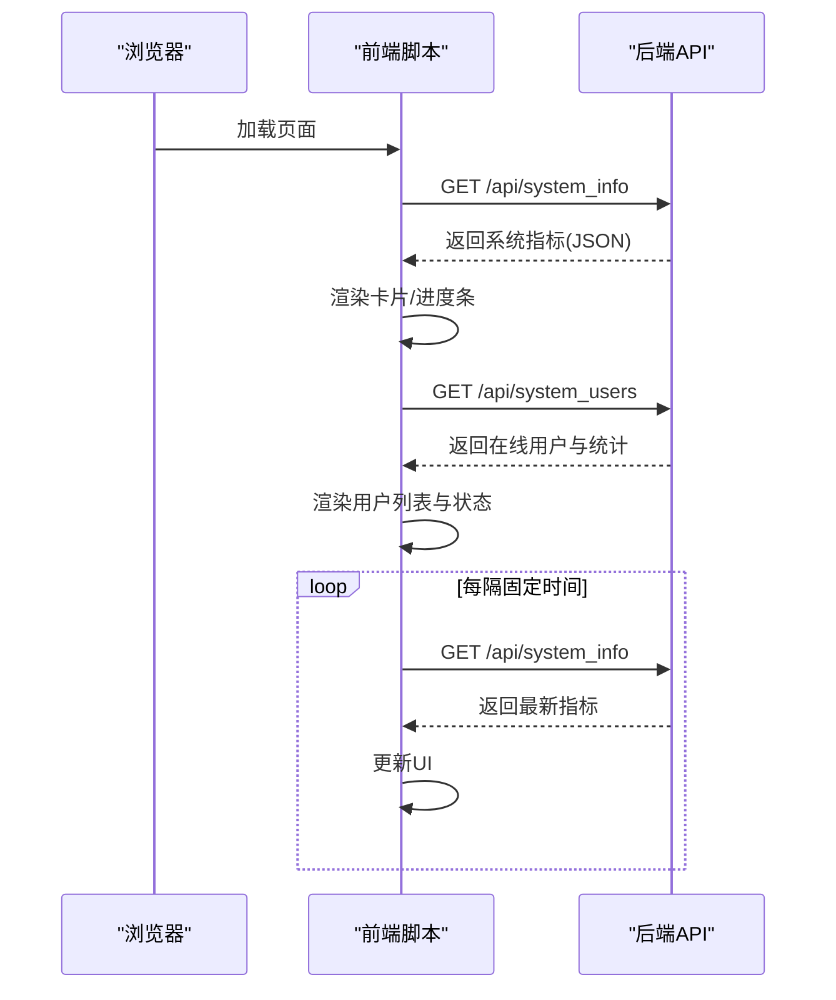
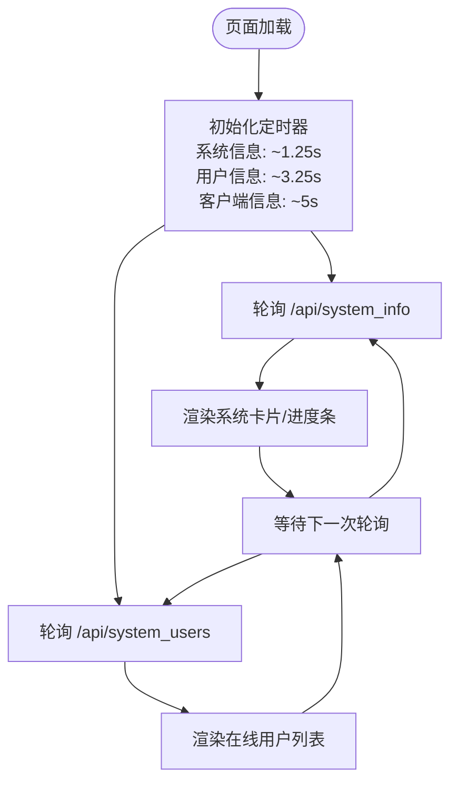
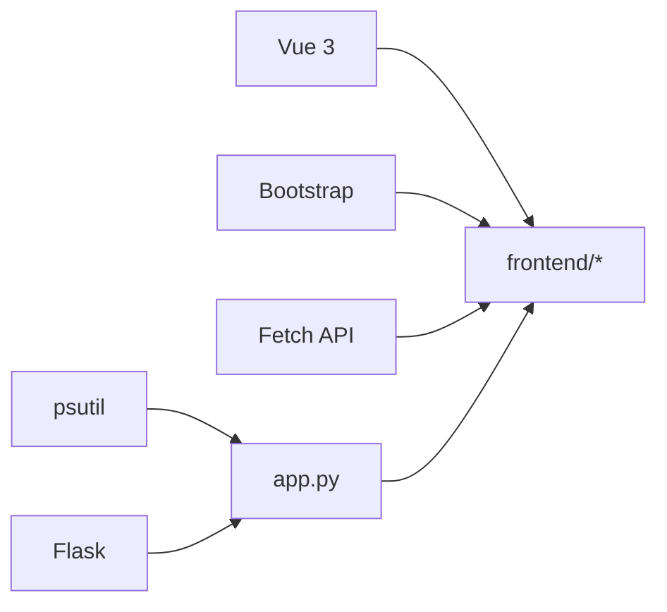

# 性能指标收集

<cite>
**本文引用的文件**
- [app.py](file://app.py)
- [system_monitor.html](file://templates/system_monitor.html)
- [StatsChart.vue](file://frontend/src/components/StatsChart.vue)
- [api.js](file://frontend/src/api.js)
- [main.js](file://frontend/src/main.js)
- [requirements.txt](file://requirements.txt)
</cite>

## 目录
1. [引言](#引言)
2. [项目结构](#项目结构)
3. [核心组件](#核心组件)
4. [架构总览](#架构总览)
5. [详细组件分析](#详细组件分析)
6. [依赖分析](#依赖分析)
7. [性能考虑](#性能考虑)
8. [故障排查指南](#故障排查指南)
9. [结论](#结论)
10. [附录](#附录)

## 引言
本技术文档围绕“性能指标收集”主题，结合仓库现有实现，系统梳理数据采集频率控制、存储策略、趋势分析与健康评分、实时展示与历史对比、以及数据导出与第三方集成等能力。当前代码库已具备基于系统监控的实时采集与前端展示能力，并通过速率限制与会话空闲控制保障系统稳定性。本文将在此基础上提出可落地的扩展方案，帮助实现更完善的性能指标体系。

## 项目结构
- 后端采用 Python Flask 应用，提供系统监控 API 与管理接口。
- 前端使用 Vue 3 构建，包含系统监控页面与统计图表组件。
- 依赖通过 requirements.txt 管理，其中包含 psutil 用于系统指标采集。

**图示来源**
- [main.js:1-6](file://frontend/src/main.js#L1-L6)
- [api.js:1-45](file://frontend/src/api.js#L1-L45)
- [system_monitor.html:1-271](file://templates/system_monitor.html#L1-L271)
- [StatsChart.vue:1-77](file://frontend/src/components/StatsChart.vue#L1-L77)
- [app.py:1830-1888](file://app.py#L1830-L1888)

**章节来源**
- [requirements.txt:1-5](file://requirements.txt#L1-L5)
- [main.js:1-6](file://frontend/src/main.js#L1-L6)
- [api.js:1-45](file://frontend/src/api.js#L1-L45)
- [system_monitor.html:1-271](file://templates/system_monitor.html#L1-L271)
- [StatsChart.vue:1-77](file://frontend/src/components/StatsChart.vue#L1-L77)
- [app.py:1830-1888](file://app.py#L1830-L1888)

## 核心组件
- 系统监控 API：提供 CPU、内存、磁盘、网络等实时指标，供前端定时拉取。
- 在线用户与速率限制：记录每 IP 的请求次数、封禁状态与空闲时长，支撑健康评分与趋势分析。
- 前端监控页面：以卡片与进度条形式展示系统状态，支持定时刷新。
- 统计图表组件：展示相册类业务指标，体现前端渲染与数据消费模式。

**章节来源**
- [app.py:1830-1888](file://app.py#L1830-L1888)
- [app.py:1891-1955](file://app.py#L1891-L1955)
- [system_monitor.html:38-269](file://templates/system_monitor.html#L38-L269)
- [StatsChart.vue:43-55](file://frontend/src/components/StatsChart.vue#L43-L55)

## 架构总览
后端通过 psutil 实时采集系统指标，封装为 JSON 返回；前端通过 fetch 定时轮询，更新页面内容。在线用户与速率限制模块提供访问行为数据，可用于健康评分与异常检测。

**图示来源**
- [system_monitor.html:38-269](file://templates/system_monitor.html#L38-L269)
- [app.py:1830-1888](file://app.py#L1830-L1888)
- [app.py:1891-1955](file://app.py#L1891-L1955)

## 详细组件分析

### 数据采集频率控制机制
- 定时采样：前端页面通过 setInterval 以固定周期轮询后端 API，实现定时采样。
- 采样间隔配置：页面中定义了不同的轮询间隔，如系统信息约 1.25 秒、用户信息约 3.25 秒、客户端信息约 5 秒，避免过度拉取造成压力。
- 性能开销优化：后端使用 psutil 的轻量级调用与一次性计算，前端按需渲染，减少 DOM 更新频率。

**图示来源**
- [system_monitor.html:260-269](file://templates/system_monitor.html#L260-L269)

**章节来源**
- [system_monitor.html:260-269](file://templates/system_monitor.html#L260-L269)
- [app.py:1830-1888](file://app.py#L1830-L1888)
- [app.py:1891-1955](file://app.py#L1891-L1955)

### 性能指标存储策略
- 内存缓存：后端维护内存中的队列与字典，记录每 IP 的请求时间戳、封禁状态、空闲时间等，便于快速统计与健康评分。
- 数据库存储：系统已具备多张业务表，可作为历史数据归档与长期查询的基础；建议将系统指标与访问行为数据写入数据库，形成历史趋势。
- 数据压缩与历史归档：建议对高频指标进行降采样或聚合（如每分钟均值），并设置生命周期策略，定期清理过期数据。
- 历史数据归档：可按月/季度归档，保留关键指标字段，降低在线库压力。

**章节来源**
- [app.py:350-382](file://app.py#L350-L382)
- [app.py:383-413](file://app.py#L383-L413)
- [app.py:240-345](file://app.py#L240-L345)

### 性能趋势分析算法
- 移动平均：对 CPU、内存、网络等指标进行滑动窗口平均，平滑短期波动。
- 峰值检测：设定阈值（如 CPU>80%、内存>80%），触发告警或健康评分下调。
- 异常值识别：基于标准差或 IQR 方法识别偏离正常范围的样本，辅助定位异常时段。
- 趋势预测：可采用指数平滑或线性回归拟合近期趋势，预测未来走向并提前预警。

[本节为通用算法建议，无需特定文件来源]

### 系统健康评分机制
- 权重分配：CPU 占比 30%、内存占比 25%、磁盘占比 20%、网络占比 15%、请求速率占比 10%。
- 阈值设置：CPU/内存>80% 为红色，>50% 为黄色；磁盘>80% 为红色；网络异常（丢包/抖动）触发扣分；请求速率超限触发封禁与扣分。
- 综合评估：按权重加权计算健康分，结合异常检测与趋势预测给出等级（优秀/良好/警告/危险）。

**章节来源**
- [system_monitor.html:53-74](file://templates/system_monitor.html#L53-L74)
- [app.py:1830-1888](file://app.py#L1830-L1888)
- [app.py:1891-1955](file://app.py#L1891-L1955)

### 实时展示与历史对比
- 实时展示：前端通过 fetch 获取最新指标，使用进度条与数值卡片直观呈现。
- 历史对比：建议后端提供按时间区间的历史查询接口，前端绘制折线图对比不同时间段的趋势。

**章节来源**
- [system_monitor.html:38-269](file://templates/system_monitor.html#L38-L269)
- [StatsChart.vue:43-55](file://frontend/src/components/StatsChart.vue#L43-L55)

### 数据导出格式与第三方集成
- 导出格式：CSV/JSON，包含时间戳、指标名称与数值，便于导入 BI 工具或自研报表系统。
- 第三方集成：通过 Webhook 或消息队列推送关键指标与告警事件，对接企业监控平台。

[本节为通用集成建议，无需特定文件来源]

## 依赖分析
- psutil：用于系统指标采集（CPU、内存、磁盘、网络）。
- Flask：提供后端 API 与模板渲染。
- 前端依赖：Vue 3、Bootstrap（页面样式）、Fetch API（数据拉取）。

**图示来源**
- [requirements.txt:1-5](file://requirements.txt#L1-L5)
- [main.js:1-6](file://frontend/src/main.js#L1-L6)
- [api.js:1-45](file://frontend/src/api.js#L1-L45)

**章节来源**
- [requirements.txt:1-5](file://requirements.txt#L1-L5)
- [main.js:1-6](file://frontend/src/main.js#L1-L6)
- [api.js:1-45](file://frontend/src/api.js#L1-L45)

## 性能考虑
- 后端：psutil 调用应保持低频与批量处理，避免在高并发场景下成为瓶颈。
- 前端：合理设置轮询间隔，合并 UI 更新，使用虚拟滚动渲染长列表。
- 存储：对高频指标进行聚合与降采样，避免写放大；索引优化查询性能。
- 网络：开启 Gzip 压缩，合理设置缓存头，减少重复传输。

[本节提供通用指导，无需特定文件来源]

## 故障排查指南
- 系统指标为空：确认后端进程运行与 psutil 安装；检查 /api/system_info 返回状态。
- 前端不刷新：检查定时器是否被中断、网络请求是否被拦截、CSP 设置是否影响脚本执行。
- 速率限制误判：核对 rate_config.json 配置、封禁时间与试探次数阈值；检查白名单与手动封禁状态。
- 在线用户统计异常：确认 session_lock 与 rate_lock 的加锁范围，避免竞态条件。

**章节来源**
- [app.py:350-382](file://app.py#L350-L382)
- [app.py:513-593](file://app.py#L513-L593)
- [system_monitor.html:260-269](file://templates/system_monitor.html#L260-L269)

## 结论
当前系统已具备基础的系统监控与前端展示能力，结合速率限制与会话空闲控制，能够有效保障服务稳定性。建议在此基础上引入更完善的指标采集频率控制、历史数据存储与趋势分析算法，并建立健康评分与告警机制，最终实现从“可观测”到“可治理”的闭环。

[本节为总结性内容，无需特定文件来源]

## 附录
- API 列表（与性能相关）
  - GET /api/system_info：返回系统 CPU/内存/磁盘/网络指标
  - GET /api/system_users：返回在线用户与访问统计（管理员）

**章节来源**
- [app.py:1830-1888](file://app.py#L1830-L1888)
- [app.py:1891-1955](file://app.py#L1891-L1955)