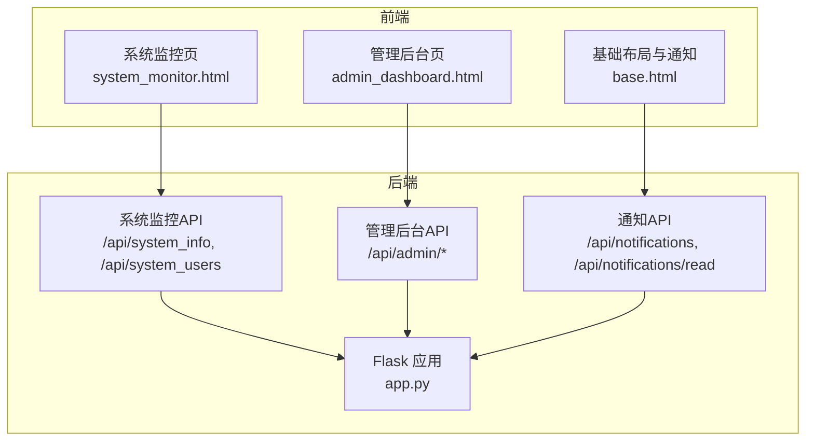
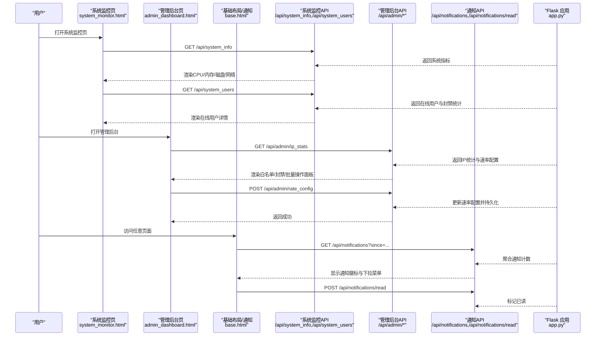
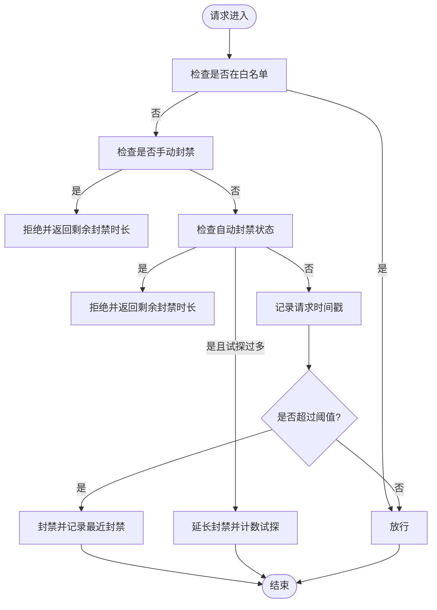
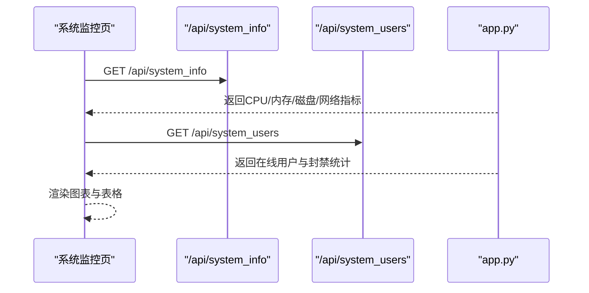
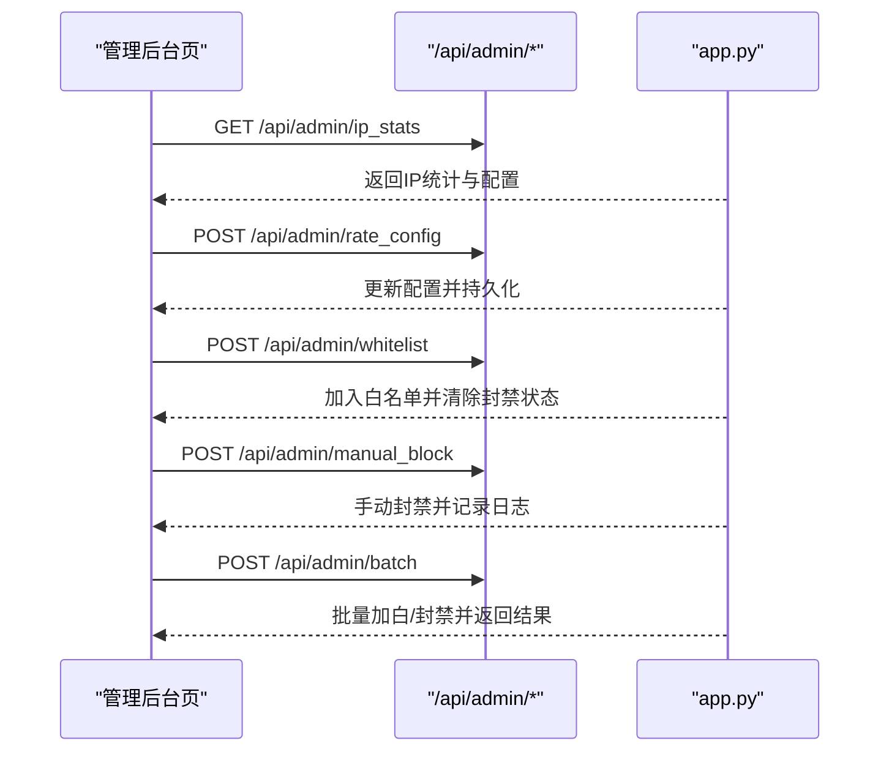
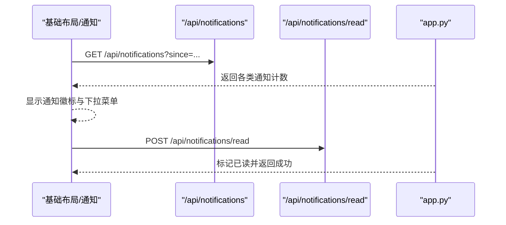
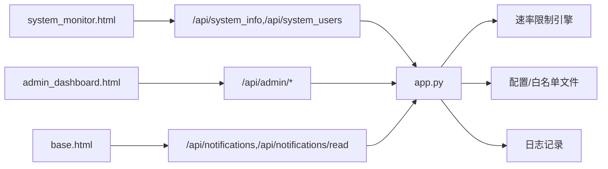

# 监控告警机制

<cite>
**本文引用的文件**
- [app.py](file://app.py)
- [system_monitor.html](file://templates/system_monitor.html)
- [admin_dashboard.html](file://templates/admin_dashboard.html)
- [base.html](file://templates/base.html)
</cite>

## 目录
1. [简介](#简介)
2. [项目结构](#项目结构)
3. [核心组件](#核心组件)
4. [架构总览](#架构总览)
5. [详细组件分析](#详细组件分析)
6. [依赖分析](#依赖分析)
7. [性能考量](#性能考量)
8. [故障排查指南](#故障排查指南)
9. [结论](#结论)
10. [附录](#附录)

## 简介
本文件面向“监控告警机制”的技术文档需求，结合仓库现有实现，系统梳理与告警相关的能力边界与扩展路径。当前代码库实现了完善的“速率限制与封禁”能力，并配套了“系统监控页面”“管理后台”“通知中心”等前端界面与后端API，为后续扩展“阈值设置系统（静态/动态/自适应/多级）”“告警触发条件（单指标/复合/延时/恢复）”“通知方式（邮件/短信/微信/钉钉/企业微信）”“告警处理流程（确认/指派/跟踪/反馈）”“统计与报表（趋势/效率/成本）”“动态配置与批量管理”等能力提供了清晰的落点与扩展方向。

## 项目结构
- 后端服务采用Flask框架，集中于应用入口与路由定义，包含速率限制、系统监控、管理后台、通知中心等模块。
- 前端模板位于templates目录，包含系统监控页、管理后台页、基础布局与通知下拉菜单等。
- 前端通过AJAX调用后端API，实现数据刷新、配置变更、封禁/解封、白名单维护、批量操作等功能。

图表来源
- [system_monitor.html:1-271](file://templates/system_monitor.html#L1-L271)
- [admin_dashboard.html:1-800](file://templates/admin_dashboard.html#L1-L800)
- [base.html:301-336](file://templates/base.html#L301-L336)
- [app.py:1827-1888](file://app.py#L1827-L1888)
- [app.py:4044-4102](file://app.py#L4044-L4102)
- [app.py:1644-1707](file://app.py#L1644-L1707)

章节来源
- [app.py:1817-1824](file://app.py#L1817-L1824)
- [app.py:1827-1888](file://app.py#L1827-L1888)
- [app.py:4044-4102](file://app.py#L4044-L4102)
- [app.py:1644-1707](file://app.py#L1644-L1707)
- [system_monitor.html:1-271](file://templates/system_monitor.html#L1-L271)
- [admin_dashboard.html:1-800](file://templates/admin_dashboard.html#L1-L800)
- [base.html:301-336](file://templates/base.html#L301-L336)

## 核心组件
- 速率限制与封禁引擎
  - 基于内存的滑动窗口计数器，支持动态配置窗口大小、请求数阈值、封禁时长、试探阈值与追加封禁。
  - 支持白名单豁免、手动封禁、封禁试探检测与封禁延长。
  - 提供持久化配置文件与白名单文件，支持热更新。
- 系统监控页面
  - 展示CPU、内存、磁盘、网络等系统指标，支持定时刷新。
  - 展示在线用户、活跃IP、封禁/白名单统计等。
- 管理后台
  - 提供白名单管理、手动封禁、批量操作、速率限制配置修改、服务器状态可视化等。
- 通知中心
  - 前端轮询后端通知API，聚合聊天未读、管理员申请、封禁IP、待审核照片等通知项，支持标记已读。

章节来源
- [app.py:31-114](file://app.py#L31-L114)
- [app.py:348-592](file://app.py#L348-L592)
- [app.py:4258-4284](file://app.py#L4258-L4284)
- [system_monitor.html:37-269](file://templates/system_monitor.html#L37-L269)
- [admin_dashboard.html:106-367](file://templates/admin_dashboard.html#L106-L367)
- [base.html:301-336](file://templates/base.html#L301-L336)

## 架构总览
下图展示了从前端到后端的关键交互路径，以及与通知系统的联动。

图表来源
- [system_monitor.html:37-269](file://templates/system_monitor.html#L37-L269)
- [admin_dashboard.html:106-367](file://templates/admin_dashboard.html#L106-L367)
- [base.html:301-336](file://templates/base.html#L301-L336)
- [app.py:1827-1888](file://app.py#L1827-L1888)
- [app.py:4044-4102](file://app.py#L4044-L4102)
- [app.py:4258-4284](file://app.py#L4258-L4284)
- [app.py:1644-1707](file://app.py#L1644-L1707)

## 详细组件分析

### 速率限制与封禁引擎
- 设计要点
  - 滑动窗口：按IP维度维护请求时间戳队列，窗口外的请求自动清理。
  - 动态配置：支持窗口大小、请求数阈值、封禁时长、试探阈值、追加封禁等参数的热更新。
  - 状态管理：区分白名单、手动封禁、自动封禁，封禁期间支持试探检测与封禁延长。
  - 持久化：配置与白名单写入文件，重启不丢失。
- 关键API
  - 获取/设置速率配置：/api/admin/rate_config
  - IP统计：/api/admin/ip_stats
  - 清除统计：/api/admin/ip_stats (DELETE)
  - 解封：/api/admin/unblock
  - 白名单增删改查：/api/admin/whitelist
  - 手动封禁：/api/admin/manual_block
  - 批量操作：/api/admin/batch

图表来源
- [app.py:513-562](file://app.py#L513-L562)
- [app.py:348-592](file://app.py#L348-L592)
- [app.py:4258-4284](file://app.py#L4258-L4284)

章节来源
- [app.py:31-114](file://app.py#L31-L114)
- [app.py:348-592](file://app.py#L348-L592)
- [app.py:4044-4102](file://app.py#L4044-L4102)
- [app.py:4127-4256](file://app.py#L4127-L4256)
- [app.py:4258-4284](file://app.py#L4258-L4284)

### 系统监控页面
- 功能概述
  - 实时展示CPU/内存/磁盘/网络等系统指标，支持定时刷新。
  - 展示在线用户、活跃IP、封禁/白名单统计与详情。
  - 前端通过AJAX调用后端API，实现数据拉取与渲染。
- 关键API
  - /api/system_info：返回系统基础信息、CPU/内存、磁盘分区、网络IO。
  - /api/system_users：返回在线用户列表、封禁/白名单状态、请求次数等。

图表来源
- [system_monitor.html:37-269](file://templates/system_monitor.html#L37-L269)
- [app.py:1827-1888](file://app.py#L1827-L1888)
- [app.py:1891-1955](file://app.py#L1891-L1955)

章节来源
- [system_monitor.html:1-271](file://templates/system_monitor.html#L1-L271)
- [app.py:1827-1888](file://app.py#L1827-L1888)
- [app.py:1891-1955](file://app.py#L1891-L1955)

### 管理后台
- 功能概述
  - 白名单管理：支持单个/批量添加、移除、列表展示。
  - 手动封禁：支持选择时长进行封禁，展示剩余时长。
  - 批量操作：支持批量加白/封禁，返回成功/跳过/失败集合。
  - 速率限制配置：支持修改窗口、阈值、封禁时长、试探阈值、追加封禁。
  - 服务器状态：仪表盘式展示CPU/内存/磁盘/网络。
- 关键API
  - /api/admin/ip_stats：获取IP统计与速率配置。
  - /api/admin/unblock：解封指定IP。
  - /api/admin/whitelist：白名单增删改查。
  - /api/admin/manual_block：手动封禁。
  - /api/admin/batch：批量操作。
  - /api/admin/rate_config：获取/设置速率配置。

图表来源
- [admin_dashboard.html:106-367](file://templates/admin_dashboard.html#L106-L367)
- [app.py:4044-4102](file://app.py#L4044-L4102)
- [app.py:4127-4256](file://app.py#L4127-L4256)
- [app.py:4258-4284](file://app.py#L4258-L4284)

章节来源
- [admin_dashboard.html:106-367](file://templates/admin_dashboard.html#L106-L367)
- [app.py:4044-4102](file://app.py#L4044-L4102)
- [app.py:4127-4256](file://app.py#L4127-L4256)
- [app.py:4258-4284](file://app.py#L4258-L4284)

### 通知中心
- 功能概述
  - 前端定时轮询后端通知API，聚合聊天未读、管理员申请、封禁IP、待审核照片等。
  - 支持标记已读，清空通知徽标。
- 关键API
  - /api/notifications：获取未读通知数量。
  - /api/notifications/read：标记已读。

图表来源
- [base.html:301-336](file://templates/base.html#L301-L336)
- [app.py:1644-1707](file://app.py#L1644-L1707)

章节来源
- [base.html:301-336](file://templates/base.html#L301-L336)
- [app.py:1644-1707](file://app.py#L1644-L1707)

## 依赖分析
- 前端与后端通过REST API交互，前端负责数据渲染与用户交互，后端负责业务逻辑与状态存储。
- 通知系统与管理后台存在耦合：管理后台的封禁行为会影响通知中心的“封禁IP”计数。
- 速率限制引擎与管理后台存在耦合：管理后台的配置变更直接影响封禁策略与封禁延长逻辑。

图表来源
- [system_monitor.html:37-269](file://templates/system_monitor.html#L37-L269)
- [admin_dashboard.html:106-367](file://templates/admin_dashboard.html#L106-L367)
- [base.html:301-336](file://templates/base.html#L301-L336)
- [app.py:31-114](file://app.py#L31-L114)
- [app.py:348-592](file://app.py#L348-L592)
- [app.py:4258-4284](file://app.py#L4258-L4284)

章节来源
- [app.py:31-114](file://app.py#L31-L114)
- [app.py:348-592](file://app.py#L348-L592)
- [app.py:4258-4284](file://app.py#L4258-L4284)
- [system_monitor.html:37-269](file://templates/system_monitor.html#L37-L269)
- [admin_dashboard.html:106-367](file://templates/admin_dashboard.html#L106-L367)
- [base.html:301-336](file://templates/base.html#L301-L336)

## 性能考量
- 前端定时刷新策略
  - 系统监控页对不同接口采用不同的刷新间隔，避免过度请求导致负载上升。
  - 管理后台对IP统计采用倒计时与定时器结合的方式，减少不必要的轮询。
- 后端状态存储
  - 速率限制状态与白名单采用内存结构，查询与更新复杂度低；配置与白名单定期持久化，降低重启后状态丢失风险。
- I/O与网络
  - 系统监控API依赖psutil，建议在高并发场景下适当调整刷新频率，避免采集开销过大。
  - 通知API按需聚合，避免重复查询数据库。

## 故障排查指南
- 速率限制误判
  - 现象：正常用户被封禁或封禁时间异常。
  - 排查：检查速率配置、试探阈值与封禁延长逻辑；确认是否存在白名单误加或手动封禁冲突。
  - 参考路径：[app.py:513-562](file://app.py#L513-L562)、[app.py:4258-4284](file://app.py#L4258-L4284)、[app.py:4127-4207](file://app.py#L4127-L4207)
- 通知不显示或计数异常
  - 现象：通知徽标不更新或显示错误计数。
  - 排查：确认since参数传递正确；检查后端通知聚合逻辑；确认本地存储的已读时间是否被正确更新。
  - 参考路径：[app.py:1644-1707](file://app.py#L1644-L1707)、[base.html:301-336](file://templates/base.html#L301-L336)
- 管理后台无法修改配置
  - 现象：修改速率配置后未生效。
  - 排查：确认请求体字段与数值合法性；检查持久化文件写入权限；确认日志记录是否成功。
  - 参考路径：[app.py:4258-4284](file://app.py#L4258-L4284)

章节来源
- [app.py:513-562](file://app.py#L513-L562)
- [app.py:4258-4284](file://app.py#L4258-L4284)
- [app.py:1644-1707](file://app.py#L1644-L1707)
- [base.html:301-336](file://templates/base.html#L301-L336)

## 结论
当前代码库已具备完善的“速率限制与封禁”能力，并通过系统监控页、管理后台与通知中心形成了可观测、可治理的运维闭环。围绕“阈值设置系统”“告警触发条件”“通知方式”“告警处理流程”“统计与报表”“动态配置与批量管理”的扩展，均可在此基础上进行模块化增强，既保证与现有实现的兼容性，又满足未来告警体系的演进需求。

## 附录
- 扩展建议（概念性）
  - 阈值设置系统
    - 静态阈值：沿用现有速率配置字段，直接映射到封禁策略。
    - 动态阈值：引入滑动窗口平均值、标准差等统计指标，按时间窗口动态调整阈值。
    - 自适应阈值：结合历史峰值、业务时段、节假日等因素，训练模型预测阈值。
    - 多级阈值：针对不同指标（CPU/内存/磁盘/网络/请求速率）分别设置阈值与优先级。
  - 告警触发条件
    - 单指标告警：任一指标越限时触发。
    - 复合条件告警：多指标同时或连续越限触发，支持权重与相关性过滤。
    - 延时触发：设置“稳态窗口”，避免瞬时抖动引发误报。
    - 恢复条件：指标回落至阈值以下并持续一段时间视为恢复。
  - 通知方式配置
    - 邮件通知：集成SMTP或第三方邮件服务。
    - 短信告警：对接短信网关API。
    - 微信/钉钉/企业微信：对接官方Webhook或机器人接口。
  - 告警处理流程
    - 确认：人工/自动确认告警有效性。
    - 指派：将告警分配给责任人或团队。
    - 跟踪：记录处置步骤、耗时与结果。
    - 反馈：形成知识库，沉淀经验。
  - 统计与报表
    - 告警趋势：按日/周/月统计告警数量与分布。
    - 处理效率：平均响应时间、解决时间、首次修复率。
    - 告警成本：人力成本、外部服务费用、SLA影响评估。
  - 动态配置与批量管理
    - 规则模板：提供常用阈值模板，快速部署。
    - 批量导入/导出：支持规则集的批量导入与导出。
    - 灰度发布：支持规则的灰度生效与回滚。