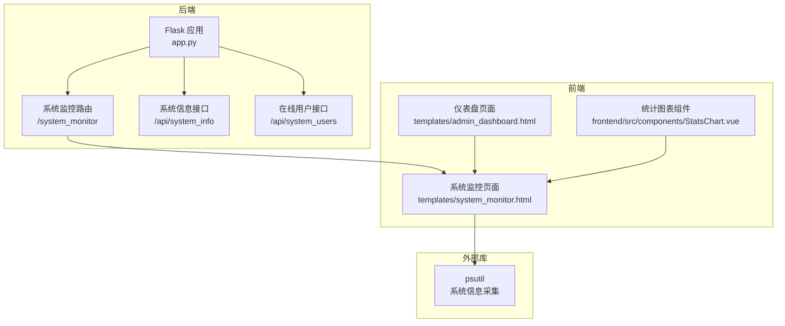
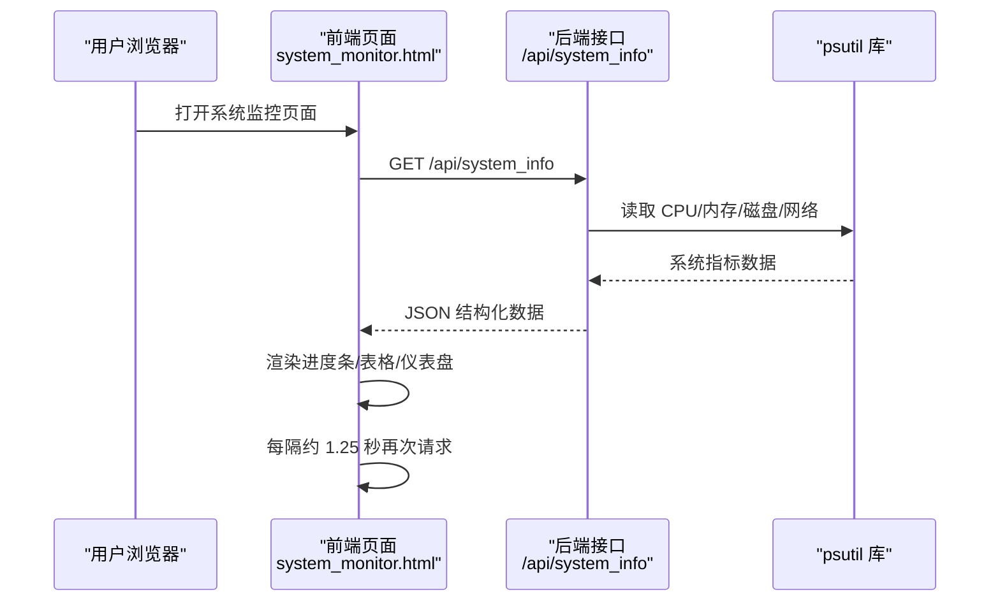
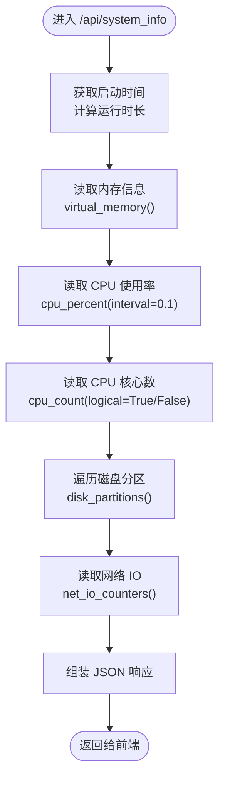
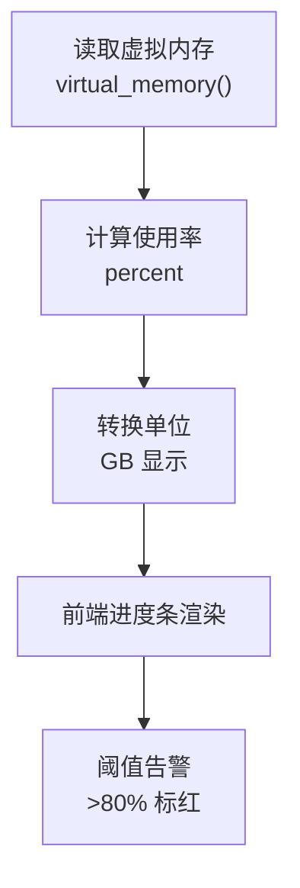
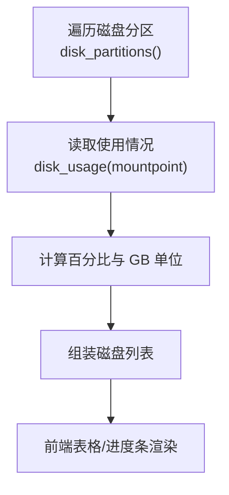
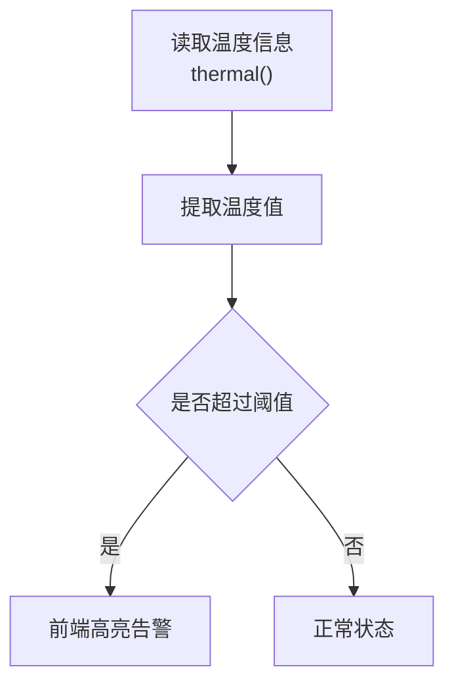
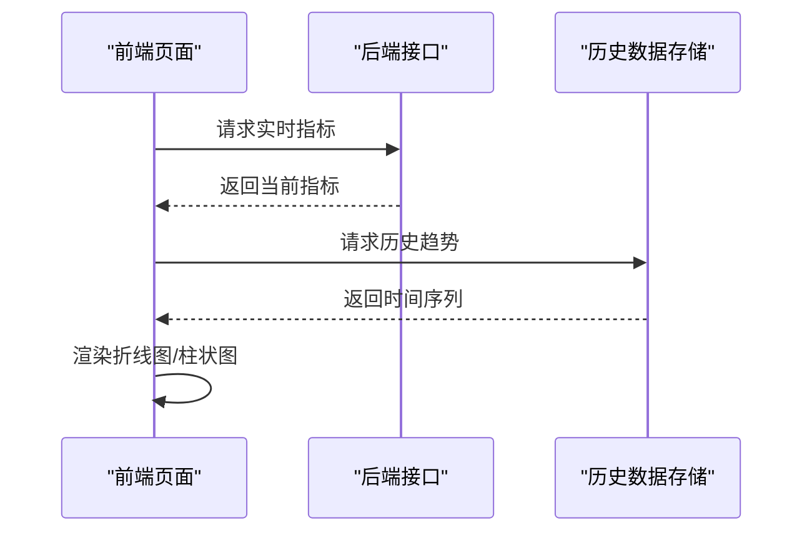
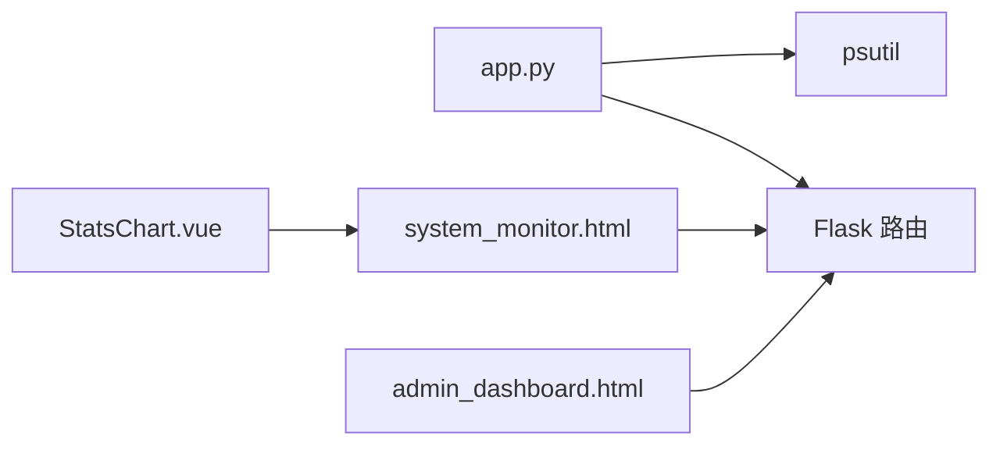

# 硬件状态监控

<cite>
**本文引用的文件**
- [app.py](file://app.py)
- [system_monitor.html](file://templates/system_monitor.html)
- [requirements.txt](file://requirements.txt)
- [admin_dashboard.html](file://templates/admin_dashboard.html)
- [StatsChart.vue](file://frontend/src/components/StatsChart.vue)
</cite>

## 目录
1. [简介](#简介)
2. [项目结构](#项目结构)
3. [核心组件](#核心组件)
4. [架构总览](#架构总览)
5. [详细组件分析](#详细组件分析)
6. [依赖分析](#依赖分析)
7. [性能考虑](#性能考虑)
8. [故障排查指南](#故障排查指南)
9. [结论](#结论)
10. [附录](#附录)

## 简介
本技术文档聚焦于系统硬件状态监控功能，基于 Python 的 Flask 后端与 Vue/Bootstrap 前端实现，结合 psutil 库完成对 CPU、内存、磁盘、网络等硬件指标的采集与展示。文档涵盖以下主题：
- CPU 使用率监控：单核与多核采集、负载均衡与性能指标计算
- 内存监控：物理内存、虚拟内存、交换分区与内存泄漏检测思路
- 磁盘空间监控：分区监控、使用率计算与空间预警
- 系统温度监控：传感器读取、阈值设置与过热保护机制
- 实时展示与历史趋势：前端图表与历史数据存储建议
- 性能优化与可视化建议

## 项目结构
系统监控功能主要由以下部分组成：
- 后端路由与监控 API：提供系统信息、在线用户统计等接口
- 前端页面与组件：实时展示硬件指标与交互式图表
- 依赖库：psutil 用于系统信息采集，Flask 提供 Web 服务

**图示来源**
- [app.py:1815-1953](file://app.py#L1815-L1953)
- [system_monitor.html:1-271](file://templates/system_monitor.html#L1-L271)
- [admin_dashboard.html:243-727](file://templates/admin_dashboard.html#L243-L727)
- [StatsChart.vue:1-77](file://frontend/src/components/StatsChart.vue#L1-L77)

**章节来源**
- [app.py:1815-1953](file://app.py#L1815-L1953)
- [system_monitor.html:1-271](file://templates/system_monitor.html#L1-L271)
- [requirements.txt:1-5](file://requirements.txt#L1-L5)

## 核心组件
- 系统监控页面：负责拉取后端接口并渲染 CPU、内存、磁盘、网络等指标
- 系统信息接口：聚合 psutil 数据，返回结构化 JSON
- 在线用户接口：统计在线 IP、请求速率与封禁状态
- 仪表盘页面：提供更丰富的硬件仪表盘与磁盘表格视图

**章节来源**
- [system_monitor.html:38-76](file://templates/system_monitor.html#L38-L76)
- [app.py:1824-1886](file://app.py#L1824-L1886)
- [app.py:1889-1953](file://app.py#L1889-L1953)
- [admin_dashboard.html:243-727](file://templates/admin_dashboard.html#L243-L727)

## 架构总览
系统采用前后端分离模式：
- 前端通过 fetch 请求后端接口，定时刷新数据
- 后端使用 psutil 采集系统指标，封装为 JSON 返回
- 前端使用 Bootstrap 与原生 JS 渲染进度条、表格与 SVG 仪表盘

**图示来源**
- [system_monitor.html:39-76](file://templates/system_monitor.html#L39-L76)
- [app.py:1824-1886](file://app.py#L1824-L1886)

**章节来源**
- [system_monitor.html:38-76](file://templates/system_monitor.html#L38-L76)
- [app.py:1824-1886](file://app.py#L1824-L1886)

## 详细组件分析

### CPU 使用率监控
- 采集方式：使用 psutil 获取 CPU 使用率与核心数量
- 多核支持：同时提供物理核数与逻辑核数，便于区分负载分布
- 性能指标：当前 CPU 使用率百分比，用于前端进度条与告警
- 负载均衡：结合在线用户与请求速率，评估系统负载是否集中在少数核心

**图示来源**
- [app.py:1824-1886](file://app.py#L1824-L1886)

**章节来源**
- [app.py:1836-1870](file://app.py#L1836-L1870)
- [system_monitor.html:52-56](file://templates/system_monitor.html#L52-L56)

### 内存监控
- 指标采集：物理内存总量、已用、可用、使用率
- 虚拟内存与交换分区：可通过扩展 psutil 的虚拟内存接口实现
- 内存泄漏检测：通过对比一段时间内的“已用”与“可用”变化趋势，结合进程级内存占用，定位异常增长

**图示来源**
- [app.py:1836-1876](file://app.py#L1836-L1876)
- [system_monitor.html:56-60](file://templates/system_monitor.html#L56-L60)

**章节来源**
- [app.py:1871-1876](file://app.py#L1871-L1876)
- [system_monitor.html:56-60](file://templates/system_monitor.html#L56-L60)

### 磁盘空间监控
- 分区监控：遍历磁盘分区并计算使用率、总容量、已用与剩余
- 预警机制：使用率超过阈值时，前端进度条颜色变红或警告
- 历史趋势：建议后端记录磁盘使用率时间序列，前端绘制折线图

**图示来源**
- [app.py:1841-1856](file://app.py#L1841-L1856)
- [system_monitor.html:61-67](file://templates/system_monitor.html#L61-L67)

**章节来源**
- [app.py:1841-1856](file://app.py#L1841-L1856)
- [system_monitor.html:61-67](file://templates/system_monitor.html#L61-L67)

### 系统温度监控
- 传感器读取：psutil 提供 thermal 信息接口，可用于读取温度
- 阈值设置：根据硬件特性设定高/超高阈值
- 过热保护：当温度超过阈值时，触发告警并在前端显示红色提示

**图示来源**
- [app.py:1824-1886](file://app.py#L1824-L1886)

**章节来源**
- [app.py:1824-1886](file://app.py#L1824-L1886)

### 实时展示与历史趋势
- 实时展示：前端定时请求后端接口，更新进度条与表格
- 历史趋势：建议后端维护时间序列数据（如使用数据库或本地文件），前端使用折线图展示 CPU/内存/磁盘使用率随时间的变化

**图示来源**
- [StatsChart.vue:43-55](file://frontend/src/components/StatsChart.vue#L43-L55)

**章节来源**
- [StatsChart.vue:1-77](file://frontend/src/components/StatsChart.vue#L1-L77)

## 依赖分析
- psutil：系统信息采集的核心库，提供 CPU、内存、磁盘、网络、温度等指标
- Flask：提供 Web 服务与路由，承载监控接口
- 前端依赖：Bootstrap 与原生 JS，负责界面渲染与定时刷新

**图示来源**
- [requirements.txt:1-5](file://requirements.txt#L1-L5)
- [app.py:1-25](file://app.py#L1-L25)

**章节来源**
- [requirements.txt:1-5](file://requirements.txt#L1-L5)
- [app.py:1-25](file://app.py#L1-L25)

## 性能考虑
- 采集频率：CPU 使用率采用短间隔采样，避免阻塞主线程
- 前端轮询：合理设置轮询间隔，避免频繁请求造成压力
- 数据缓存：对不频繁变化的数据进行前端缓存，减少重复渲染
- 后端并发：在高并发场景下，注意接口的线程安全与资源释放

## 故障排查指南
- 无法获取系统信息：检查 psutil 是否正确安装与导入
- 接口报错：查看后端日志与异常返回，确认权限与参数
- 前端不刷新：确认定时器是否正常执行，网络请求是否被拦截
- 权限问题：系统监控需管理员权限，确认登录状态与权限

**章节来源**
- [app.py:1885-1886](file://app.py#L1885-L1886)
- [app.py:932-939](file://app.py#L932-L939)

## 结论
本系统通过 psutil 与 Flask 实现了对 CPU、内存、磁盘与网络的实时监控，并以直观的前端界面呈现。为进一步完善监控体系，建议增加系统温度监控、历史趋势存储与更细粒度的内存泄漏检测方法，以提升系统的可观测性与稳定性。

## 附录
- 端点定义与字段说明
  - GET /api/system_info：返回系统基本信息、CPU、内存、磁盘、网络指标
  - GET /api/system_users：返回在线用户与封禁状态统计
- 前端页面
  - /system_monitor：实时监控页面
  - 仪表盘页面：提供更丰富的硬件仪表盘与磁盘表格视图

**章节来源**
- [app.py:1815-1953](file://app.py#L1815-L1953)
- [system_monitor.html:1-35](file://templates/system_monitor.html#L1-L35)