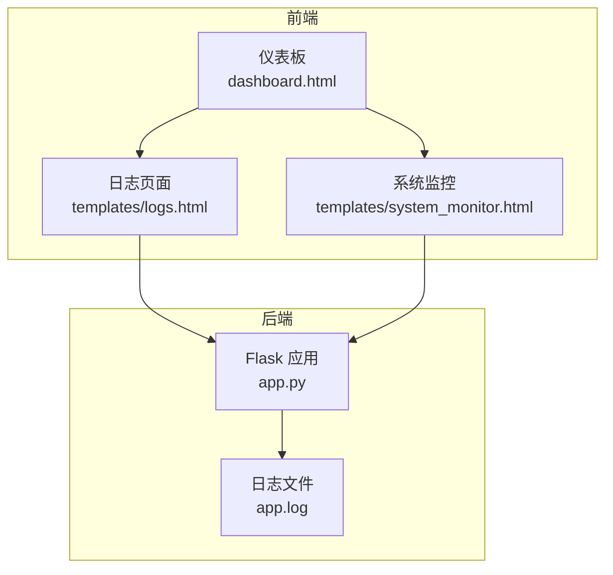
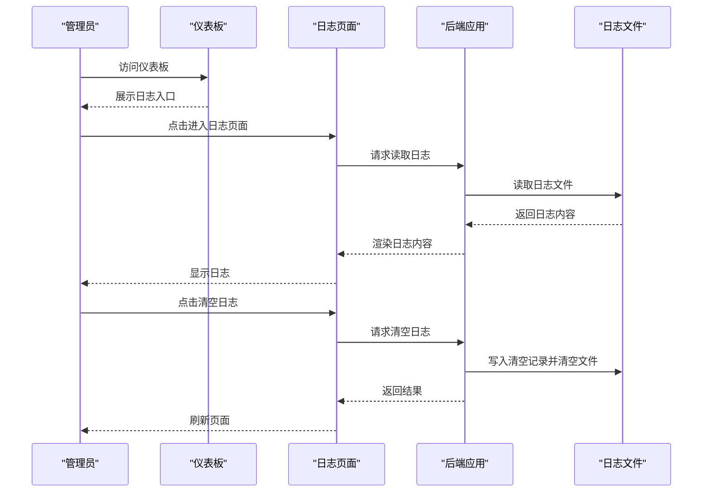
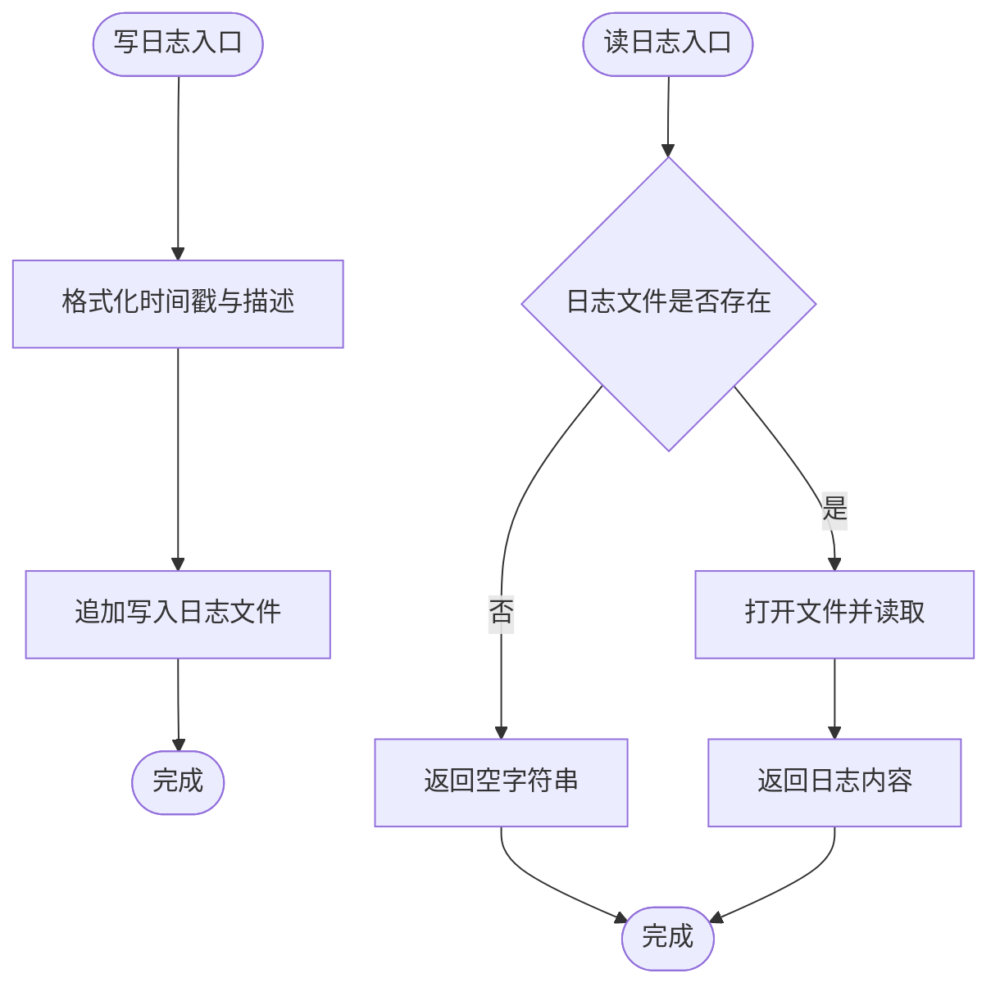
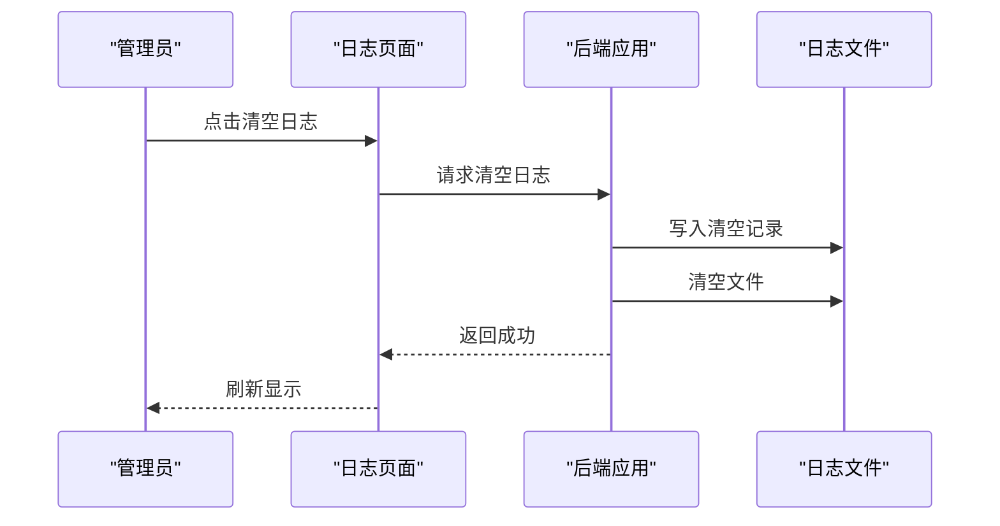
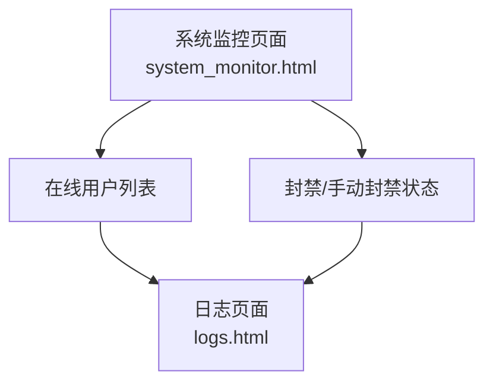
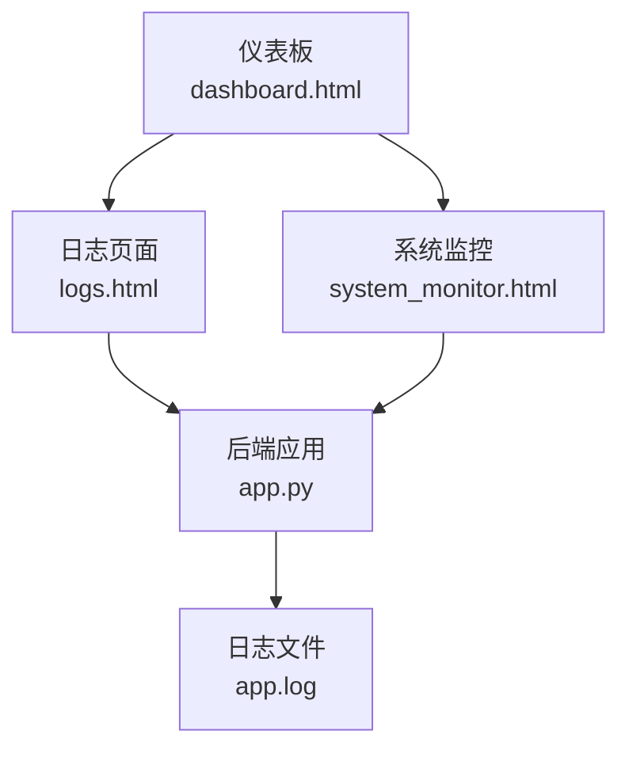

# 系统日志管理

<cite>
**本文档引用的文件**
- [app.py](file://app.py)
- [logs.html](file://templates/logs.html)
- [system_monitor.html](file://templates/system_monitor.html)
- [dashboard.html](file://templates/dashboard.html)
</cite>

## 目录
1. [简介](#简介)
2. [项目结构](#项目结构)
3. [核心组件](#核心组件)
4. [架构概览](#架构概览)
5. [详细组件分析](#详细组件分析)
6. [依赖关系分析](#依赖关系分析)
7. [性能考虑](#性能考虑)
8. [故障排查指南](#故障排查指南)
9. [结论](#结论)

## 简介
本技术文档聚焦于系统日志管理功能，涵盖日志收集、分类、过滤与搜索、分析、轮转与归档、实时监控与告警以及安全存储与访问控制等能力。当前仓库中的日志管理以“操作日志”为主，采用纯文本文件形式进行统一收集与展示，同时结合系统监控页面提供在线用户与封禁状态的可视化展示。

## 项目结构
日志相关的核心实现位于后端应用文件中，前端通过模板渲染日志内容，并在仪表板中提供入口。系统监控页面提供在线用户与封禁状态的可视化展示，便于管理员进行实时监控。

**图表来源**
- [dashboard.html:214-224](file://templates/dashboard.html#L214-L224)
- [logs.html:1-19](file://templates/logs.html#L1-L19)
- [system_monitor.html:1-35](file://templates/system_monitor.html#L1-L35)
- [app.py:638-639](file://app.py#L638-L639)
- [app.py:886-905](file://app.py#L886-L905)

**章节来源**
- [dashboard.html:214-224](file://templates/dashboard.html#L214-L224)
- [logs.html:1-19](file://templates/logs.html#L1-L19)
- [system_monitor.html:1-35](file://templates/system_monitor.html#L1-L35)
- [app.py:638-639](file://app.py#L638-L639)
- [app.py:886-905](file://app.py#L886-L905)

## 核心组件
- 日志写入与读取
  - 写入：统一调用写日志函数，格式包含时间戳与操作描述，追加写入至日志文件。
  - 读取：读取日志文件全文并在模板中渲染显示。
- 日志页面与入口
  - 提供刷新与清空日志的功能按钮，清空日志时会写入一条清空记录。
- 系统监控集成
  - 监控页面展示在线用户、封禁状态等信息，辅助管理员进行日志分析与告警联动。

**章节来源**
- [app.py:886-905](file://app.py#L886-L905)
- [app.py:4287-4313](file://app.py#L4287-L4313)
- [logs.html:5-17](file://templates/logs.html#L5-L17)
- [system_monitor.html:78-138](file://templates/system_monitor.html#L78-L138)

## 架构概览
日志管理的整体流程如下：业务操作触发写日志函数，日志内容被追加到日志文件；管理员通过日志页面读取与清空日志；系统监控页面展示在线用户与封禁状态，便于快速定位问题。

**图表来源**
- [dashboard.html:214-224](file://templates/dashboard.html#L214-L224)
- [logs.html:5-17](file://templates/logs.html#L5-L17)
- [app.py:4287-4313](file://app.py#L4287-L4313)
- [app.py:886-905](file://app.py#L886-L905)

## 详细组件分析

### 日志写入与读取组件
- 写日志函数负责格式化时间戳与操作描述，并追加写入日志文件。
- 读日志函数负责读取文件内容，若文件不存在则返回空字符串。
- 日志文件路径在配置中定义，当前指向项目根目录上层的 app.log。

**图表来源**
- [app.py:886-896](file://app.py#L886-L896)
- [app.py:898-905](file://app.py#L898-L905)
- [app.py:638-639](file://app.py#L638-L639)

**章节来源**
- [app.py:886-905](file://app.py#L886-L905)
- [app.py:638-639](file://app.py#L638-L639)

### 日志页面与清空功能
- 日志页面提供刷新与清空按钮，清空时会向日志文件写入一条清空记录并清空文件内容。
- 若日志文件为空，则页面显示“暂无日志记录”。

**图表来源**
- [logs.html:5-17](file://templates/logs.html#L5-L17)
- [app.py:4298-4313](file://app.py#L4298-L4313)

**章节来源**
- [logs.html:5-17](file://templates/logs.html#L5-L17)
- [app.py:4298-4313](file://app.py#L4298-L4313)

### 系统监控与日志分析联动
- 系统监控页面展示在线用户、封禁状态与手动封禁状态，便于管理员快速定位异常流量与攻击行为。
- 结合日志页面中的清空记录，可辅助进行审计与溯源。

**图表来源**
- [system_monitor.html:78-138](file://templates/system_monitor.html#L78-L138)
- [logs.html:1-19](file://templates/logs.html#L1-L19)

**章节来源**
- [system_monitor.html:78-138](file://templates/system_monitor.html#L78-L138)
- [logs.html:1-19](file://templates/logs.html#L1-L19)

## 依赖关系分析
- 日志页面依赖后端路由与模板渲染，后端依赖日志文件进行读写。
- 系统监控页面依赖后端接口获取在线用户与封禁状态，这些状态与日志中的封禁记录相互印证。
- 仪表板提供日志入口，引导管理员进入日志页面。

**图表来源**
- [dashboard.html:214-224](file://templates/dashboard.html#L214-L224)
- [logs.html:1-19](file://templates/logs.html#L1-L19)
- [system_monitor.html:1-35](file://templates/system_monitor.html#L1-L35)
- [app.py:638-639](file://app.py#L638-L639)

**章节来源**
- [dashboard.html:214-224](file://templates/dashboard.html#L214-L224)
- [logs.html:1-19](file://templates/logs.html#L1-L19)
- [system_monitor.html:1-35](file://templates/system_monitor.html#L1-L35)
- [app.py:638-639](file://app.py#L638-L639)

## 性能考虑
- 当前日志采用纯文本文件追加写入，适合中小规模日志量。对于高并发场景，建议引入异步写入、批量刷盘或外部日志收集系统（如 syslog、ELK）以提升吞吐与可靠性。
- 日志读取为一次性读取整个文件，若日志体量增大，建议增加分页读取、增量读取或索引机制，避免内存压力。

## 故障排查指南
- 日志无法读取
  - 检查日志文件是否存在与可读权限。
  - 确认日志文件路径配置正确。
- 清空日志失败
  - 检查写权限与磁盘空间。
  - 查看后端错误日志定位具体异常。
- 日志页面空白
  - 确认模板渲染逻辑与后端返回内容一致。
  - 检查浏览器控制台是否有跨域或权限问题。

**章节来源**
- [app.py:898-905](file://app.py#L898-L905)
- [app.py:4298-4313](file://app.py#L4298-L4313)
- [logs.html:11-15](file://templates/logs.html#L11-L15)

## 结论
当前系统日志管理以“操作日志”为核心，采用简单高效的文件存储与模板渲染方式，满足基础的日志查看与清空需求。结合系统监控页面，管理员可以快速掌握在线用户与封禁状态，辅助进行日志分析与安全运维。后续可考虑引入过滤与搜索、轮转与归档、实时监控与告警以及更完善的安全存储与访问控制机制，以进一步提升日志管理的实用性与安全性。