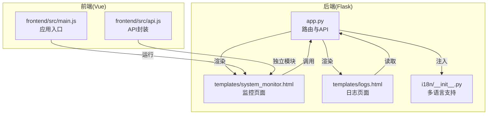
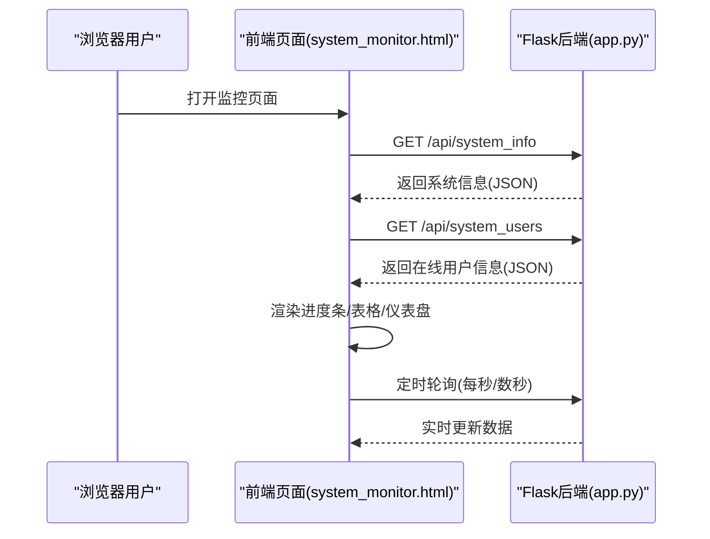
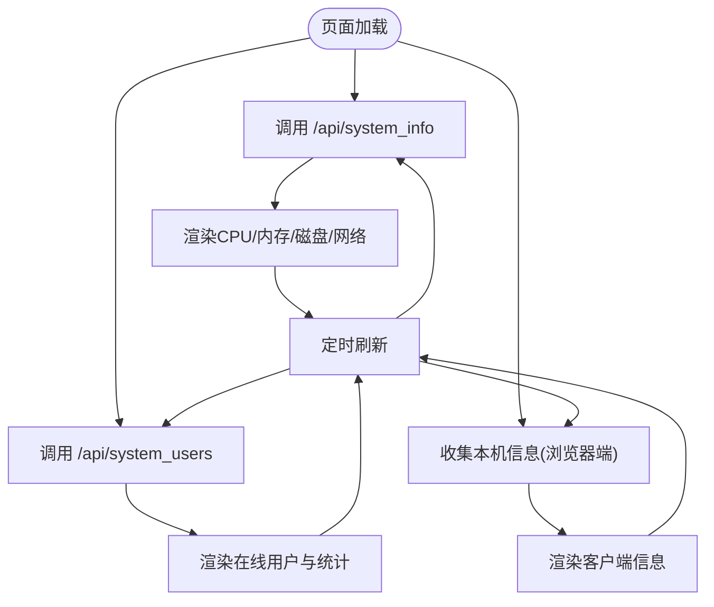
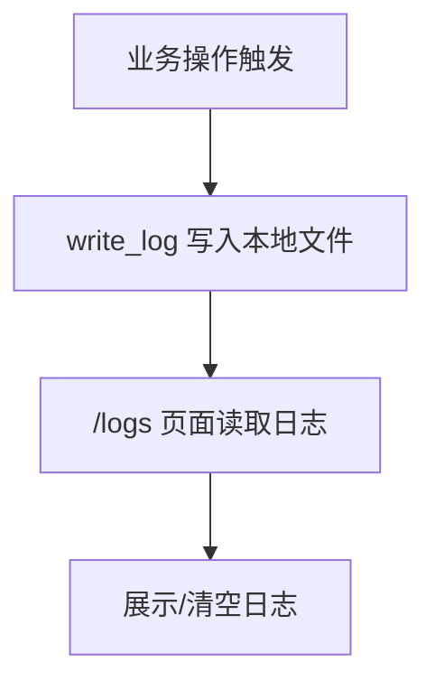
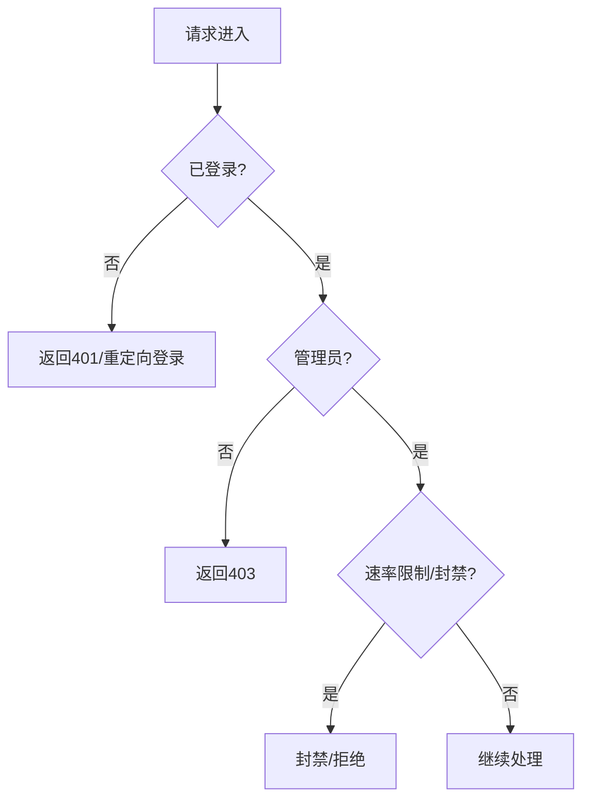
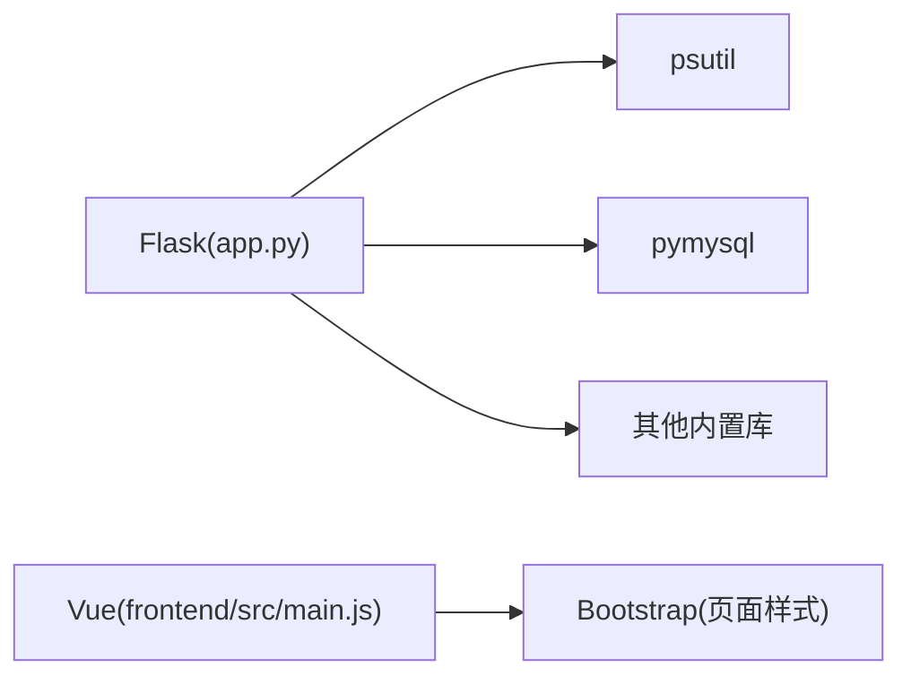

# 系统监控系统

<cite>
**本文档引用的文件**
- [app.py](file://app.py)
- [system_monitor.html](file://templates/system_monitor.html)
- [logs.html](file://templates/logs.html)
- [i18n/__init__.py](file://i18n/__init__.py)
- [frontend/src/main.js](file://frontend/src/main.js)
- [frontend/src/api.js](file://frontend/src/api.js)
</cite>

## 目录
1. [简介](#简介)
2. [项目结构](#项目结构)
3. [核心组件](#核心组件)
4. [架构概览](#架构概览)
5. [详细组件分析](#详细组件分析)
6. [依赖分析](#依赖分析)
7. [性能考虑](#性能考虑)
8. [故障排查指南](#故障排查指南)
9. [结论](#结论)
10. [附录](#附录)

## 简介
本系统监控系统为“多合一工具箱 Web 版”的一部分，提供以下能力：
- 硬件状态监控：CPU 使用率、内存占用、磁盘空间、网络流量等
- 在线用户与访问行为监控：活跃 IP、请求频次、封禁/白名单状态
- 系统日志管理：本地文件日志的读取与清理
- 可视化展示：前端页面实时刷新展示系统状态
- 权限与安全：管理员权限访问、CSRF/XSS/安全响应头等防护

注意：当前代码库未实现进程管理、性能指标历史存储与趋势分析、系统告警阈值与通知等功能。本文档基于现有实现进行技术说明，并给出扩展建议。

## 项目结构
系统监控相关的核心文件与职责如下：
- 后端应用与监控 API
  - app.py：Flask 应用入口，定义系统监控路由与 API、权限装饰器、日志写入与读取、速率限制等
- 前端页面与交互
  - templates/system_monitor.html：系统监控页面，调用 /api/system_info 与 /api/system_users，定时刷新并渲染
  - templates/logs.html：日志查看与清空页面
  - frontend/src/main.js：Vue 应用入口（与监控页面无直接耦合）
  - frontend/src/api.js：相册模块 API 封装（与监控页面无直接耦合）
- 国际化支持
  - i18n/__init__.py：多语言支持模块，被模板注入到上下文

**图表来源**
- [app.py](file://app.py)
- [system_monitor.html](file://templates/system_monitor.html)
- [logs.html](file://templates/logs.html)
- [i18n/__init__.py](file://i18n/__init__.py)
- [frontend/src/main.js](file://frontend/src/main.js)
- [frontend/src/api.js](file://frontend/src/api.js)

**章节来源**
- [app.py](file://app.py)
- [system_monitor.html](file://templates/system_monitor.html)
- [logs.html](file://templates/logs.html)
- [i18n/__init__.py](file://i18n/__init__.py)
- [frontend/src/main.js](file://frontend/src/main.js)
- [frontend/src/api.js](file://frontend/src/api.js)

## 核心组件
- 系统监控页面与 API
  - /system_monitor：管理员访问的监控页面
  - /api/system_info：返回 CPU、内存、磁盘、网络等系统信息
  - /api/system_users：返回在线用户、封禁/白名单状态、请求统计
- 日志管理
  - write_log：向本地文件追加日志
  - read_logs：读取本地日志内容
  - /logs：日志页面，支持刷新与清空
- 权限与安全
  - admin_required：管理员权限装饰器
  - login_required：登录权限装饰器
  - CSRF/XSS/安全响应头：统一安全策略
- 速率限制与白名单
  - 基于内存的请求队列与封禁机制
  - 白名单持久化文件

**章节来源**
- [app.py](file://app.py)
- [system_monitor.html](file://templates/system_monitor.html)
- [logs.html](file://templates/logs.html)

## 架构概览
系统采用前后端分离的典型模式：前端页面通过 fetch 调用后端 API 获取数据，后端使用 psutil 等库采集系统信息，使用 Flask 路由与模板渲染页面。

**图表来源**
- [system_monitor.html](file://templates/system_monitor.html)
- [app.py](file://app.py)

## 详细组件分析

### 系统监控页面与 API
- 页面功能
  - 服务器标签页：显示系统基本信息、CPU/内存使用率、磁盘分区使用情况、网络发送/接收字节与包数
  - 在线用户标签页：显示在线 IP 数、注册用户数、封禁/白名单数量、活跃 IP 列表与状态
  - 本机信息标签页：通过浏览器端脚本收集客户端信息（UA、屏幕、连接类型、电池等）
- 数据来源
  - /api/system_info：调用 psutil 获取 CPU、内存、磁盘、网络等指标
  - /api/system_users：聚合内存中的在线用户、封禁/白名单状态与请求统计
- 刷新策略
  - 页面加载后立即拉取一次数据
  - 定时器周期性刷新（例如每 1.2~2.6 秒）

**图表来源**
- [system_monitor.html](file://templates/system_monitor.html)
- [app.py](file://app.py)

**章节来源**
- [system_monitor.html](file://templates/system_monitor.html)
- [app.py](file://app.py)

### 日志管理
- 日志写入
  - write_log：按时间戳格式化写入本地文件
  - read_logs：读取本地日志文件内容
- 日志页面
  - /logs：展示日志内容，支持刷新与清空
- 注意
  - 当前为纯文本文件日志，未实现分页、过滤、滚动日志或远程日志上报

**图表来源**
- [app.py](file://app.py)
- [logs.html](file://templates/logs.html)

**章节来源**
- [app.py](file://app.py)
- [logs.html](file://templates/logs.html)

### 权限与安全
- 权限装饰器
  - admin_required：仅管理员可访问监控页面与 API
  - login_required：未登录访问 API 返回 401
- 安全策略
  - CSRF 校验、CSP 非ces、XSS/帧劫持防护、HSTS（生产环境）、隐藏 Server 版本
- 速率限制
  - 基于内存的滑动窗口与封禁，支持白名单与手动封禁

**图表来源**
- [app.py](file://app.py)

**章节来源**
- [app.py](file://app.py)

### 多语言支持
- i18n 模块负责加载多语言 JSON 并注入到模板上下文，监控页面标题与文案由模板渲染

**章节来源**
- [i18n/__init__.py](file://i18n/__init__.py)
- [system_monitor.html](file://templates/system_monitor.html)

## 依赖分析
- 后端依赖
  - Flask：Web 框架
  - psutil：系统信息采集
  - pymysql：数据库初始化与查询（与监控页面无直接耦合）
  - 其他：CORS、PIL、Werkzeug、datetime、threading 等
- 前端依赖
  - Vue：应用入口（与监控页面无直接耦合）
  - Bootstrap：页面样式（监控页面使用 Bootstrap 样式类）

**图表来源**
- [app.py](file://app.py)
- [frontend/src/main.js](file://frontend/src/main.js)

**章节来源**
- [app.py](file://app.py)
- [frontend/src/main.js](file://frontend/src/main.js)

## 性能考虑
- 前端轮询频率
  - 当前页面定时器间隔为 1.2~2.6 秒，建议根据监控需求调整，避免过度轮询造成后端压力
- 后端采集开销
  - psutil 采集 CPU/内存/磁盘/网络等指标为轻量操作，但频繁轮询仍会增加 CPU 占用
- 速率限制
  - 内存中的封禁与白名单可有效缓解恶意请求，建议结合持久化配置文件进行动态调整
- 建议
  - 对 /api/system_info 与 /api/system_users 的响应进行缓存或降采样
  - 前端使用更智能的轮询策略（如页面不可见时降低频率）

[本节为通用性能建议，无需特定文件引用]

## 故障排查指南
- 无法访问监控页面
  - 检查是否登录且具备管理员权限
  - 检查 CSRF 令牌与会话状态
- API 返回 401/403
  - 确认登录状态与权限
  - 检查速率限制是否触发封禁
- 页面无数据或报错
  - 检查 /api/system_info 与 /api/system_users 的返回 JSON 结构
  - 查看浏览器控制台网络请求与错误
- 日志为空
  - 确认日志文件路径与写入权限
  - 检查 write_log 是否被调用

**章节来源**
- [app.py](file://app.py)
- [system_monitor.html](file://templates/system_monitor.html)
- [logs.html](file://templates/logs.html)

## 结论
本系统监控系统提供了基础的硬件状态与在线用户监控能力，配合前端页面实现了直观的可视化展示。当前版本未包含进程管理、历史指标存储与趋势分析、系统告警阈值与通知等功能。建议后续扩展方向：
- 引入数据库或时序数据库存储历史指标，支持趋势分析与报表
- 增加进程列表、状态监控与控制接口
- 完善告警机制：阈值配置、通知渠道（邮件/IM）、故障处理流程
- 优化前端轮询策略与缓存，提升性能与用户体验

[本节为总结性内容，无需特定文件引用]

## 附录

### API 定义与调用
- /system_monitor
  - 方法：GET
  - 权限：管理员
  - 功能：渲染系统监控页面
- /api/system_info
  - 方法：GET
  - 权限：管理员
  - 返回字段：系统信息、CPU、内存、磁盘、网络等
- /api/system_users
  - 方法：GET
  - 权限：管理员
  - 返回字段：在线 IP 数、在线用户列表、注册用户数、管理员/VIP 数、封禁/白名单数量

**章节来源**
- [app.py](file://app.py)
- [system_monitor.html](file://templates/system_monitor.html)