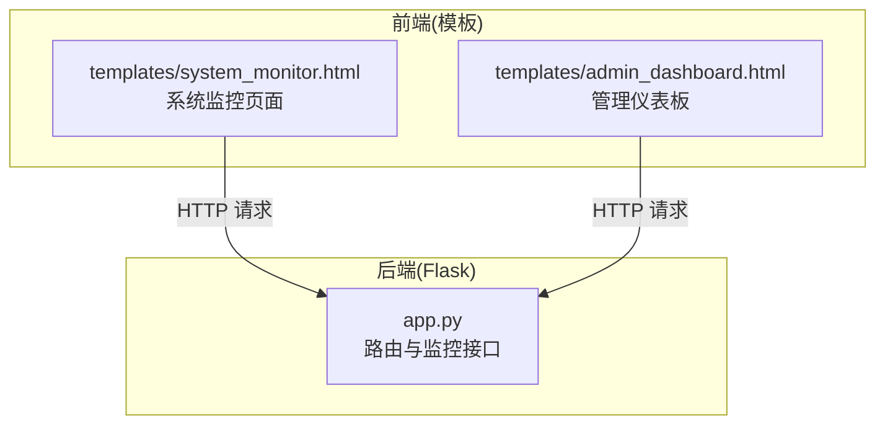
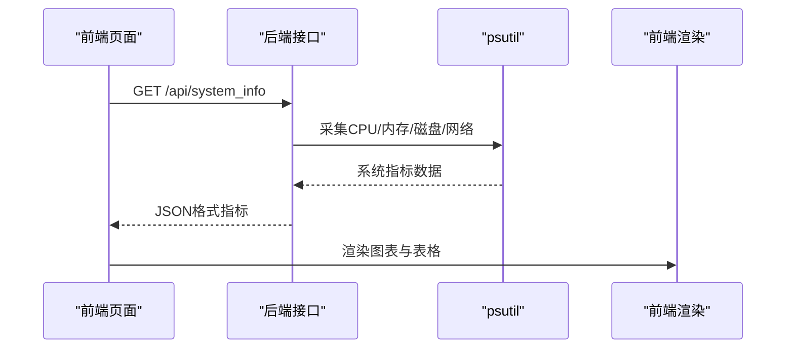
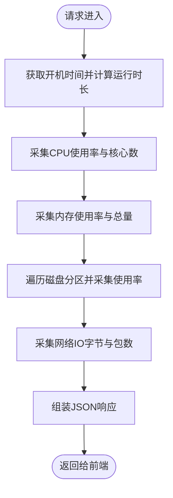
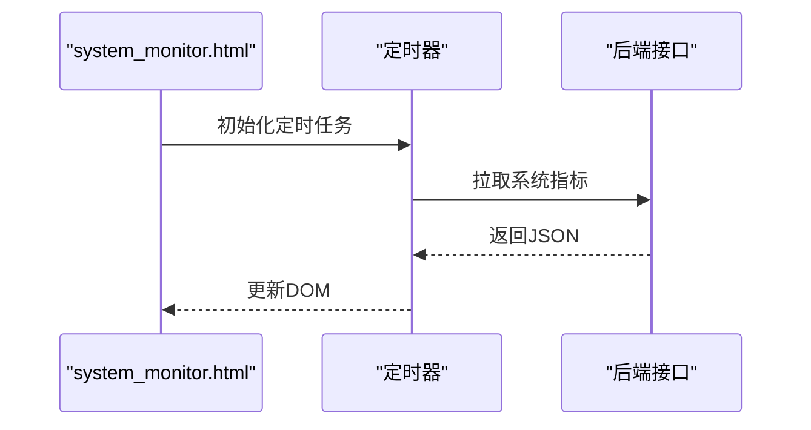
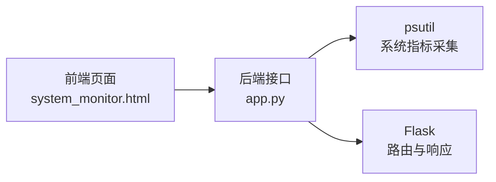

# 进程管理

<cite>
**本文档引用的文件**
- [app.py](file://app.py)
- [system_monitor.html](file://templates/system_monitor.html)
- [admin_dashboard.html](file://templates/admin_dashboard.html)
</cite>

## 目录
1. [简介](#简介)
2. [项目结构](#项目结构)
3. [核心组件](#核心组件)
4. [架构概览](#架构概览)
5. [详细组件分析](#详细组件分析)
6. [依赖分析](#依赖分析)
7. [性能考虑](#性能考虑)
8. [故障排查指南](#故障排查指南)
9. [结论](#结论)

## 简介
本文件面向“进程管理”功能的技术文档，基于仓库中的现有实现进行系统化梳理。当前代码库实现了系统监控与用户管理相关能力，其中涉及进程相关的接口与前端展示页面。本文将围绕以下主题展开：
- 进程列表获取机制：psutil.process_iter()的使用方式、进程信息字段提取、进程树结构展示
- 进程状态监控：运行状态、CPU和内存占用统计、进程启动时间、父进程关系
- 进程控制功能：进程终止、优先级调整、进程信息查询、批量操作
- 进程过滤与搜索：按名称、PID、用户、状态等条件筛选
- 实时更新机制与性能影响分析
- 安全考虑与权限控制机制

注意：当前仓库未发现直接调用psutil.process_iter()或实现进程树展示的具体代码。本文将以现有系统监控接口为基础，结合psutil常用实践，提供可落地的实现建议与最佳实践。

## 项目结构
本项目采用Flask后端 + Vue/Bootstrap前端的架构。与进程管理相关的核心位置如下：
- 后端路由与监控接口：位于应用主文件中
- 前端监控页面：位于模板目录，包含系统监控与仪表板页面

**图表来源**
- [app.py](file://app.py)
- [system_monitor.html](file://templates/system_monitor.html)
- [admin_dashboard.html](file://templates/admin_dashboard.html)

**章节来源**
- [app.py](file://app.py)
- [system_monitor.html](file://templates/system_monitor.html)
- [admin_dashboard.html](file://templates/admin_dashboard.html)

## 核心组件
- 系统监控接口：提供CPU、内存、磁盘、网络等系统指标，为进程管理提供基础监控能力
- 前端监控页面：通过定时轮询拉取系统指标，展示实时状态
- 权限控制：登录与管理员权限保护关键监控与管理接口

关键实现要点：
- 使用psutil采集系统指标（CPU、内存、磁盘、网络IO）
- 前端定时任务定期刷新数据
- 登录与管理员权限装饰器保护接口

**章节来源**
- [app.py](file://app.py)
- [system_monitor.html](file://templates/system_monitor.html)
- [admin_dashboard.html](file://templates/admin_dashboard.html)

## 架构概览
下图展示了进程管理相关的端到端流程：前端页面发起请求 -> 后端接口处理 -> psutil采集系统信息 -> 返回JSON数据 -> 前端渲染。

**图表来源**
- [app.py](file://app.py)
- [system_monitor.html](file://templates/system_monitor.html)

**章节来源**
- [app.py](file://app.py)
- [system_monitor.html](file://templates/system_monitor.html)

## 详细组件分析

### 系统监控接口（/api/system_info）
- 功能：返回系统基础信息、CPU使用率、内存使用率、磁盘分区使用情况、网络IO统计
- 数据来源：psutil
- 前端调用：系统监控页面与仪表板页面定时轮询

**图表来源**
- [app.py](file://app.py)

**章节来源**
- [app.py](file://app.py)

### 前端监控页面（system_monitor.html）
- 功能：展示CPU、内存、磁盘、网络等实时指标，并提供在线用户统计
- 实时更新：定时器每秒/数秒轮询后端接口
- 展示形式：进度条、数值卡片、表格

**图表来源**
- [system_monitor.html](file://templates/system_monitor.html)

**章节来源**
- [system_monitor.html](file://templates/system_monitor.html)

### 管理仪表板（admin_dashboard.html）
- 功能：在仪表板中展示CPU、内存、磁盘、网络等指标
- 与系统监控页面联动：共享后端接口与数据格式

**章节来源**
- [admin_dashboard.html](file://templates/admin_dashboard.html)

## 依赖分析
- psutil：用于采集系统指标（CPU、内存、磁盘、网络IO）
- Flask：后端框架，提供路由与接口
- 前端：Bootstrap + 原生JavaScript，负责定时轮询与渲染

**图表来源**
- [app.py](file://app.py)
- [system_monitor.html](file://templates/system_monitor.html)

**章节来源**
- [app.py](file://app.py)
- [system_monitor.html](file://templates/system_monitor.html)

## 性能考虑
- 轮询频率：前端定时器应避免过于频繁，以免增加后端压力与浏览器负担
- 数据量：磁盘分区列表可能较大，建议分页或按需展示
- 响应时间：后端接口应尽量快速返回，避免阻塞
- 缓存策略：对于不频繁变化的数据可考虑短期缓存

[本节为通用指导，无需特定文件引用]

## 故障排查指南
- 接口返回错误：检查后端日志与异常处理
- 前端无法渲染：确认定时器是否正常执行、网络请求是否成功
- 权限不足：确认登录状态与管理员权限

**章节来源**
- [app.py](file://app.py)
- [system_monitor.html](file://templates/system_monitor.html)

## 结论
当前仓库提供了完善的系统监控能力，为进程管理奠定了基础。若需扩展至进程列表、进程树、进程控制等功能，建议在现有psutil采集与Flask接口基础上，新增进程相关路由与前端页面，遵循现有权限控制与安全策略，确保性能与稳定性。

[本节为总结性内容，无需特定文件引用]