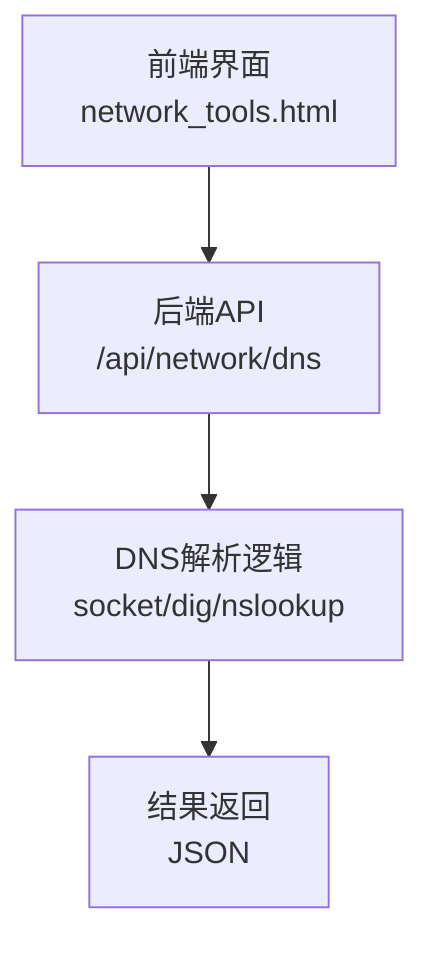
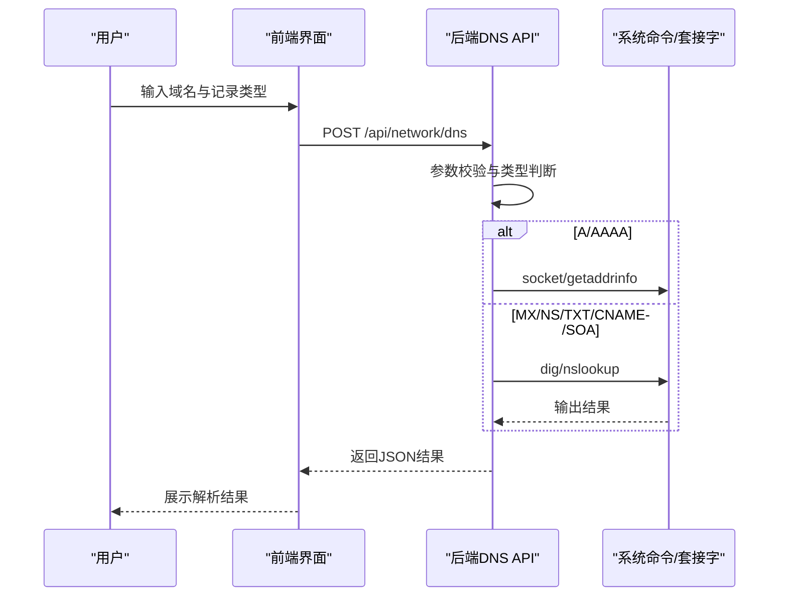
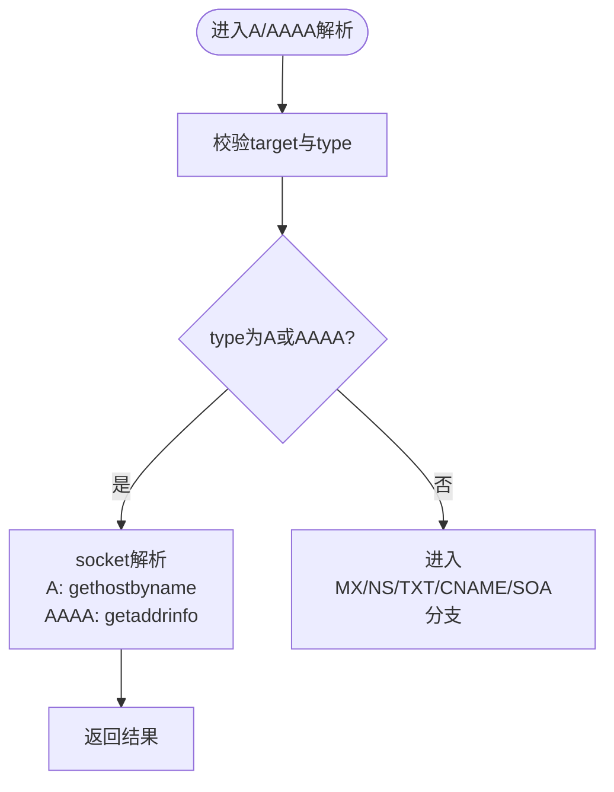
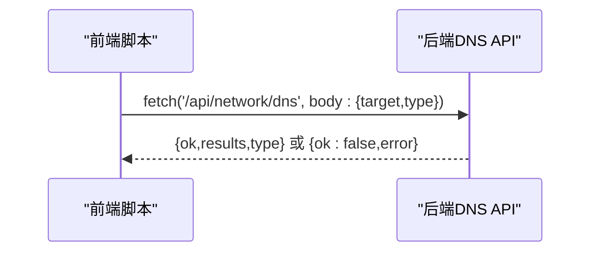
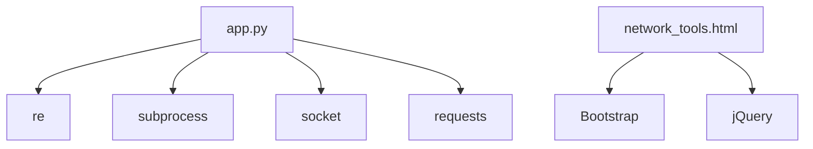

# DNS解析

<cite>
**本文引用的文件**
- [app.py](file://app.py)
- [network_tools.html](file://templates/network_tools.html)
- [calculator_net.html](file://templates/calculator_net.html)
- [requirements.txt](file://requirements.txt)
</cite>

## 目录
1. [简介](#简介)
2. [项目结构](#项目结构)
3. [核心组件](#核心组件)
4. [架构总览](#架构总览)
5. [详细组件分析](#详细组件分析)
6. [依赖分析](#依赖分析)
7. [性能考虑](#性能考虑)
8. [故障排除指南](#故障排除指南)
9. [结论](#结论)
10. [附录](#附录)

## 简介
本文件围绕项目中的DNS解析功能进行系统化技术文档整理，重点覆盖以下方面：
- 正向DNS解析：A/AAAA记录的递归与迭代查询路径说明
- 反向DNS解析（PTR记录）：PTR记录的生成与应用场景
- DNS缓存机制：本地缓存策略、TTL处理与缓存失效
- 权威DNS服务器查询：区域传输与DNSSEC验证现状与建议
- 性能优化：连接复用、查询队列管理与超时控制
- API接口文档与错误处理指南
- 故障排除与最佳实践

## 项目结构
DNS解析能力主要由后端Flask路由与前端模板协作完成：
- 后端提供统一的网络工具API，其中DNS解析位于“/api/network/dns”
- 前端模板“network_tools.html”提供DNS查询界面与交互逻辑
- 反向DNS计算在“calculator_net.html”中提供辅助功能

图表来源
- [network_tools.html:130-156](file://templates/network_tools.html#L130-L156)
- [app.py:2153-2208](file://app.py#L2153-L2208)

章节来源
- [network_tools.html:130-156](file://templates/network_tools.html#L130-L156)
- [app.py:2153-2208](file://app.py#L2153-L2208)

## 核心组件
- 前端DNS工具页：提供域名输入与记录类型选择，并通过fetch调用后端API
- 后端DNS API：负责参数校验、记录类型分发、系统命令执行与结果封装
- 系统命令执行：优先使用dig/nslookup，失败时回退到nslookup
- 本地解析：针对A/AAAA记录使用Python socket模块

章节来源
- [network_tools.html:130-156](file://templates/network_tools.html#L130-L156)
- [app.py:2153-2208](file://app.py#L2153-L2208)

## 架构总览
DNS解析流程分为三类：
- A/AAAA记录：优先使用socket解析，必要时使用getaddrinfo
- MX/NS/TXT/CNAME/SOA：通过dig/nslookup执行外部命令获取结果
- 反向解析：通过将IPv4地址段反转拼接生成in-addr.arpa格式，结合权威服务器PTR记录进行查询

图表来源
- [app.py:2153-2208](file://app.py#L2153-L2208)
- [network_tools.html:200-263](file://templates/network_tools.html#L200-L263)

## 详细组件分析

### DNS API接口定义
- 路径：/api/network/dns
- 方法：POST
- 权限：登录且VIP或管理员
- 请求体字段：
  - target：域名或主机名（必填）
  - type：记录类型，默认A，支持A/AAAA/MX/NS/TXT/CNAME/SOA
- 成功响应字段：
  - ok：布尔值
  - results：字符串数组（按记录类型返回）
  - type：记录类型
- 错误响应字段：
  - ok：布尔值（False）
  - error：错误描述

章节来源
- [app.py:2153-2208](file://app.py#L2153-L2208)

### 正向DNS解析（A/AAAA）
- A记录：使用socket.gethostbyname进行解析
- AAAA记录：使用socket.getaddrinfo并限定IPv6族，去重后返回
- 适用场景：快速获取主机的IPv4/IPv6地址

图表来源
- [app.py:2153-2208](file://app.py#L2153-L2208)

章节来源
- [app.py:2153-2208](file://app.py#L2153-L2208)

### 迭代与递归查询说明
- A/AAAA记录：通过socket解析，底层由系统名称解析器决定采用递归还是迭代策略
- MX/NS/TXT/CNAME/SOA记录：通过dig/nslookup执行外部命令，具体查询行为取决于系统解析器与上游DNS服务器策略

章节来源
- [app.py:2153-2208](file://app.py#L2153-L2208)

### 权威服务器查找与区域传输
- 当前实现：通过dig/nslookup查询权威服务器返回的记录
- 区域传输：未在代码中实现自动化区域传输流程
- DNSSEC验证：未在代码中实现DNSSEC验证逻辑

章节来源
- [app.py:2153-2208](file://app.py#L2153-L2208)

### 反向DNS解析（PTR记录）
- 前端辅助：在IP进制转换工具中，将IPv4地址段反转并拼接in-addr.arpa形成PTR查询域名
- 实际查询：需结合权威服务器或公共反向解析服务进行PTR记录查询
- 应用场景：日志审计、邮件投递验证、IP归属反查

章节来源
- [calculator_net.html:169-187](file://templates/calculator_net.html#L169-L187)

### DNS缓存机制
- 本地缓存策略：当前实现未内置DNS缓存
- TTL处理：未对TTL进行显式处理
- 缓存失效：未实现缓存失效逻辑
- 建议：在应用层引入基于TTL的缓存（如内存缓存或Redis），并实现定期清理与命中统计

章节来源
- [app.py:2153-2208](file://app.py#L2153-L2208)

### API调用序列（前端到后端）

图表来源
- [network_tools.html:200-263](file://templates/network_tools.html#L200-L263)
- [app.py:2153-2208](file://app.py#L2153-L2208)

## 依赖分析
- Python标准库：socket、subprocess、re等
- 外部工具：dig、nslookup（需系统安装）
- 前端依赖：Bootstrap、jQuery（在模板中使用）

图表来源
- [app.py:1-28](file://app.py#L1-L28)
- [requirements.txt:1-5](file://requirements.txt#L1-L5)
- [network_tools.html:1-328](file://templates/network_tools.html#L1-L328)

章节来源
- [requirements.txt:1-5](file://requirements.txt#L1-L5)
- [app.py:1-28](file://app.py#L1-L28)

## 性能考虑
- 连接复用：当前未实现连接池或复用策略
- 查询队列管理：未实现并发队列与限流
- 超时控制：dig/nslookup超时5秒，其他命令超时策略需统一
- 建议：
  - 引入线程池/进程池执行外部命令
  - 实现全局超时与重试策略
  - 对高频查询增加本地缓存与TTL
  - 对dig/nslookup失败进行快速回退与降级

章节来源
- [app.py:2153-2208](file://app.py#L2153-L2208)

## 故障排除指南
- dig/nslookup不可用
  - 现象：返回“DNS tools (dig/nslookup) not available”
  - 处理：在系统安装bind-tools或相应工具包
- 域名格式非法
  - 现象：返回“Invalid target”
  - 处理：确保输入合法域名或主机名
- A/AAAA解析失败
  - 现象：返回gaierror异常
  - 处理：检查网络连通性与上游DNS可用性
- 超时问题
  - 现象：dig/nslookup超时或命令执行超时
  - 处理：调整超时阈值或更换DNS服务器

章节来源
- [app.py:2153-2208](file://app.py#L2153-L2208)

## 结论
本项目提供了基础的DNS解析能力，覆盖常用记录类型的查询，并通过dig/nslookup与socket实现不同记录类型的解析路径。当前未实现权威服务器区域传输与DNSSEC验证，亦未内置DNS缓存与统一超时控制。建议后续引入缓存、统一超时与重试、以及权威查询与DNSSEC验证能力，以满足更复杂场景需求。

## 附录

### API接口文档（摘要）
- 路径：/api/network/dns
- 方法：POST
- 权限：登录且VIP或管理员
- 请求体
  - target：字符串（必填）
  - type：字符串（A/AAAA/MX/NS/TXT/CNAME/SOA，默认A）
- 成功响应
  - ok：true
  - results：字符串数组
  - type：记录类型
- 失败响应
  - ok：false
  - error：错误描述

章节来源
- [app.py:2153-2208](file://app.py#L2153-L2208)