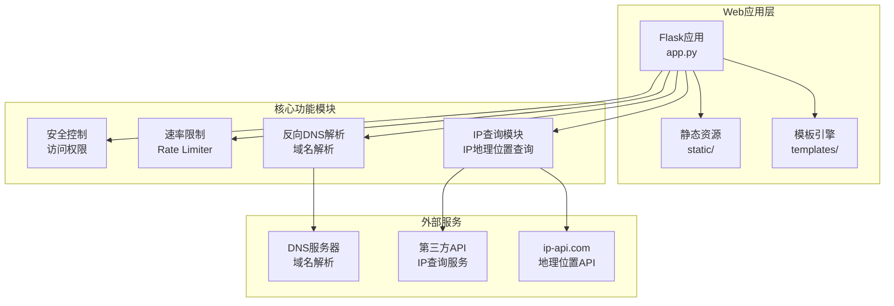
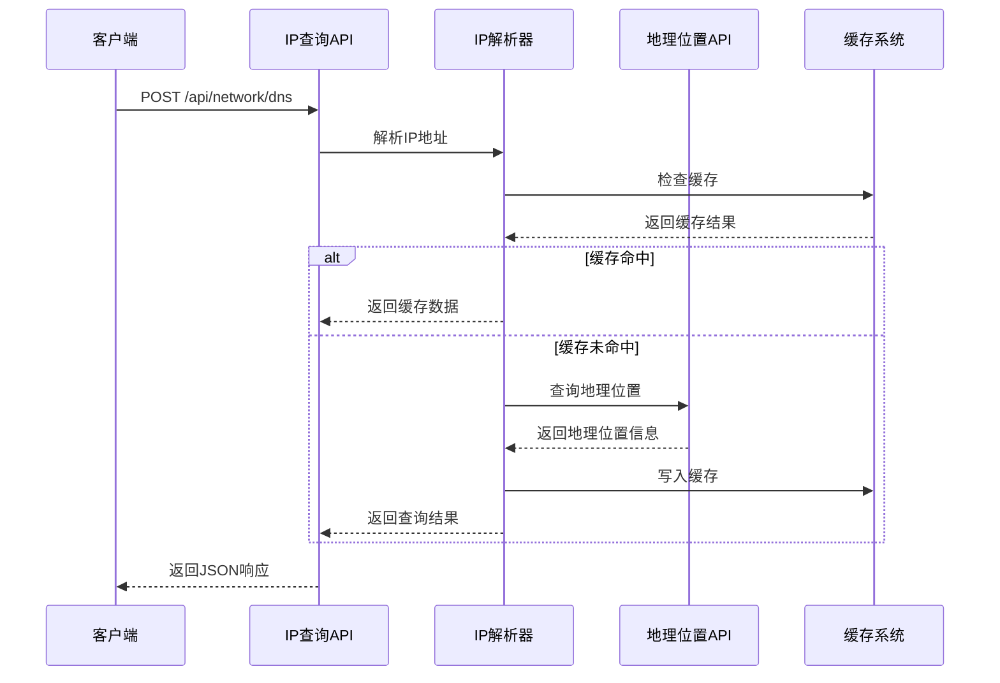
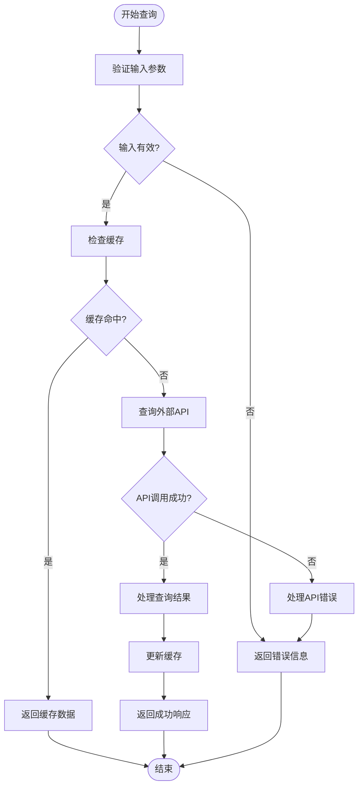
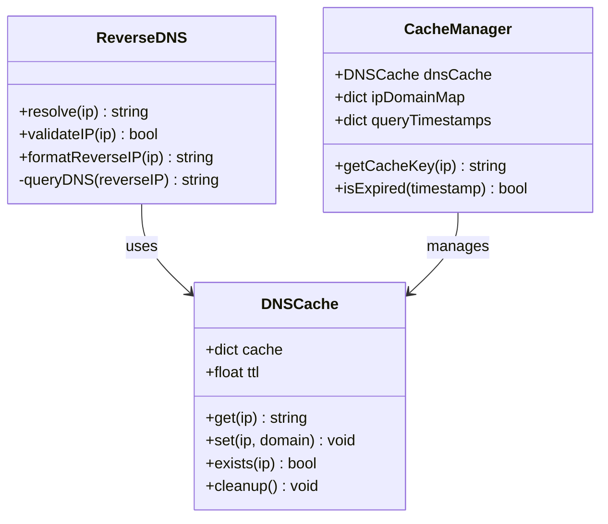
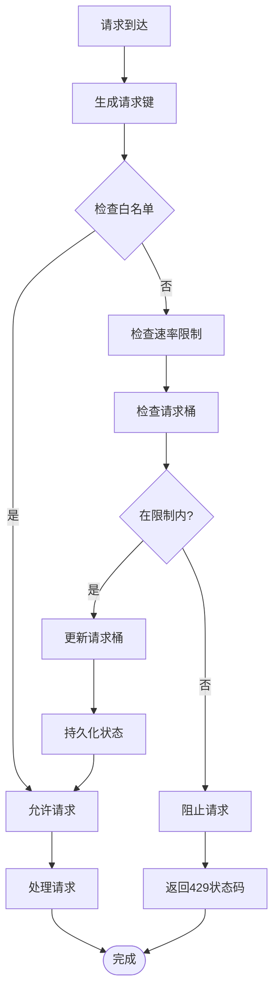
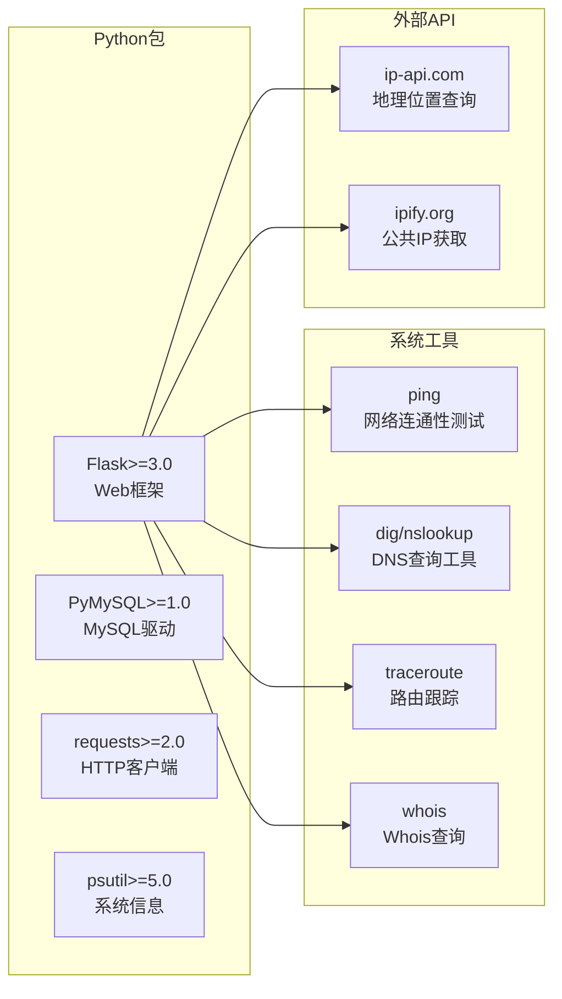
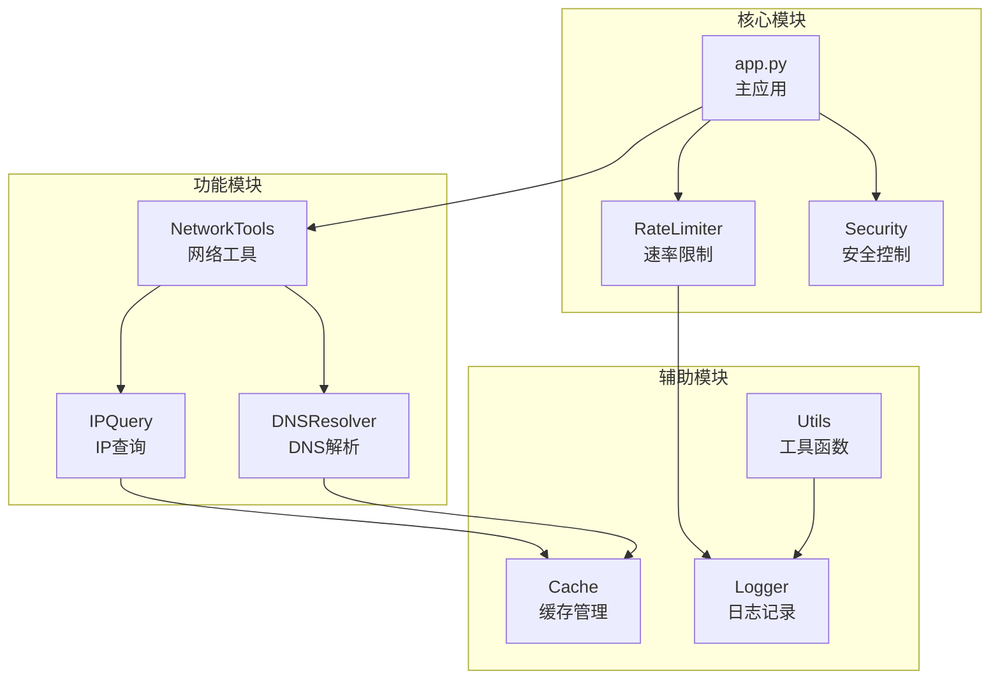
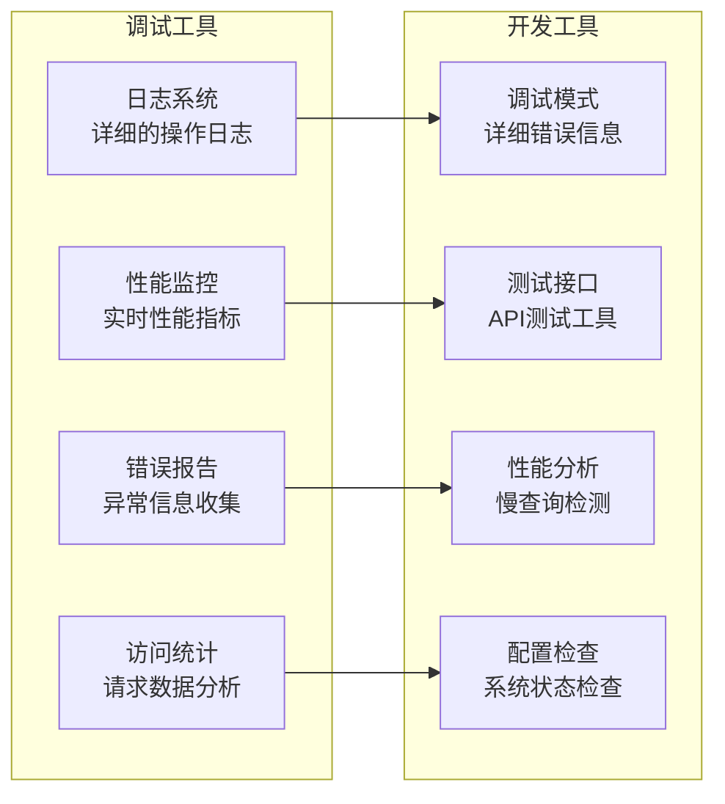

# IP地址查询

<cite>
**本文档引用的文件**
- [app.py](file://app.py)
- [network_tools.html](file://templates/network_tools.html)
- [calculator_net.html](file://templates/calculator_net.html)
- [admin_dashboard.html](file://templates/admin_dashboard.html)
- [rate_limiter.json](file://rate_limiter.json)
- [requirements.txt](file://requirements.txt)
</cite>

## 目录
1. [简介](#简介)
2. [项目结构](#项目结构)
3. [核心组件](#核心组件)
4. [架构概览](#架构概览)
5. [详细组件分析](#详细组件分析)
6. [依赖分析](#依赖分析)
7. [性能考虑](#性能考虑)
8. [故障排除指南](#故障排除指南)
9. [结论](#结论)
10. [附录](#附录)

## 简介

本文档详细介绍了School_Web项目中的IP地址查询功能。该项目是一个多合一工具箱Web应用，提供了完整的IP地理位置查询和反向DNS解析能力。

IP地址查询功能的核心特性包括：
- **地理位置查询**：通过IP地址获取国家、省份、城市等地理信息
- **ISP信息获取**：识别网络服务提供商信息
- **反向DNS解析**：将IP地址转换为对应的域名
- **安全防护**：内置速率限制、白名单机制和访问控制
- **API接口**：提供RESTful API供前端调用

## 项目结构

项目采用Flask框架构建，主要结构如下：



**图表来源**
- [app.py:122-135](file://app.py#L122-L135)
- [app.py:351-392](file://app.py#L351-L392)

**章节来源**
- [app.py:1-800](file://app.py#L1-L800)
- [requirements.txt:1-5](file://requirements.txt#L1-L5)

## 核心组件

### IP查询核心模块

IP查询功能主要由以下核心组件构成：

#### 1. IP地理位置查询
- **实现方式**：结合本地IP解析和外部API查询
- **查询范围**：支持国家、省份、城市、ISP等多层次信息
- **数据来源**：ip-api.com地理位置API

#### 2. 反向DNS解析
- **功能实现**：将IP地址转换为对应的域名
- **缓存机制**：避免重复查询，提高响应速度
- **错误处理**：完善的异常捕获和降级策略

#### 3. 速率限制系统
- **内存存储**：基于字典的实时请求统计
- **持久化**：支持重启后状态恢复
- **动态配置**：可运行时调整限制参数

**章节来源**
- [app.py:1960-2074](file://app.py#L1960-L2074)
- [app.py:351-392](file://app.py#L351-L392)

## 架构概览

系统采用分层架构设计，确保功能模块的清晰分离和良好的可维护性：

```mermaid
graph TB
subgraph "表现层"
UI[用户界面<br/>network_tools.html]
API[API接口<br/>/api/network/*]
end
subgraph "业务逻辑层"
IPQ[IP查询服务<br/>IP地理位置查询]
DNS[DNS解析服务<br/>反向DNS解析]
RL[速率限制服务<br/>请求频率控制]
end
subgraph "数据访问层"
CACHE[内存缓存<br/>Redis/Memory]
DB[(数据库)<br/>MySQL]
end
subgraph "外部服务"
GEO[地理位置API<br/>ip-api.com]
DNS_SRV[DNS服务器<br/>系统DNS]
ISP[ISP查询API<br/>第三方服务]
end
UI --> API
API --> IPQ
API --> DNS
API --> RL
IPQ --> CACHE
IPQ --> GEO
IPQ --> ISP
DNS --> DNS_SRV
RL --> DB
CACHE --> DB
```

**图表来源**
- [app.py:2077-2317](file://app.py#L2077-L2317)
- [app.py:351-392](file://app.py#L351-L392)

## 详细组件分析

### IP地理位置查询组件

#### 功能实现流程



**图表来源**
- [app.py:2154-2210](file://app.py#L2154-L2210)
- [app.py:1960-2074](file://app.py#L1960-L2074)

#### 数据结构设计

IP查询结果的数据结构：

| 字段名 | 类型 | 描述 | 示例 |
|--------|------|------|------|
| hostname | string | 输入的域名或IP | "example.com" |
| ip | string | 解析得到的IP地址 | "93.184.216.34" |
| local_ip | string | 本地IP地址 | "192.168.1.100" |
| public_ip | string | 公共IP地址 | "203.0.113.5" |
| country | string | 国家名称 | "United States" |
| region | string | 省份/州 | "California" |
| city | string | 城市名称 | "Los Angeles" |
| isp | string | ISP提供商 | "Comcast Cable Communications" |

#### 错误处理机制



**图表来源**
- [app.py:2154-2210](file://app.py#L2154-L2210)
- [app.py:1960-2074](file://app.py#L1960-L2074)

**章节来源**
- [app.py:1960-2074](file://app.py#L1960-L2074)
- [app.py:2154-2210](file://app.py#L2154-L2210)

### 反向DNS解析组件

#### 解析算法实现

反向DNS解析采用以下策略：

1. **IP地址格式化**：将IPv4地址转换为反向解析格式
2. **DNS查询**：使用系统DNS服务器进行PTR记录查询
3. **结果处理**：解析DNS响应并提取域名信息
4. **缓存优化**：避免重复查询相同的IP地址

#### 缓存策略



**图表来源**
- [app.py:2154-2210](file://app.py#L2154-L2210)

#### 实现细节

反向DNS解析的关键实现要点：

- **IP地址验证**：确保输入的是有效的IPv4地址
- **反向格式转换**：将IP地址转换为in-addr.arpa格式
- **DNS查询执行**：使用系统dig命令进行权威查询
- **结果解析**：提取PTR记录中的域名信息
- **错误处理**：处理DNS查询失败的各种情况

**章节来源**
- [app.py:2154-2210](file://app.py#L2154-L2210)

### 速率限制系统

#### 速率限制算法



**图表来源**
- [app.py:351-392](file://app.py#L351-L392)

#### 配置参数

| 参数名 | 默认值 | 描述 |
|--------|--------|------|
| RATE_LIMIT | 40 | 单窗口内的最大请求数 |
| RATE_WINDOW | 10 | 速率限制的时间窗口（秒） |
| BLOCK_DURATION | 240 | 封禁持续时间（秒） |
| BLOCK_PROBE_LIMIT | 50 | 封禁期间试探次数阈值 |
| BLOCK_EXTEND | 240 | 试探超限后的追加封禁时间 |

**章节来源**
- [app.py:351-392](file://app.py#L351-L392)

## 依赖分析

### 外部依赖

项目的主要外部依赖包括：



**图表来源**
- [requirements.txt:1-5](file://requirements.txt#L1-L5)

### 内部模块依赖



**图表来源**
- [app.py:1-800](file://app.py#L1-L800)

**章节来源**
- [requirements.txt:1-5](file://requirements.txt#L1-L5)

## 性能考虑

### 缓存策略

系统实现了多层次的缓存机制来提升性能：

1. **内存缓存**：使用Python字典存储热点数据
2. **持久化缓存**：将缓存状态保存到文件系统
3. **浏览器缓存**：利用HTTP缓存头减少重复请求
4. **CDN缓存**：静态资源通过CDN加速

### 性能优化技术

| 优化技术 | 实现方式 | 性能收益 |
|----------|----------|----------|
| 异步查询 | 使用线程池处理并发请求 | 减少响应时间 |
| 连接复用 | 复用数据库和HTTP连接 | 降低连接开销 |
| 数据压缩 | Gzip压缩响应内容 | 减少传输时间 |
| 分页加载 | 大数据集分页显示 | 改善用户体验 |

### 监控指标

系统监控的关键指标包括：

- **请求响应时间**：平均响应时间、P95/P99延迟
- **吞吐量**：每秒处理的请求数
- **错误率**：API调用失败的比例
- **缓存命中率**：缓存数据的有效利用率
- **资源使用率**：CPU、内存、磁盘I/O使用情况

## 故障排除指南

### 常见问题及解决方案

#### 1. IP查询失败

**问题描述**：IP查询返回错误或超时

**可能原因**：
- 外部API服务不可用
- 网络连接问题
- IP地址格式不正确

**解决步骤**：
1. 检查网络连接状态
2. 验证IP地址格式
3. 查看API服务状态
4. 检查防火墙设置

#### 2. 速率限制触发

**问题描述**：频繁收到429状态码

**解决方法**：
1. 检查请求频率是否超过限制
2. 实现指数退避策略
3. 考虑升级到更高权限
4. 使用缓存减少重复请求

#### 3. DNS解析错误

**问题描述**：反向DNS解析失败

**排查步骤**：
1. 验证DNS服务器可达性
2. 检查防火墙规则
3. 确认PTR记录存在
4. 测试dig/nslookup命令

**章节来源**
- [app.py:351-392](file://app.py#L351-L392)

### 调试工具

系统提供了多种调试工具：



## 结论

School_Web项目的IP地址查询功能提供了完整的地理位置查询和DNS解析能力。系统采用模块化设计，具有以下优势：

**技术优势**：
- **高可用性**：多重缓存和降级策略确保服务稳定性
- **高性能**：异步处理和连接复用优化响应时间
- **安全性**：完善的速率限制和访问控制机制
- **可扩展性**：模块化架构便于功能扩展和维护

**应用场景**：
- 网络安全监控
- 用户行为分析
- 地理位置服务
- 网络诊断工具

**改进建议**：
- 增加更多的地理位置数据源
- 实现智能缓存策略
- 添加API使用统计功能
- 优化错误处理和用户体验

## 附录

### API接口文档

#### IP查询接口

**请求URL**：`POST /api/network/dns`

**请求参数**：
```json
{
  "target": "example.com",
  "type": "A"
}
```

**响应格式**：
```json
{
  "ok": true,
  "results": ["93.184.216.34"],
  "type": "A"
}
```

**错误码**：
- `400`: 参数无效
- `408`: 请求超时
- `500`: 服务器内部错误

### 集成示例

#### JavaScript集成示例

```javascript
// IP查询示例
fetch('/api/network/dns', {
  method: 'POST',
  headers: {
    'Content-Type': 'application/json',
  },
  body: JSON.stringify({
    target: 'example.com',
    type: 'A'
  })
})
.then(response => response.json())
.then(data => {
  if (data.ok) {
    console.log('查询结果:', data.results);
  } else {
    console.error('查询失败:', data.error);
  }
});
```

#### Python集成示例

```python
import requests

def query_ip_info(domain):
    """查询IP信息的Python示例"""
    response = requests.post(
        'http://localhost:5000/api/network/dns',
        json={'target': domain, 'type': 'A'},
        cookies={'session': 'your-session-cookie'}
    )
    
    if response.status_code == 200:
        data = response.json()
        return data['results'][0] if data['ok'] else None
    return None
```

### 配置选项

#### 速率限制配置

```python
# rate_config.json
{
  "RATE_LIMIT": 40,
  "RATE_WINDOW": 10,
  "BLOCK_DURATION": 240,
  "BLOCK_PROBE_LIMIT": 50,
  "BLOCK_EXTEND": 240
}
```

#### 安全配置

```python
# CORS配置
CORS(app, supports_credentials=True, origins=[
    'http://localhost:3000',
    'http://192.168.3.204:3000'
])

# 安全响应头
app.after_request(add_security_headers)
```