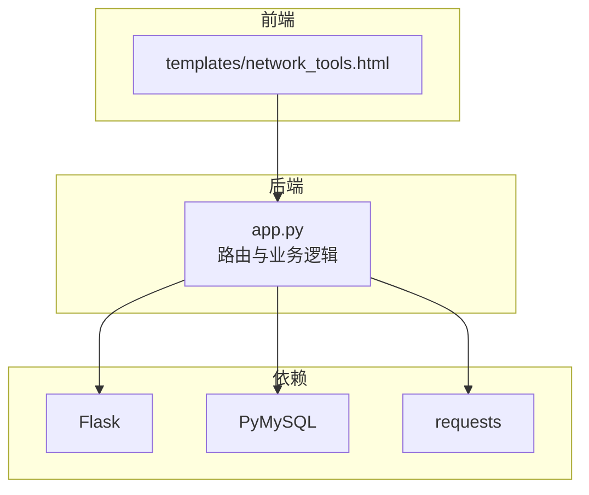
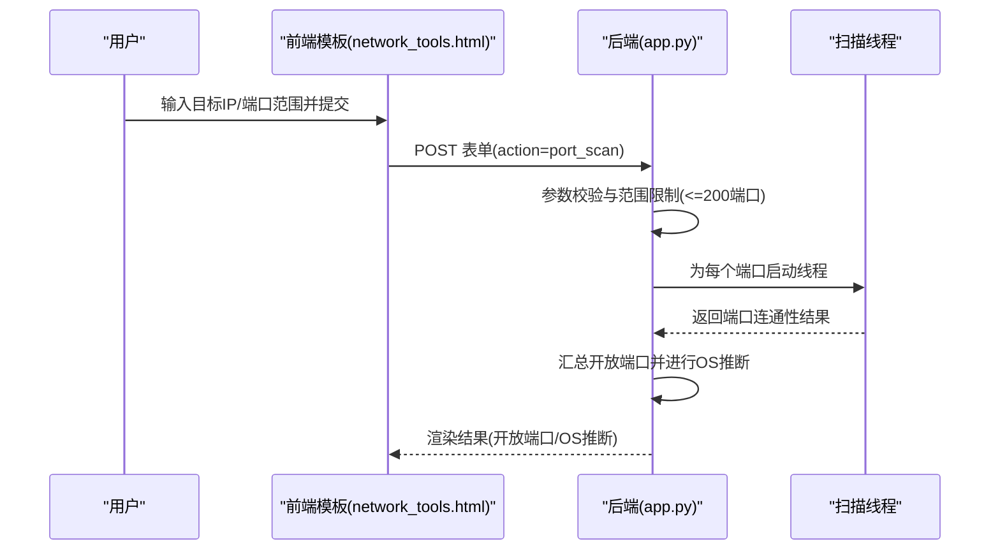
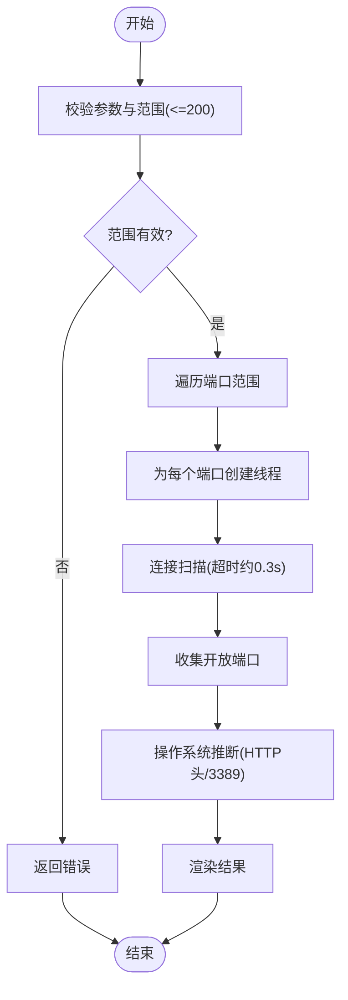
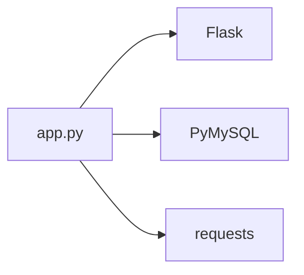

# 端口扫描

<cite>
**本文引用的文件**
- [app.py](file://app.py)
- [network_tools.html](file://templates/network_tools.html)
- [zh-CN.json](file://i18n/zh-CN.json)
- [requirements.txt](file://requirements.txt)
</cite>

## 目录
1. [引言](#引言)
2. [项目结构](#项目结构)
3. [核心组件](#核心组件)
4. [架构总览](#架构总览)
5. [详细组件分析](#详细组件分析)
6. [依赖分析](#依赖分析)
7. [性能考量](#性能考量)
8. [故障排查指南](#故障排查指南)
9. [结论](#结论)
10. [附录](#附录)

## 引言
本文件面向“端口扫描”功能，基于现有代码库进行技术文档梳理，重点覆盖以下方面：
- TCP连接扫描算法实现与现状
- UDP端口扫描的技术原理、挑战与实现现状
- 性能优化策略（并发扫描、线程池管理、扫描速度控制）
- 安全与合规注意事项（法律、目标主机保护、扫描频率限制）
- API接口文档与客户端集成示例
- 扫描结果解读与网络安全建议

说明：根据代码库现状，当前实现为基于TCP的连接扫描（CONNECT风格），未包含SYN扫描与ACK扫描的专用实现；UDP扫描亦未在后端实现。本文将结合现有实现与通用实践进行说明。

## 项目结构
与端口扫描相关的核心文件与职责如下：
- 后端主程序与路由：app.py
  - 端口扫描表单处理与结果渲染
  - 网络工具API（如Ping、Traceroute等，便于理解整体网络工具模块）
- 前端模板：templates/network_tools.html
  - 提供端口扫描表单与结果展示
- 国际化资源：i18n/zh-CN.json
  - 端口扫描相关文案与提示
- 依赖声明：requirements.txt
  - Flask、PyMySQL、psutil、requests等

图表来源
- [app.py](file://app.py)
- [network_tools.html](file://templates/network_tools.html)
- [requirements.txt](file://requirements.txt)

章节来源
- [app.py](file://app.py)
- [network_tools.html](file://templates/network_tools.html)
- [zh-CN.json](file://i18n/zh-CN.json)
- [requirements.txt](file://requirements.txt)

## 核心组件
- 端口扫描表单与结果展示
  - 前端模板提供目标IP、起止端口输入，并在扫描完成后展示开放端口与操作系统推断结果。
- 后端扫描流程
  - 表单参数校验与范围限制（超过200个端口仅扫描前200个常见端口）
  - 多线程并发扫描每个端口
  - 基于HTTP响应头与特定端口可达性进行操作系统推断
- 速率限制与安全
  - 全局IP速率限制与封禁策略，防止滥用
  - 白名单与手动封禁机制
  - 用户代理阻断，识别常见扫描工具

章节来源
- [app.py](file://app.py)
- [network_tools.html](file://templates/network_tools.html)
- [zh-CN.json](file://i18n/zh-CN.json)

## 架构总览
端口扫描在当前实现中的调用链路如下：

图表来源
- [app.py](file://app.py)
- [network_tools.html](file://templates/network_tools.html)

## 详细组件分析

### 端口扫描实现（TCP CONNECT风格）
- 表单与参数
  - 支持目标IP、起始/结束端口输入
  - 对端口范围进行上限约束（超过200个端口仅扫描前200个常见端口）
- 并发扫描
  - 为每个端口创建独立线程，设置连接超时（约0.3秒）
  - 使用同步集合收集结果，最终汇总开放端口
- 操作系统推断
  - 尝试向目标主机的80端口发送HTTP请求，解析响应头中的Server字段
  - 若失败，则尝试3389端口判断Windows RDP服务
- 结果返回
  - 返回目标、端口范围、开放端口列表与操作系统推断结果

图表来源
- [app.py](file://app.py)

章节来源
- [app.py](file://app.py)

### UDP端口扫描（现状与挑战）
- 现状
  - 当前代码库未提供UDP扫描的后端实现
- 技术原理与挑战
  - UDP无连接特性导致无法通过三次握手判断开放性
  - 常见策略：发送探测报文并监听ICMP端口不可达错误；对不同服务采用特征匹配
  - 挑战：ICMP错误类型复杂、误报与漏报、防火墙与NAT影响、超时与重传策略
- 实现建议（概念性）
  - 基于socket与ICMP（需管理员权限）
  - 结合多策略探测与统计判定
  - 严格超时与并发控制，避免对目标造成过大压力

[本节为概念性说明，不直接对应具体源码文件]

### TCP扫描算法对比与适用场景
- CONNECT扫描（当前实现）
  - 原理：建立完整TCP三次握手，成功即开放
  - 优点：准确度高、实现简单
  - 缺点：易被日志记录、易触发告警
- SYN扫描（未实现）
  - 原理：仅发送SYN，依据SYN/ACK或RST判断
  - 优点：隐蔽性更好
  - 缺点：通常需要原始套接字与管理员权限
- ACK扫描（未实现）
  - 原理：发送ACK，依据RST判断端口可达性
  - 优点：可探测防火墙规则
  - 缺点：仅适用于已知开放端口的辅助手段

[本节为通用原理说明，不直接对应具体源码文件]

### API接口文档（端口扫描）
- 路由与方法
  - 表单提交：POST /network_tools（模板内隐藏域action=port_scan）
  - 前端交互：前端模板通过fetch调用后端渲染结果
- 请求参数
  - target：目标IP或域名
  - start_port：起始端口（1-65535）
  - end_port：结束端口（1-65535，且≥start_port）
- 响应
  - 成功：渲染模板，包含目标、端口范围、开放端口列表、操作系统推断
  - 失败：错误信息（如端口范围无效、解析失败）

章节来源
- [network_tools.html](file://templates/network_tools.html)
- [app.py](file://app.py)

### 客户端集成示例（基于现有前端模板）
- 前端模板已内置端口扫描表单与结果展示
- 关键点
  - 表单字段：target、start_port、end_port
  - 结果展示：开放端口列表与操作系统推断
  - 交互：提交后由后端处理并返回渲染后的HTML片段

章节来源
- [network_tools.html](file://templates/network_tools.html)

### 扫描结果解读与网络安全建议
- 结果解读
  - 开放端口：表示对应端口处于监听状态
  - 操作系统推断：基于HTTP头或RDP可达性进行的启发式判断，仅供参考
- 安全建议
  - 仅对自有资产或获得授权的目标进行扫描
  - 控制扫描粒度与频率，避免对目标造成性能影响
  - 结合业务需求选择合适端口范围，避免大规模端口扫描
  - 注意合规性与法律风险，遵循组织政策与法律法规

[本节为通用实践说明，不直接对应具体源码文件]

## 依赖分析
- Flask：Web框架，提供路由与请求处理
- PyMySQL：数据库连接（与端口扫描无直接关系）
- psutil：系统信息采集（与端口扫描无直接关系）
- requests：HTTP请求（与端口扫描无直接关系）

图表来源
- [app.py](file://app.py)
- [requirements.txt](file://requirements.txt)

章节来源
- [requirements.txt](file://requirements.txt)
- [app.py](file://app.py)

## 性能考量
- 并发扫描
  - 当前实现为每个端口启动一个线程，适合小范围扫描
  - 建议：在更大范围时引入线程池与队列，限制并发度，避免资源耗尽
- 超时与重试
  - 连接超时约0.3秒，建议根据网络状况调整
  - 对于高延迟网络，适当增加超时并减少并发
- 范围限制
  - 默认仅扫描前200个端口，降低对目标的压力与自身资源消耗
- 速率限制
  - 全局IP速率限制与封禁策略，防止滥用
  - 白名单与手动封禁机制，便于运维管理

章节来源
- [app.py](file://app.py)

## 故障排查指南
- 常见问题
  - 端口范围无效：起始/结束端口越界或顺序错误
  - 目标无法解析：域名解析失败
  - 扫描超时：网络延迟高或目标主机无响应
- 排查步骤
  - 检查输入参数与范围
  - 确认目标可达性（可先进行Ping或DNS解析）
  - 调整超时与并发策略
  - 检查速率限制状态与封禁情况
- 相关实现参考
  - 参数校验与异常处理
  - 速率限制与封禁逻辑
  - 白名单与手动封禁

章节来源
- [app.py](file://app.py)

## 结论
- 当前端口扫描实现为TCP CONNECT风格，具备基础并发与范围限制能力
- 未包含SYN/ACK扫描与UDP扫描的专用实现
- 建议在保持合规前提下，结合业务需求优化并发与超时策略，并完善UDP扫描与更丰富的OS推断逻辑

[本节为总结性内容，不直接对应具体源码文件]

## 附录
- 国际化文案
  - 端口扫描相关文案位于i18n/zh-CN.json中，涵盖界面提示与结果展示文本

章节来源
- [zh-CN.json](file://i18n/zh-CN.json)