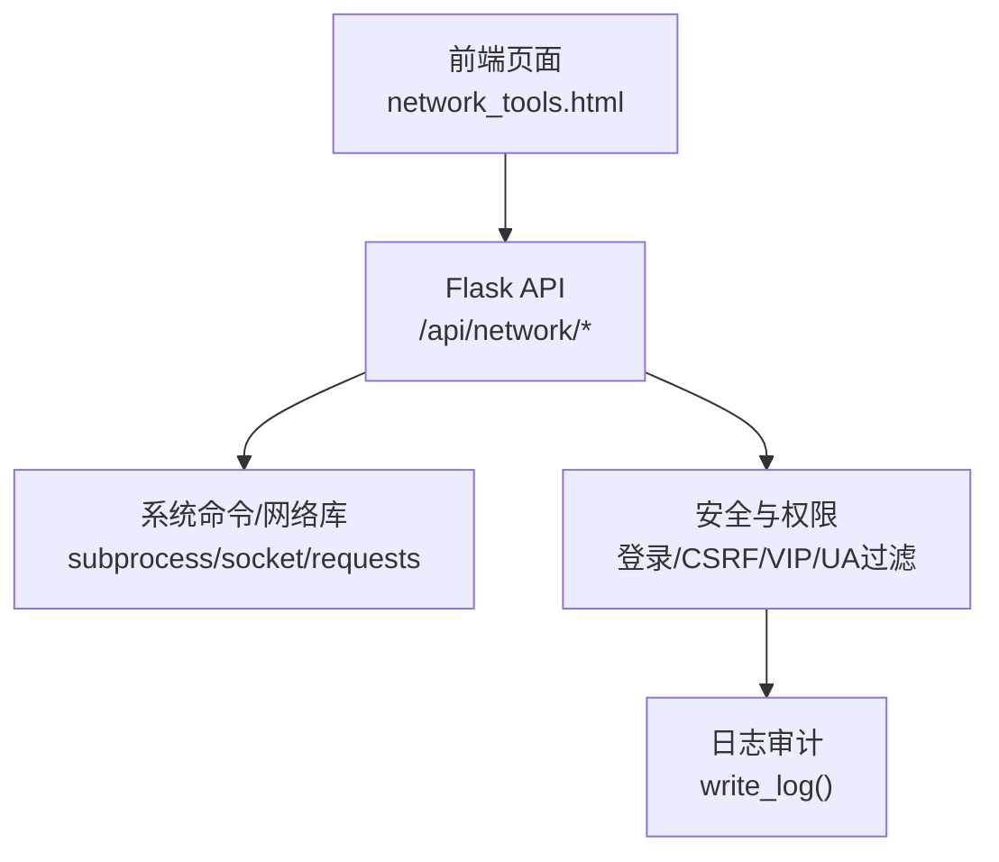
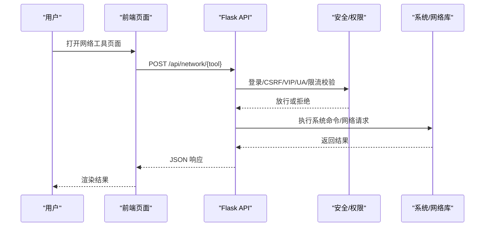
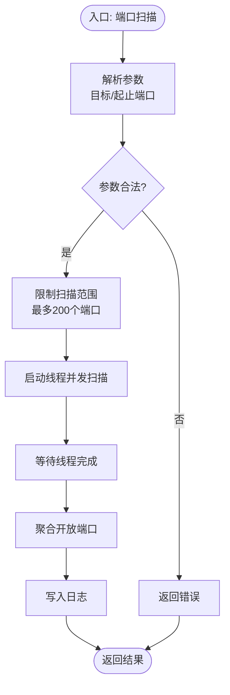
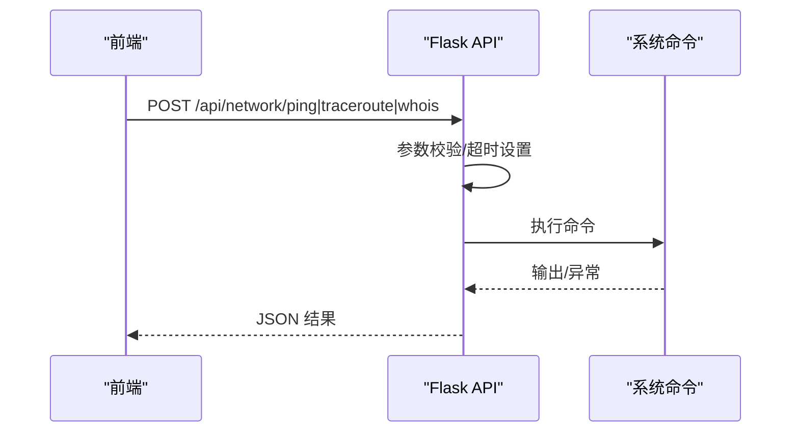
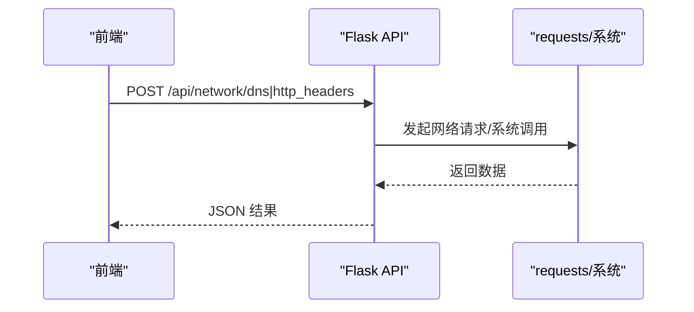
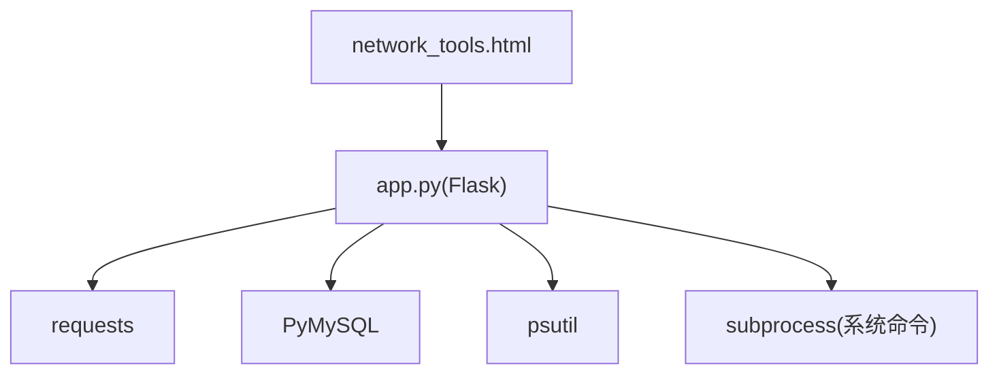

# 网络安全扫描

<cite>
**本文引用的文件**
- [app.py](file://app.py)
- [network_tools.html](file://templates/network_tools.html)
- [zh-CN.json](file://i18n/zh-CN.json)
- [安全措施清单.md](file://安全措施清单.md)
- [requirements.txt](file://requirements.txt)
</cite>

## 目录
1. [简介](#简介)
2. [项目结构](#项目结构)
3. [核心组件](#核心组件)
4. [架构总览](#架构总览)
5. [详细组件分析](#详细组件分析)
6. [依赖分析](#依赖分析)
7. [性能考虑](#性能考虑)
8. [故障排查指南](#故障排查指南)
9. [结论](#结论)
10. [附录](#附录)

## 简介
本文件面向“网络安全扫描”能力的技术文档，基于仓库中的现有实现进行系统化梳理与说明。当前项目提供了网络工具集，其中包含端口扫描、Ping、Traceroute、Whois、DNS、HTTP 头检查、SSL 证书检查与子网计算器等能力。这些能力可作为网络安全扫描的基础构件，支撑后续扩展为更完整的扫描引擎。

本文件将围绕以下主题展开：
- 常见网络漏洞检测方法与实现现状
- 扫描策略（主动/被动/混合）与当前实现映射
- 扫描结果分析与报告生成思路
- 法律合规与授权边界
- 性能优化与资源管理
- API 接口与企业级集成方案
- 最佳实践与安全建议

## 项目结构
项目采用前后端分离的 Web 架构：
- 前端：Vue 单页应用（位于 frontend/ 目录），但网络工具页面以传统模板渲染为主，部分网络工具通过前端脚本调用后端 /api/network/* 接口。
- 后端：Flask 应用，提供网络工具 API 与基础安全防护。
- 国际化：i18n/zh-CN.json 提供界面文案。
- 安全与合规：安全措施清单.md 展示了当前已实现的安全加固项。

图表来源
- [network_tools.html](file://templates/network_tools.html)
- [app.py](file://app.py)

章节来源
- [network_tools.html](file://templates/network_tools.html)
- [app.py](file://app.py)
- [zh-CN.json](file://i18n/zh-CN.json)

## 核心组件
- 网络工具 API：提供 Ping、Traceroute、Whois、DNS、HTTP 头检查、SSL 证书检查、子网计算器等接口，均需登录且具备 VIP 权限。
- 端口扫描：支持指定目标与端口范围，内置并发线程扫描，限制扫描范围以避免过大开销。
- 安全与权限：登录保护、CSRF 校验、VIP 权限控制、UA 黑名单拦截、速率限制与会话超时。
- 日志与审计：统一写日志接口，便于审计扫描行为与异常。

章节来源
- [app.py](file://app.py)
- [network_tools.html](file://templates/network_tools.html)

## 架构总览
后端通过装饰器实现权限与安全控制，网络工具 API 通过 subprocess 或标准库发起系统调用或网络请求，返回结构化结果给前端渲染。

图表来源
- [app.py](file://app.py)
- [network_tools.html](file://templates/network_tools.html)

## 详细组件分析

### 端口扫描（Port Scan）
- 功能概述：支持指定目标与端口范围，最多扫描前 200 个常见端口，使用多线程并发探测开放端口。
- 实现要点：
  - 参数校验与范围限制，避免过大扫描范围导致资源消耗。
  - 并发线程池扫描，设置连接超时，降低单点阻塞风险。
  - 结果聚合与日志记录。
- 当前局限：未进行服务版本识别与已知漏洞匹配，仅返回开放端口集合。

图表来源
- [app.py](file://app.py)

章节来源
- [app.py](file://app.py)
- [network_tools.html](file://templates/network_tools.html)

### Ping、Traceroute、Whois
- 功能概述：调用系统命令进行连通性、路由追踪与域名信息查询。
- 安全与超时：对系统命令执行设置超时，捕获超时与异常，避免长时间阻塞。
- 参数校验：对目标进行正则过滤，限制非法字符。

图表来源
- [app.py](file://app.py)

章节来源
- [app.py](file://app.py)

### DNS 解析与 HTTP 头检查
- DNS：支持 A/AAAA/MX/NS/TXT/CNAME/SOA 记录查询，优先使用 dig，回退 nslookup。
- HTTP 头：对目标 URL 发起请求，返回状态码、重定向次数与响应头。

图表来源
- [app.py](file://app.py)

章节来源
- [app.py](file://app.py)

### SSL 证书检查
- 功能概述：对目标域名建立 TLS 连接，提取证书主体、颁发者、有效期、SAN 等信息。
- 适用场景：识别证书有效性、剩余天数与 SAN 列表，辅助识别证书风险。

章节来源
- [app.py](file://app.py)

### 子网计算器
- 功能概述：对 CIDR 进行解析，输出网络地址、广播地址、掩码、可用主机数等信息。
- 适用场景：网络规划与资产梳理。

章节来源
- [app.py](file://app.py)

### 权限与安全控制
- 登录保护：未登录访问 /api/network/* 返回 401。
- VIP 权限：仅管理员与 VIP 用户可访问网络工具 API。
- CSRF 校验：对非 GET 请求进行 CSRF token 校验。
- UA 黑名单：拦截常见安全扫描工具的 User-Agent。
- 速率限制：对验证码与登录等接口进行独立限流，支持封禁与试探延长。
- 会话超时：IP 级别的会话空闲超时自动登出。

章节来源
- [app.py](file://app.py)

## 依赖分析
- Python 运行时与第三方库：Flask、PyMySQL、psutil、requests。
- 前端依赖：Vue 与 Bootstrap（由模板与静态资源体现）。
- 系统命令：ping、traceroute、whois、dig、nslookup（视平台而定）。

图表来源
- [app.py](file://app.py)
- [requirements.txt](file://requirements.txt)

章节来源
- [requirements.txt](file://requirements.txt)
- [app.py](file://app.py)

## 性能考虑
- 并发与超时
  - 端口扫描使用多线程并发，建议根据目标数量与系统资源调整并发度，避免过度占用 CPU 与网络带宽。
  - 对系统命令调用设置合理超时，防止长时间阻塞。
- 资源隔离
  - 将扫描任务与业务请求分离，避免相互影响。
  - 对高频接口（如 /api/network/*）实施速率限制与封禁策略。
- 结果缓存与增量
  - 对 DNS/Whois/SSL 等相对稳定的查询结果可引入短期缓存，减少重复请求。
- 日志与审计
  - 统一日志格式与落盘策略，避免日志风暴影响系统性能。

章节来源
- [app.py](file://app.py)

## 故障排查指南
- 常见错误与定位
  - 401 未登录：确认已登录并持有有效会话。
  - 403 权限不足：确认账户权限为管理员或 VIP。
  - 400 参数错误：检查目标格式与端口范围。
  - 408/500 超时/命令不可用：检查系统命令是否安装、网络连通性与超时设置。
- 日志审计
  - 使用统一日志接口定位扫描行为与异常，结合会话与 IP 维度过滤。
- 速率限制与封禁
  - 若被封禁，等待封禁期结束或联系管理员解除；检查封禁原因与试探次数。

章节来源
- [app.py](file://app.py)
- [安全措施清单.md](file://安全措施清单.md)

## 结论
当前项目在网络工具层面提供了较为完善的扫描基础能力，具备登录/权限/CSRF/UA/限流等安全基线，以及对系统命令的超时与异常处理。若要构建完整的“网络安全扫描”，可在现有基础上扩展：
- 主动扫描：完善端口扫描的服务指纹识别与漏洞匹配模块。
- 被动扫描：基于流量采集与规则匹配，识别弱口令、敏感路径等。
- 混合扫描：结合主动与被动策略，形成闭环的资产发现与风险评估。
- 报告与治理：标准化扫描结果、风险分级与修复建议，对接工单与变更流程。

## 附录

### API 接口定义（概览）
- 路由前缀：/api/network/*
- 权限：登录 + VIP
- 请求体字段（示例）：
  - ping：target（必填）、count（可选，默认 4，上限 20）
  - traceroute：target（必填）
  - whois：target（必填）
  - dns：target（必填）、type（A/AAAA/MX/NS/TXT/CNAME/SOA）
  - http_headers：target（URL）
  - ssl：target（域名）
  - subnet：cidr（CIDR）
- 响应：统一 { ok: true/false, ... } 结构，错误时包含 error 字段。

章节来源
- [app.py](file://app.py)

### 扫描策略与实现映射
- 主动扫描：Ping/Traceroute/Whois/DNS/HTTP 头/SSL/子网计算器 + 端口扫描（开放端口）。
- 被动扫描：可基于日志与流量分析，识别异常访问与敏感信息泄露。
- 混合扫描：以主动发现资产，以被动持续监测风险变化。

章节来源
- [app.py](file://app.py)
- [network_tools.html](file://templates/network_tools.html)

### 法律合规与授权边界
- 授权要求：仅在获得明确授权的范围内进行扫描，遵守目标方政策与法律法规。
- 扫描范围限制：严格限定目标与端口范围，避免对非授权资产造成影响。
- 责任声明：建议在产品中加入免责声明与使用条款，提示用户自行承担扫描风险。

章节来源
- [zh-CN.json](file://i18n/zh-CN.json)

### 企业级集成方案
- 身份与权限：对接企业身份系统（LDAP/OIDC），按部门/项目维度分配 VIP 权限。
- 审计与告警：统一接入 SIEM/日志平台，对扫描行为与异常进行告警。
- 自动化编排：通过调度系统定时执行扫描任务，产出报告并归档。
- 风险治理：将扫描结果纳入风险矩阵，跟踪修复进度与验证效果。

章节来源
- [app.py](file://app.py)

### 最佳实践与安全建议
- 限流与节流：对高频接口实施独立限流池，避免滥用。
- 超时与重试：为外部请求设置合理超时与指数退避重试。
- 输入净化：对用户输入进行白名单校验与长度限制。
- 最小权限：扫描任务以受限账户运行，避免高权限暴露。
- 结果脱敏：对敏感信息（如证书内容）在前端展示时进行必要脱敏。

章节来源
- [app.py](file://app.py)
- [安全措施清单.md](file://安全措施清单.md)