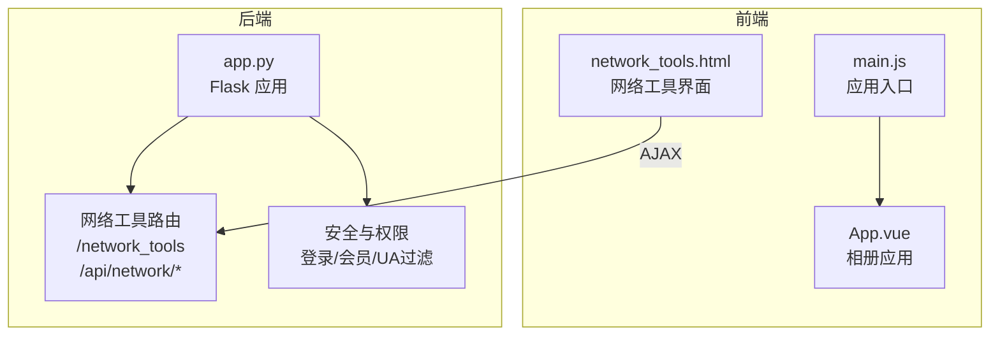
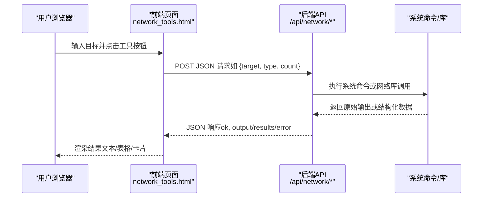
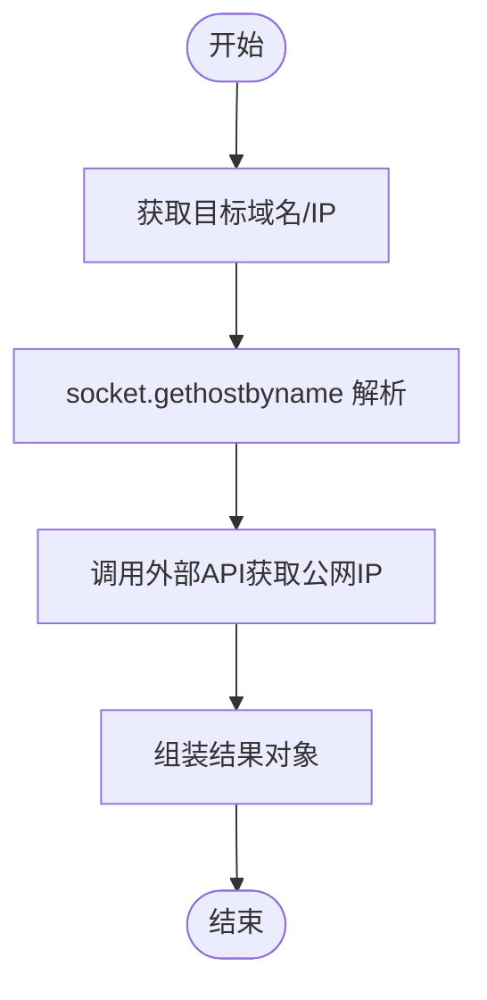
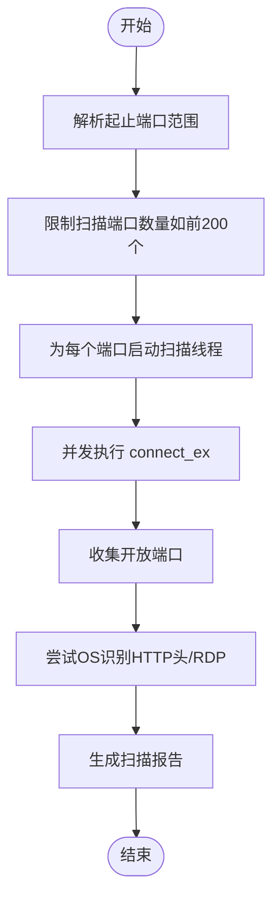
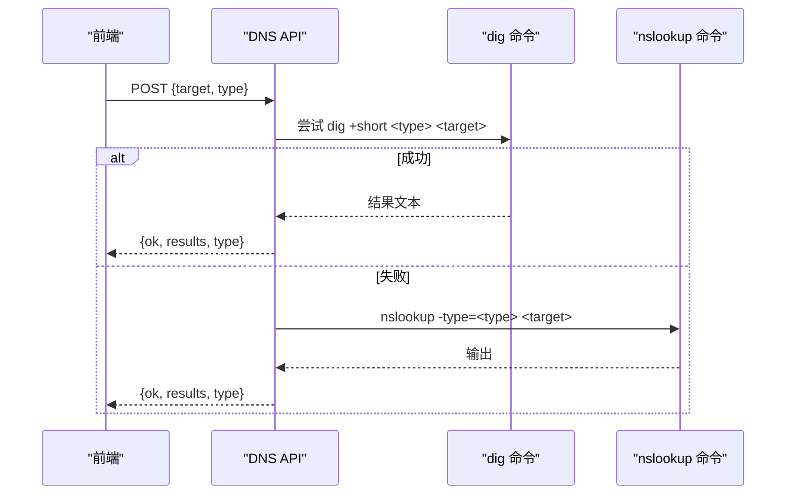
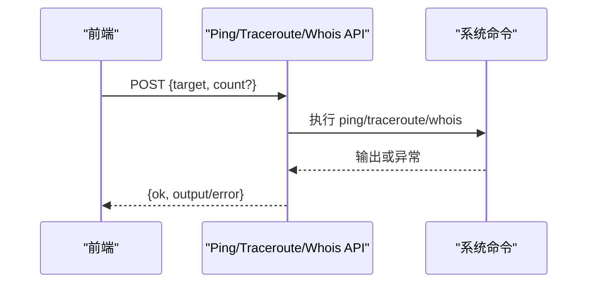
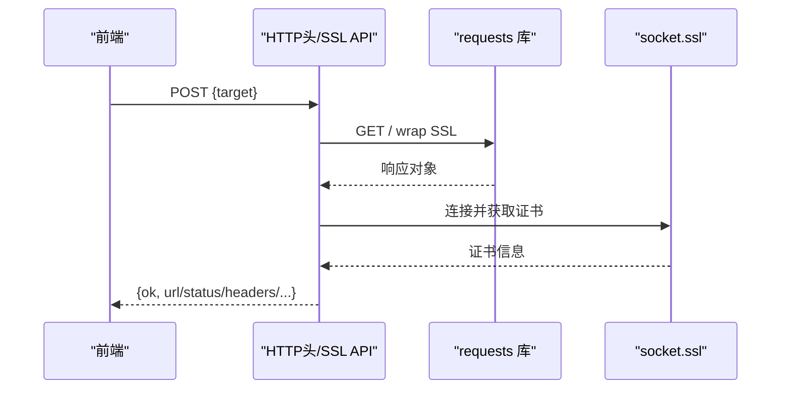
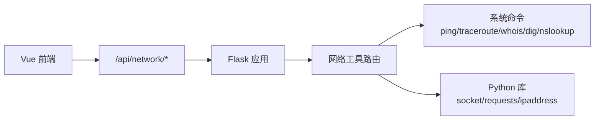

# 网络工具系统

<cite>
**本文档引用的文件**
- [app.py](file://app.py)
- [network_tools.html](file://templates/network_tools.html)
- [api.js](file://frontend/src/api.js)
- [main.js](file://frontend/src/main.js)
- [App.vue](file://frontend/src/App.vue)
- [requirements.txt](file://requirements.txt)
- [安全措施清单.md](file://安全措施清单.md)
</cite>

## 目录
1. [简介](#简介)
2. [项目结构](#项目结构)
3. [核心组件](#核心组件)
4. [架构总览](#架构总览)
5. [详细组件分析](#详细组件分析)
6. [依赖关系分析](#依赖关系分析)
7. [性能考虑](#性能考虑)
8. [故障排查指南](#故障排查指南)
9. [结论](#结论)
10. [附录](#附录)

## 简介
本项目是一个基于 Flask 的多合一工具箱 Web 应用，其中网络工具模块提供了多种网络诊断与分析能力，包括：
- IP 地址查询（域名解析、公网/内网 IP 获取）
- 端口扫描（TCP 连接扫描、常见端口并发扫描、基础操作系统识别）
- DNS 解析（A/AAAA/MX/NS/TXT/CNAME/SOA 记录）
- 网络诊断工具（Ping、Traceroute、Whois）
- 安全相关（HTTP 响应头检查、SSL 证书检查）
- 网络辅助（子网计算器）

系统采用前后端分离架构，前端使用 Vue 3，后端提供 RESTful API，并通过严格的权限控制与安全策略保障稳定与安全。

## 项目结构
- 后端入口与路由：app.py
- 网络工具前端页面：templates/network_tools.html
- 前端 Vue 应用：frontend/src/*
- 依赖声明：requirements.txt
- 安全评估报告：安全措施清单.md

**图表来源**
- [app.py](file://app.py)
- [network_tools.html](file://templates/network_tools.html)
- [main.js](file://frontend/src/main.js)
- [App.vue](file://frontend/src/App.vue)

**章节来源**
- [app.py](file://app.py)
- [network_tools.html](file://templates/network_tools.html)
- [requirements.txt](file://requirements.txt)

## 核心组件
- 网络工具路由与页面
  - GET/POST /network_tools：提供表单式 IP 查询与端口扫描功能，返回渲染后的页面与结果。
  - /api/network/*：提供纯 API 接口，支持 Ping、Traceroute、Whois、DNS、HTTP 头检查、SSL 证书检查、子网计算器等。
- 前端交互
  - network_tools.html：包含多个工具的表单与输出区域，JavaScript 通过 fetch 调用 /api/network/* 并渲染结果。
- 安全与权限
  - 登录保护与 VIP 权限装饰器：确保只有登录用户与 VIP 用户可访问网络工具。
  - UA 黑名单：拦截常见安全扫描工具的 User-Agent。
  - 速率限制与验证码：保护接口免受滥用。

**章节来源**
- [app.py](file://app.py)
- [network_tools.html](file://templates/network_tools.html)

## 架构总览
系统采用“前端模板 + 后端 API”的混合架构：
- 前端负责用户交互与结果展示（network_tools.html 中的 JavaScript 调用 /api/network/*）。
- 后端负责业务逻辑与系统命令调用（如 ping、traceroute、dig/nslookup、socket 连接等）。
- 安全层贯穿前后端，包括登录认证、VIP 权限、CSP、CORS、UA 过滤、速率限制等。

**图表来源**
- [network_tools.html](file://templates/network_tools.html)
- [app.py](file://app.py)

## 详细组件分析

### IP 地址查询
- 功能概述
  - 解析输入的域名或 IP，获取本地主机名对应的 IP。
  - 通过外部服务获取公网 IP，便于区分内外网 IP。
- 实现要点
  - 使用 socket.gethostbyname 进行域名解析。
  - 调用外部 API 获取公网 IP。
  - 表单提交与 AJAX 调用分别支持页面直连与前端异步请求。
- 输出
  - 包含输入域名、解析到的 IP、本机 IP、公网 IP（若可获取）。

**图表来源**
- [app.py](file://app.py)

**章节来源**
- [app.py](file://app.py)
- [network_tools.html](file://templates/network_tools.html)

### 端口扫描（TCP 连接扫描）
- 功能概述
  - 对指定目标进行 TCP 端口扫描，支持起止端口范围。
  - 限制扫描范围：超过一定数量时仅扫描前若干常见端口，避免资源浪费。
  - 基于线程并发扫描，提升效率。
  - 简单的 OS 识别：通过探测 HTTP Server 头或 RDP 端口判断。
- 实现要点
  - 使用 socket.SOCK_STREAM 建立 TCP 连接，connect_ex 返回 0 表示端口开放。
  - 多线程遍历端口范围，收集开放端口。
  - OS 识别：探测 80 端口响应头或 3389 端口开放性。
- 性能与优化
  - 限制扫描端口数量（例如前 200 个常见端口）。
  - 设置较短超时（约 0.3 秒），避免阻塞。
  - 并发线程数与端口范围成比例，注意系统资源占用。

**图表来源**
- [app.py](file://app.py)

**章节来源**
- [app.py](file://app.py)
- [network_tools.html](file://templates/network_tools.html)

### DNS 解析（A/AAAA/MX/NS/TXT/CNAME/SOA）
- 功能概述
  - 支持多种 DNS 记录类型的查询。
  - 优先使用 dig 命令，若不可用则回退到 nslookup。
- 实现要点
  - A/AAAA：使用 socket.gethostbyname/getaddrinfo。
  - MX/NS/TXT/CNAME/SOA：调用 dig 或 nslookup。
  - 对无效目标与记录类型进行参数校验与错误处理。
- 输出
  - 返回记录类型与结果数组，前端以列表形式展示。

**图表来源**
- [app.py](file://app.py)

**章节来源**
- [app.py](file://app.py)
- [network_tools.html](file://templates/network_tools.html)

### 网络诊断工具
- Ping 测试
  - 跨平台支持：Linux/macOS 使用 ping -c，Windows 使用 ping -n。
  - 参数校验与超时控制，返回原始输出或错误信息。
- Traceroute 追踪
  - 跨平台支持：Linux/macOS 使用 traceroute，Windows 使用 tracert。
  - 设置最大跳数与超时，返回路由路径文本。
- Whois 查询
  - 调用 whois 命令，返回注册信息文本。

**图表来源**
- [app.py](file://app.py)

**章节来源**
- [app.py](file://app.py)
- [network_tools.html](file://templates/network_tools.html)

### 安全相关工具
- HTTP 响应头检查
  - 自动补充协议前缀，支持重定向跟踪，返回状态码、原因短语、响应头与重定向次数。
- SSL 证书检查
  - 通过 socket.ssl 建立 TLS 连接，提取证书主题、颁发者、有效期、SAN 等信息，并计算剩余天数。

**图表来源**
- [app.py](file://app.py)

**章节来源**
- [app.py](file://app.py)
- [network_tools.html](file://templates/network_tools.html)

### 子网计算器
- 功能概述
  - 输入 CIDR（如 192.168.1.0/24），计算网络地址、广播地址、子网掩码、可用主机范围等。
- 实现要点
  - 使用 ipaddress 库解析并计算网络属性。
  - 对非法输入进行错误处理与返回。

**章节来源**
- [app.py](file://app.py)
- [network_tools.html](file://templates/network_tools.html)

## 依赖关系分析
- 后端依赖
  - Flask：Web 框架与路由。
  - PyMySQL：数据库连接（用于用户与日志等）。
  - requests：HTTP 请求（如公网 IP 查询、HTTP 头检查）。
  - psutil：系统信息（用于系统监控页面，非网络工具核心）。
- 前端依赖
  - Vue 3：应用框架。
  - Bootstrap：样式与组件（网络工具界面使用了 Bootstrap 样式类）。
- 系统命令
  - ping/traceroute/whois/dig/nslookup：用于网络诊断与 DNS 查询。

**图表来源**
- [app.py](file://app.py)
- [requirements.txt](file://requirements.txt)

**章节来源**
- [requirements.txt](file://requirements.txt)
- [app.py](file://app.py)

## 性能考虑
- 端口扫描
  - 限制扫描范围与并发线程数，避免对目标与本机造成过大压力。
  - 设置合理超时，防止长时间阻塞。
- DNS 查询
  - 优先使用 dig，失败回退 nslookup，减少超时风险。
- 系统命令调用
  - 为每个命令设置超时与异常捕获，避免阻塞。
- 前端渲染
  - 大量输出（如 traceroute）使用 pre 区域展示原始文本，避免复杂 DOM 渲染。

[本节为通用指导，无需特定文件分析]

## 故障排查指南
- 常见错误与定位
  - 目标无效：检查正则校验与输入格式（域名/IP/URL）。
  - 命令不可用：确认系统安装了 ping/traceroute/whois/dig/nslookup。
  - 超时：调整超时参数或减少扫描范围。
  - 权限不足：确认用户已登录且具备 VIP 权限。
- 日志与审计
  - 端口扫描写入日志，便于审计与追踪。
- 安全与风控
  - UA 黑名单拦截：若被拦截，更换请求来源或联系管理员。
  - 速率限制：触发后等待封禁结束或降低请求频率。

**章节来源**
- [app.py](file://app.py)
- [安全措施清单.md](file://安全措施清单.md)

## 结论
本网络工具系统通过前后端协作，提供了从基础 IP 查询到高级 DNS、SSL、子网计算等全面的网络诊断能力。系统在安全性方面具备完善的防护策略（登录/权限、CSP、CORS、UA 过滤、速率限制等），在性能方面通过并发扫描与超时控制提升了用户体验。建议在生产环境中结合日志与监控，持续优化扫描策略与资源配额。

[本节为总结性内容，无需特定文件分析]

## 附录

### API 接口文档（摘要）
- 路由：/api/network/ping
  - 方法：POST
  - 参数：target（必填，域名/IP）、count（可选，默认4，上限20）
  - 返回：ok、output 或 error
- 路由：/api/network/traceroute
  - 方法：POST
  - 参数：target（必填，域名/IP）
  - 返回：ok、output 或 error
- 路由：/api/network/whois
  - 方法：POST
  - 参数：target（必填，域名）
  - 返回：ok、output 或 error
- 路由：/api/network/dns
  - 方法：POST
  - 参数：target（必填，域名）、type（可选，A/AAAA/MX/NS/TXT/CNAME/SOA，默认A）
  - 返回：ok、results、type 或 error
- 路由：/api/network/http_headers
  - 方法：POST
  - 参数：target（必填，URL 或域名）
  - 返回：ok、url、status_code、reason、headers、redirect_count 或 error
- 路由：/api/network/ssl
  - 方法：POST
  - 参数：target（必填，域名）
  - 返回：ok、subject、issuer、not_before、not_after、days_left、san、version 或 error
- 路由：/api/network/subnet
  - 方法：POST
  - 参数：cidr（必填，CIDR 格式）
  - 返回：ok、network_address、broadcast_address、netmask、hostmask、num_addresses、usable_hosts、first_host、last_host、is_private、is_global 或 error

**章节来源**
- [app.py](file://app.py)

### 集成示例（前端 fetch）
- Ping 示例
  - 发送 POST /api/network/ping，JSON 包含 {target, count}，接收 {ok, output} 并渲染到页面。
- DNS 示例
  - 发送 POST /api/network/dns，JSON 包含 {target, type}，接收 {ok, results, type} 并渲染列表。
- HTTP 头检查与 SSL 检查
  - 发送 POST /api/network/http_headers 与 /api/network/ssl，分别接收响应头与证书信息并渲染卡片。

**章节来源**
- [network_tools.html](file://templates/network_tools.html)

### 使用场景与实际应用案例
- IT 运维
  - 快速排查网络连通性（Ping/Traceroute）、识别开放端口与潜在风险（端口扫描）、验证 DNS 配置（DNS 查询）。
- 安全审计
  - 检查网站安全头（HTTP 头检查）、验证证书有效性（SSL 证书检查）、核查子网规划（子网计算器）。
- 开发调试
  - 通过 DNS 查询确认域名解析行为，通过 Whois 查看域名注册信息，辅助域名与证书管理。

[本节为概念性内容，无需特定文件分析]