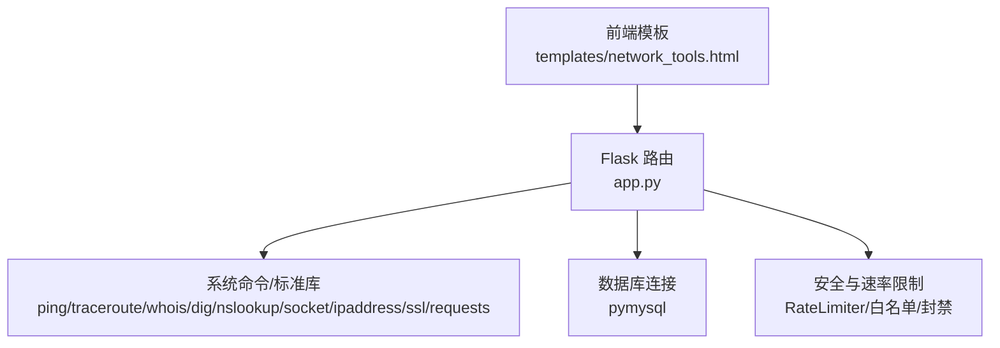
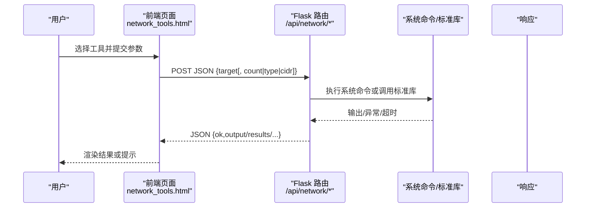
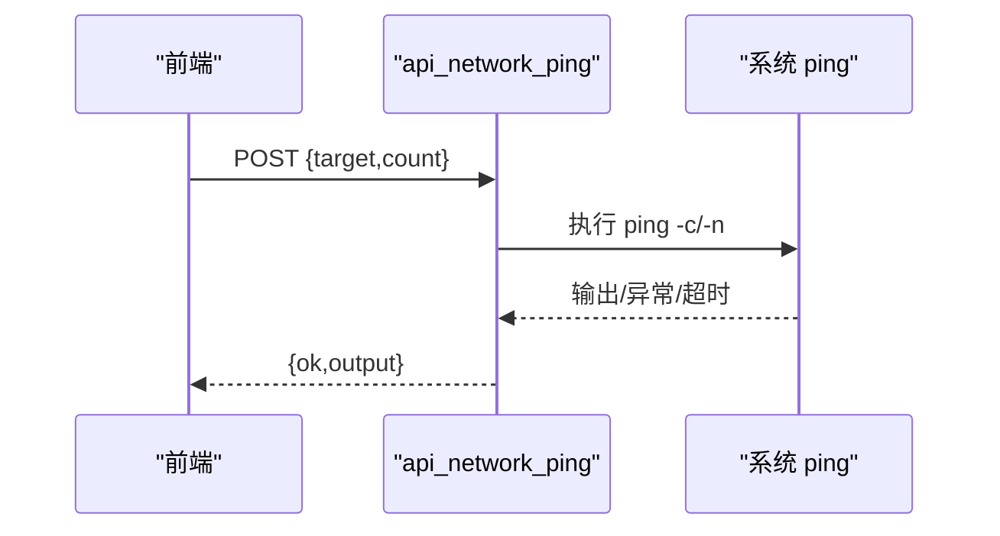
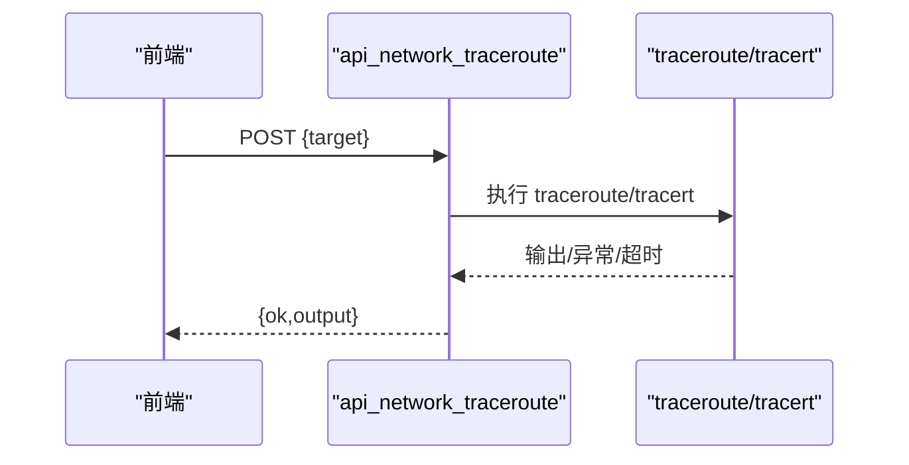
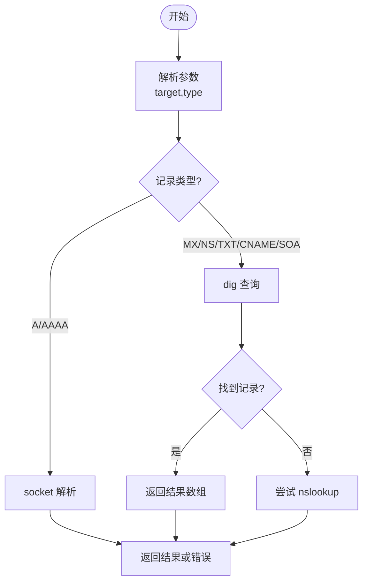
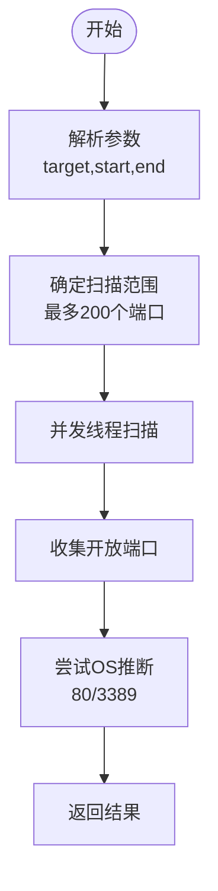
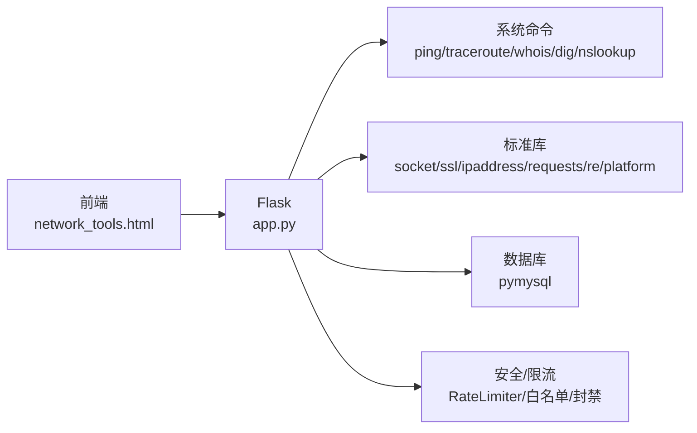

# 网络诊断

<cite>
**本文引用的文件**
- [app.py](file://app.py)
- [network_tools.html](file://templates/network_tools.html)
</cite>

## 目录
1. [简介](#简介)
2. [项目结构](#项目结构)
3. [核心组件](#核心组件)
4. [架构总览](#架构总览)
5. [详细组件分析](#详细组件分析)
6. [依赖关系分析](#依赖关系分析)
7. [性能考量](#性能考量)
8. [故障排查指南](#故障排查指南)
9. [结论](#结论)
10. [附录](#附录)

## 简介
本文件面向“网络诊断工具”的技术文档，聚焦以下能力：
- Ping 测试：基于系统 ping 命令的 ICMP Echo 请求/响应，展示 RTT 与丢包情况（通过解析输出）。
- Traceroute 路径追踪：基于系统 traceroute/tracert，实现 TTL 递增与路径节点发现。
- DNS/Whois/HTTP 头/SSL 证书等辅助诊断能力。
- 端口连通性检测：基于 TCP Socket 的并发端口扫描与简单操作系统特征推断。
- 子网计算器：基于标准库进行 CIDR 计算。

同时，文档提供 API 接口说明、前端调用流程、结果解读与自动化集成建议。

## 项目结构
- 后端采用 Flask 应用，集中于 app.py，包含网络诊断相关路由与工具函数。
- 前端模板位于 templates/network_tools.html，提供 Tab 化的网络诊断界面与 JavaScript 调用后端 API 的逻辑。
- 部分功能受 VIP 权限保护，体现资源控制与访问分级。

图表来源
- [network_tools.html:1-196](file://templates/network_tools.html#L1-L196)
- [app.py:2075-2315](file://app.py#L2075-L2315)

章节来源
- [network_tools.html:1-196](file://templates/network_tools.html#L1-L196)
- [app.py:1958-2315](file://app.py#L1958-L2315)

## 核心组件
- 网络诊断 API 路由组：/api/network/*
- 前端交互：Tab 切换与 fetch 请求，统一通过 /api/network/{tool} 调用。
- 权限控制：部分工具需登录且具备 VIP 权限。
- 安全与稳定性：输入校验、超时控制、系统命令可用性检查、跨平台适配（Unix/Linux 与 Windows）。

章节来源
- [network_tools.html:1-196](file://templates/network_tools.html#L1-L196)
- [app.py:2075-2315](file://app.py#L2075-L2315)

## 架构总览
后端以路由为中心，前端通过 AJAX 调用对应 API，后端根据目标平台选择系统命令或标准库实现具体功能，最终返回结构化结果或纯文本输出。

图表来源
- [network_tools.html:207-263](file://templates/network_tools.html#L207-L263)
- [app.py:2075-2315](file://app.py#L2075-L2315)

## 详细组件分析

### Ping 测试（ICMP Echo）
- 功能要点
  - 参数：target（域名/IP）、count（探测次数，上限 20）。
  - 平台适配：Unix/Linux 使用 ping -c，Windows 使用 ping -n。
  - 超时控制：整体超时约 15 秒。
  - 返回：纯文本输出，前端直接渲染。
- 结果解读
  - RTT：通常出现在输出中的“time≈”或类似字段，单位毫秒。
  - 丢包率：可通过发送次数与存活次数计算。
  - 超时/不可达：依据返回状态与输出文本判断。
- 安全与健壮性
  - 输入过滤：仅允许字母、数字、点、连字符、冒号。
  - 异常处理：超时、命令不存在、非零退出码均有明确返回。

图表来源
- [app.py:2075-2102](file://app.py#L2075-L2102)
- [network_tools.html:90-102](file://templates/network_tools.html#L90-L102)

章节来源
- [app.py:2075-2102](file://app.py#L2075-L2102)
- [network_tools.html:90-102](file://templates/network_tools.html#L90-L102)

### Traceroute 路径追踪
- 功能要点
  - 参数：target（域名/IP）。
  - 平台适配：Unix/Linux 使用 traceroute（最大跳数 15，每跳超时 3s），Windows 使用 tracert（最大生存时间 15，超时 3000ms）。
  - 超时控制：整体超时约 30 秒。
  - 返回：纯文本输出，前端直接渲染。
- 结果解读
  - 路径节点：逐行显示中间路由器或目标主机的响应。
  - TTL 递增：由 traceroute/tracert 自动实现。
  - 超时/黑洞：节点无响应或超时。
- 安全与健壮性
  - 输入过滤：仅允许字母、数字、点、连字符、冒号。
  - 异常处理：超时、命令不存在、非零退出码均有明确返回。

图表来源
- [app.py:2104-2127](file://app.py#L2104-L2127)
- [network_tools.html:104-115](file://templates/network_tools.html#L104-L115)

章节来源
- [app.py:2104-2127](file://app.py#L2104-L2127)
- [network_tools.html:104-115](file://templates/network_tools.html#L104-L115)

### DNS 记录查询
- 功能要点
  - 参数：target（域名）、type（A/AAAA/MX/NS/TXT/CNAME/SOA）。
  - 实现策略：
    - A/AAAA：优先使用 socket 标准库；AAAA 失败时回退。
    - MX/NS/TXT/CNAME/SOA：优先使用 dig（若不可用回退 nslookup）。
  - 超时控制：dig/nslookup 约 5 秒；A/AAAA 约 5 秒。
- 结果解读
  - A/AAAA：返回解析到的 IPv4/IPv6 地址列表。
  - 其他类型：返回记录值数组或原始输出。
- 安全与健壮性
  - 输入过滤：仅允许字母、数字、点、连字符。
  - 异常处理：工具缺失、超时、解析失败均有明确返回。

图表来源
- [app.py:2153-2208](file://app.py#L2153-L2208)

章节来源
- [app.py:2153-2208](file://app.py#L2153-L2208)

### Whois 查询
- 功能要点
  - 参数：target（域名）。
  - 实现：调用 whois 命令，超时约 10 秒。
  - 返回：纯文本输出。
- 安全与健壮性
  - 输入过滤：仅允许字母、数字、点、连字符。
  - 异常处理：超时、命令不存在、非零退出码均有明确返回。

章节来源
- [app.py:2130-2151](file://app.py#L2130-L2151)

### HTTP 响应头检查
- 功能要点
  - 参数：target（URL，自动补全 http/https）。
  - 实现：使用 requests 发起请求，允许重定向，设置自定义 User-Agent。
  - 返回：URL、状态码、原因、响应头、重定向次数。
- 结果解读
  - 状态码：指示请求结果（2xx 成功、4xx/5xx 错误）。
  - 重定向：记录重定向次数与链路。
  - 关键头：可据此判断缓存策略、安全策略、服务端版本等。
- 安全与健壮性
  - 超时：约 10 秒。
  - 异常处理：请求异常统一返回错误信息。

章节来源
- [app.py:2211-2237](file://app.py#L2211-L2237)

### SSL 证书检查
- 功能要点
  - 参数：target（域名）。
  - 实现：通过 socket + ssl 上下文连接 443 端口，提取证书信息。
  - 返回：主题、颁发者、有效期、SAN、版本、剩余天数等。
- 结果解读
  - 有效期：剩余天数用于判断证书健康度。
  - SAN：验证域名覆盖范围。
  - 版本：指示加密套件与协议版本趋势。
- 安全与健壮性
  - 超时：约 10 秒。
  - 异常处理：连接失败、证书解析异常均有明确返回。

章节来源
- [app.py:2239-2285](file://app.py#L2239-L2285)

### 子网计算器
- 功能要点
  - 参数：cidr（如 192.168.1.0/24）。
  - 实现：使用 ipaddress 标准库解析并计算网络地址、广播地址、掩码、主机范围等。
  - 返回：网络地址、广播地址、子网掩码、反掩码、地址总数、可用主机数、首尾可用 IP、是否私有/全局。
- 结果解读
  - 可用主机数：总地址数减去网络地址与广播地址。
  - 私有/全局：用于判断网络性质（如 NAT、公网可达性）。

章节来源
- [app.py:2288-2315](file://app.py#L2288-L2315)

### 端口连通性检测（TCP 端口扫描）
- 功能要点
  - 参数：target（IP）、start_port、end_port。
  - 实现：并发线程扫描端口范围（最多 200 个常用端口），使用 socket 进行 TCP 连接测试。
  - 操作系统推断：通过向 80 发送 HTTP HEAD 或检测 3389 端口判断（Nginx/Apache/IIS/Windows RDP）。
- 结果解读
  - 开放端口：返回开放列表。
  - OS 推断：基于服务头或端口开放情况给出推测。
- 安全与健壮性
  - 超时：单端口约 0.3 秒；整体并发控制。
  - 限制：为避免过大扫描范围，最多扫描前 200 个端口。

图表来源
- [app.py:1987-2067](file://app.py#L1987-L2067)

章节来源
- [app.py:1958-2072](file://app.py#L1958-L2072)

## 依赖关系分析
- 前端依赖
  - Bootstrap Tabs 与自定义脚本：负责表单收集、AJAX 调用、结果渲染。
- 后端依赖
  - Flask：路由与响应。
  - 系统命令：ping/traceroute/whois/dig/nslookup。
  - 标准库：socket、ssl、ipaddress、requests、subprocess、re、platform。
  - 数据库：pymysql（用于用户权限与日志）。
- 安全与速率限制
  - RateLimiter：内存+文件持久化，支持定时保存。
  - 白名单/封禁：IP 级别封禁与试探追加封禁。
  - VIP 权限：部分网络工具需登录且具备 VIP 权限。

图表来源
- [network_tools.html:1-196](file://templates/network_tools.html#L1-L196)
- [app.py:2075-2315](file://app.py#L2075-L2315)

章节来源
- [app.py:31-116](file://app.py#L31-L116)
- [app.py:348-412](file://app.py#L348-L412)
- [app.py:2075-2315](file://app.py#L2075-L2315)

## 性能考量
- 并发与超时
  - 端口扫描采用多线程，但对扫描范围做了上限控制，避免过度占用资源。
  - 各系统命令调用均设置超时，防止阻塞。
- I/O 与网络
  - DNS 查询优先使用 dig，失败回退 nslookup；HTTP/SSL 查询设置合理超时。
- 资源控制
  - VIP 权限与速率限制结合，避免滥用导致系统负载过高。

## 故障排查指南
- 常见错误与处理
  - “目标必填/非法目标”：检查输入格式与字符集。
  - “命令不可用”：确认系统安装了相应工具（ping/traceroute/whois/dig/nslookup）。
  - “超时”：网络不稳定或目标不可达；适当增加探测次数或检查防火墙。
  - “权限不足”：确认登录状态与 VIP 权限。
- 前端调试
  - 观察浏览器 Network 面板，确认请求与响应体。
  - 查看控制台是否有脚本错误。
- 后端日志
  - 可结合应用日志定位异常（如命令缺失、超时、数据库问题）。

章节来源
- [app.py:2075-2315](file://app.py#L2075-L2315)
- [network_tools.html:207-263](file://templates/network_tools.html#L207-L263)

## 结论
该网络诊断工具以轻量、可移植的方式整合了常用的网络诊断能力：Ping/Traceroute、DNS/Whois、HTTP/SSL、子网计算与端口扫描。通过前端 AJAX 与后端路由的清晰分离，实现了良好的用户体验与可维护性。配合 VIP 权限与速率限制，兼顾了安全性与稳定性。对于吞吐量与带宽测量等高级需求，当前版本未提供专用实现，建议在后续迭代中引入专门的测试模块或外部工具集成。

## 附录

### API 接口一览（后端）
- POST /api/network/ping
  - 参数：target（域名/IP），count（探测次数，1~20）
  - 返回：ok + output（纯文本）
- POST /api/network/traceroute
  - 参数：target（域名/IP）
  - 返回：ok + output（纯文本）
- POST /api/network/dns
  - 参数：target（域名），type（A/AAAA/MX/NS/TXT/CNAME/SOA）
  - 返回：ok + results（数组）或 error
- POST /api/network/whois
  - 参数：target（域名）
  - 返回：ok + output（纯文本）
- POST /api/network/http_headers
  - 参数：target（URL）
  - 返回：ok + url/status_code/reason/headers/redirect_count
- POST /api/network/ssl
  - 参数：target（域名）
  - 返回：ok + subject/issuer/not_before/not_after/days_left/san/version
- POST /api/network/subnet
  - 参数：cidr（CIDR 字符串）
  - 返回：ok + 网络计算结果字段

章节来源
- [app.py:2075-2315](file://app.py#L2075-L2315)

### 前端调用流程（关键）
- 收集表单参数（Ping/Traceroute/Whois/DNS/HTTP/SSL/Subnet）。
- 发送 JSON 至 /api/network/{tool}。
- 根据返回渲染纯文本或卡片式结果。

章节来源
- [network_tools.html:207-325](file://templates/network_tools.html#L207-L325)