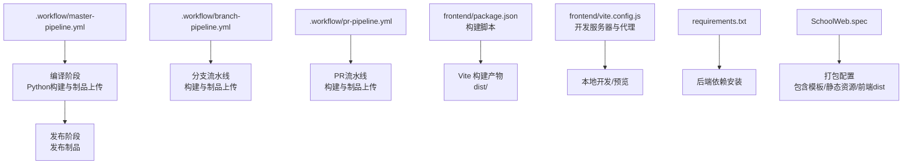
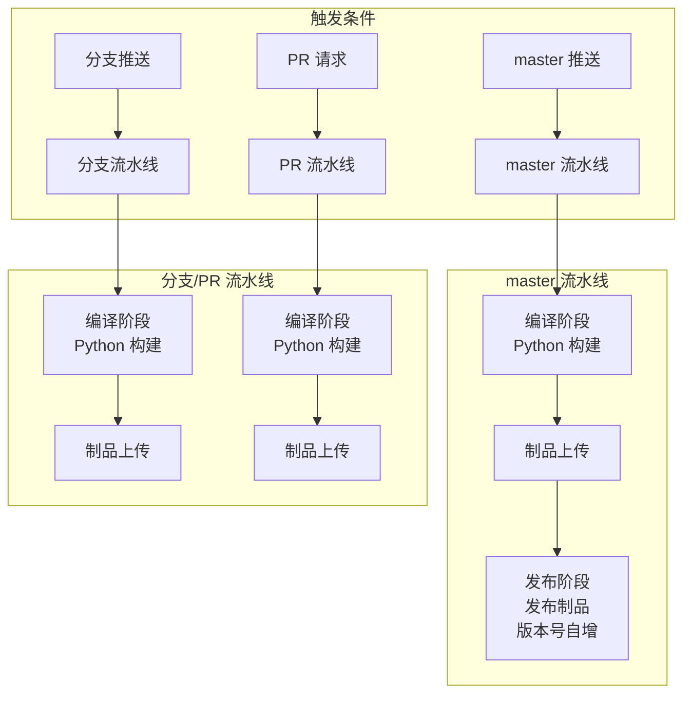
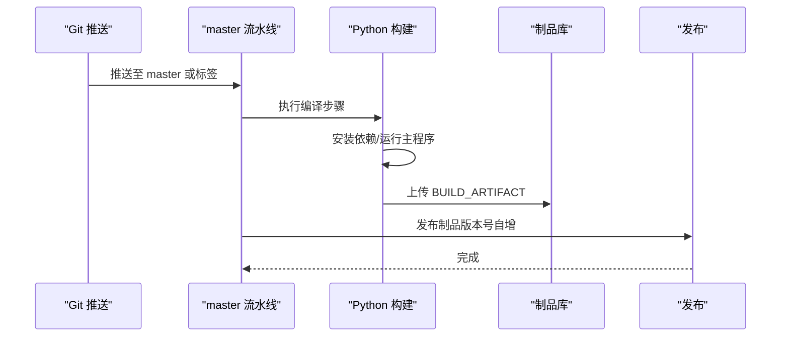
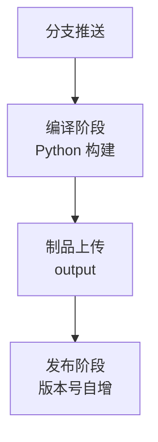
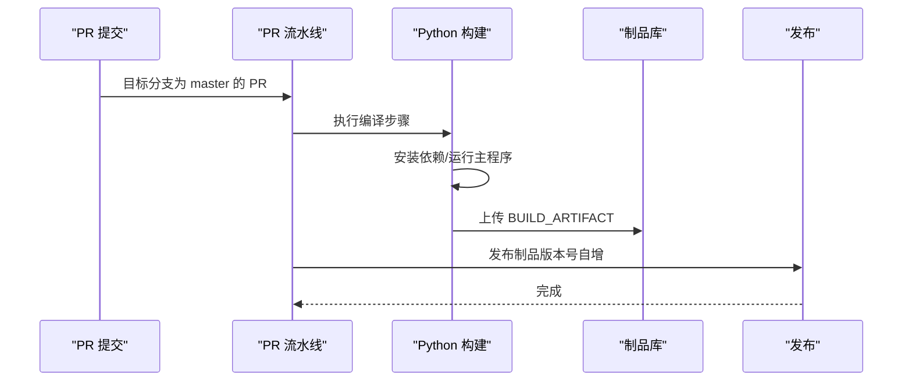
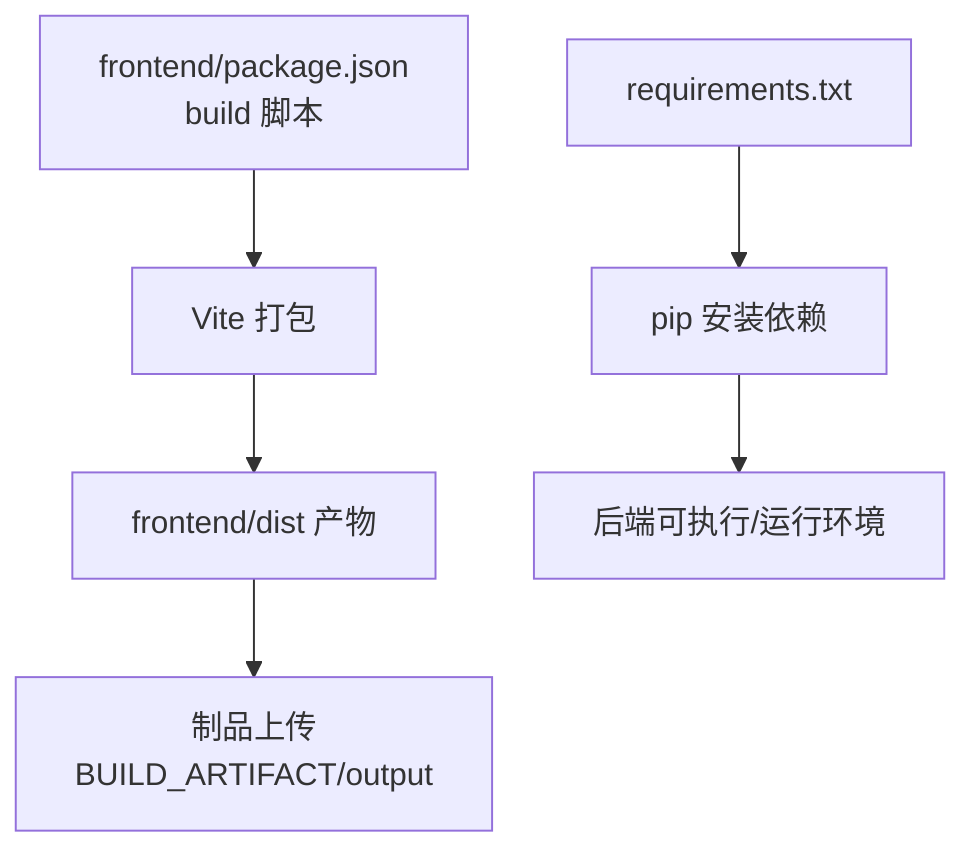
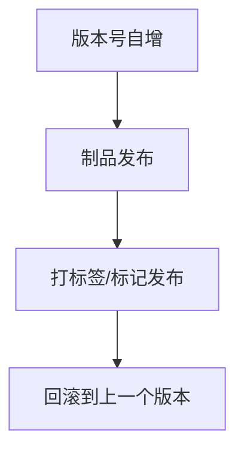
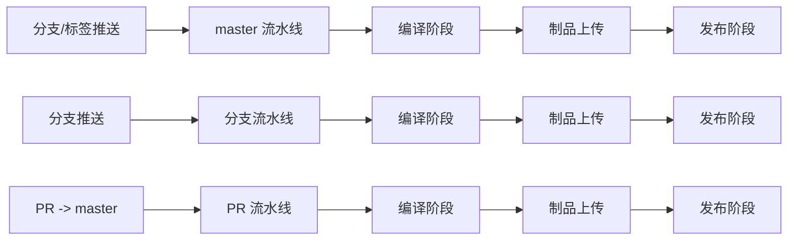

# CI/CD流水线

<cite>
**本文引用的文件**
- [.workflow/master-pipeline.yml](file://.workflow/master-pipeline.yml)
- [.workflow/branch-pipeline.yml](file://.workflow/branch-pipeline.yml)
- [.workflow/pr-pipeline.yml](file://.workflow/pr-pipeline.yml)
- [requirements.txt](file://requirements.txt)
- [frontend/package.json](file://frontend/package.json)
- [frontend/vite.config.js](file://frontend/vite.config.js)
- [SchoolWeb.spec](file://SchoolWeb.spec)
- [app.py](file://app.py)
- [.gitignore](file://.gitignore)
</cite>

## 目录
1. [简介](#简介)
2. [项目结构](#项目结构)
3. [核心组件](#核心组件)
4. [架构总览](#架构总览)
5. [详细组件分析](#详细组件分析)
6. [依赖关系分析](#依赖关系分析)
7. [性能考虑](#性能考虑)
8. [故障排除指南](#故障排除指南)
9. [结论](#结论)
10. [附录](#附录)

## 简介
本指南面向School_Web项目的CI/CD流水线，系统性解析现有流水线配置与运行策略，覆盖master分支自动部署、分支流水线与PR流水线的设计思路；详细说明构建步骤（Python依赖安装、前端打包与制品管理）；阐述自动化测试与代码质量检查的落地建议；给出发布策略（版本号管理、发布标签与回滚机制）；并提供监控与告警配置要点及常见问题排查方法。

## 项目结构
仓库采用前后端同库的组织方式，关键目录与文件如下：
- .workflow：存放三类流水线配置（master、branch、pr）
- frontend：Vue3前端工程，包含构建脚本与Vite代理配置
- app.py：Flask应用入口与业务逻辑
- requirements.txt：后端Python依赖
- SchoolWeb.spec：打包配置（用于将应用打包为可执行程序）
- .gitignore：敏感文件忽略规则

图表来源
- [.workflow/master-pipeline.yml:1-55](file://.workflow/master-pipeline.yml#L1-L55)
- [.workflow/branch-pipeline.yml:1-53](file://.workflow/branch-pipeline.yml#L1-L53)
- [.workflow/pr-pipeline.yml:1-38](file://.workflow/pr-pipeline.yml#L1-L38)
- [frontend/package.json:1-21](file://frontend/package.json#L1-L21)
- [frontend/vite.config.js:1-21](file://frontend/vite.config.js#L1-L21)
- [requirements.txt:1-5](file://requirements.txt#L1-L5)
- [SchoolWeb.spec:1-45](file://SchoolWeb.spec#L1-L45)

章节来源
- [.workflow/master-pipeline.yml:1-55](file://.workflow/master-pipeline.yml#L1-L55)
- [.workflow/branch-pipeline.yml:1-53](file://.workflow/branch-pipeline.yml#L1-L53)
- [.workflow/pr-pipeline.yml:1-38](file://.workflow/pr-pipeline.yml#L1-L38)
- [frontend/package.json:1-21](file://frontend/package.json#L1-L21)
- [frontend/vite.config.js:1-21](file://frontend/vite.config.js#L1-L21)
- [requirements.txt:1-5](file://requirements.txt#L1-L5)
- [SchoolWeb.spec:1-45](file://SchoolWeb.spec#L1-L45)

## 核心组件
- master流水线：针对master分支的自动部署流水线，包含编译与发布两个阶段，自动递增版本号并产出制品。
- 分支流水线：针对非master分支的通用流水线，完成构建与制品上传，便于后续发布或测试。
- PR流水线：针对拉取请求的快速反馈流水线，完成构建与制品上传，便于审阅与合并前验证。
- 前端构建：通过Vite进行开发与打包，支持本地代理与跨域API访问。
- 后端构建：基于Python 3.9，使用pip安装requirements.txt中的依赖。
- 打包配置：SchoolWeb.spec声明了模板、静态资源与前端dist等打包数据，便于生成可执行程序。

章节来源
- [.workflow/master-pipeline.yml:19-55](file://.workflow/master-pipeline.yml#L19-L55)
- [.workflow/branch-pipeline.yml:4-53](file://.workflow/branch-pipeline.yml#L4-L53)
- [.workflow/pr-pipeline.yml:4-38](file://.workflow/pr-pipeline.yml#L4-L38)
- [frontend/package.json:6-10](file://frontend/package.json#L6-L10)
- [frontend/vite.config.js:6-19](file://frontend/vite.config.js#L6-L19)
- [requirements.txt:1-5](file://requirements.txt#L1-L5)
- [SchoolWeb.spec:8-44](file://SchoolWeb.spec#L8-L44)

## 架构总览
下图展示了三条流水线的触发条件、阶段与制品流转关系：

图表来源
- [.workflow/master-pipeline.yml:4-18](file://.workflow/master-pipeline.yml#L4-L18)
- [.workflow/branch-pipeline.yml:46-53](file://.workflow/branch-pipeline.yml#L46-L53)
- [.workflow/pr-pipeline.yml:34-38](file://.workflow/pr-pipeline.yml#L34-L38)
- [.workflow/master-pipeline.yml:19-55](file://.workflow/master-pipeline.yml#L19-L55)
- [.workflow/branch-pipeline.yml:4-53](file://.workflow/branch-pipeline.yml#L4-L53)
- [.workflow/pr-pipeline.yml:4-38](file://.workflow/pr-pipeline.yml#L4-L38)

## 详细组件分析

### master流水线
- 触发条件：master分支推送、任意标签推送、定时器（每月1日触发一次）。
- 编译阶段：
  - 使用Python 3.9构建后端依赖。
  - 安装requirements.txt中的依赖。
  - 运行主程序入口以进行基础健康检查。
  - 产出BUILD_ARTIFACT制品。
- 发布阶段：
  - 依赖上一阶段制品，发布为版本号1.0.0.0并开启自动递增。

图表来源
- [.workflow/master-pipeline.yml:4-18](file://.workflow/master-pipeline.yml#L4-L18)
- [.workflow/master-pipeline.yml:19-55](file://.workflow/master-pipeline.yml#L19-L55)

章节来源
- [.workflow/master-pipeline.yml:4-18](file://.workflow/master-pipeline.yml#L4-L18)
- [.workflow/master-pipeline.yml:19-55](file://.workflow/master-pipeline.yml#L19-L55)

### 分支流水线
- 触发条件：除master外的任意分支推送。
- 编译阶段：
  - Python 3.9构建，安装requirements.txt。
  - 运行主程序进行基础验证。
  - 产出BUILD_ARTIFACT。
- 发布阶段：
  - 上传制品为output，版本号1.0.0.0并自动递增。

图表来源
- [.workflow/branch-pipeline.yml:4-53](file://.workflow/branch-pipeline.yml#L4-L53)
- [.workflow/branch-pipeline.yml:46-53](file://.workflow/branch-pipeline.yml#L46-L53)

章节来源
- [.workflow/branch-pipeline.yml:4-53](file://.workflow/branch-pipeline.yml#L4-L53)
- [.workflow/branch-pipeline.yml:46-53](file://.workflow/branch-pipeline.yml#L46-L53)

### PR流水线
- 触发条件：PR目标分支为master。
- 编译阶段：
  - Python 3.9构建，安装requirements.txt。
  - 运行主程序进行基础验证。
  - 产出BUILD_ARTIFACT。
- 发布阶段：
  - 上传制品为output，版本号1.0.0.0并自动递增。

图表来源
- [.workflow/pr-pipeline.yml:34-38](file://.workflow/pr-pipeline.yml#L34-L38)
- [.workflow/pr-pipeline.yml:4-38](file://.workflow/pr-pipeline.yml#L4-L38)

章节来源
- [.workflow/pr-pipeline.yml:34-38](file://.workflow/pr-pipeline.yml#L34-L38)
- [.workflow/pr-pipeline.yml:4-38](file://.workflow/pr-pipeline.yml#L4-L38)

### 构建步骤详解
- Python依赖安装
  - 使用pip安装requirements.txt中的依赖，镜像源指向清华源以提升下载速度。
- 前端打包
  - 前端工程通过package.json中的build脚本进行打包，产物输出至frontend/dist。
  - Vite开发服务器配置了/api与/static/albums代理，便于本地联调后端接口。
- 制品管理
  - master与分支/PR流水线均将构建产物命名为BUILD_ARTIFACT，并在发布阶段上传为output。
  - master流水线直接进入发布阶段，分支/PR流水线同样可作为发布前置。

图表来源
- [requirements.txt:1-5](file://requirements.txt#L1-L5)
- [frontend/package.json:6-10](file://frontend/package.json#L6-L10)
- [frontend/vite.config.js:6-19](file://frontend/vite.config.js#L6-L19)
- [.workflow/master-pipeline.yml:24-43](file://.workflow/master-pipeline.yml#L24-L43)
- [.workflow/branch-pipeline.yml:8-32](file://.workflow/branch-pipeline.yml#L8-L32)
- [.workflow/pr-pipeline.yml:8-32](file://.workflow/pr-pipeline.yml#L8-L32)

章节来源
- [requirements.txt:1-5](file://requirements.txt#L1-L5)
- [frontend/package.json:6-10](file://frontend/package.json#L6-L10)
- [frontend/vite.config.js:6-19](file://frontend/vite.config.js#L6-L19)
- [.workflow/master-pipeline.yml:24-43](file://.workflow/master-pipeline.yml#L24-L43)
- [.workflow/branch-pipeline.yml:8-32](file://.workflow/branch-pipeline.yml#L8-L32)
- [.workflow/pr-pipeline.yml:8-32](file://.workflow/pr-pipeline.yml#L8-L32)

### 自动化测试与代码质量检查
- 单元测试与集成测试
  - 当前流水线未包含测试步骤。建议在编译阶段后增加测试命令，如pytest或unittest，以覆盖后端逻辑与API端点。
- 代码质量检查
  - 建议引入lint与格式化检查（如flake8、black、isort等），在流水线中新增独立步骤以保证提交质量。
- 前端质量
  - 建议在前端构建前增加ESLint与Prettier检查，确保代码风格一致。

章节来源
- [.workflow/master-pipeline.yml:19-55](file://.workflow/master-pipeline.yml#L19-L55)
- [.workflow/branch-pipeline.yml:4-53](file://.workflow/branch-pipeline.yml#L4-L53)
- [.workflow/pr-pipeline.yml:4-38](file://.workflow/pr-pipeline.yml#L4-L38)

### 发布策略
- 版本号管理
  - master与分支/PR流水线均使用发布制品步骤并开启版本号自增，初始版本为1.0.0.0。
- 发布标签
  - master流水线支持标签推送触发，可用于发布里程碑版本。
- 回滚机制
  - 建议在制品库中保留最近N个版本，配合发布阶段的版本号自增实现快速回滚。
- 打包与分发
  - SchoolWeb.spec声明了模板、静态资源与前端dist的打包数据，可用于生成可执行程序并随制品一同发布。

图表来源
- [.workflow/master-pipeline.yml:49-55](file://.workflow/master-pipeline.yml#L49-L55)
- [.workflow/branch-pipeline.yml:37-45](file://.workflow/branch-pipeline.yml#L37-L45)
- [.workflow/pr-pipeline.yml:37-45](file://.workflow/pr-pipeline.yml#L37-L45)
- [SchoolWeb.spec:8-44](file://SchoolWeb.spec#L8-L44)

章节来源
- [.workflow/master-pipeline.yml:49-55](file://.workflow/master-pipeline.yml#L49-L55)
- [.workflow/branch-pipeline.yml:37-45](file://.workflow/branch-pipeline.yml#L37-L45)
- [.workflow/pr-pipeline.yml:37-45](file://.workflow/pr-pipeline.yml#L37-L45)
- [SchoolWeb.spec:8-44](file://SchoolWeb.spec#L8-L44)

### 监控与告警
- 建议在流水线中增加以下监控点：
  - 构建时长与成功率趋势。
  - 制品大小与发布频率。
  - 测试覆盖率与失败率。
- 告警策略：
  - 构建失败或超时立即告警。
  - 测试失败或覆盖率低于阈值触发告警。
  - 发布异常（版本号未递增、制品缺失）告警。

[本节为通用建议，无需特定文件引用]

### 常见问题与故障排除
- Python依赖安装失败
  - 检查镜像源配置与网络连通性。
  - 确认requirements.txt语法正确且无冲突版本。
- 前端打包失败
  - 检查Vite配置与node_modules完整性。
  - 确认package.json中的build脚本可用。
- 制品上传失败
  - 检查制品名称与路径是否与上游一致。
  - 确认制品库权限与存储空间。
- 发布版本号异常
  - 检查发布阶段的autoIncrement配置与初始版本号。
- 敏感文件泄露风险
  - .gitignore已忽略.secret_key、ip_whitelist.json、rate_config.json，避免误提交。

章节来源
- [requirements.txt:1-5](file://requirements.txt#L1-L5)
- [frontend/package.json:6-10](file://frontend/package.json#L6-L10)
- [frontend/vite.config.js:6-19](file://frontend/vite.config.js#L6-L19)
- [.workflow/master-pipeline.yml:34-43](file://.workflow/master-pipeline.yml#L34-L43)
- [.workflow/branch-pipeline.yml:25-32](file://.workflow/branch-pipeline.yml#L25-L32)
- [.workflow/pr-pipeline.yml:25-32](file://.workflow/pr-pipeline.yml#L25-L32)
- [.gitignore:1-4](file://.gitignore#L1-L4)

## 依赖关系分析
- 触发链路依赖
  - master流水线依赖master分支推送与标签推送。
  - 分支/PR流水线分别依赖对应分支与PR目标分支为master。
- 构建链路依赖
  - 编译阶段依赖Python 3.9与pip安装requirements.txt。
  - 发布阶段依赖上一阶段制品（BUILD_ARTIFACT或output）。
- 打包与分发依赖
  - SchoolWeb.spec声明的数据项影响最终可执行程序的内容与运行时资源。

图表来源
- [.workflow/master-pipeline.yml:4-18](file://.workflow/master-pipeline.yml#L4-L18)
- [.workflow/branch-pipeline.yml:46-53](file://.workflow/branch-pipeline.yml#L46-L53)
- [.workflow/pr-pipeline.yml:34-38](file://.workflow/pr-pipeline.yml#L34-L38)
- [.workflow/master-pipeline.yml:19-55](file://.workflow/master-pipeline.yml#L19-L55)
- [.workflow/branch-pipeline.yml:4-53](file://.workflow/branch-pipeline.yml#L4-L53)
- [.workflow/pr-pipeline.yml:4-38](file://.workflow/pr-pipeline.yml#L4-L38)

章节来源
- [.workflow/master-pipeline.yml:4-18](file://.workflow/master-pipeline.yml#L4-L18)
- [.workflow/branch-pipeline.yml:46-53](file://.workflow/branch-pipeline.yml#L46-L53)
- [.workflow/pr-pipeline.yml:34-38](file://.workflow/pr-pipeline.yml#L34-L38)
- [.workflow/master-pipeline.yml:19-55](file://.workflow/master-pipeline.yml#L19-L55)
- [.workflow/branch-pipeline.yml:4-53](file://.workflow/branch-pipeline.yml#L4-L53)
- [.workflow/pr-pipeline.yml:4-38](file://.workflow/pr-pipeline.yml#L4-L38)

## 性能考虑
- 依赖安装优化
  - 使用国内镜像源提升pip安装速度。
  - 在流水线中缓存pip与node_modules，减少重复下载。
- 构建并行化
  - 将前端打包与后端构建并行执行，缩短总耗时。
- 制品复用
  - 通过制品传递（BUILD_ARTIFACT/output）避免重复构建，提高效率。

[本节为通用建议，无需特定文件引用]

## 故障排除指南
- 构建失败
  - 检查Python版本与依赖冲突。
  - 查看pip安装日志与requirements.txt语法。
- 前端构建失败
  - 检查Vite配置与node_modules完整性。
  - 确认package.json脚本可用。
- 制品缺失
  - 确认制品名称与路径与上游一致。
  - 检查制品库权限与存储空间。
- 发布异常
  - 检查版本号自增与初始版本配置。
- 安全与合规
  - 确保敏感文件不在仓库中，遵循.gitignore规则。

章节来源
- [requirements.txt:1-5](file://requirements.txt#L1-L5)
- [frontend/package.json:6-10](file://frontend/package.json#L6-L10)
- [frontend/vite.config.js:6-19](file://frontend/vite.config.js#L6-L19)
- [.workflow/master-pipeline.yml:34-43](file://.workflow/master-pipeline.yml#L34-L43)
- [.workflow/branch-pipeline.yml:25-32](file://.workflow/branch-pipeline.yml#L25-L32)
- [.workflow/pr-pipeline.yml:25-32](file://.workflow/pr-pipeline.yml#L25-L32)
- [.gitignore:1-4](file://.gitignore#L1-L4)

## 结论
本指南梳理了School_Web的CI/CD流水线现状与最佳实践建议。master流水线负责自动部署，分支与PR流水线提供快速反馈。建议补充测试与代码质量检查步骤，并完善监控与告警机制，以进一步提升交付质量与稳定性。

## 附录
- SchoolWeb.spec中声明的数据项与隐藏导入，确保打包后的可执行程序包含模板、静态资源与前端dist，便于统一分发。

章节来源
- [SchoolWeb.spec:8-44](file://SchoolWeb.spec#L8-L44)