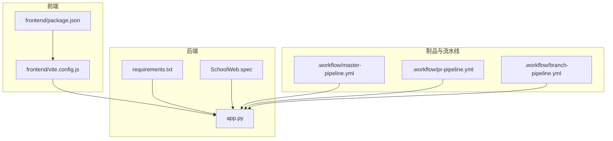
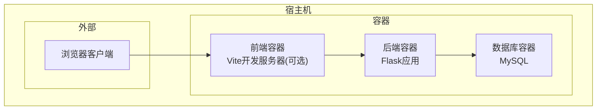
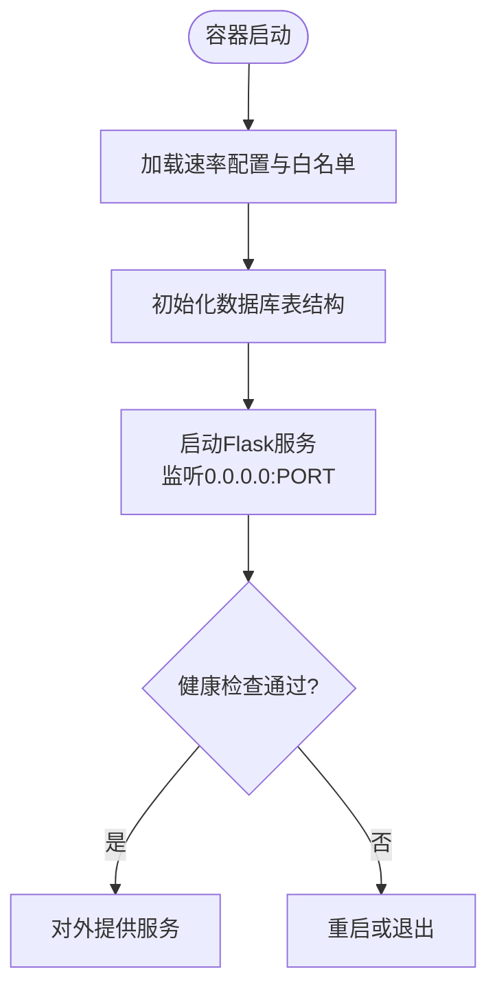
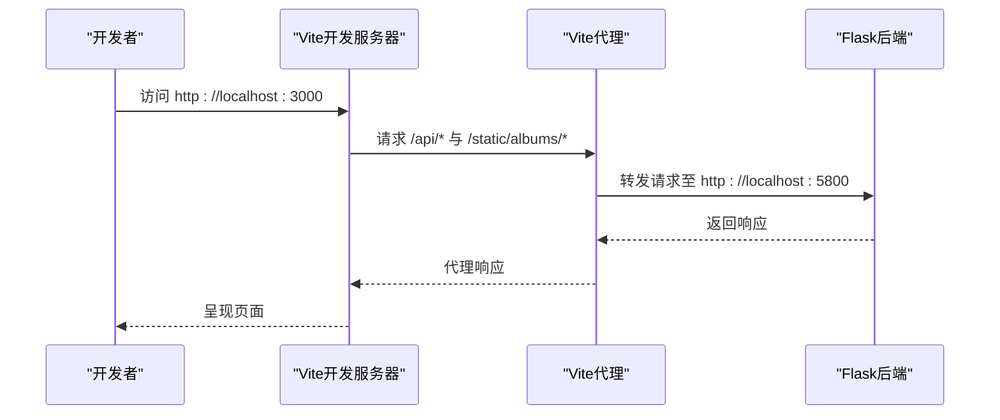
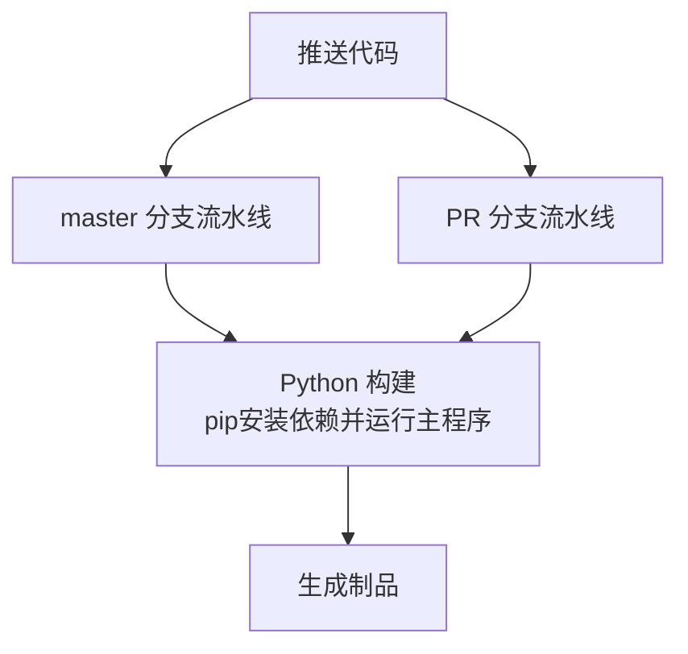
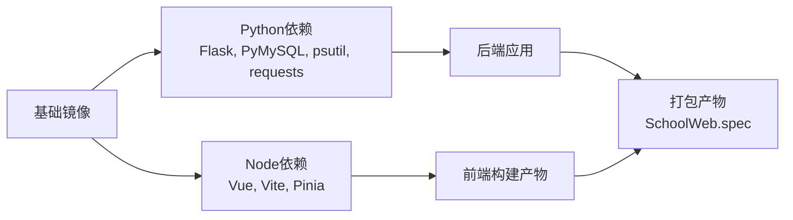

# Docker容器化部署

<cite>
**本文引用的文件**
- [app.py](file://app.py)
- [requirements.txt](file://requirements.txt)
- [package.json](file://frontend/package.json)
- [vite.config.js](file://frontend/vite.config.js)
- [SchoolWeb.spec](file://SchoolWeb.spec)
- [.gitignore](file://.gitignore)
- [安全措施清单.md](file://安全措施清单.md)
- [master-pipeline.yml](file://.workflow/master-pipeline.yml)
- [pr-pipeline.yml](file://.workflow/pr-pipeline.yml)
- [branch-pipeline.yml](file://.workflow/branch-pipeline.yml)
</cite>

## 目录
1. [简介](#简介)
2. [项目结构](#项目结构)
3. [核心组件](#核心组件)
4. [架构总览](#架构总览)
5. [详细组件分析](#详细组件分析)
6. [依赖分析](#依赖分析)
7. [性能考量](#性能考量)
8. [故障排查指南](#故障排查指南)
9. [结论](#结论)
10. [附录](#附录)

## 简介
本指南面向School_Web项目的Docker容器化部署，涵盖Dockerfile多阶段构建、依赖优化与安全配置，Docker Compose编排（服务定义、网络与卷）、镜像构建流程（缓存优化、构建参数、版本管理）、容器运行配置（环境变量、端口映射、健康检查）、容器监控与日志最佳实践，以及容器安全加固措施。文档同时结合项目现有配置与安全实践，提供可落地的实施建议。

## 项目结构
School_Web采用前后端分离架构：
- 后端：基于Flask的应用，提供API与模板渲染，静态资源由前端构建产物提供。
- 前端：基于Vite+Vue的单页应用，开发时通过Vite代理转发API至后端。
- 部署侧：可通过Docker将后端打包为容器镜像，并将前端构建产物作为静态资源分发。

图表来源
- [app.py:119-139](file://app.py#L119-L139)
- [requirements.txt:1-5](file://requirements.txt#L1-L5)
- [package.json:6-10](file://frontend/package.json#L6-L10)
- [vite.config.js:9-18](file://frontend/vite.config.js#L9-L18)
- [SchoolWeb.spec:8-9](file://SchoolWeb.spec#L8-L9)
- [master-pipeline.yml:25-33](file://.workflow/master-pipeline.yml#L25-L33)
- [pr-pipeline.yml:9-24](file://.workflow/pr-pipeline.yml#L9-L24)
- [branch-pipeline.yml:31-45](file://.workflow/branch-pipeline.yml#L31-L45)

章节来源
- [app.py:119-139](file://app.py#L119-L139)
- [requirements.txt:1-5](file://requirements.txt#L1-L5)
- [package.json:6-10](file://frontend/package.json#L6-L10)
- [vite.config.js:9-18](file://frontend/vite.config.js#L9-L18)
- [SchoolWeb.spec:8-9](file://SchoolWeb.spec#L8-L9)
- [master-pipeline.yml:25-33](file://.workflow/master-pipeline.yml#L25-L33)
- [pr-pipeline.yml:9-24](file://.workflow/pr-pipeline.yml#L9-L24)
- [branch-pipeline.yml:31-45](file://.workflow/branch-pipeline.yml#L31-L45)

## 核心组件
- 后端服务（Flask）
  - 监听地址与端口：容器内监听0.0.0.0，端口由环境变量控制。
  - 安全响应头与CSP：内置严格的响应头与CSP策略，需配合HTTPS与环境变量启用安全Cookie。
  - 会话与CORS：启用HttpOnly、SameSite、Secure（受HTTPS环境变量影响）；CORS白名单限定前端域名。
  - 速率限制与白名单：基于内存与文件持久化的速率限制，支持白名单与封禁。
- 前端构建
  - 开发服务器：Vite监听0.0.0.0:3000，通过代理将/api与/static/albums转发至后端。
  - 生产构建：Vite构建产物输出至frontend/dist，作为静态资源由后端提供或独立静态服务器提供。
- 部署与制品
  - PyInstaller规格：SchoolWeb.spec定义了打包时的数据目录与隐藏导入，便于容器内直接运行。
  - CI流水线：master与PR分支均包含Python构建步骤，便于自动化构建与制品发布。

章节来源
- [app.py:119-139](file://app.py#L119-L139)
- [app.py:641-676](file://app.py#L641-L676)
- [app.py:348-413](file://app.py#L348-L413)
- [package.json:6-10](file://frontend/package.json#L6-L10)
- [vite.config.js:6-18](file://frontend/vite.config.js#L6-L18)
- [SchoolWeb.spec:8-9](file://SchoolWeb.spec#L8-L9)
- [master-pipeline.yml:25-33](file://.workflow/master-pipeline.yml#L25-L33)
- [pr-pipeline.yml:9-24](file://.workflow/pr-pipeline.yml#L9-L24)

## 架构总览
下图展示容器化部署的典型拓扑：前端Vite开发服务器（可选）与后端Flask容器通过Docker网络通信；前端生产构建产物可由后端提供或由独立静态服务器提供；数据库由外部服务提供。

图表来源
- [vite.config.js:6-18](file://frontend/vite.config.js#L6-L18)
- [app.py:625-636](file://app.py#L625-L636)

## 详细组件分析

### 后端服务（Flask）容器化要点
- 监听与端口
  - 容器内监听0.0.0.0，端口由环境变量控制，便于在不同环境中灵活配置。
- 安全响应头与CSP
  - 内置严格的安全响应头与CSP策略，建议在生产环境启用HTTPS并设置HTTPS环境变量以启用Secure Cookie。
- 会话与CORS
  - 启用HttpOnly、SameSite、Secure（受HTTPS环境变量影响）；CORS白名单限定前端域名。
- 速率限制与白名单
  - 基于内存与文件持久化的速率限制，支持白名单与封禁；白名单与配置文件持久化，需通过卷挂载保证重启后不丢失。

图表来源
- [app.py:360-382](file://app.py#L360-L382)
- [app.py:394-412](file://app.py#L394-L412)
- [app.py:232-345](file://app.py#L232-L345)
- [app.py:5890-5915](file://app.py#L5890-L5915)

章节来源
- [app.py:119-139](file://app.py#L119-L139)
- [app.py:641-676](file://app.py#L641-L676)
- [app.py:348-413](file://app.py#L348-L413)
- [app.py:232-345](file://app.py#L232-L345)
- [app.py:5890-5915](file://app.py#L5890-L5915)

### 前端构建与静态资源
- 开发模式
  - Vite开发服务器监听0.0.0.0:3000，通过代理将/api与/static/albums转发至后端。
- 生产模式
  - Vite构建产物输出至frontend/dist，可由后端直接提供或由独立静态服务器提供。
- 与后端集成
  - SchoolWeb.spec将frontend/dist作为数据目录打包，便于容器内直接运行。

图表来源
- [vite.config.js:6-18](file://frontend/vite.config.js#L6-L18)
- [app.py:131](file://app.py#L131)

章节来源
- [package.json:6-10](file://frontend/package.json#L6-L10)
- [vite.config.js:6-18](file://frontend/vite.config.js#L6-L18)
- [SchoolWeb.spec:8](file://SchoolWeb.spec#L8)

### CI/CD与制品
- master与PR流水线均包含Python构建步骤，便于自动化构建与制品发布。
- 构建命令安装依赖并运行主程序，可作为容器构建的基础步骤参考。

图表来源
- [master-pipeline.yml:25-33](file://.workflow/master-pipeline.yml#L25-L33)
- [pr-pipeline.yml:9-24](file://.workflow/pr-pipeline.yml#L9-L24)

章节来源
- [master-pipeline.yml:25-33](file://.workflow/master-pipeline.yml#L25-L33)
- [pr-pipeline.yml:9-24](file://.workflow/pr-pipeline.yml#L9-L24)

## 依赖分析
- 运行时依赖
  - Flask、PyMySQL、psutil、requests等，需在容器基础镜像中安装。
- 前端依赖
  - Vue、Vue Router、Pinia等，用于生产构建与开发调试。
- 打包与部署
  - SchoolWeb.spec定义了打包时的数据目录与隐藏导入，便于容器内直接运行。

图表来源
- [requirements.txt:1-5](file://requirements.txt#L1-L5)
- [package.json:11-19](file://frontend/package.json#L11-L19)
- [SchoolWeb.spec:8-9](file://SchoolWeb.spec#L8-L9)

章节来源
- [requirements.txt:1-5](file://requirements.txt#L1-L5)
- [package.json:11-19](file://frontend/package.json#L11-L19)
- [SchoolWeb.spec:8-9](file://SchoolWeb.spec#L8-L9)

## 性能考量
- 前端构建优化
  - 使用Vite进行生产构建，减少打包体积与构建时间。
- 后端性能
  - 使用多线程运行（threaded=True），适合轻量并发场景；如需高并发，建议使用WSGI服务器（如Gunicorn）与容器编排。
- 缓存与持久化
  - 速率限制与白名单配置文件持久化，需通过卷挂载保证重启后不丢失。

## 故障排查指南
- CORS跨域问题
  - 确认CORS白名单包含前端域名，避免因跨域导致API不可用。
- 会话与Cookie
  - 在生产环境启用HTTPS并设置HTTPS环境变量以启用Secure Cookie；否则Cookie可能无法正常工作。
- 速率限制与封禁
  - 若出现频繁429或封禁，检查速率配置与白名单；必要时调整配置或加入白名单。
- 日志与监控
  - 后端日志输出至文件，建议通过卷挂载到宿主机并结合日志收集系统集中管理。

章节来源
- [app.py:131](file://app.py#L131)
- [app.py:134-139](file://app.py#L134-L139)
- [app.py:348-413](file://app.py#L348-L413)
- [app.py:638](file://app.py#L638)

## 结论
通过Docker容器化部署School_Web，可实现前后端分离、环境一致与快速扩缩容。结合本文提供的多阶段构建、依赖优化、安全配置、编排与监控建议，可在保证安全性与稳定性的同时，提升交付效率与运维体验。

## 附录

### Dockerfile编写要点（多阶段构建、依赖优化与安全配置）
- 基础镜像选择
  - 使用官方Python运行时镜像作为基础，确保依赖安装与运行时一致。
- 多阶段构建
  - 第一阶段：安装Node与Python依赖，执行Vite生产构建。
  - 第二阶段：仅复制构建产物与运行时依赖，减小镜像体积。
- 依赖优化
  - 使用requirements.txt安装Python依赖；前端依赖在构建阶段安装，运行时不携带node_modules。
- 安全配置
  - 设置非root用户运行；最小权限原则；隐藏敏感文件（.secret_key、白名单与配置文件）。
- 缓存优化
  - 分层缓存：先复制依赖再复制源码；构建命令顺序合理安排以利用缓存。
- 版本管理
  - 通过镜像标签管理版本；CI流水线中使用版本号自增策略。

### Docker Compose编排要点（服务定义、网络配置与卷挂载）
- 服务定义
  - 后端服务：暴露端口、挂载日志卷、配置环境变量（如HTTPS）。
  - 前端服务：可选，若使用独立静态服务器则无需。
  - 数据库服务：使用官方MySQL镜像，配置持久化卷。
- 网络配置
  - 使用自定义桥接网络，确保服务间通过服务名互通。
- 卷挂载
  - 日志卷：将后端日志目录挂载到宿主机。
  - 配置卷：将白名单与速率配置文件挂载到容器，实现持久化。

### 镜像构建流程（缓存优化、构建参数与版本管理）
- 缓存优化
  - 依赖安装与源码复制分层；构建命令顺序合理安排。
- 构建参数
  - 通过构建参数传递环境变量（如PIP索引源），加速依赖安装。
- 版本管理
  - 使用语义化版本标签；CI流水线中启用自动版本号自增。

### 容器运行配置（环境变量传递、端口映射与健康检查）
- 环境变量
  - HTTPS：用于控制Cookie Secure标志。
  - FLASK_DEBUG：控制调试模式。
- 端口映射
  - 后端容器映射到宿主机端口，前端开发服务器可按需映射。
- 健康检查
  - 提供HTTP健康检查端点，定期探测后端服务可用性。

### 容器监控与日志收集最佳实践
- 日志收集
  - 将后端日志目录挂载到宿主机；结合日志收集系统集中管理。
- 监控指标
  - 结合容器监控系统采集CPU、内存、网络与健康检查状态。
- 告警策略
  - 针对429、5xx错误与健康检查失败设置告警。

### 容器安全加固措施
- 基础安全
  - 非root用户运行；最小权限原则；隐藏敏感文件。
- 应用安全
  - 启用HTTPS并设置HTTPS环境变量以启用Secure Cookie。
  - 使用严格的CSP与安全响应头。
- 运行时安全
  - 限制容器能力；使用只读根文件系统；禁用不必要的系统调用。