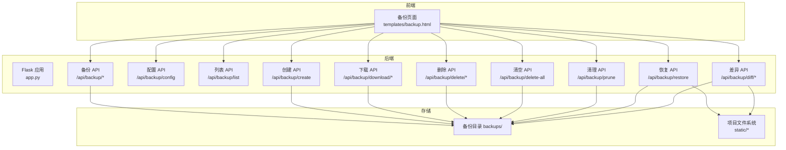
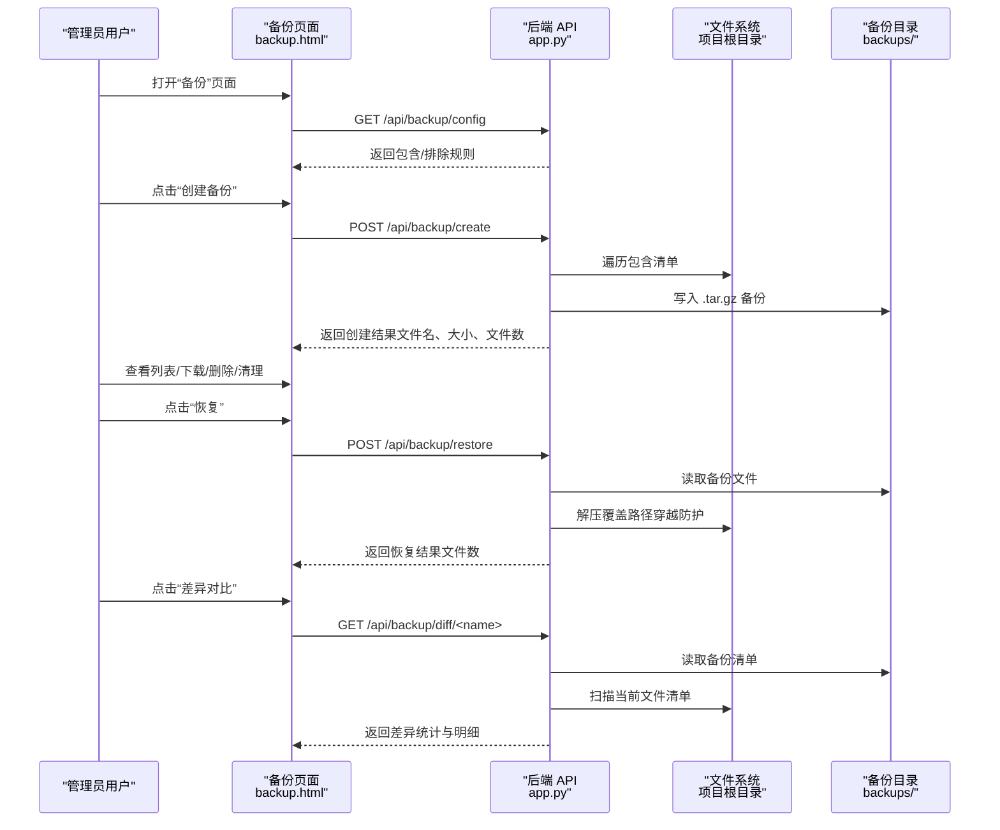
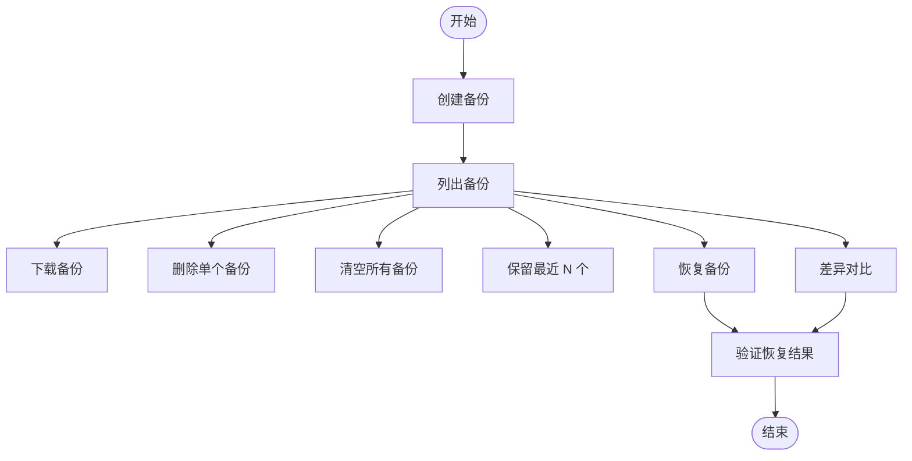
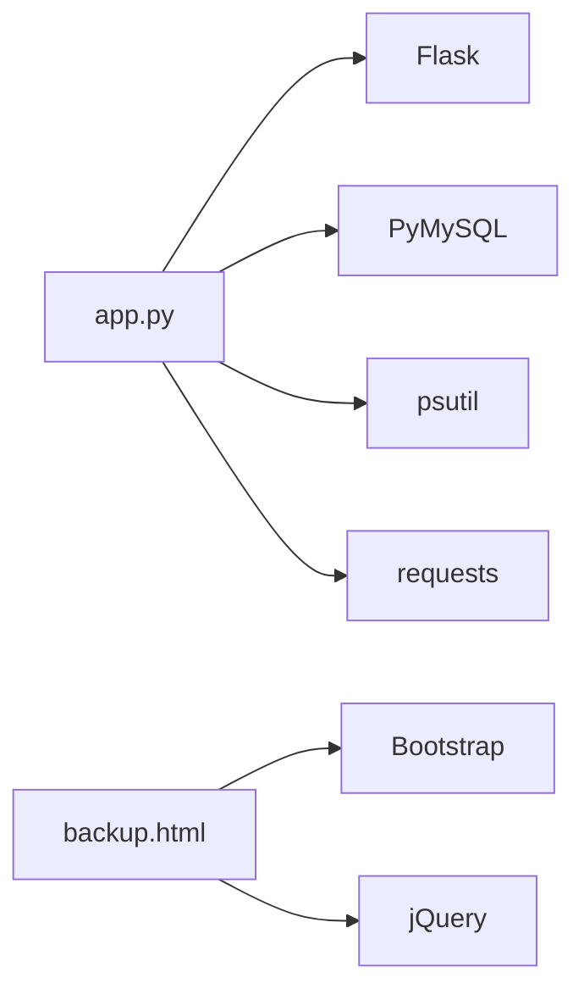

# 备份与恢复

<cite>
**本文引用的文件**
- [app.py](file://app.py)
- [backup.html](file://templates/backup.html)
- [requirements.txt](file://requirements.txt)
- [i18n/__init__.py](file://i18n/__init__.py)
</cite>

## 目录
1. [简介](#简介)
2. [项目结构](#项目结构)
3. [核心组件](#核心组件)
4. [架构总览](#架构总览)
5. [详细组件分析](#详细组件分析)
6. [依赖分析](#依赖分析)
7. [性能考量](#性能考量)
8. [故障排查指南](#故障排查指南)
9. [结论](#结论)
10. [附录](#附录)

## 简介
本指南面向 School_Web 的运维与开发团队，提供一套完整的“备份与恢复”策略，涵盖以下方面：
- 数据库备份计划：全量备份、增量备份与备份验证流程
- 文件系统备份策略：相册图片、项目文件与用户上传内容的备份方案
- 备份存储管理：本地备份、云存储备份与异地容灾配置建议
- 灾难恢复流程：数据恢复步骤、系统重建与业务连续性保障
- 备份监控与告警机制：结合现有日志与活动记录进行监控
- 备份策略的定期评估与更新

本指南严格基于仓库中的现有实现与模板进行分析，并给出可落地的建议与流程。

## 项目结构
School_Web 的备份能力由后端 Flask 应用提供，前端通过模板与 API 实现备份管理界面与操作。关键位置如下：
- 后端备份 API 与配置：位于应用主文件中，定义了备份目录、包含/排除规则、备份/恢复/差异对比等接口
- 前端备份页面：模板负责展示备份列表、进度条、差异对比与恢复确认
- 多语言支持：i18n 模块提供多语言文案，便于国际化部署场景下的备份操作提示
- 依赖声明：requirements.txt 明确运行所需的基础依赖

图表来源
- [app.py:4639-4979](file://app.py#L4639-L4979)
- [backup.html:1-463](file://templates/backup.html#L1-L463)

章节来源
- [app.py:4639-4979](file://app.py#L4639-L4979)
- [backup.html:1-463](file://templates/backup.html#L1-L463)

## 核心组件
- 备份目录与规则
  - 备份目录：应用根目录下的 backups 文件夹
  - 包含清单：静态资源（相册、头像、通用图片）、配置文件、模板、源代码、国际化与插件等
  - 排除清单：缓存、构建产物、版本控制、工作流等
- 备份 API
  - 列表、创建、下载、删除、清空、按数量保留、恢复、差异对比
- 前端备份页面
  - 提供创建备份、查看列表、下载、删除、批量清理、差异对比与恢复确认的交互
- 日志与活动记录
  - 备份/恢复/删除等操作写入日志，便于审计与监控

章节来源
- [app.py:4639-4979](file://app.py#L4639-L4979)
- [backup.html:1-463](file://templates/backup.html#L1-L463)

## 架构总览
备份与恢复的端到端流程如下：

图表来源
- [app.py:4639-4979](file://app.py#L4639-L4979)
- [backup.html:1-463](file://templates/backup.html#L1-L463)

## 详细组件分析

### 备份与恢复 API 设计
- 备份配置
  - 接口：GET /api/backup/config
  - 返回：包含/排除清单，用于前端展示与用户理解备份范围
- 备份列表
  - 接口：GET /api/backup/list
  - 返回：备份文件名、大小、创建时间
- 创建备份
  - 接口：POST /api/backup/create
  - 行为：遍历包含清单，过滤排除项，打包为 .tar.gz，记录日志与活动
- 下载备份
  - 接口：GET /api/backup/download/<name>
  - 行为：安全校验文件名后返回下载
- 删除备份
  - 接口：DELETE /api/backup/delete/<name>
  - 行为：删除指定备份文件
- 清空备份
  - 接口：DELETE /api/backup/delete-all
  - 行为：删除所有 .tar.gz 文件
- 保留最近 N 个备份
  - 接口：DELETE /api/backup/prune?keep=N
  - 行为：删除旧备份，保留最新 N 个
- 恢复备份
  - 接口：POST /api/backup/restore
  - 行为：解压覆盖（路径穿越与符号链接防护），记录日志与活动
- 差异对比
  - 接口：GET /api/backup/diff/<name>
  - 行为：对比备份与当前文件系统差异，返回新增/删除/变更统计与明细

图表来源
- [app.py:4639-4979](file://app.py#L4639-L4979)

章节来源
- [app.py:4639-4979](file://app.py#L4639-L4979)

### 备份范围与策略
- 备份范围（包含清单）
  - 静态资源：相册、头像、通用图片
  - 配置与代码：应用主文件、国际化、插件、前端源码
  - 运行时关键文件：白名单、速率限制配置、密钥文件
- 排除清单
  - 缓存、构建产物、版本控制、IDE/CI 目录等
- 文件系统备份策略
  - 相册图片：static/albums
  - 用户头像：static/avatars
  - 通用图片：static/img
  - 项目文件与用户上传内容：static/projects/uploads（如存在）
  - 前端构建产物：dist、build（已排除）
- 建议
  - 对于数据库，当前实现未提供数据库备份 API，需另行制定 MySQL 全量/增量备份与恢复方案（见后续章节）

章节来源
- [app.py:4644-4671](file://app.py#L4644-L4671)

### 前端备份页面与交互
- 功能概览
  - 展示统计：总数、总大小、最新备份、包含内容摘要
  - 操作：创建、刷新、批量删除（全部、保留 N 个）、下载、差异对比、恢复
  - 恢复确认：二次确认框，勾选后方可执行
  - 差异对比：高亮新增/删除/变更行
- 国际化
  - 多语言文案由 i18n 模块提供，便于不同语言环境下的操作提示

章节来源
- [backup.html:1-463](file://templates/backup.html#L1-L463)
- [i18n/__init__.py:1-113](file://i18n/__init__.py#L1-L113)

### 数据库备份计划（全量/增量/验证）
- 现状
  - 应用通过 PyMySQL 连接数据库，但未内置数据库备份 API
- 建议方案
  - 全量备份
    - 使用 mysqldump 导出 SQL（建议包含结构与数据）
    - 建议在业务低峰期执行，输出带时间戳的压缩文件
  - 增量备份
    - 使用二进制日志（binlog）或 Percona XtraBackup 进行增量备份
    - 结合全量与增量，形成混合备份策略
  - 备份验证
    - 定期对备份进行抽样恢复（测试环境）
    - 验证导出文件完整性与可导入性
- 与现有系统集成
  - 可将数据库备份纳入统一的备份调度（如 cron），并将备份文件纳入“包含清单”，以便集中管理与下载

章节来源
- [requirements.txt:1-5](file://requirements.txt#L1-L5)
- [app.py:624-636](file://app.py#L624-L636)

### 文件系统备份策略
- 相册图片与用户上传
  - static/albums：相册图片
  - static/projects/uploads：项目文件与用户上传内容
  - static/avatars：用户头像
- 备份策略
  - 增量备份：基于文件变更时间或哈希对比，仅同步变化部分
  - 归档策略：按月/季度归档旧数据，减少单次备份体量
  - 一致性：在备份前暂停写入或锁定相关表，保证快照一致性
- 与现有备份系统的衔接
  - 将上述目录加入包含清单，即可通过现有 API 进行打包备份

章节来源
- [app.py:4644-4671](file://app.py#L4644-L4671)

### 备份存储管理（本地/云存储/异地容灾）
- 本地备份
  - 使用应用内置的备份目录 backups/，支持下载与清理
- 云存储备份
  - 建议将备份目录中的 .tar.gz 文件上传至对象存储（如 OSS/COS/S3）
  - 上传脚本应具备断点续传、重试与校验能力
- 异地容灾
  - 至少一个异地副本，定期校验可用性
  - 与恢复流程联动，优先从异地副本恢复

章节来源
- [app.py:4639-4641](file://app.py#L4639-L4641)

### 灾难恢复流程
- 数据恢复步骤
  - 选择目标备份文件，进入恢复确认对话框
  - 确认后执行恢复，系统解压覆盖（路径穿越与符号链接防护）
  - 记录日志与活动，核对关键文件是否存在
- 系统重建
  - 重新部署应用（如需），确保依赖安装与配置正确
  - 恢复完成后进行功能自检与回归测试
- 业务连续性保障
  - 制定最小恢复时间目标（RTO）与恢复点目标（RPO）
  - 定期演练恢复流程，确保团队熟悉操作

章节来源
- [app.py:4851-4893](file://app.py#L4851-L4893)

### 备份监控与告警机制
- 现有机制
  - 备份/恢复/删除等操作写入日志，可用于审计与异常追踪
  - 活动记录用于统计管理员行为（如创建备份获得积分）
- 建议增强
  - 监控指标：备份任务成功率、耗时、文件数、大小、差异统计
  - 告警：备份失败、超时、容量不足、恢复失败等
  - 报表：按天/周/月汇总备份状态与差异趋势

章节来源
- [app.py:4762-4763](file://app.py#L4762-L4763)
- [app.py:4885-4886](file://app.py#L4885-L4886)

### 备份策略的定期评估与更新
- 评估维度
  - 备份完整性、恢复效率、存储成本、合规要求
- 更新频率
  - 每季度评审一次，根据业务增长与数据变化调整包含/排除清单
- 变更流程
  - 变更前进行演练，变更后验证差异对比与恢复流程

章节来源
- [app.py:4644-4671](file://app.py#L4644-L4671)

## 依赖分析
- 运行时依赖
  - Flask、PyMySQL、psutil、requests 等
- 备份相关依赖
  - Python 标准库 tarfile、subprocess、fnmatch 等用于打包与过滤
  - 前端依赖 Bootstrap 与 jQuery（在模板中引入）

图表来源
- [requirements.txt:1-5](file://requirements.txt#L1-L5)
- [backup.html:1-463](file://templates/backup.html#L1-L463)

章节来源
- [requirements.txt:1-5](file://requirements.txt#L1-L5)
- [app.py:4639-4979](file://app.py#L4639-L4979)

## 性能考量
- 备份性能
  - 大文件压缩与网络传输可能成为瓶颈，建议分批处理与限速
  - 排除不必要的目录（如 node_modules、.git）可显著降低体积
- 恢复性能
  - 解压覆盖时注意磁盘空间与权限，避免路径穿越与符号链接带来的风险
- 监控与告警
  - 对备份耗时、失败率与差异统计进行监控，及时发现异常

章节来源
- [app.py:4735-4775](file://app.py#L4735-L4775)
- [app.py:4873-4893](file://app.py#L4873-L4893)

## 故障排查指南
- 常见问题
  - 备份失败：检查磁盘空间、权限与包含/排除规则
  - 恢复失败：确认备份文件未被篡改，检查路径穿越防护逻辑
  - 差异对比异常：确认备份文件与当前文件系统一致，排除临时文件
- 日志定位
  - 查看应用日志中“创建/恢复/删除”等关键字，定位具体错误
- 修复建议
  - 重新创建备份并进行差异对比
  - 在测试环境先演练恢复流程，再在生产执行

章节来源
- [app.py:4772-4775](file://app.py#L4772-L4775)
- [app.py:4892-4893](file://app.py#L4892-L4893)

## 结论
School_Web 已具备完善的本地文件备份与恢复能力，覆盖静态资源、配置与源代码等关键资产。建议在此基础上补充数据库备份（全量/增量）与云存储/异地容灾策略，并建立监控与告警体系，以满足更高的可靠性与合规要求。同时，定期评估与演练恢复流程，确保在真实灾难场景下快速恢复业务。

## 附录
- 关键接口一览
  - GET /api/backup/config：获取备份配置
  - GET /api/backup/list：列出备份
  - POST /api/backup/create：创建备份
  - GET /api/backup/download/<name>：下载备份
  - DELETE /api/backup/delete/<name>：删除备份
  - DELETE /api/backup/delete-all：清空备份
  - DELETE /api/backup/prune?keep=N：保留最近 N 个备份
  - POST /api/backup/restore：恢复备份
  - GET /api/backup/diff/<name>：差异对比

章节来源
- [app.py:4683-4979](file://app.py#L4683-L4979)