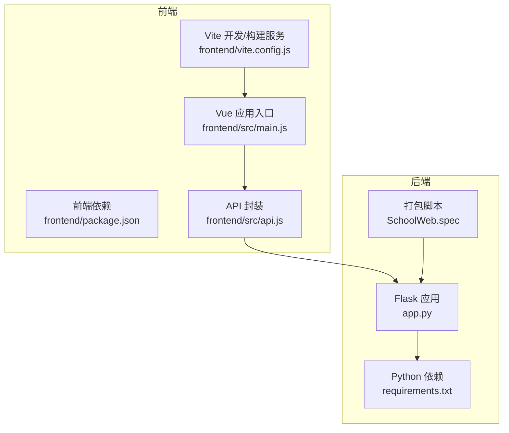
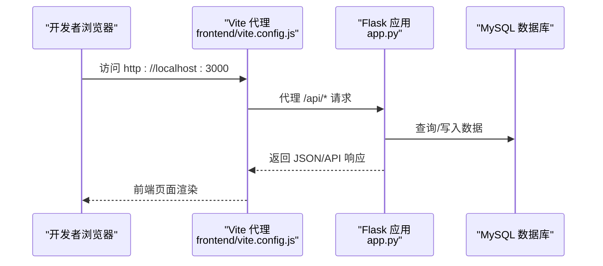
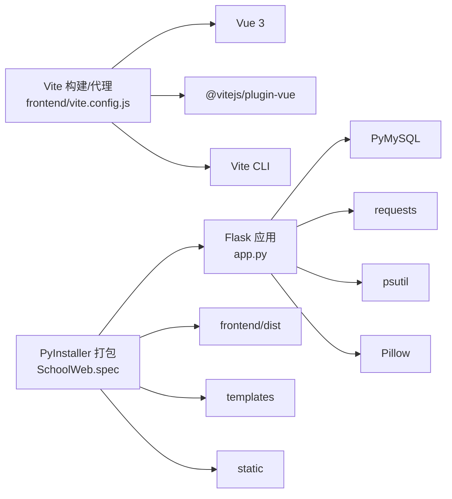

# 环境配置

<cite>
**本文引用的文件**
- [app.py](file://app.py)
- [requirements.txt](file://requirements.txt)
- [package.json](file://frontend/package.json)
- [vite.config.js](file://frontend/vite.config.js)
- [main.js](file://frontend/src/main.js)
- [api.js](file://frontend/src/api.js)
- [SchoolWeb.spec](file://SchoolWeb.spec)
</cite>

## 目录
1. [简介](#简介)
2. [项目结构](#项目结构)
3. [核心组件](#核心组件)
4. [架构总览](#架构总览)
5. [详细组件分析](#详细组件分析)
6. [依赖分析](#依赖分析)
7. [性能考虑](#性能考虑)
8. [故障排查指南](#故障排查指南)
9. [结论](#结论)
10. [附录](#附录)

## 简介
本指南面向部署与运维人员，提供 School_Web 在生产环境下的完整环境配置说明。内容涵盖：
- 系统要求与运行时环境（操作系统、Python 3.9+、Node.js）
- 数据库 MySQL 的安装、用户权限与连接参数
- 前端构建环境（Vite、依赖安装、静态资源处理）
- 环境变量配置示例（数据库连接串、API 密钥、调试开关）
- 常见环境问题排查与性能优化建议

## 项目结构
项目采用前后端分离架构：
- 后端：基于 Python Flask，提供 Web 服务与 API
- 前端：基于 Vue 3 + Vite，位于 frontend 目录
- 打包：使用 PyInstaller 将应用打包为可执行程序

图表来源
- [vite.config.js:1-21](file://frontend/vite.config.js#L1-L21)
- [package.json:1-21](file://frontend/package.json#L1-L21)
- [main.js:1-6](file://frontend/src/main.js#L1-L6)
- [api.js:1-45](file://frontend/src/api.js#L1-L45)
- [app.py:1-200](file://app.py#L1-L200)
- [requirements.txt:1-5](file://requirements.txt#L1-L5)
- [SchoolWeb.spec:1-45](file://SchoolWeb.spec#L1-L45)

章节来源
- [vite.config.js:1-21](file://frontend/vite.config.js#L1-L21)
- [package.json:1-21](file://frontend/package.json#L1-L21)
- [main.js:1-6](file://frontend/src/main.js#L1-L6)
- [api.js:1-45](file://frontend/src/api.js#L1-L45)
- [app.py:1-200](file://app.py#L1-L200)
- [requirements.txt:1-5](file://requirements.txt#L1-L5)
- [SchoolWeb.spec:1-45](file://SchoolWeb.spec#L1-L45)

## 核心组件
- 后端服务：Flask 应用，提供认证、数据库访问、相册、聊天等 API
- 数据库：MySQL（通过 PyMySQL 连接），包含用户、相册、聊天、日历等表
- 前端：Vue 3 单页应用，通过 /api/ 前缀与后端交互
- 打包：PyInstaller 将模板、静态资源与后端代码打包为可执行程序

章节来源
- [app.py:624-640](file://app.py#L624-L640)
- [requirements.txt:1-5](file://requirements.txt#L1-L5)
- [SchoolWeb.spec:8-9](file://SchoolWeb.spec#L8-L9)

## 架构总览
后端与前端通过 Vite 代理进行开发联调，生产环境由 Flask 提供静态资源与 API，同时支持 PyInstaller 打包。

图表来源
- [vite.config.js:6-19](file://frontend/vite.config.js#L6-L19)
- [app.py:624-640](file://app.py#L624-L640)

章节来源
- [vite.config.js:1-21](file://frontend/vite.config.js#L1-L21)
- [app.py:624-640](file://app.py#L624-L640)

## 详细组件分析

### 后端运行时与依赖
- Python 版本：3.9+（推荐）
- 关键依赖：Flask、PyMySQL、psutil、requests
- 安全与会话：CORS、CSRF、Session 安全头、HSTS（非调试时）

章节来源
- [requirements.txt:1-5](file://requirements.txt#L1-L5)
- [app.py:119-139](file://app.py#L119-L139)
- [app.py:641-676](file://app.py#L641-L676)

### 数据库配置
- 默认数据库配置（开发/演示用途）：
  - 主库：host=localhost, user=root, password=root@123456, database=sample
  - 相册库：host=localhost, user=root, password=root@123456, database=sample
- 环境变量覆盖：
  - ADMIN_SECRET：管理员注册时的密钥
- 运行时行为：
  - 首次访问会自动创建所需表（用户、相册、聊天、日历等）
  - 支持独立的相册数据库连接

章节来源
- [app.py:624-640](file://app.py#L624-L640)
- [app.py:231-346](file://app.py#L231-L346)
- [app.py:680-693](file://app.py#L680-L693)

### 前端构建与开发
- 构建工具：Vite（开发服务器、代理、构建）
- 开发服务器：host=0.0.0.0, port=3000
- 代理规则：
  - /api → http://localhost:5800
  - /static/albums → http://localhost:5800
- 前端入口：Vue 应用挂载到 #app
- API 封装：统一前缀 /api/album，携带 Cookie

章节来源
- [vite.config.js:1-21](file://frontend/vite.config.js#L1-L21)
- [main.js:1-6](file://frontend/src/main.js#L1-L6)
- [api.js:1-45](file://frontend/src/api.js#L1-L45)

### 打包与分发
- 使用 PyInstaller 将模板、静态资源、前端构建产物与后端代码打包
- 包含：templates、static、frontend/dist、.secret_key
- 隐藏导入：pymysql、flask、flask_cors、werkzeug、PIL、psutil、requests

章节来源
- [SchoolWeb.spec:8-9](file://SchoolWeb.spec#L8-L9)
- [SchoolWeb.spec:19-35](file://SchoolWeb.spec#L19-L35)

## 依赖分析
后端与前端的依赖关系如下：

图表来源
- [requirements.txt:1-5](file://requirements.txt#L1-L5)
- [vite.config.js:1-21](file://frontend/vite.config.js#L1-L21)
- [SchoolWeb.spec:8-9](file://SchoolWeb.spec#L8-L9)

章节来源
- [requirements.txt:1-5](file://requirements.txt#L1-L5)
- [vite.config.js:1-21](file://frontend/vite.config.js#L1-L21)
- [SchoolWeb.spec:1-45](file://SchoolWeb.spec#L1-L45)

## 性能考虑
- 会话与安全头：启用 HttpOnly/Secure/Lax、CSP、HSTS（生产环境）
- 速率限制：基于内存的轻量级速率限制，支持白名单、手动封禁与动态配置
- 系统监控：CPU/内存/磁盘/网络信息采集
- 前端代理：开发阶段使用 Vite 代理减少跨域与调试成本
- 打包体积：PyInstaller 打包包含大量静态资源，注意磁盘空间与启动时间

章节来源
- [app.py:133-139](file://app.py#L133-L139)
- [app.py:641-676](file://app.py#L641-L676)
- [app.py:348-390](file://app.py#L348-L390)
- [app.py:1827-1888](file://app.py#L1827-L1888)
- [SchoolWeb.spec:36-44](file://SchoolWeb.spec#L36-L44)

## 故障排查指南
- 数据库连接失败
  - 检查 host、user、password、database 是否正确
  - 确认 MySQL 服务运行与网络可达
  - 首次运行会自动建表，若失败检查权限
- 前端无法访问 API
  - 确认 Vite 代理指向的后端地址（默认 5800）
  - 检查 Flask CORS 配置与 Origin 白名单
- 会话与认证异常
  - 检查 Cookie 安全头（Secure、SameSite）、HTTPS 环境变量
  - 确认 .secret_key 是否存在且可写
- 速率限制导致访问受限
  - 查看白名单与封禁状态，必要时通过管理接口调整
- 打包后静态资源缺失
  - 确认打包 spec 中包含 frontend/dist 与 templates/static

章节来源
- [app.py:624-640](file://app.py#L624-L640)
- [app.py:131-139](file://app.py#L131-L139)
- [app.py:348-390](file://app.py#L348-L390)
- [vite.config.js:6-19](file://frontend/vite.config.js#L6-L19)
- [SchoolWeb.spec:8-9](file://SchoolWeb.spec#L8-L9)

## 结论
本指南提供了 School_Web 在生产环境下的环境配置要点：明确的系统与运行时要求、数据库安装与连接参数、前端构建与代理、环境变量与安全策略、常见问题排查与性能优化建议。按照上述步骤配置，可快速搭建稳定可靠的运行环境。

## 附录

### 环境变量与配置项
- 数据库相关
  - DB_CONFIG：host、user、password、database
  - ALBUM_DB_CONFIG：相册数据库连接
  - ADMIN_SECRET：管理员注册密钥
- 运行时与安全
  - HTTPS：影响 Session Secure 标志
  - SECRET_KEY_FILE：密钥文件路径（自动生成）
  - FLASK_DEBUG：非调试时启用 HSTS
- 前端代理
  - Vite host/port：0.0.0.0/3000
  - 代理 /api 与 /static/albums 指向后端 5800 端口

章节来源
- [app.py:624-640](file://app.py#L624-L640)
- [app.py:121-129](file://app.py#L121-L129)
- [app.py:133-139](file://app.py#L133-L139)
- [app.py:672-674](file://app.py#L672-L674)
- [vite.config.js:6-19](file://frontend/vite.config.js#L6-L19)