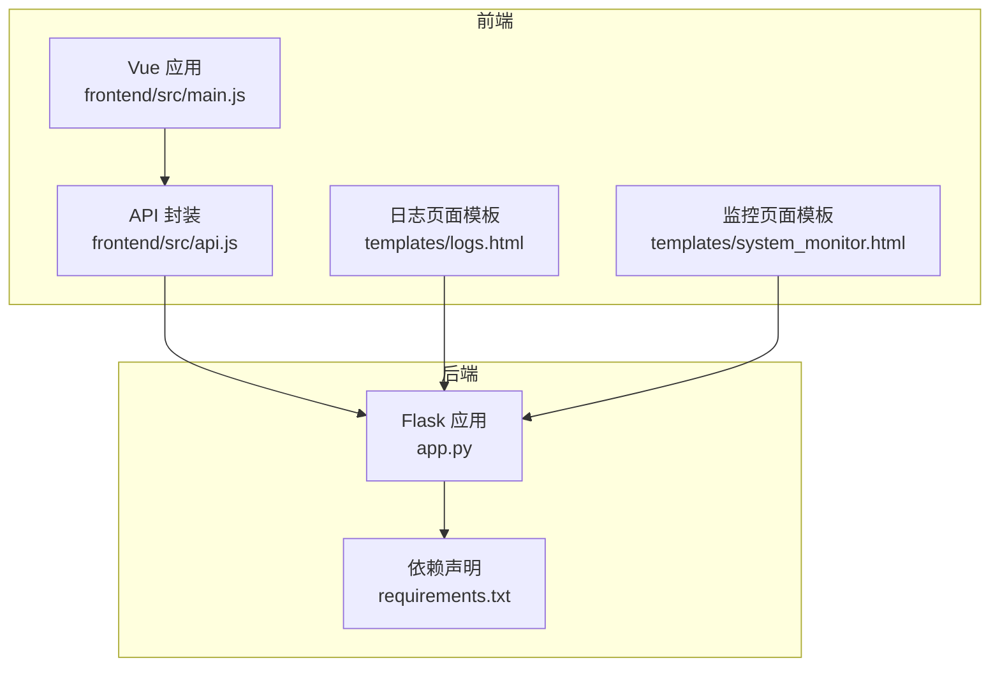
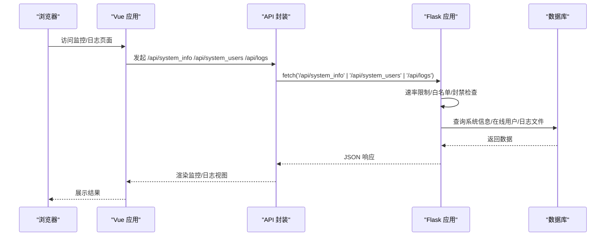
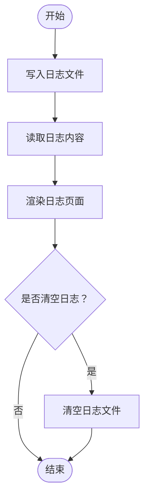
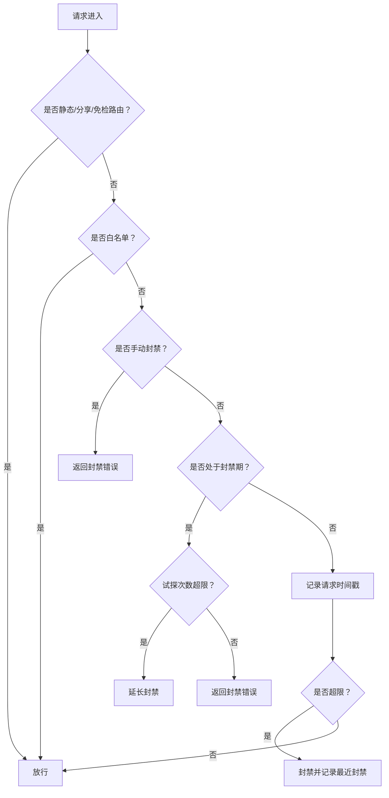
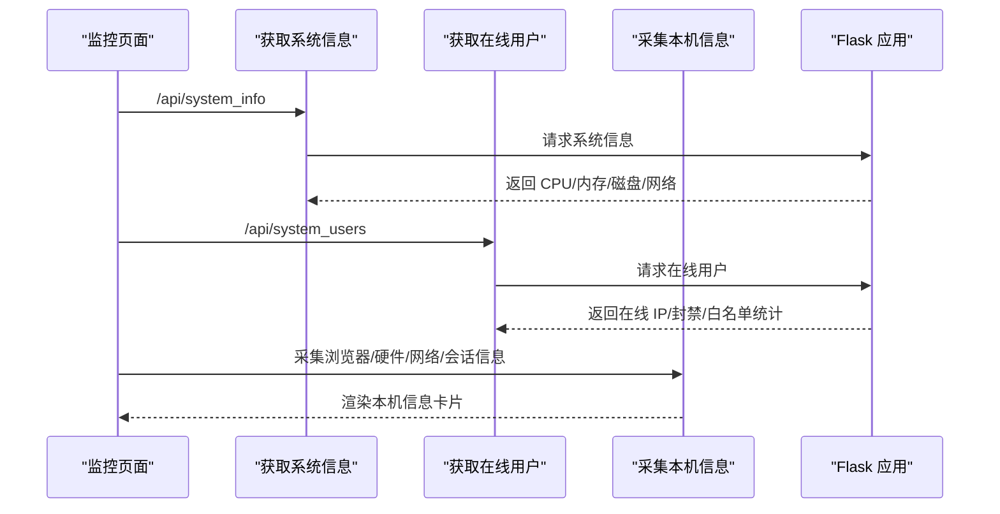
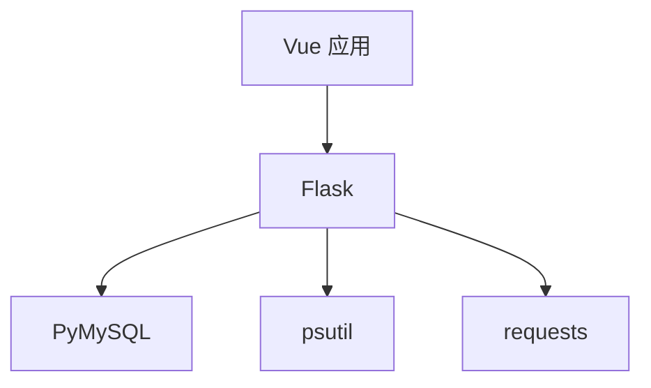

# 监控与日志管理

<cite>
**本文引用的文件**
- [app.py](file://app.py)
- [requirements.txt](file://requirements.txt)
- [templates/logs.html](file://templates/logs.html)
- [templates/system_monitor.html](file://templates/system_monitor.html)
- [frontend/src/api.js](file://frontend/src/api.js)
- [frontend/src/main.js](file://frontend/src/main.js)
</cite>

## 目录
1. [简介](#简介)
2. [项目结构](#项目结构)
3. [核心组件](#核心组件)
4. [架构总览](#架构总览)
5. [详细组件分析](#详细组件分析)
6. [依赖分析](#依赖分析)
7. [性能考虑](#性能考虑)
8. [故障排查指南](#故障排查指南)
9. [结论](#结论)
10. [附录](#附录)

## 简介
本指南面向 School_Web 项目的监控与日志管理，目标是建立一套完整的应用监控方案，涵盖 Flask 应用性能监控、数据库连接池监控、前端性能指标采集，以及日志分类管理策略。同时提供实时监控仪表板设计思路、日志聚合与分析工具配置建议（如 ELK Stack）、告警机制设置（阈值告警、异常检测与通知渠道）。文档力求兼顾技术深度与可操作性，帮助运维与开发团队快速落地。

## 项目结构
本项目采用前后端分离架构：后端基于 Flask，前端使用 Vue 3 + Vite 构建。监控与日志相关的关键位置如下：
- 后端 Flask 应用：集中处理路由、中间件、安全头、速率限制、日志写入等
- 前端 Vue 应用：通过 API 模块调用后端接口，渲染监控仪表板与日志页面
- 模板页面：提供日志查看与系统监控界面
- 依赖声明：包含 Flask、PyMySQL、psutil、requests 等

图表来源
- [frontend/src/main.js:1-6](file://frontend/src/main.js#L1-L6)
- [frontend/src/api.js:1-45](file://frontend/src/api.js#L1-L45)
- [templates/logs.html:1-19](file://templates/logs.html#L1-L19)
- [templates/system_monitor.html:1-271](file://templates/system_monitor.html#L1-L271)
- [app.py:1-120](file://app.py#L1-L120)
- [requirements.txt:1-5](file://requirements.txt#L1-L5)

章节来源
- [frontend/src/main.js:1-6](file://frontend/src/main.js#L1-L6)
- [frontend/src/api.js:1-45](file://frontend/src/api.js#L1-L45)
- [templates/logs.html:1-19](file://templates/logs.html#L1-L19)
- [templates/system_monitor.html:1-271](file://templates/system_monitor.html#L1-L271)
- [app.py:1-120](file://app.py#L1-L120)
- [requirements.txt:1-5](file://requirements.txt#L1-L5)

## 核心组件
- 日志系统
  - 后端统一日志写入与读取：提供日志文件路径、写入格式与读取接口，便于在管理后台展示与清理
  - 日志页面模板：提供刷新与清空按钮，支持前端异步获取日志内容
- 速率限制与安全
  - 内存级速率限制器：支持持久化到文件，重启不丢失；结合白名单、手动封禁与封禁试探逻辑
  - 全局验证码门禁：针对未登录用户的敏感路由进行二次验证
  - 会话空闲超时：按 IP 维护最后活跃时间，超时自动登出
- 系统监控仪表板
  - 前端模板负责轮询后端接口，展示 CPU、内存、磁盘、网络、在线用户与本机信息
  - 后端提供系统信息与在线用户统计接口，支撑前端可视化

章节来源
- [app.py:886-906](file://app.py#L886-L906)
- [templates/logs.html:1-19](file://templates/logs.html#L1-L19)
- [app.py:30-114](file://app.py#L30-L114)
- [app.py:348-594](file://app.py#L348-L594)
- [templates/system_monitor.html:1-271](file://templates/system_monitor.html#L1-L271)

## 架构总览
下图展示了监控与日志管理的整体交互流程：前端通过 API 模块调用后端接口，后端根据中间件与安全策略进行处理，最终返回监控数据或日志内容。

图表来源
- [frontend/src/api.js:1-45](file://frontend/src/api.js#L1-L45)
- [templates/system_monitor.html:36-271](file://templates/system_monitor.html#L36-L271)
- [templates/logs.html:1-19](file://templates/logs.html#L1-L19)
- [app.py:348-594](file://app.py#L348-L594)

## 详细组件分析

### 日志管理策略
- 日志分类
  - 访问日志：记录用户登录、注册、活动等行为，便于审计与追踪
  - 错误日志：数据库连接失败、验证码错误、权限不足等错误场景
  - 业务日志：系统关键业务操作（如封禁、白名单变更、速率配置更新）
- 日志写入与读取
  - 统一日志文件路径与写入格式，支持追加写入与异常兜底
  - 提供日志读取接口，前端模板支持刷新与清空
- 日志轮转与保留
  - 建议引入日志轮转工具（如 logrotate）按大小或时间切分，避免单文件过大
  - 设置保留周期（如 30 天），定期清理过期日志

图表来源
- [app.py:886-906](file://app.py#L886-L906)
- [templates/logs.html:1-19](file://templates/logs.html#L1-L19)

章节来源
- [app.py:886-906](file://app.py#L886-L906)
- [templates/logs.html:1-19](file://templates/logs.html#L1-L19)

### 速率限制与安全中间件
- 速率限制
  - 内存队列记录每 IP 的请求时间戳，窗口清理与超限封禁
  - 支持白名单、手动封禁与封禁试探逻辑，封禁期间试探次数超限自动延长
- 全局验证码门禁
  - 对未登录用户的敏感路由进行二次验证，API 路由返回 JSON 错误
- 会话空闲超时
  - 按 IP 维护最后活跃时间，超时自动登出并提示

图表来源
- [app.py:513-594](file://app.py#L513-L594)
- [app.py:348-594](file://app.py#L348-L594)

章节来源
- [app.py:30-114](file://app.py#L30-L114)
- [app.py:348-594](file://app.py#L348-L594)

### 系统监控仪表板
- 前端轮询
  - 定时拉取系统信息与在线用户数据，展示 CPU、内存、磁盘、网络与本机信息
- 后端接口
  - 提供系统信息与在线用户统计接口，支撑前端可视化
- 前端性能指标采集
  - 建议在前端增加页面可见性、首屏渲染时间、网络质量等指标上报（见附录）

图表来源
- [templates/system_monitor.html:36-271](file://templates/system_monitor.html#L36-L271)
- [frontend/src/api.js:1-45](file://frontend/src/api.js#L1-L45)
- [app.py:1826-1890](file://app.py#L1826-L1890)

章节来源
- [templates/system_monitor.html:1-271](file://templates/system_monitor.html#L1-L271)
- [frontend/src/api.js:1-45](file://frontend/src/api.js#L1-L45)
- [app.py:1826-1890](file://app.py#L1826-L1890)

### 数据库连接池监控
- 当前实现
  - 使用 PyMySQL 直连数据库，未显式配置连接池参数
- 建议
  - 引入连接池（如 PyMySQL 的连接池或 SQLAlchemy）并设置最大连接数、超时与健康检查
  - 在监控面板中增加数据库连接数、等待队列长度与慢查询统计

章节来源
- [app.py:680-693](file://app.py#L680-L693)
- [requirements.txt:1-5](file://requirements.txt#L1-L5)

## 依赖分析
- Flask：Web 框架，提供路由、中间件与响应头设置
- PyMySQL：数据库驱动，用于连接 MySQL
- psutil：系统信息采集（CPU、内存、磁盘、网络）
- requests：外部 HTTP 请求能力（可用于上报或集成第三方服务）

图表来源
- [requirements.txt:1-5](file://requirements.txt#L1-L5)
- [app.py:1-120](file://app.py#L1-L120)

章节来源
- [requirements.txt:1-5](file://requirements.txt#L1-L5)
- [app.py:1-120](file://app.py#L1-L120)

## 性能考虑
- 前端轮询频率
  - 系统信息与在线用户轮询间隔建议在 1-5 秒之间，避免过度请求
- 速率限制窗口与阈值
  - 根据业务峰值调整窗口与请求数阈值，避免误封
- 日志写入
  - 使用异步写入或缓冲策略，减少 IO 阻塞
- 数据库连接
  - 启用连接池并设置合理的最大连接数与超时，避免连接耗尽

## 故障排查指南
- 日志无法读取或为空
  - 检查日志文件路径与权限，确认后端写入逻辑未抛出异常
- 速率限制误判
  - 查看最近封禁列表与封禁试探次数，确认是否触发延长封禁
- 监控数据不更新
  - 检查前端定时器与 fetch 请求，确认后端接口返回正常
- 数据库连接失败
  - 检查数据库配置与连接池状态，确认慢查询与连接数上限

章节来源
- [app.py:886-906](file://app.py#L886-L906)
- [app.py:513-594](file://app.py#L513-L594)
- [templates/system_monitor.html:36-271](file://templates/system_monitor.html#L36-L271)
- [app.py:680-693](file://app.py#L680-L693)

## 结论
本指南为 School_Web 提供了从日志管理到系统监控的完整实践路径。通过统一的日志策略、完善的速率限制与安全中间件、以及可扩展的监控仪表板，能够有效提升系统的可观测性与稳定性。建议后续引入日志聚合与分析工具（如 ELK Stack）与告警机制，进一步增强自动化运维能力。

## 附录
- 前端性能指标采集建议
  - 页面可见性变化、首屏渲染时间、网络质量（下行带宽、RTT）、用户交互延迟
  - 通过前端 API 模块上报至后端或独立采集服务
- 日志聚合与分析工具配置（ELK Stack）
  - Logstash/Fluent Bit：采集与转发日志
  - Elasticsearch：索引与检索
  - Kibana：可视化与仪表板
  - 建议按日切分索引、设置生命周期策略与只读副本
- 告警机制设置
  - 阈值告警：CPU 使用率、内存使用率、磁盘空间、请求失败率、封禁次数
  - 异常检测：突发流量、异常封禁模式、数据库连接异常
  - 通知渠道：邮件、IM、短信，结合分级策略