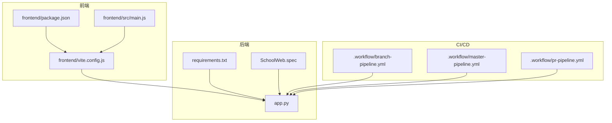
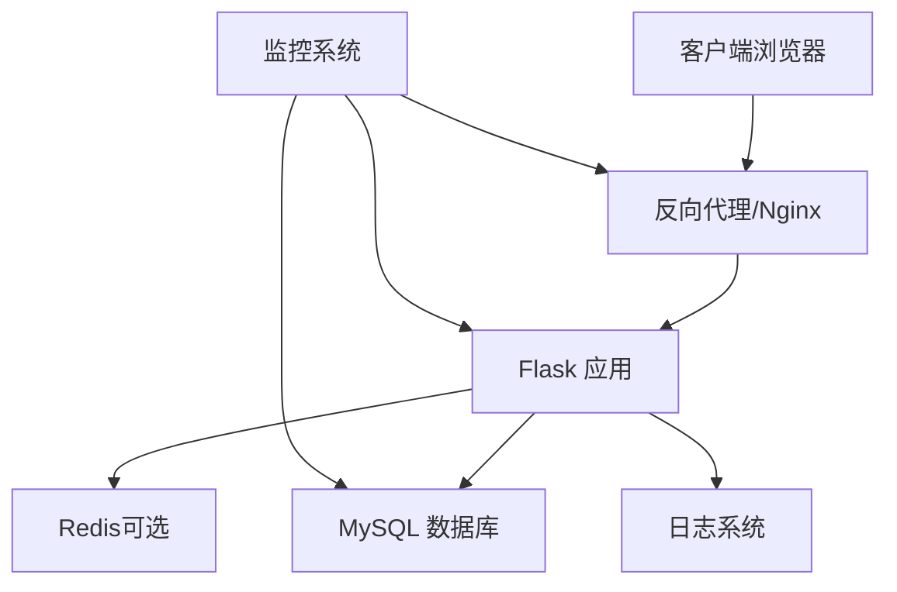
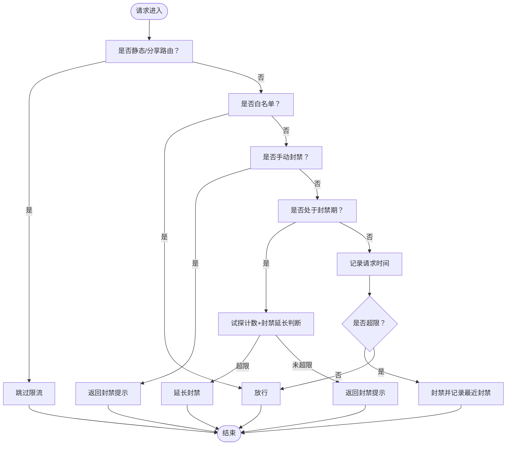
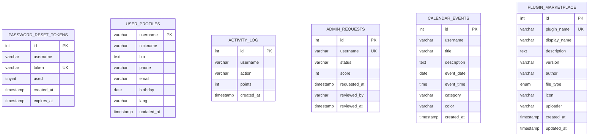
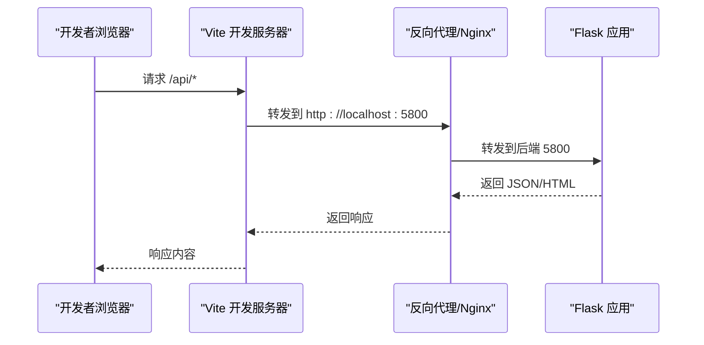
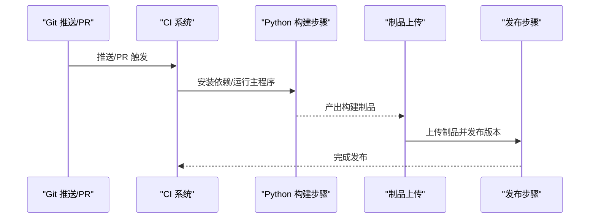
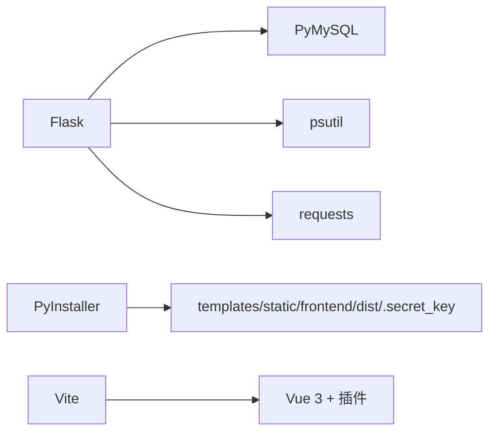

# 部署与运维

<cite>
**本文引用的文件**
- [app.py](file://app.py)
- [requirements.txt](file://requirements.txt)
- [SchoolWeb.spec](file://SchoolWeb.spec)
- [.workflow/branch-pipeline.yml](file://.workflow/branch-pipeline.yml)
- [.workflow/master-pipeline.yml](file://.workflow/master-pipeline.yml)
- [.workflow/pr-pipeline.yml](file://.workflow/pr-pipeline.yml)
- [frontend/package.json](file://frontend/package.json)
- [frontend/vite.config.js](file://frontend/vite.config.js)
- [frontend/src/main.js](file://frontend/src/main.js)
</cite>

## 目录
1. [简介](#简介)
2. [项目结构](#项目结构)
3. [核心组件](#核心组件)
4. [架构总览](#架构总览)
5. [详细组件分析](#详细组件分析)
6. [依赖分析](#依赖分析)
7. [性能考虑](#性能考虑)
8. [故障排除指南](#故障排除指南)
9. [结论](#结论)
10. [附录](#附录)

## 简介
本指南面向 School_Web 的生产部署与运维，涵盖服务器环境准备、数据库配置与安全加固、Docker 容器化与编排、CI/CD 流水线设计、监控与日志管理、备份与灾难恢复、性能调优与容量规划，以及运维最佳实践与故障排除方法。文档基于仓库现有配置与实现进行提炼与扩展，帮助团队在不同规模环境中稳定运行系统。

## 项目结构
项目采用前后端分离架构：
- 后端：Python Flask 应用，负责业务逻辑、数据库访问、安全策略与接口。
- 前端：Vue 3 应用，通过 Vite 开发服务器提供本地开发体验，并通过代理访问后端 API。
- CI/CD：基于工作流文件定义分支、主干与 PR 的自动化构建与制品发布。
- 打包：使用 PyInstaller 规格文件打包桌面版可执行程序（非容器部署场景）。

图表来源
- [frontend/vite.config.js:1-21](file://frontend/vite.config.js#L1-L21)
- [frontend/package.json:1-21](file://frontend/package.json#L1-L21)
- [frontend/src/main.js:1-6](file://frontend/src/main.js#L1-L6)
- [app.py:1-800](file://app.py#L1-L800)
- [requirements.txt:1-5](file://requirements.txt#L1-L5)
- [SchoolWeb.spec:1-45](file://SchoolWeb.spec#L1-L45)
- [.workflow/branch-pipeline.yml:1-53](file://.workflow/branch-pipeline.yml#L1-L53)
- [.workflow/master-pipeline.yml:1-55](file://.workflow/master-pipeline.yml#L1-L55)
- [.workflow/pr-pipeline.yml:1-38](file://.workflow/pr-pipeline.yml#L1-L38)

章节来源
- [frontend/package.json:1-21](file://frontend/package.json#L1-L21)
- [frontend/vite.config.js:1-21](file://frontend/vite.config.js#L1-L21)
- [frontend/src/main.js:1-6](file://frontend/src/main.js#L1-L6)
- [app.py:1-800](file://app.py#L1-L800)
- [requirements.txt:1-5](file://requirements.txt#L1-L5)
- [SchoolWeb.spec:1-45](file://SchoolWeb.spec#L1-L45)
- [.workflow/branch-pipeline.yml:1-53](file://.workflow/branch-pipeline.yml#L1-L53)
- [.workflow/master-pipeline.yml:1-55](file://.workflow/master-pipeline.yml#L1-L55)
- [.workflow/pr-pipeline.yml:1-38](file://.workflow/pr-pipeline.yml#L1-L38)

## 核心组件
- Flask 应用与安全策略
  - 会话安全：HttpOnly、SameSite、Secure（按环境变量自动启用）、会话超时控制。
  - 安全响应头：X-Content-Type-Options、X-Frame-Options、X-XSS-Protection、Referrer-Policy、CSP（nonce 注入）、HSTS（非调试环境）、Permissions-Policy。
  - 速率限制：内存级滑动窗口 + 文件持久化，支持白名单、手动封禁、试探封禁延长。
  - 全站验证码门禁：针对未登录用户或特定路由的验证码拦截。
  - 用户代理过滤：阻断常见安全扫描工具 UA。
  - 多语言支持：请求前语言检测与模板上下文注入。
- 数据库与表初始化
  - 主库与相册库配置分离，按需连接。
  - 自动初始化密码重置令牌、用户资料、活动日志、管理员申请、日历事件、插件市场等表。
  - 相册扩展表：大事记、同学录、毕业寄语、照片标签、播放列表、弹幕、分享链接等。
- 前端开发与代理
  - Vite 开发服务器监听 0.0.0.0:3000，代理 /api 与 /static/albums 到后端 5800 端口。
  - Vue 3 + Vue Router + Pinia，构建脚本与预览脚本。
- 打包与分发
  - 使用 PyInstaller 规格文件打包桌面版可执行程序，包含模板、静态资源与密钥文件。

章节来源
- [app.py:122-198](file://app.py#L122-L198)
- [app.py:351-597](file://app.py#L351-L597)
- [app.py:627-678](file://app.py#L627-L678)
- [app.py:680-800](file://app.py#L680-L800)
- [frontend/vite.config.js:1-21](file://frontend/vite.config.js#L1-L21)
- [frontend/package.json:1-21](file://frontend/package.json#L1-L21)
- [SchoolWeb.spec:1-45](file://SchoolWeb.spec#L1-L45)

## 架构总览
下图展示生产环境中的典型部署形态：Nginx/反向代理位于前端，后端 Flask 提供 API 与模板渲染，MySQL 提供数据存储，Redis 可选用于会话或缓存，日志与监控由外部系统采集。

## 详细组件分析

### 后端安全与限流组件
- 速率限制器（内存 + 文件持久化）
  - 支持按 IP+路由维度的滑动窗口计数，超限封禁并记录试探行为。
  - 配置文件持久化，支持动态调整限流参数。
  - 白名单与手动封禁机制，便于运维干预。
- 全站验证码门禁
  - 对未登录用户或敏感路由进行验证码拦截，API 路由返回 403。
- 会话与安全响应头
  - HttpOnly、SameSite、Secure（HTTPS 环境自动启用）、HSTS（非调试）、CSP（nonce 注入）、XSS/ClickJacking 防护。
- 用户代理过滤
  - 阻断常见扫描工具 UA，降低恶意探测风险。

图表来源
- [app.py:516-597](file://app.py#L516-L597)
- [app.py:353-392](file://app.py#L353-L392)

章节来源
- [app.py:34-117](file://app.py#L34-L117)
- [app.py:353-597](file://app.py#L353-L597)

### 数据库初始化与表结构
- 主要表族
  - 密码重置令牌、用户资料、活动日志、管理员申请、日历事件。
  - 插件市场（管理员上传的 HTML/Vue 插件元数据）。
- 相册扩展表族
  - 大事记、同学录、毕业寄语、照片标签、播放列表、弹幕、分享链接。
- 初始化策略
  - 首次请求时自动创建缺失表，兼容旧表列变更（如新增列）。

图表来源
- [app.py:243-348](file://app.py#L243-L348)

章节来源
- [app.py:243-348](file://app.py#L243-L348)

### 前端开发与代理
- 开发服务器
  - 监听 0.0.0.0:3000，支持热更新与跨主机访问。
- 代理规则
  - /api 与 /static/albums 代理至后端 5800 端口，解决开发阶段跨域问题。
- 构建与运行
  - 使用 npm scripts 进行开发、构建与预览。

图表来源
- [frontend/vite.config.js:1-21](file://frontend/vite.config.js#L1-L21)
- [app.py:122-142](file://app.py#L122-L142)

章节来源
- [frontend/vite.config.js:1-21](file://frontend/vite.config.js#L1-L21)
- [frontend/package.json:1-21](file://frontend/package.json#L1-L21)
- [frontend/src/main.js:1-6](file://frontend/src/main.js#L1-L6)

### CI/CD 流水线设计
- 分支流水线（branch-pipeline）
  - 非 master 分支触发，执行 Python 构建、安装依赖、运行主程序并上传制品。
- 主干流水线（master-pipeline）
  - master 分支与标签触发，执行构建、上传制品并发布版本。
- PR 流水线（pr-pipeline）
  - PR 合并请求触发，执行构建与制品上传。
- 触发条件
  - 分支匹配策略与定时调度（主干流水线包含每小时定时触发示例）。

图表来源
- [.workflow/branch-pipeline.yml:1-53](file://.workflow/branch-pipeline.yml#L1-L53)
- [.workflow/master-pipeline.yml:1-55](file://.workflow/master-pipeline.yml#L1-L55)
- [.workflow/pr-pipeline.yml:1-38](file://.workflow/pr-pipeline.yml#L1-L38)

章节来源
- [.workflow/branch-pipeline.yml:1-53](file://.workflow/branch-pipeline.yml#L1-L53)
- [.workflow/master-pipeline.yml:1-55](file://.workflow/master-pipeline.yml#L1-L55)
- [.workflow/pr-pipeline.yml:1-38](file://.workflow/pr-pipeline.yml#L1-L38)

## 依赖分析
- 运行时依赖
  - Flask、PyMySQL、psutil、requests 等，满足 Web 框架、数据库连接、系统监控与网络请求需求。
- 打包依赖
  - PyInstaller 规格文件声明了数据目录（templates、static、frontend/dist）与隐藏导入模块，确保打包后可运行。
- 前端依赖
  - Vue 3、Vue Router、Pinia 与 Vite 插件，支撑现代前端开发与构建。

图表来源
- [requirements.txt:1-5](file://requirements.txt#L1-L5)
- [SchoolWeb.spec:4-16](file://SchoolWeb.spec#L4-L16)
- [frontend/package.json:11-19](file://frontend/package.json#L11-L19)

章节来源
- [requirements.txt:1-5](file://requirements.txt#L1-L5)
- [SchoolWeb.spec:1-45](file://SchoolWeb.spec#L1-L45)
- [frontend/package.json:1-21](file://frontend/package.json#L1-L21)

## 性能考虑
- 限流与封禁
  - 内存滑动窗口 + 文件持久化，避免重启丢失状态；合理设置窗口与阈值，结合白名单与手动封禁减少误伤。
- 会话与超时
  - 会话空闲超时控制，降低长期会话带来的资源占用与安全风险。
- 响应头与缓存
  - 敏感页面禁用缓存，静态资源可由反向代理缓存；CSP 使用 nonce 提升安全性。
- 数据库连接
  - 合理复用连接与索引优化，避免慢查询；对高频表建立必要索引（如用户、日志、活动）。
- 前端代理与静态资源
  - 生产环境由 Nginx 提供静态资源与反向代理，减少后端压力；CDN 可进一步加速静态资源。
- 监控与日志
  - 结合外部监控系统采集 CPU、内存、QPS、错误率与响应时间；日志分级输出，接入集中式日志平台。

## 故障排除指南
- 无法访问后端 API
  - 检查前端代理配置是否指向正确后端端口；确认反向代理（Nginx）转发规则。
- 验证码相关问题
  - 确认会话中验证码状态与有效期；检查验证码接口限流配置。
- 会话超时频繁
  - 检查客户端网络与代理设置；适当调整会话空闲超时阈值。
- 速率限制误伤
  - 将可信 IP 加入白名单；根据业务调整限流窗口与阈值；必要时临时手动封禁可疑来源。
- 数据库连接失败
  - 核对数据库配置与凭据；确认网络连通性与防火墙策略。
- 日志与监控
  - 检查日志输出位置与轮转策略；确认监控探针与告警规则。

章节来源
- [app.py:516-597](file://app.py#L516-L597)
- [app.py:603-625](file://app.py#L603-L625)
- [app.py:627-678](file://app.py#L627-L678)
- [frontend/vite.config.js:1-21](file://frontend/vite.config.js#L1-L21)

## 结论
本指南提供了 School_Web 在生产环境中的部署与运维蓝图：从服务器与数据库配置、安全加固，到容器化与编排、CI/CD 设计、监控与日志、备份与灾备，再到性能调优与运维最佳实践。建议在实际落地时结合自身基础设施与合规要求，细化参数与流程，并持续迭代完善。

## 附录

### 生产环境配置清单（建议）
- 服务器
  - 操作系统：Linux（推荐 Ubuntu/CentOS）。
  - 反向代理：Nginx（SSL/TLS、Gzip、缓存、限流）。
  - 应用服务器：Gunicorn/uWSGI + Nginx。
  - 数据库：MySQL（主从复制、备份策略）。
  - 缓存：Redis（可选，用于会话或热点缓存）。
- 环境变量（建议）
  - FLASK_ENV、FLASK_DEBUG、HTTPS（影响安全响应头与会话 Secure）。
  - ADMIN_SECRET（管理员相关接口鉴权）。
  - DB_*（数据库连接参数）。
- 安全加固
  - 仅开放必要端口；启用防火墙；定期更新依赖；最小权限原则。
- 备份策略
  - 数据库：全量 + 增量 + 归档，异地存放；定期校验恢复演练。
  - 文件：静态资源与上传文件的增量备份与快照。
  - 配置与密钥：密钥文件与配置文件纳入备份与权限控制。
- 监控与日志
  - 指标：QPS、错误率、P95/P99 延迟、CPU/内存/磁盘/网络。
  - 日志：结构化日志、按级别切分、集中收集与检索。
- CI/CD 最佳实践
  - 分支策略：master 保护、PR 审查、自动化测试通过才合并。
  - 构建：缓存依赖、并行步骤、制品签名与溯源。
  - 发布：蓝绿/金丝雀发布、回滚策略、灰度流量。
- 容器化与编排（建议）
  - Docker：多阶段构建、最小基础镜像、只读根文件系统、secrets 管理。
  - Kubernetes：Deployment/Service/Ingress、HPA、PodDisruptionBudget、Secret/ConfigMap。
  - 环境变量：通过 ConfigMap/Secret 注入；避免硬编码。
- 性能调优与容量规划
  - 前端：CDN、压缩、懒加载、骨架屏。
  - 后端：连接池、索引优化、异步任务、缓存命中率。
  - 数据库：读写分离、慢查询分析、分区与归档。
  - 容量：压测基线、峰值预测、弹性伸缩策略。