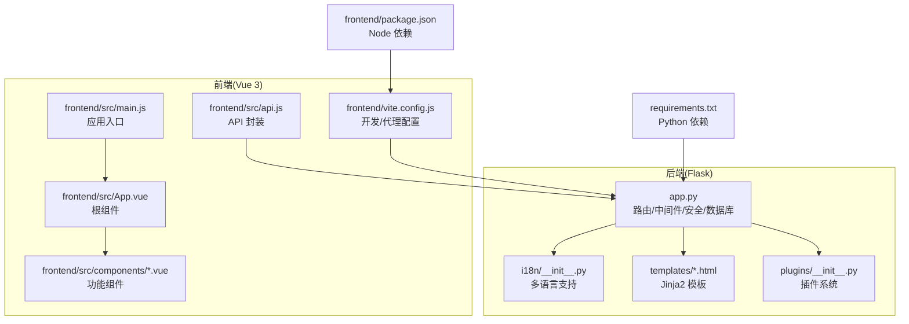
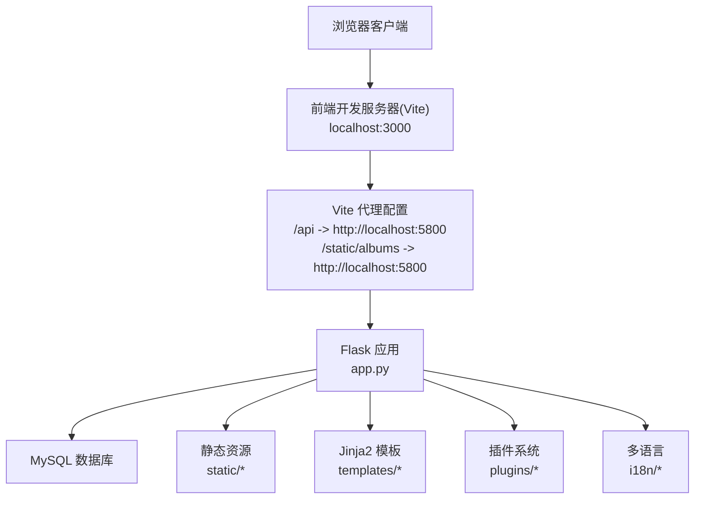
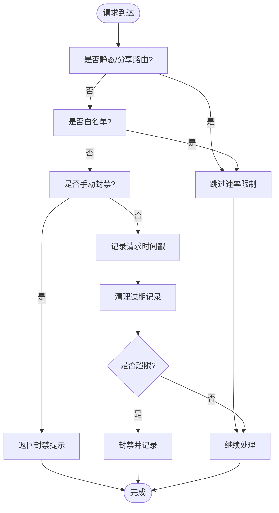
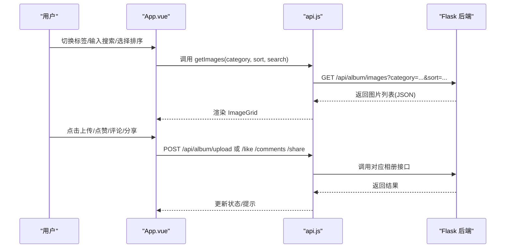
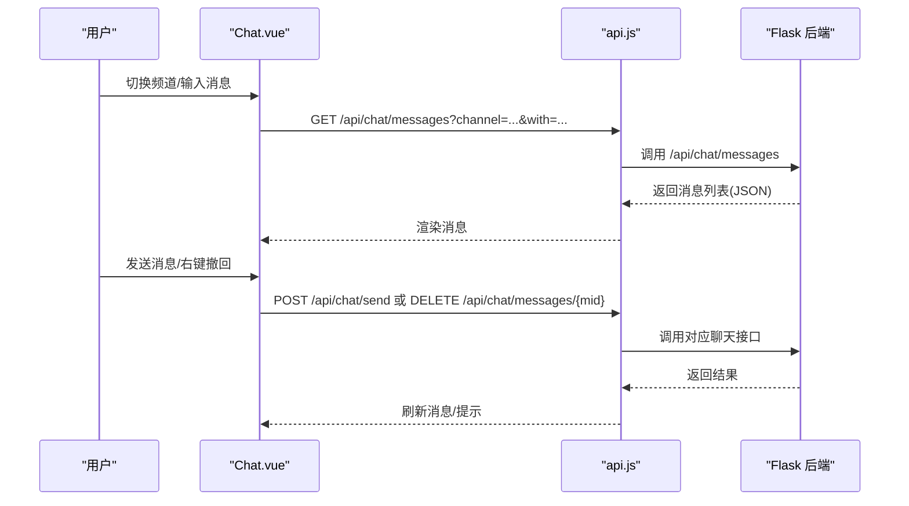
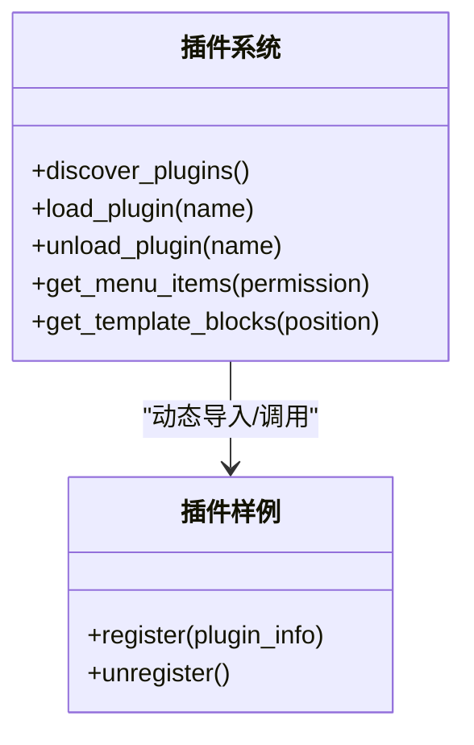
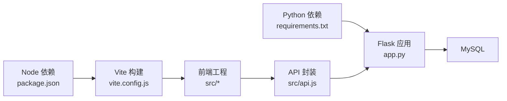

# 项目概述

<cite>
**本文档引用的文件**
- [README.md](file://README.md)
- [app.py](file://app.py)
- [frontend/package.json](file://frontend/package.json)
- [frontend/vite.config.js](file://frontend/vite.config.js)
- [frontend/src/main.js](file://frontend/src/main.js)
- [frontend/src/App.vue](file://frontend/src/App.vue)
- [frontend/src/api.js](file://frontend/src/api.js)
- [frontend/src/components/Chat.vue](file://frontend/src/components/Chat.vue)
- [templates/base.html](file://templates/base.html)
- [templates/dashboard.html](file://templates/dashboard.html)
- [templates/admin_dashboard.html](file://templates/admin_dashboard.html)
- [plugins/__init__.py](file://plugins/__init__.py)
- [plugins/plugins/sample_hello/plugin.json](file://plugins/plugins/sample_hello/plugin.json)
- [i18n/__init__.py](file://i18n/__init__.py)
- [requirements.txt](file://requirements.txt)
</cite>

## 目录
1. [引言](#引言)
2. [项目结构](#项目结构)
3. [核心组件](#核心组件)
4. [架构总览](#架构总览)
5. [详细组件分析](#详细组件分析)
6. [依赖关系分析](#依赖关系分析)
7. [性能考虑](#性能考虑)
8. [故障排查指南](#故障排查指南)
9. [结论](#结论)
10. [附录](#附录)

## 引言
School_Web 多合一工具箱 Web 版是一个面向校园场景的全栈集成平台，集成了相册管理、实时聊天、学习工具、网络工具、数据库管理、系统监控和文件管理等多种功能。项目采用前后端分离架构：后端基于 Flask（Python 3.8+），前端基于 Vue 3 + Vite，模板引擎使用 Jinja2，数据库采用 MySQL。项目强调模块化设计、安全优先与可扩展性，支持插件系统与国际化。

## 项目结构
项目采用清晰的模块化组织方式：
- 后端入口与业务逻辑：app.py
- 前端工程：frontend 目录，包含 Vue 组件、API 封装、构建配置
- 模板与静态资源：templates、static
- 国际化：i18n 目录
- 插件系统：plugins 目录
- 依赖与运行环境：requirements.txt、package.json、vite.config.js

**图示来源**
- [app.py:122-134](file://app.py#L122-L134)
- [frontend/src/main.js:1-6](file://frontend/src/main.js#L1-L6)
- [frontend/src/App.vue:1-99](file://frontend/src/App.vue#L1-L99)
- [frontend/src/api.js:1-45](file://frontend/src/api.js#L1-L45)
- [frontend/vite.config.js:1-21](file://frontend/vite.config.js#L1-L21)
- [templates/base.html:1-337](file://templates/base.html#L1-L337)
- [i18n/__init__.py:1-113](file://i18n/__init__.py#L1-L113)
- [plugins/__init__.py:1-249](file://plugins/__init__.py#L1-L249)
- [requirements.txt:1-5](file://requirements.txt#L1-L5)
- [frontend/package.json:1-21](file://frontend/package.json#L1-L21)

**章节来源**
- [README.md:212-305](file://README.md#L212-L305)
- [app.py:122-134](file://app.py#L122-L134)
- [frontend/src/main.js:1-6](file://frontend/src/main.js#L1-L6)
- [frontend/vite.config.js:1-21](file://frontend/vite.config.js#L1-L21)
- [templates/base.html:1-337](file://templates/base.html#L1-L337)
- [i18n/__init__.py:1-113](file://i18n/__init__.py#L1-L113)
- [plugins/__init__.py:1-249](file://plugins/__init__.py#L1-L249)
- [requirements.txt:1-5](file://requirements.txt#L1-L5)
- [frontend/package.json:1-21](file://frontend/package.json#L1-L21)

## 核心组件
- 全栈框架
  - 后端：Flask 3.0+，提供路由、模板渲染、会话管理、CORS、安全头等
  - 前端：Vue 3.4+，配合 Vite 5.0+、Vue Router 4.3+、Pinia 2.1+
- 安全与认证
  - 图形验证码、登录防爆破、CSRF 令牌、会话超时、CSP/HSTS/X-Frame-Options/X-XSS-Protection 等安全响应头
  - 速率限制（可配置）、IP 白名单、手动封禁、全局验证码门禁
- 数据层
  - PyMySQL 连接 MySQL，参数化查询，表结构初始化与扩展
- 国际化
  - 多语言支持（zh-CN/en/ja/ko），模板注入翻译函数
- 插件系统
  - 动态加载/卸载插件，菜单项与模板块注入，支持纯清单插件
- 前端相册（Vue 3）
  - 图片上传/下载/评论/点赞/分享/标签/弹幕/时间轴/同学录/寄语墙/歌单/统计等

**章节来源**
- [README.md:174-210](file://README.md#L174-L210)
- [app.py:144-197](file://app.py#L144-L197)
- [app.py:351-416](file://app.py#L351-L416)
- [app.py:627-641](file://app.py#L627-L641)
- [i18n/__init__.py:1-113](file://i18n/__init__.py#L1-L113)
- [plugins/__init__.py:1-249](file://plugins/__init__.py#L1-L249)
- [frontend/src/App.vue:1-99](file://frontend/src/App.vue#L1-L99)

## 架构总览
系统采用前后端分离架构，后端提供 RESTful API 与模板页面，前端通过 Vite 开发服务器代理到后端，实现跨域与静态资源转发。

**图示来源**
- [frontend/vite.config.js:6-19](file://frontend/vite.config.js#L6-L19)
- [app.py:122-134](file://app.py#L122-L134)
- [templates/base.html:158-203](file://templates/base.html#L158-L203)
- [plugins/__init__.py:1-249](file://plugins/__init__.py#L1-L249)
- [i18n/__init__.py:1-113](file://i18n/__init__.py#L1-L113)

**章节来源**
- [README.md:174-210](file://README.md#L174-L210)
- [frontend/vite.config.js:1-21](file://frontend/vite.config.js#L1-L21)
- [app.py:122-134](file://app.py#L122-L134)

## 详细组件分析

### 后端安全与速率限制
- 速率限制
  - 内存队列 + 文件持久化，支持白名单、手动封禁、试探封禁延长
  - 可在管理后台动态调整参数（无需重启）
- 全局验证码门禁
  - 对敏感路由与 API 请求进行二次验证码校验
- 会话与安全头
  - 会话超时（2分钟无操作自动登出）、CSRF 令牌、CSP/安全响应头
- 用户代理过滤
  - 拦截常见安全扫描 UA

**图示来源**
- [app.py:516-596](file://app.py#L516-L596)
- [app.py:351-416](file://app.py#L351-L416)

**章节来源**
- [app.py:351-416](file://app.py#L351-L416)
- [app.py:516-596](file://app.py#L516-L596)
- [app.py:644-677](file://app.py#L644-L677)

### 前端相册与交互组件
- 根组件与路由
  - App.vue 提供标签页切换、搜索、排序、标签筛选、上传弹窗与音乐播放器
- API 封装
  - api.js 统一封装 /api/album 前缀的请求，便于组件复用
- 组件生态
  - ImageGrid、ImageDetailModal、Classmates、Timeline、WishWall、TagFilter、MusicPlayer、Playlist、Danmaku、CountDown、StatsChart、Chat、TopBar、UploadModal、Slideshow 等

**图示来源**
- [frontend/src/App.vue:47-84](file://frontend/src/App.vue#L47-L84)
- [frontend/src/api.js:7-45](file://frontend/src/api.js#L7-L45)
- [app.py:502-547](file://app.py#L502-L547)

**章节来源**
- [frontend/src/App.vue:1-99](file://frontend/src/App.vue#L1-L99)
- [frontend/src/api.js:1-45](file://frontend/src/api.js#L1-L45)
- [README.md:499-547](file://README.md#L499-L547)

### 实时聊天组件
- 功能概览
  - 世界频道与私信频道、好友搜索/请求/接受/删除、消息右键撤回、定时轮询刷新
- API 调用
  - /api/chat/messages、/api/chat/send、/api/chat/friends、/api/chat/search、/api/chat/friends/request、/api/chat/friends/accept、/api/chat/friends/remove、/api/chat/messages/{mid}

**图示来源**
- [frontend/src/components/Chat.vue:78-164](file://frontend/src/components/Chat.vue#L78-L164)
- [app.py:548-562](file://app.py#L548-L562)

**章节来源**
- [frontend/src/components/Chat.vue:1-200](file://frontend/src/components/Chat.vue#L1-L200)
- [README.md:548-562](file://README.md#L548-L562)

### 插件系统
- 设计要点
  - 动态发现与加载插件目录中的 plugin.json 与 __init__.py
  - 支持注册菜单项与模板块注入，按权限过滤显示
  - 提供示例插件 sample_hello 展示基本用法
- 生命周期
  - 加载时调用插件 register，卸载时调用 unregister

**图示来源**
- [plugins/__init__.py:25-136](file://plugins/__init__.py#L25-L136)
- [plugins/plugins/sample_hello/plugin.json:1-7](file://plugins/plugins/sample_hello/plugin.json#L1-L7)

**章节来源**
- [plugins/__init__.py:1-249](file://plugins/__init__.py#L1-L249)
- [plugins/plugins/sample_hello/plugin.json:1-7](file://plugins/plugins/sample_hello/plugin.json#L1-L7)

### 国际化与模板注入
- 多语言模块
  - i18n/__init__.py 提供翻译函数、语言检测、支持语言列表
- 模板注入
  - base.html 注入翻译函数与插件模板块，支持主题切换与通知轮询

**章节来源**
- [i18n/__init__.py:1-113](file://i18n/__init__.py#L1-L113)
- [templates/base.html:168-334](file://templates/base.html#L168-L334)

### 管理后台与仪表盘
- 管理后台页面
  - admin_dashboard.html 提供 IP 监控、服务器状态、网络请求地图、插件管理、市场、备份入口等
- 仪表盘与导航
  - dashboard.html 展示功能入口卡片，按权限显示不同模块

**章节来源**
- [templates/admin_dashboard.html:1-200](file://templates/admin_dashboard.html#L1-L200)
- [templates/dashboard.html:1-200](file://templates/dashboard.html#L1-L200)

## 依赖关系分析
- 后端依赖
  - Flask、PyMySQL、psutil、requests、flask-cors 等
- 前端依赖
  - Vue 3、Vue Router、Pinia、Vite、@vitejs/plugin-vue
- 开发与运行环境
  - Python 3.8+、Node.js 16+、MySQL 5.7+

**图示来源**
- [requirements.txt:1-5](file://requirements.txt#L1-L5)
- [frontend/package.json:11-19](file://frontend/package.json#L11-L19)
- [frontend/vite.config.js:1-21](file://frontend/vite.config.js#L1-L21)
- [frontend/src/api.js:1-45](file://frontend/src/api.js#L1-L45)
- [app.py:627-641](file://app.py#L627-L641)

**章节来源**
- [requirements.txt:1-5](file://requirements.txt#L1-L5)
- [frontend/package.json:1-21](file://frontend/package.json#L1-L21)
- [README.md:203-210](file://README.md#L203-L210)

## 性能考虑
- 前端
  - Vite 提供快速冷启动与热更新，代理配置减少跨域与额外请求
  - 组件化与按需渲染降低首屏压力
- 后端
  - 速率限制与封禁策略避免突发流量冲击
  - 持久化配置文件（如 rate_config.json、ip_whitelist.json）提升运维效率
- 数据库
  - 参数化查询与索引（如 activity_log、calendar_events）提升查询性能
- 安全与稳定性
  - CSP 与安全响应头减少 XSS/CSP 风险
  - 会话超时与登录防爆破降低账户滥用风险

## 故障排查指南
- 常见问题
  - 无法访问后端 API：检查 Vite 代理配置与 Flask CORS 设置
  - 速率限制导致访问异常：查看封禁状态与白名单配置
  - 会话超时频繁：检查 SESSION_IDLE_TIMEOUT 与 PERMANENT_SESSION_LIFETIME
  - 相册上传失败：确认文件大小与类型限制、数据库连接配置
- 定位方法
  - 查看 Flask 日志与前端控制台错误
  - 使用管理后台查看 IP 统计与封禁记录
  - 检查 rate_config.json 与 ip_whitelist.json 的配置一致性

**章节来源**
- [app.py:134-142](file://app.py#L134-L142)
- [app.py:516-596](file://app.py#L516-L596)
- [app.py:627-641](file://app.py#L627-L641)
- [README.md:601-664](file://README.md#L601-L664)

## 结论
School_Web 多合一工具箱 Web 版通过 Flask + Vue 3 的全栈组合，实现了功能丰富且安全可控的校园场景平台。其模块化设计与插件系统为后续扩展提供了良好基础；完善的多语言与安全机制保障了用户体验与系统稳定。结合本文档的架构与组件分析，开发者可快速理解项目结构、定位问题并进行二次开发与部署。

## 附录
- 系统要求
  - Python 3.8+、Node.js 16+、MySQL 5.7+
- 许可证
  - GPLv2
- 社区贡献
  - 参考项目文档中的开发与贡献指南，遵循代码规范与安全实践

**章节来源**
- [README.md:1-28](file://README.md#L1-L28)
- [README.md:601-664](file://README.md#L601-L664)